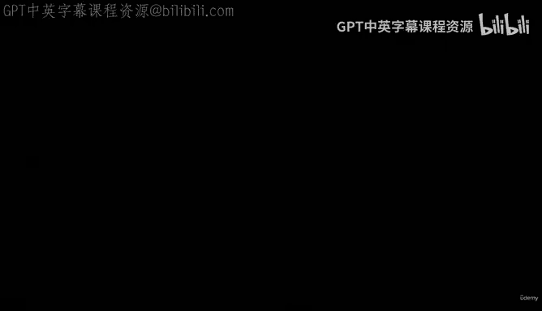
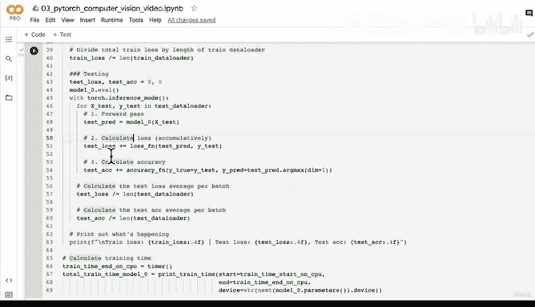

# Daniel Bourke《PyTorch 深度学习｜PyTorch 101 Crash Course For Beginners in 2025》中英字幕 - P112：112_05_016 模型1：配置损失函数与优化器.zh_en - GPT中英字幕课程资源 - BV1kTSKB1E9m

Welcome back。 In the last video， we created another model。

 So we're continuing with our modeling experiments。

 And the only difference here between fashion M S model V1 and V 0 is that we've added in non linear layers。

 Now， we don't know for now， we could。😊，Think or guess whether they would help improve our model and with practice。

 you can start to understand how different functions will influence your neural networks。

 but I prefer to， if in doubt， code it out， run lots of different experiments， so let's continue。

We now have to create a loss function， loss Opr。And evaluation metrics。

 So we've done this for Model 0。 So we're not going to spend too much time explaining what's going on here and we've done this a fair few times now。

 So from helper functions， which is a script we downloaded before。

 we're going to import our accuracy function and we're going to set up a loss function。

 which is we're working with multiclass classification， So what loss function do we typically use。

N then dot cross entropy loss。😡，And as our optimizer is going to be torch。opim。sgd。

 and we're going to optimize this time， I'll put in the parameterss keyword here。😡。

Model 1 dot parameters。And the learning rate， we're just going to keep it the same as our previous model。

 And that's a thing to keep a note for your experiments。 When you're running fair few experiments。

 you only really want to tweak a couple of things， or maybe just one thing per experiment that way you can really narrow down what actually influences your model and what improves it。

 slash what doesn't improve it And little pop quiz。😊，What does a loss function do？This is going to。

Measure how wrong our model is。And what does the optimizer do？Tryries to。Update Al。

Models parameters to reduce the loss。So that's what these two functions are going to be doing。

 The accuracy function is， of a course， going to be measuring our models's accuracy。

 we measure the accuracy because that's one of the base classification metrics So we'll run this。😊。

Now what's next？We're getting quite good at this。 We've picked a loss function and an optimizer。

 Now we're going to build a training loop。 However。

 we spent quite a bit of time doing that in a previous video。 if we go up here。😊。

That was our vow model function。 Oh， that was helpful。 We turned it into a function。

 How about we do the same with these。😊，Why don't we make a function for our training loop？

As well as our testing loop。So I think you can give this a go。

We're going to make a function in the next video for training。

We're going to call that train step and we'll create a function for testing called test step。

Now they'll both have to take in some parameters， I'll let you figure out what they are。

 but otherwise we're going to code that up together in the next video。😊。

So I'll see you there。