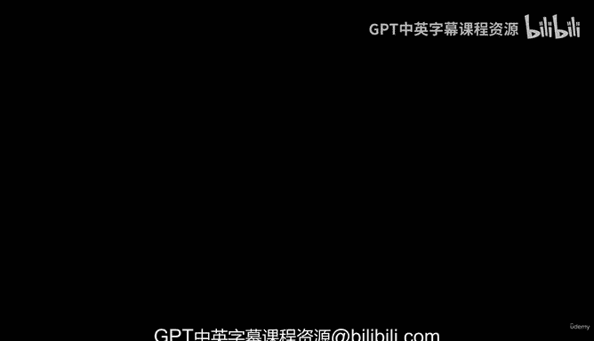
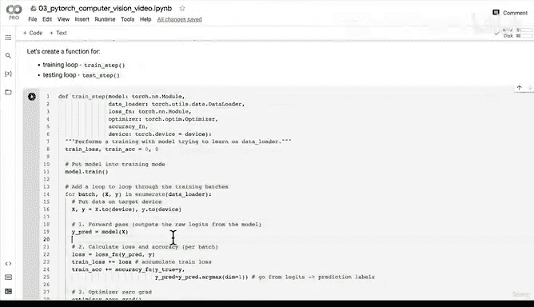

# Daniel Bourke《PyTorch 深度学习｜PyTorch 101 Crash Course For Beginners in 2025》中英字幕 - P113：113_05_017 将训练循环封装为函数.zh_en - GPT中英字幕课程资源 - BV1kTSKB1E9m

So we've got a loss function ready and an optimizer， what's our next step？😊，Well。

 it's to create training and evaluation loops。 So let's make a heading here。

 And we're going to call this functionizing training and evaluation or slash testing loops。😊。

Because we've written similar code quite often for training and evaluating slash testing our models。

Now we're going to start moving towards functionising code that we've written before because that's not only a best practice。

 it helps reduce errors because if you're writing and training loop all the time。

 we may get it wrong if we've got one that works for our particular problem hey we most well save that as a function so we can continually call that over and over and over again。

So how about we， and this is going to be very rare that I'm going to allow you to do this is that is we're going to copy this training。

 and you might have already attempted to create this。😊，That is the function called Let's create。

A function 4。1。Training loop。And we're going to call this。Train step。

And we're going to create a function for the testing loop。I'm going to call this test step Now。

 these are just what I'm calling them。 You can call them whatever you want。

 I just understand it quite easily by calling it train step。

 and then we can for each epoch in a range， we call our training step and then the same thing for each epoch in a range。

 we can call a testing step。 This will make a lot more sense once we've coded it out。

So let's put the training code here to functionise this， let's start it off with Tra step。 Now。

 what parameters should our train step function take in？Let's think about this， we need a model。

 we need a data loader。We need a loss function。And we need an optimizer。

We could also put in an accuracy function here if we wanted to。And potentially， it's not here。

 but we could put in what target device we'd like to compute on。And make our code device agnostic。

 So this is just the exact same code we went through before。 We loop through a data loader。

 We do the forward pass。 We calculate the loss。 We accumulate it。We zero the optr。

 We perform back propagation in respect to the loss with the parameters of the model。

 and then we step the optimizer to， hopefully improve the parameters of our model to better predict the data that we're trying to predict。

So let's craft a train step function here。We'll take a model。

 which is going to be torchnN dot module。才 paint。And we're going to put in a data loader。

Which is going to be of type tor us。Dog data， do data loader。

Now we don't necessarily need to put this in these type hints。

 but they're relatively new addition to Python， and so you might start to see them more and more and it also just helps people understand what your code is expecting。

😊，So loss function， we're going to put in an optimizer。Torch dot opt dim。😡，Which is a type optimizer。

We also want an accuracy function。 We don't necessarily need this either。

 These are a lot of nicer haves。 The first four are probably the most important。 and then the device。

 So torch。This is going to be torch do device equals device。

 So we'll just hard code that to be our already set device parameter。And we'll just write in here。

Performs。Training step with model。Trying to。Learn on。Data loader。Nice and simple。

 We could make that more explanatory if we wanted to， but we'll leave it at that for now。

And so right at the start， we're going to set up train loss and train Act equals 0，0。

 We're going to introduce accuracy here so we can get rid of this。

 Let's just go through this line by line。 What do we need to do here。Well。

 we've got four batch X Y in enumerate train data loader。

 but we're going to change that to data loader up here。 so we can just change this to data loader。

Wonderful， and now we've got Model 0 dot train。😊，Do we want that？Well， no。

 because we're going to keep this model agnostic。 We want to be able to use any model with this function。

 So let's get rid of this model dot train。 But we are missing one step here is put data on target。

Deevvicice， and we could actually put this model dot train。啊pe人。Put model into training mode。 Now。

 this will be the default for the model， but just in case we're going to call it anyway。

 model dot train。Put data on the target device。 So we're going to go X Y equals X dot2 device。

 Y dot2 device， wonderful。And the forward pass， we don't need to use model0 anymore。

 We're just going to use model that's up here。The loss function can stay the same because we're passing in a loss function up there。

The train loss can be accumulated， that's fine， but we might also accumulate now the train accuracy。

Calculate loss。And accuracy per batch。 So train Act equals or plus equals our accuracy function on y true。

Equals y and y pre equals y pre。 So the outputs here， y pre。

 we need to take because the raw outputs outputs the raw logits from the model。

Because our accuracy function expects our predictions to be in the same format as our true values。

 we need to make sure that they are。 We can call the arg max here on the first dimension。

 This is going to go from logits to prediction labels。

We can keep the optimizer 0 grab the same because we're passing in an optimizer up here。

 We can keep the loss backwards because the loss is just calculated there。

 we can keep optimizer step， and we could print out what's happening。

 but we might change this up a little bit。 We need to divide the total train loss。And accuracy。

I just want to type in accuracy here because now we've added in accuracy image。😊。

Ac so train Act divided equals length。Train data loader， Oh no sorry。

 we can just use the data loader here。仔咯老啦。Data loader。And we're not going to print out。

Per batch here， I'm just going to get rid of this。 We'll make at the end of this step。

 we will make our print out here。Print。Notice how it's at the end of the step because we're outside the for loop now。

😡，So we're going to。Here， we're accumulating the。Loss on the training data and the accuracy on the training dataset per batch。

 and then we're finding out at the end of the training step so after it's been through all the batches in the data loader。

😊，We're finding out what the average loss is per batch and the average accuracy is per batch。

 and now we're going to go train loss。Is going to be。The train loss。On。5。And then we're going to go。

Train Act is going to be train Act。And we're going to set that to 0。2 F。get that there。Percentage。

Wonderful， so if all this works， we should be able to call our train step function and pass it in a model。

 a data loader， a loss function， an optimize an accuracy function and a device。😊。

And it should automatically do all of these steps， So we're going to find that out in a later video in the next video we're going to do the same thing we've just done for the training loop with the test step。

 but here's your challenge for this video is to go up to the testing loop code we wrote before and try to recreate the test step function in the same format that we've done here。

😊。

So give that a go and I'll see you in the next video。

