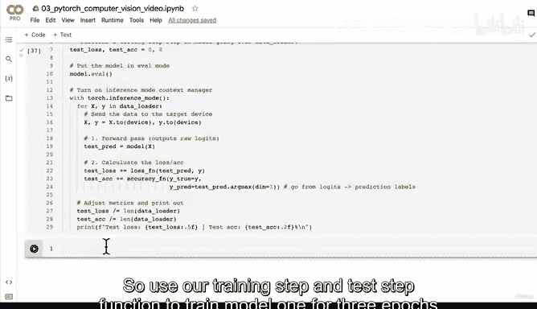

# Daniel Bourke《PyTorch 深度学习｜PyTorch 101 Crash Course For Beginners in 2025》中英字幕 - P114：114_05_018 将测试循环封装为函数.zh_en - GPT中英字幕课程资源 - BV1kTSKB1E9m

Welcome back。 In the last video， we functionalized our training loop。

 So now we can call this training step function。 And instead of writing all this training loop code again。

 Well， we can train our model through the art of a function。 Now。

 let's do the same for our testing loop。 So I issued you the challenge in the last video to give it a go。

 I hope you did， because that's the best way to practice Pytorch code is to write more Pytorch code。

 let's put in a model， which is going to be torch。 and then dot module。😊。

And we're going to put in a data loader。Because we need a model and we need data。

 the data loader is going to be， of course the test data load here， torch。utils。data。data loader。

 and then we're going to put in a loss function， which is going to be torch n dot module as well。

Cause we're going to use。And end up cross entropy loss， we'll see that later on。

We're going to put in an accuracy function。 We don't need an optimizer because we're not doing any optimization in the testing loop。

 we're just evaluating， and the device can be torch on device。

 and we're going to set that as a default to the target device parameter。Beautiful。

 so I'll put a little doing here， so performs a testing loop step on model going over data loader。😊。

Wonderful， so now let's set up a test loss and a test accuracy because we'll measure test loss and accuracy with our testing loop function and we're going to set the model into。

 I'll just put a comment here。😊，Put the model in aV mode， So model dot aval。

 we don't have to use any underscore here as in model 0 because we have a model coming in the top here。

Now， what should we do？Well， because we're performing a test step， we should turn on inference mode。

 So turn on inference mode。Inference mode context manager。Remember。

 whenever you're performing predictions with your model， you should put it in model。val。

 and if you want as many speed ups as you can get， make sure the predictions are done within the inference mode。

Because remember， inference is another word for predictions within the inference mode context manager。

 So we're going to loop through our data loader for X and Y in data loader。

 We don't have to specify that this is X test。Well why test， we could if we wanted to。

 but because we're in another function here， we can just go 4 x Y in data loader。

We can do the forwardd pass。After we send the data to the target device。😊，Target device。

 So we're going to have x Y equals x dot2 device。 and the same thing with y。

We're just doing best practice here， creating device agnostic code。

Then what should we do Well we should do the thing that I said before， which is the forward pass。

 Now that our data and model be on the same device， we can create a variable here。

 test pre equals model。 We're going to pass in X。And then what do we do， We can calculate the loss。

 So two。Calculate the loss slash accuracy。We're going to accumulate it per batch so。

We'll set up test loss equals loss function。Oh plus equals loss function。

 We're going to pass it in test pre and Y， which is our truth label。

 and then the test act where you will accumulate as well。

 using our accuracy function will pass in Y true equals y and then Y pre What do we have to do to Y pre。

Well I'll test pre， we have to take the Arg max to convert it from。 So this is going to。Outputs。

 raw logits。 Remember， a model's raw output is referred to as logits。

 And then here we have to go from logits to prediction。Lbels。Beautiful oh。Little typo here。

 Did you catch that one。Tap tap。Beautiful， oh， look how good this function is looking。

 Now we're going to adjust the metrics。 So adjust metrics and print out。

 You might notice that we're outside of the batch loop here， right？

 So if we draw down from this line for and we write some code here。

 we're still within the context manager。 This is important because if we want to adapt a value created inside the context manager。

 we have to。😊，Modify it still within that context manager。 Otherwise Pytorch will throw an error。

 So try to write this code if you want， outside the context manager and see if it still works。

So test loss， we're going to adjust it to find out the average test loss and test accuracy per batch across a whole step。

So we're going to go length， data loader。Now we're going to print out what's happening。

 Pri out what's happening。 So test loss。 What should we put in here where we're going to get the test loss。

 Let's get this to five decimal places。And then we're going to go test arc。

 and we will get that to two decimal places。 You could do this as many decimal as you want。

 You could even times it by 100 to get it in proper accuracy format。

 and we'll put a new line on the end here。Wonderful。

So now it looks like we've got functions I haven't run this cell yet。😊。

For a training step and a test step。So how do you think we could replicate if we go back up to our training loop that we wrote before？

How do you think we could replicate the functionality of this except this time using our functions？

Well， we could still use this for epoch in TQDM range epochs。

But then we would just call our training step for this training code， our training step function。

 and we would call our testing step function passing in the appropriate parameters for our testing loop。

So that's what we'll do in the next video， we will leverage our two functions。

 train step and test step to train Model1， but here's your challenge for this video， give that a go。

 so use our training step and test step function to train Model1 for 3 epos and see how you go but we'll do it together in the next video。

😊。

