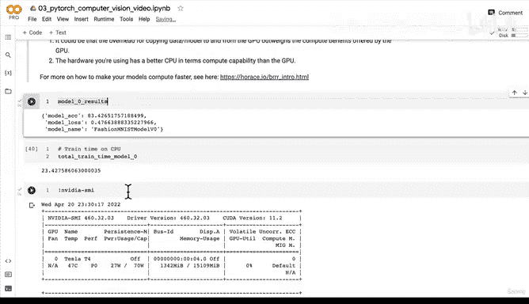

# Daniel Bourke《PyTorch 深度学习｜PyTorch 101 Crash Course For Beginners in 2025》中英字幕 - P115：115_05_019 使用训练测试函数评估模型1.zh_en - GPT中英字幕课程资源 - BV1kTSKB1E9m

Welcome back。 How'd you go。 Did you create a training loop or a Pytoch optimization loop using our training step function and a test step function。

 Were there any errors。😊，In fact， I don't even know。 But how about we find out together， Hey。

 how do we combine these two functions to create an optimization loop。

 So I'm going to go torch dot manual seed。42。And I'm going to measure the time of how long our training and test loop takes。

 This time we're using a different model。 So this model uses linearities and it's on the GPU。

 So that's the main thing we want to compare is how long our model took on CPU versus GP。

So I'm going to import from timeit， import default timer as timer。

And I'm going to start the train time。 train time， start。On GPU equals timer。

And then I'm just right here， set epochs。I'm going to set epoch equal to 3。

 because we want to keep our training experiments as close to the same as possible so we can see what little changes do want。

 And then it's。Create a optimization and evaluation。Loop， using train step。And test step。

So we're going to loop through the epochs for epoch in TQDM。 So we get a nice progress bar in epos。

Then we're going to print。Epoch。Little print out of what's going on。Epoch， and we'll get a new line。

 and then maybe 1，2，3，4，5，6，7，8 or something like that。 Maybe I'll miscounted bit。

 But that's all right。 Tra step。 What do we have to do for this。 Now， we have a little dock string。

 We have a model。 What model would we like to use， We'd like to use model1， We have a data loader。

 What data loader would we like to use。 Well， we'd like to use our train data loader。

We also have a loss function， which is our loss function。We have an optimizer。Which is our。Optimizer。

And we have an accuracy function， which is our accuracy function。 And oops， forgot to put Fn。😊。

And finally， we have a device which equals device， but we're going to set that anyway。😊。

So how beautiful is that for creating a training loop thanks to the code that we've functionised before and just recall。

 we set our optimizer and loss function in a previous video。

 you could bring these down here if you really wanted to so that they're all in one place。😊。

Either way up， but we can just get rid of that because we've already said it。

Now we're going to do the same thing for our test step。 So what do we need here。

 Let's check the dock string。 We could put a little bit more information in this dock string if we wanted to to really make our code more reusable。

 and so that if someone else was to use our code or even us in the future knows what's going on。

 But let's just code it out because it just still fresh in our minds， Model equals Model 1。

 what's our data letter going to be for the test step。😊，It's going to be our test data loader。😊。

Then we're going to set in a loss function， which is going to be just the same loss function。

 We don't need to use an optimizer here because we are only evaluating our model。

 but we can pass in our accuracy function。Accuracy function。 And then finally。

 the device is already set， but we can just pass it in anyway。Look at that。

 Our whole optimization loop in a few lines of code。 Isn't that beautiful。

 So these functions are something that you could put in。😊，Like our helper functions dot pi。

And that way you could just import it later on， and you don't have to write your training loops all over again。

But we'll see more of an example of that later on in the course。So let's keep going。

 We want to measure。The train time， right， So we're going to create once it's been through these steps。

 we're going to create train time and on CPU。And then we're going to set that to the timer。

 So all this is going to do is measure at value in time。 Once this line of code is run。

 it's going to run all of these lines of code。 So it's going to perform the training and optimization loop。

 And then it's going to， oh， excuse me。 this should be GPU。

It's going to measure a point in time here。So once all this codes run， measure a point in time there。

 and then finally， we can go total train time。For Model one is equal to。Print， train time。

Which is our function that we wrote before。And we pass it in a start time。

 and it prints the difference between the start and end time on a target device。 So let's do that。

 Start equals what。Train time start on GPU。The end is going to be。Train time and on GPU。

And the device is going to be。Devicice。Beautiful， so are you ready to run our next modeling experiment。

 Model 1， We've got a model running on the GPU， and it's using nonlinear layers。

 and we want to compare it to our first model， which our results were model 0 results。😊。

And we have total train time。On model 0， yes， we do。 So this is what we're going for。

 Does our model 1 beat these results， and does it beat this result here， So 3，2，1。

 do we have any errors， No， we don't。 Okay， train step got an unexpected keyword loss， oh。

Did you catch that， I didn't type in Los function。Let's run it again。 There we go。 Okay。

 we're running。We've got a progress bar， it's going to output at the end of each epoch。

 there we go training loss。Al right， test accuracy， training accuracy。 This is so exciting。

 I love watching neural networks train。 Okay， we're improving per epoch。 That's a good sign。😊。

But we've still got a fair way to go， Oh， okay， so what do we have here。Well， we didn't beat how。H。

 it looks like we didn't beat our model zero results with the nonlinear layers。😊。

And we only just slightly had a faster training time。 Now， again。

 your numbers might not be the exact same as what I've got here。 right。

 So that's a big thing about machine learning is that。It uses randomness。

 so your numbers might be slightly different。 The direction should be quite similar。

 and we may be using different GPU。 So just keep that in mind Right now， I'm using a。Nvidia SmiI。

 I'm using a Tesla T4， which is at the time of recording this video。 Wednesday。

 April 202022 is a relatively fast GPU for making inference。 So just keep that in mind。

 your GP in the future may be different and your CPU that you run may also have a different time here。

 So if these numbers are like 10 times higher， you might want to look into seeing if your code is there's some error。

 if they're 10 times lower well，y you're running it on some fast hardware。

 So it looks like my code is running on couda slightly faster than the CPU but not dramatically faster and that's probably akin to the fact that our data set isn't too complex and our model isn't too large。

 What I mean by that is our model doesn't have like a vast amount of layers。

 and our data set is only comprised of like this is the layers our model has。😊。

And our data set is only comprised of 60，000 images that are 28 by 28。So as you can imagine。

 the more parameters in your model， the more features in your data。

 the higher this time is going to be。 and you might sometimes even find that your model is faster。😊。

On CPU。 So this is the train time on CPU。You might sometimes find that your model's training time on a CPU is。

 in fact， faster for the exact same code running on a GPU。 Now， why might that be， Well。

 let's write down this here。Let's go note。Sometimes。Depending on your data， slash hardware。

You might find that your model。Trains faster on CPU。Then， GPU。Now， why is this。

So one of the number one reasons is that one， it could be。

That the overhead for copying data slash model。To and from the GPU。Outweighs the compute benefits。

offffered。By the GPU。So that's probably one of the number one reasons is that you have to。

For data to be processed on a GPU， you have to copy it because it is by default on the CPU。

 If you have to copy it to that GP， you have some overhead time for doing that copy into the GPU memory。

 And then although the GPU will probably compute faster on that data once it's there。

 you still have that back and forth of going between the CPUU and the GPU。

 And the number two reason is that the hardware。😡，Your。Using has a。

Better CPU in terms of compute capability。Then the GPU now this is quite a bit rarer。

 usually if you're using a GPU like a fairly modern GPU， it will be faster at computing。

 deep learning or running deep learning algorithms than your general CPU。

 but sometimes these numbers of compute time are really dependent on the hardware that you're running。

So you'll get the biggest benefits of speed ups on the GPU when you're running larger models。

 larger data sets and more compute intensive layers in your neural networks。

 And so if you'd like a great article on how to get the most out of your GPUs。

 it's a little bit technical。 But this is something to keep in mind as you progress as a machine learning engineer is how to make your GPs。

😊，Go bur。 And I mean that bur from first principles。There we go。

Making deep learning go brew as in your GPU is going brew because it's running so fast from first principles。

 So this is by Horace He， who works on Ptorrch。 And it's great。

 It talks about compute as a first principle。 So here's what I mean by copying memory and compute。

 There might be a fair few things you're not familiar with here， but that's okay。 but just be aware。

 bandwidth。 So bandwidth costs are essentially the cost paid to move data from one place to another。

 That's what I was talking about， copying stuff from the CPU to the GPU。

 And then also there's one more。 Where is it overhead。 overhead is basically everything else。

 I called it overhead。 There are different terms for different things。 This article is excellent。

 So I'm going to just copy this in here。 And。😊，You'll find this in the resources， by the way。

 So for more on how to make your models compute faster。C here。Lovely， so right now。

 our baseline model is performing the best in terms of results and in terms of， or actually。

 our model computing on the GPU is performing faster than our CPU。 Again。

 yours might be slightly different。 For my case， for my particular hardware。 Couder is faster。

 except Model 0， our baseline is better than model 1。😊，So what's to do next？ Well。

 is to keep experimenting， of course。

I'll see you in the next video。