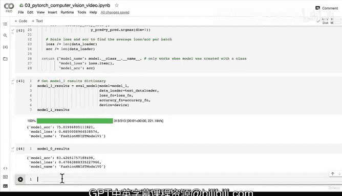

# Daniel Bourke《PyTorch 深度学习｜PyTorch 101 Crash Course For Beginners in 2025》中英字幕 - P116：116_05_020 获取模型1结果字典.zh_en - GPT中英字幕课程资源 - BV1kTSKB1E9m

Welcome back。 Now， before we move on to the next modeling experiment。

 let's get a results dictionary for our model 1。 our model that we trained on。

 So just like we've got one for Model 0， let's create one of these for model 1 results。

 and we can create that without a our model function。😊。

So we'll go right back down to where we were。 I'll just get rid of this cell。And let's type in here。

Get Model 1 results dictionary。 This is helpful。 So later on。

 we can compare all of our modeling results because they'll all be in dictionary format。

 So we're going Model 1 results equals a vow model on a model equals model one and we can pass in a data loader。

 which is going to be our test data loader。😊，Then we can pass in a loss function。

 which is going to equal our loss function， and we can pass in our accuracy function。😊。

Itals accuracy function。Wonderful， and then if we check out our Model one results， what do we get？😊。

Oh no， we get an error。Do we get the code right？That looks right to me。Oh， what does this say。

 Runtime error expected all tensors to be on the same device， but found at least two devices。

 Couda and CPU。 Of course。 So why did this happen， Well。

 let's go back up to our aval model function wherever we defined that。Here we go。AhI see。

 So this is a little gotcha and Pytorch or in deep learning in general。

 there's a saying in the industry that deep learning models fail silently and this is kind of one of those ones。

😊，It's because our data and our model are on different devices。

So remember how I said the three big errors are shape mismatches with your data and your model device mismatches。

 which is what we've got so far。 and then data type mismatches。

 which is if your data is in the wrong data type to be computed on。

 So what we're going to have to do to fix this is let's bring down our v model function down to where we were。

 And just like we've done in our test step and train step functions where we've created device agnostic data here。

 we've sent our data to the target device， we'll do that exact same thing in ourV model function。

 And this is just a note for going forward。 It's always handy to where you can create device agnostic code。

 So we've got our new Aval model function here for X Y in our data loader。😊，Let's make our data。

Devicicee agnostic。 So just like our model is device agnostic。 we've sent it to the target device。

 We will do the same here。 X dot 2 device， and then Y dot 2 device。Let's see if that works。

 We will just rerun this cell up here。 I'll grab this。

 We're just going to write the exact same code as what we did before。

 But now it should work because we've sent our。We could actually also just pass in the target device here。

 device Eagles device。That way we can pass in whatever device we want to run it on。

And we're going to just add in device here。 device equals device。

And let's see if this runs correctly。Beautiful， so if we compare this to our model 0 results。

 it looks like our baseline still out in front。😊，But that's okay。 We're going to in the next video。

 start to step things up and notch and move on to convolutional neural networks。

 This is very exciting。 And by the way， just remember。

 if your numbers here aren't exactly the same as mine。

 don't worry too much if they're outlandishly different。

 just go back through your code and see if it's maybe a cell hasn't been run correctly or something like that。

 If there are a few decimal places off， that's okay。

 That's due to the inherent randomness of machine learning and deep learning。😊。

But with that being said， I'll see in the next video。

 let's get our hands on convolutional neural networks。😊。

