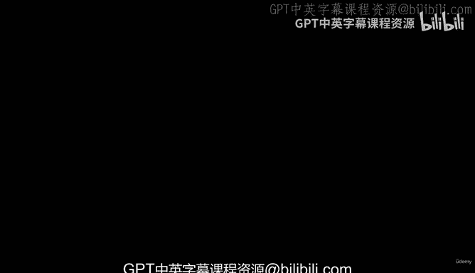
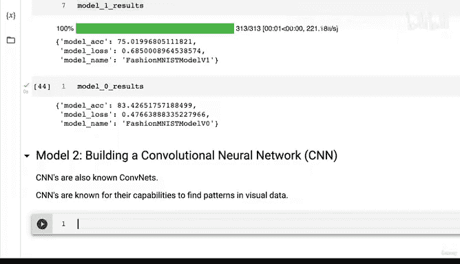
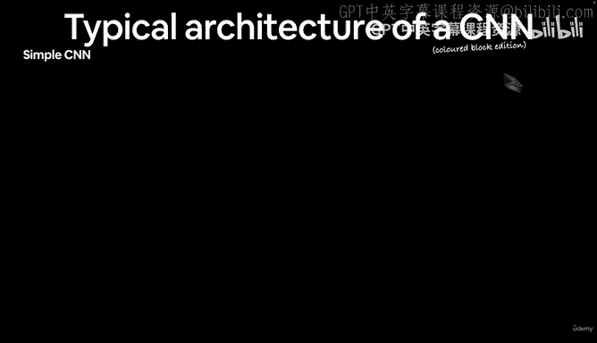
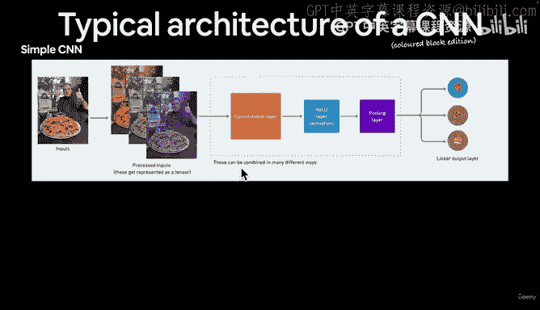
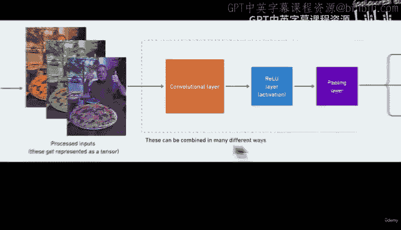
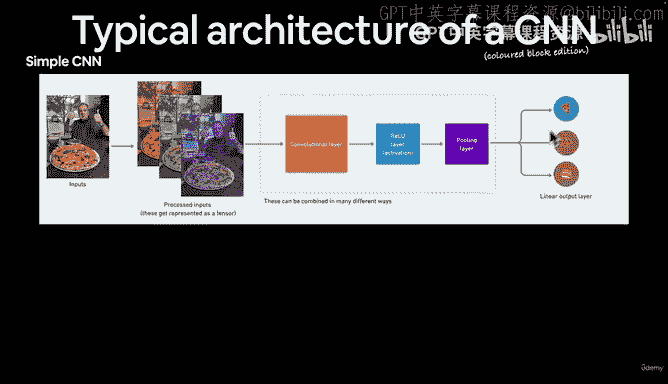
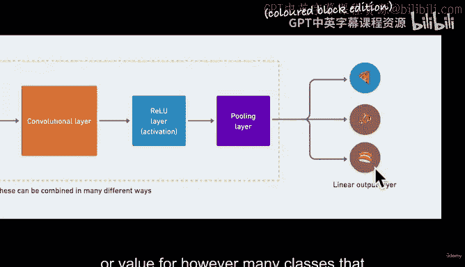
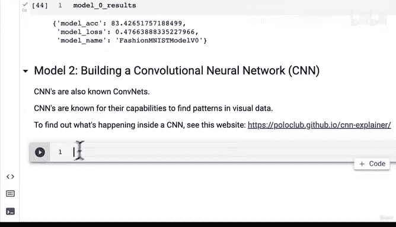

# Daniel Bourke《PyTorch 深度学习｜PyTorch 101 Crash Course For Beginners in 2025》中英字幕 - P117：117_05_021 模型2：卷积神经网络高层概览.zh_en - GPT中英字幕课程资源 - BV1kTSKB1E9m

Welcome back。 In the last video， we saw that our second modelling experiment。

 Model 1 didn't quite beat our baseline。 But now we're going to keep going with modelling experiments。

 and we're going to move on to model 2。 And this is very exciting。

 We're going to build a convolutional neural network， which are also known as CNN。

 CNNNs are also known as Comnets， And CNNs are known for their。😊。

Caapabilities。To find patterns in visual data。

So。What are we going to do， Well， let's jump back into the keynote。

 We had a look at this slide before， where this is the typical architecture of a C。

 And there's a fair bit going on here， but we're going to step through it one by one。

 We have an input layer， just like any other deep learning model， we have to input some kind of data。

 We have a bunch of hidden layers。 In our case， in a convolutional neural network。

 you have convolutional layers。😊，You often have hidden activations or nonlinear activation layers。

 You might have appaling layer。 You generally always have an output layer of some sort。

 which is usually a linear layer。And so the values for each of these different layers will depend on the problem you're working on。

 So we're going to work towards building something like this。

 And you'll notice that a lot of the code is quite similar to the code that we've been writing before for other pietorch models。

 The only differences in here is that we're going to use different layer types。 And so if we want to。

Visualize a CNN in a colored block edition。 We're going to code this out in a minute。

 so don't worry too much。

We have a simple CNN。 You might have an input， which could be this image of my dad eating some pizza with two thumbs up。

We're gonna pre processces that input。 We're going to， in other words， turn it into a tensor in red。

 green and blue for an image。And then we're going to pass it through a combination of convolutional layers。

 reello layers and pooling layers。 now again。This is a thing to note about deep learning models。

 I don't want you to get too bogged down in the order of how these layers go because they can be combined in many different ways。

 In fact， research is coming out almost every day， every week about how to best construct these layers。

 The overall principle is what's more important is how do you get your inputs into an idealolized output。

 And that's the fun part。 And then， of course， we have the linear output layer。

 which is going to output。 however many classes or value for however many classes that we have in the case of classification。

😊。

And then if you want to。Make your CNN deeper。 This is where the deep comes from deep learning。

 You can add more layers。 So the theory behind this or the practice behind this is that the more layers you add to your deep learning model The more chances it has to find patterns in the data。

 Now， how does it find these patterns。 Well， each one of these layers here is going to perform just like what we've seen before。

 a different combination of mathematical operations on whatever data we feed it。

 and each subsequent layer receives its input from the previous layer In this case。

 there are some advanced networks that you'll probably come across later in your research and machine learning career that use inputs from layers that are kind of over here or the way down here or something like that。

 therere known known as residual connections but that's beyond the scope of what we're covering for now。

 we just want to build our first convolutional neural network。 And so let's go back to Google Chrome。

 I'm going to show you my favorite website。😊，To learn about convolution or neural networks。

 It is the CNN explainer website。 And this is going to be part of your extra curriculum for this video is to spend 20 minutes clicking and going through this entire website。

 We're not going to do that together because I would like you to explore it yourself。

 That is the best way to learn。 So what you'll notice up here is we have some images。

 of some different sort。 And this is going to be our input。 So let's start with pizza。

 And then we have a convolutional layer， a relu layer， a co layer， a relu layer， a Maxpo layer。

 Com 2， Relu2 Com2 Relu2 Maxpo 2。😊，This architecture is a convolutional neural network。

 and it's running live in the browser。 And so we pass this image。

 you'll notice that it breaks down into red， green and blue。

 And then it goes through each of these layers and something happens And then finally。

 we have an output。 And you'll notice that the output has 10 different classes here。

 Because we have one，2，3，4，5，6，7，8，9，10 different classes of image in this demo here。 And， of course。

 we could change this if we had 100 classes， we might change this to 100。

 But the pieces of the puzzle here would still stay quite the same。

 And you'll notice that the class pizza has the highest output value here Because our images of pizza。

 If we change to what is this one。 espresso。 it's got the highest value there。

 So this is a pretty well performing convolutional neural network。 then we have a sport car。 Now。

 if we clicked on each one of these， something is going to happen。😊，Let's find out。

We have a convolutional layer， so we have an input of an image here that's 64，64 by 3。

 This is color channel's last format。So we have a kernel。 and this kernel。

 This is what happens inside a convolutional lane。 You might be going， well。

 there's a lot going on here。 And yes， of course， there is。

 if this is the first time you've ever seen this。 But essentially， what's happening is a kernel。

 which is also known as a filter is going over our image pixel values because， of course。

 they will be in the format of a tensor and trying to find small little intricate patterns in that data。

 So if we have a look at here， And this is why it's so valuable to go through this and just play around with it。

 We start in the top left corner。 and then slowly move along。

 you'll see on the output on the right hand side， we have another little square。

 And do you notice in the middle， all of those numbers changing。 Well。

 that is the mathematical operation that's happening as a convolutional layer convolves over our input image。

😊，How cool is that。 And you might be able to see on the output there that there's some slight values for like。

 look around the headlight here。 Do you notice on the right， how there's some activation。😊。

There's some red tiles there。Well， that just means that potentially this layer or this hidden unit。

And I want to zoom out for a second is we have 1，2，3，4，5，6，7，8，9，10 hidden units。

 Each one of these is going to learn a different feature about the data。

 And now the beauty of deep learning， but also one of the curses of deep learning is that we don't actually control what each one of these learns。

😊，The magic of deep learning is that it figures it out itself What is best to learn。 We go into here。

😊，Notice that each one we click on has a different representation on the right hand side。

 And so this is what's going to happen layer by layer as it goes through the convolutional neural network。

 And so if you want to read about what is a convolution or neural network， you can go through here。

 but we're going to replicate this exact neural network here with Ptorrch code。

That's how I'd prefer to learn it。 But if you want the intuition behind it， the math behind it。

 you can check out all of these resources here。 That is your extra curriculum for this video。

 So we have an input layer。 We have a convolutional layer。

 You can see how the input gets modified by some sort of mathematical operation， which is， of course。

 the convolutional operation。😊，And we have there all different numbers。

 finding different patterns and data。 This is a really good example here。

You notice that the output's size slightly changes。 That'll be a trend throughout each layer。

 and then we can understand the different hyperparmeter。

 but I'm going to leave this for you to explore on your own。 in the next video。

 we're going to start to write pytorch code to replicate everything that's going on here。

So I'm going to link this。In here。To find out what's happening inside CNN。See this website。系啊。

So join me in the next video。 This is super exciting。

 We're going to build our first convolutional neural network for computer vision。😊。

Ill see you there。