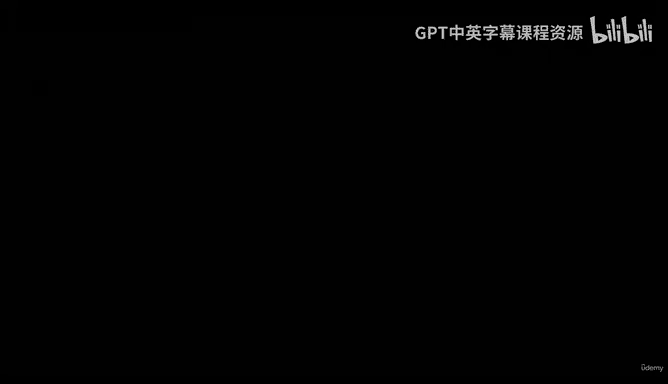
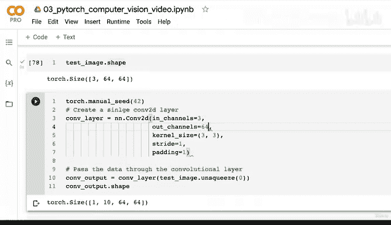

# Daniel Bourke《PyTorch 深度学习｜PyTorch 101 Crash Course For Beginners in 2025》中英字幕 - P119：119_05_023 模型2：逐步解析Conv2D层.zh_en - GPT中英字幕课程资源 - BV1kTSKB1E9m

Welcome back。 Now， I'm super stoked because in the last video。

 we coded together our first ever convolutional neural network in Pytorch。 So well done。

 we replicated the tiny VjiG architecture from the CNN explainer website。

 my favorite place for learning about CNNs in the browser。😊。

So now we introduced two new layers that we haven't seen before， Com 2D and Max poolol 2D。

But they all have the same sort of premise of what we've been doing so far is that they're trying to learn the best features to represent our data in some way。

 shape or form。 Now， in the case of Max pool 2D， it doesn't actually have any learnable parameters。

 It just takes the Mac， but we're going to step through that later on。

 Let's use this video to step through N N cov 2D。 We're going to do that with code。

 So I'll make a new heading here。7。1。Stepping through。NN co 2D。Beautiful， now。

 where could we find out what's going on in N N Com 2 D， Well， of course， we have the documentation。

 N N Com 2 D。😊，We've got pi torch。 So if you want to learn the mathematical operation that's happening。

 we have this value here， this operation here， essentially。

 it's saying the output is equal to the bias term times something plus the sum of the weight times something times the input。

😊，So do you see how just the weight matrix， the weight tensor and the bias value manipulating our input in some way equals the output？

Now， if we map this， we've got batchge size， channels in height， width channels out， out， out。

 etc cetera， etc cea。 But we're not going to focus too much on this。

 If you'd like to read more into that， you can let's try it with code and we're going to reproduce this particular layer here。

 The first layer of the CNN explainer website。 And we're going to do it with a dummy input。 In fact。

 that's one of my favorite ways to test things。 So I'm just going to link here the documentation。

See the documentation for。And then。Comale to thee。可呀。And if you'd like to read through more of this。

 of course， this is a beautiful place to learn about what's going on。 There's the shape。

 how to calculate the shape。😊，Hight out， without， etc。

 That's very helpful if you need to calculate input and output shapes。

 but I'll show you my trick for doing so later on。We have here。 Let's create some dummy data。

 So I'm going to set torch manual seed。 We need it to be the same size as our。CNN explainer data。

 So 64，64，3， but we're going to do it pi to style。 This is color channels Last。

 We're going to do color channels first。 So how about we create a batch of images。

We're going to be writing torch dot R n， and we're going to pass in size equals 32，3，64，64。

 And then we're going to create a singular image by taking the first of that。 So image0。

 Now let's get the image batch shape。Because a lot of machine learning。

 as I've said before and deep learning is making sure your data has the right shape。

 So let's check images dot shape。And let's check。Single image shape。

We're going to go test image dot shape。 and finally。

We're going to print what does the test image look like。We'll get this on a new line。 Hey。

 new line test image。 This is， of course， not going to be an actual image。

 It's just going to be a collection of random numbers。 And， of course。

 that is what our model is currently comprised of。 Model 2。

 if we have a look at what's on the insides。We are going to see a whole bunch of random numbers。

 Look at all this。 What do we have。We scroll up is going to give us a name for something。

We have Com block 22。 We have a weight。 We have a bias keep going up for go right to the top。

 We have another weight， keep going down。 We have a bias， a weight， etc cetera， et cea。 Now。

 our model is comprised of random numbers and what we are trying to do is just like all of our other models is pass data in and adjust the random numbers within these layers to best represent our data So let's see what happens if we pass some random data through one of our Com 2D layers。

So let's go here。 We're going to create a single。Comm 2 D layer。So con layer equals。What is it equal？

And then co 2D， and we're going to set the in channels。Is equal to what？Ohpe。

 revealed the answer too quickly。3， why is it 3。Well。

 it's because the in channels is the same number of color channels as our images。

So if we have a look at our test image shape。What do we have3。

 It has three color channels that is the same as the value here， except the order is reverse。

 This is color channelss last Py toch defaults to color channels first。So， or for now。

 it does in the future， this may change。 So just keep that in mind。 So out channels equals 10。

 This is equivalent to the number of hidden units we have。1， oh， I don't want that one just yet，1，2。

3，4，5，6，7，8，9，10。 So we have that 10 there。 So we have 10 there。 then we have kernel size。 Oh。

 what is the kernel， Well， it's not KFC。 I can tell you that， then we have strideide。

 And then we have padding。 We're going to step through these in a second。

But let's check out the kernel。 And this kernel can also be 3 by3。

 but it's a shortcut to just type in 3。 So that's what it actually means if you just type in a single number。

 it's equivalent to typing in a tuple。 Now， of course。

 you could find that out by reading through the documentation here。 But where did I get that value。

 Well， let's dive in this beautiful website。 And let's see what' happening。So we have a kernel here。

 which is also called a filter。 So the thing I'm talking about is this little square here。

 this kernel。 Oh， we can see the weights there up the top。😊，This is how beautiful this website is。😊。

So if we go over there。This is what's going to happen。 This is a convolution。

 It starts with this little square， and it moves pixel by pixel across our image。

 and you'll notice that the output is creating some sort of number there。

 And you'll notice in the middle， we have a mathematical operation。 This operation here。

 is what's happening here。😊，I't wait times the input。That's what we've got there。 Now。

 the beauty of Pytorch is it does all of this behind the scenes for us。 So again。

 if you'd like to dig more into the mathematical operation behind the scenes。

 you've got the resource here and you've also got plenty of other resources online。

 We're going to focus on code for now。😊，So if we keep doing this across our entire image。

 we get this output over here。 So that's the kernel。 Now， where did I get 3 by3 from。 Well。

 look at this，1，2，3，1，2，3，1，2，3。3 by three， we have nine squares。 Now， if we scroll down。

 this was your extra curriculum for the last video。😊，Understanding hyperparameter。

 What happens if we change the kernel size to 3 by 3。 Have a look at the red square on the left。 Now。

 if we change it to 2 by 2。It changed again 3 by3。 This is our kernel， or also known as a filter。

 passing across our image， Per some sort of mathematical operation。

 And now the whole idea of a convolutional layer is to try and make sure that this kernel performs the right operation to get the right output over here。

Now， what do these kernels learn， Well， that is entirely up to the model。

 That's the beauty of deep learning is that it learns how to best represent our data hopefully。

 on its own by looking at more data。😊，And then so if we jump back in here。

 So that's the equivalent of setting kernel size 3 by 3。What if we set the stride equal to one。

 Have we got this in the right order， It doesn't really matter。 Let's go through stride next。

 if we go to。Here， what does strideide say。Striide of the convolution。Of the convolving kernel。

 the default is one wonderful。 Now， if we set this stride， or if we keep it at one， it's a default 1。

 It's going to hop over。 Watch the red square on the left。

 It's going to hop over one pixel at a time。😊，So the convolution。

 the convolving happens one pixel at a time。 That's what the stride sets。 Now。

 watch what happens when I change the stride value to the output shape。Wow。

 do you notice that it went down。😮，So we have here the kernel size is still the same。

 but now we're jumping over two pixels at a time。Notice how on the left two pixels become available and then if I jump over again。

 two pixels。So the reason why the output compresses is because we're skipping some pixels as we go across the image。

And now， this pattern happens throughout the entire network。That's one of the reasons why， you see。

The size of our input or the size of each layer go down over time。

What our convolutional layer is doing and in fact， a lot of deep learning neural networks do is they try to compress the input into some representation。

That best suits the data。Because it would be no point of just memorizing the exact patterns you want to compress it in some way。

 otherwise you just might as well move your input data around。

You want to learn generalizable patterns that you can move around。 And so we' keep going。

 We've got padding equals 0。 Let's see what happens here。If we change the padding value。

 what happens up down， notice the size here。Oh， we've added two extra pixels around the edge。 Now。

 if we go down one extra pixel。 Now， if we go 0。 Now， why might we do that。

If we add some padding on the end， well， that's so that our kernel can operate on what's going on here in the corner。

In case there's some information on the edges of our image。 Now， you might be thinking， Daniel。

 there's a whole bunch of values here。 How do we know what to set them？ Well。

 you notice that I've just copied exactly what is going on here。There's a three by three kernel。

 There's no padding on the image， and the stride is just going one by one。

And so that's often very common in machine learning。

 is that when you're just getting started then you're not sure what values to set these values to。

You just copy some existing values from somewhere and see if it works on your own problem。

And then if it doesn't， well， you can adjust them。 So let's see what happens when we do that。

 So pass the data。Through。The convolutional layer。So let's see what happens Com output equals Comb layer。

 let's pass it our test image。And we'll check the comm output， What happens？Oh， no， we get an error。

 Of course we get a shape error， one of the most common issues of machine learning and deep learning。

😊，So this is saying that our input for the conlayer。Expects a four dimensional tensor。

 except it got a three dimensional input size of 3，64，64。

Now how do we add an extra dimension to our test image？Let's have a look。

How would we add a batch dimension over on the left here？We can go unsqueeze zero。

So now we have a four dimensional tensor。 Now， just keep in mind that if you're running this layer and Ncom 2 D on a pieytor version。

 that is， I believe they fixed this or they changed it in。Pietorrch。What am I on。

 I think this Google coab instance is on 1。10。 I think you might not get this error if you're running 1。

11。 So just keep that in mind like this should work if you're running 1。11。But if it doesn't。

 you can always unsqueeze here。And let's see what happens。Look at that。 We get another tensor output。

 Again， this is just all random numbers， though， because our test image is just random numbers。

 and our con layerer is instantiated with random numbers。😊，But we'll set the manual seed here。Now。

 if our numbers are different to what's， if your numbers are different to what's on my screen。

 don't worry too much。 Why is that Because our convoer is instantiated with。Random numbers。

 and our test image is just random numbers， as well。

What we're paying attention to is the input and output shapes。Do you see what just happened。

 Weve put our input image in there with three channels。 And now。

 because we've set out channels to be 10， we've got 10， and we've got 62，62。

 And this is just the batch size。 It just means one image。 So essentially， our random numbers。

 our test image have gone through the convolutional layer that we created。

Have gone through this mathematical operation with regards to all the values that we've set。

 We've put the weight tents out。 Well， actually， Pyetorch created that for us。

 Pytorch has done this whole operation for us。 Thank you， Pyetorch。

It's gone through all of these steps across。 you could code this all by hand if you want。

 but it's a lot easier and simpler to use a pytoch layer。And it's done this。

 and now it's created this output。Now， whatever this output is， I don't know。 It is random numbers。

 but this same process will happen if we use actual data as well。

 So let's see what happens if we change the values。 kernelnal size， we increase。

Notice how our output has gotten smaller because we're using a bigger kernel to convulve across the image。

 What if we put this to 3，3 back to what it was and stride of 2。 What do you think will happen。

Well I'll output size basically halves because we're skipping two pixels at a time。

 We'll put that back to one。 What do you think will happen if we set padding to one。64，64。

 we get basically the same size because we've added an extra pixel around the edges。

 So you can play around with this。 And， in fact， I encourage you to do。 This is what we just did。

 padding one。 We just added an extra dummy0 pixel around the edges。😊，So practice with this。

See what happens as you pass our test image， random numbers through a con 2 D layer with different values here。

 What do you think will happen if you change this to 64。

Give that a shot， and I'll see you in the next video。

