# Daniel Bourke《PyTorch 深度学习｜PyTorch 101 Crash Course For Beginners in 2025》中英字幕 - P11：011_02_007 PyTorch简介与优势.zh_en - GPT中英字幕课程资源 - BV1kTSKB1E9m

Well， let's now cover some of the foundations of。5。Pietorrch。 But first， you might be asking。

 what is pietorrch。 Well， of course， we could just go to our friend。

 the Internet and look up pieytorrch dot org。

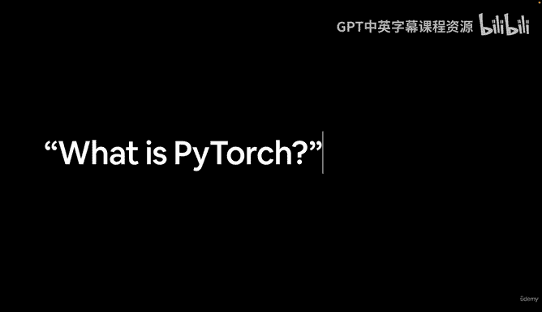

This is the homeage for Ptorrch。 This course is not a replacement for everything on this homep page。

 This should be your ground truth for everything。 Pitorrch。 so you can get started。

You've got a big ecosystem。 You've got a way to set up on your local computer。 You've got resources。

 You've got docs， Pytorrch， you've got the Github。 You've got search。 you've got blog。

 everything here。 This website should be the place you're visiting most throughout this course。

 as were writing Pytorrch code。 You're coming here。 You're reading about it。

 You're checking things out。 You're looking at examples。

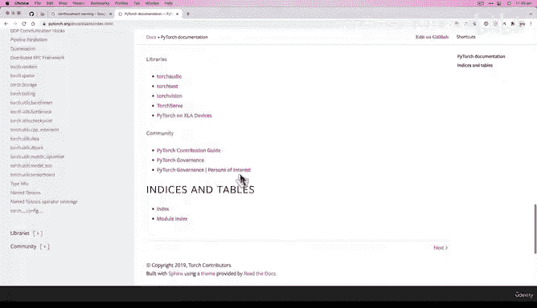

But for the sake of this course， let's break P torch down。

There's a little flame animation I just forgot about。What is Pytor？😡，I didn't sync up the animations。

 that's all right。😊，So。So Pytororch is the most popular research deep learning framework。

 And Ashtri said that I'll get to that in a second。

 It allows you to write fast deep learning code in Python。 So if you know Python。

 it's a very user friendly programming language and Pytorch allows us to write state of the art deep learning code Ac by GPus with Python it enables you access to many pre-built deep learning models from torchhub which is website that has a lots of if you remember I said transfer learning as a way that we can use other deep learning models to power our own Torchhub is a resource for that same as torchvision models we'll be looking at this throughout the course and it provides an ecosystem for the whole stack of machine learning from preprocessing data getting your data into tensors。

 What if you started with some images。 How do you represent them as numbers then you can build models such as neural networks to model that data then you can even deploy your model in your application cloud deploy your Pytorch。

😊。

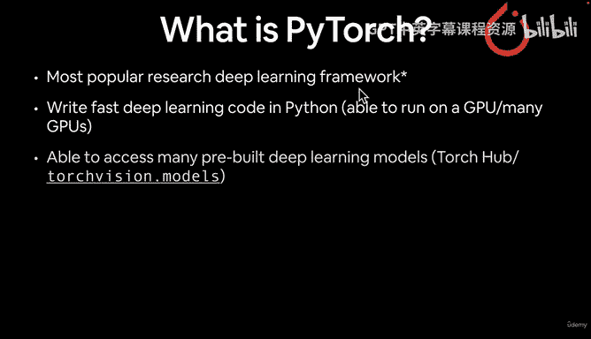

Application cloud will be depending on what sort of application cloud that you're using。

 but generally it will run some kind of ptorrch model。

 And it was originally designed and used inhouse by Facebook Me I'm pretty sure Facebook have renamed themselves meta now。

 But it is now open source and used by companies such as Tesla， Microsoft and open AI。

 And when I say it is the most popular deep learning research framework。 don't take my word for it。

 Let's have a look at papers with code dot com trends。 If you're not sure what papers with code is。

 It is a website that tracks the latest and greatest machine learning papers and whether or not they have code。

 So we have some other languages here。 Other deep learning frameworks。

 Ptorch Tensorflow jacks is another one Mxnet paddle paddle the original torch。

 So Pytorrch is an evolution of torch written in python caf2 Minpo。

 But if we look at this When is this last date is December 2021。We have。

 this is gonna move every time I move it。 No， So I'll highlight Pytorch at 58% there。

 So by far and large， the most popular research machine learning framework used to write the code for state of the art。

 Ma learning algorithms。 So this is browse state of the art papers with code dot com amazing website。

 we have semantic segmentation， image classification， object detection image generation Comp vision。

 natural language processing medical， I'll let you explore this。

 It's one of my favorite resources for staying up to date on the field。 But as you see。

 out of the 65000 papers with code that this website is tracked。58% of them implemented with Pytorch。

 How cool is that。 And this is what we're learning。😊。

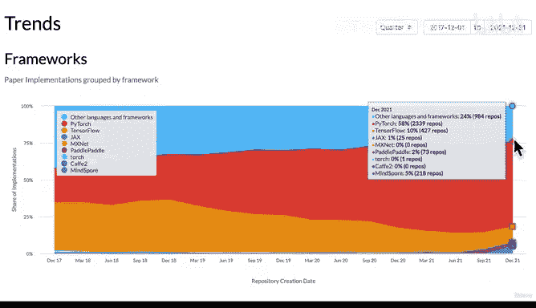

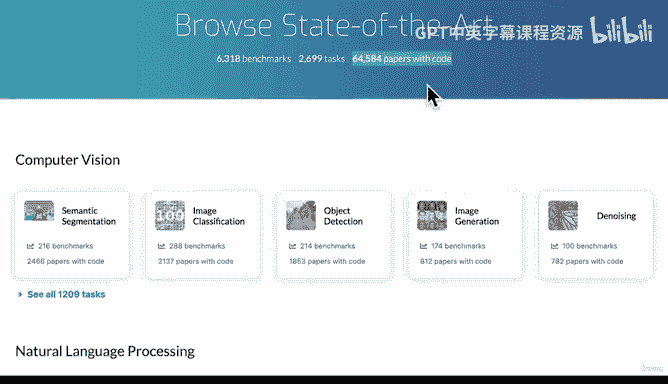

So let's jump into there。 Why high toch。 Well， other than the reasons that we just spoke about。

 it's a research favourite。 This is highlighting。 there we go。 So there we go。

 I've highlighted it here。 P torch，58%， nearly 2 and a half thousand reos。

 if you're not sure what a repo is， a repo is a place where you store all of your code online。

 And generally， if a paper gets published in machine learning。 If it's。😊。

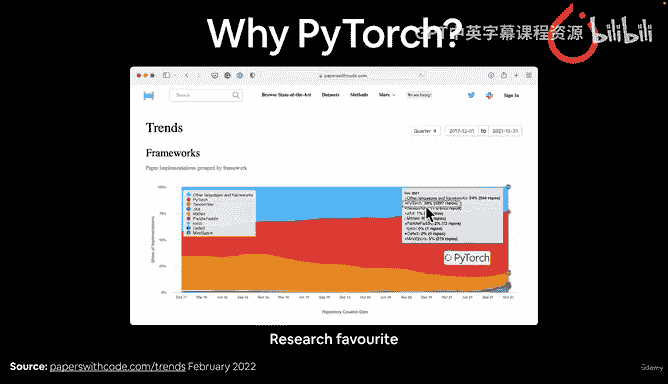

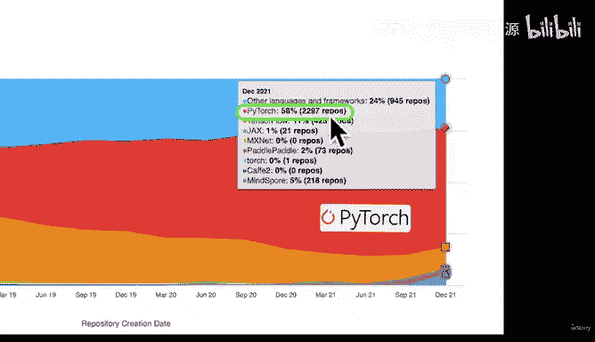

Fantastic research。 It will come with code， code that you can access and use for your own applications or your own research。

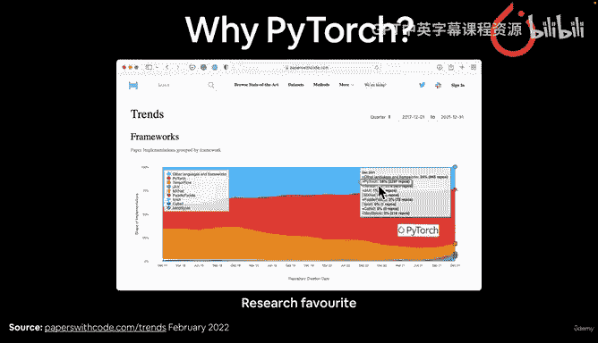

Again， why Ptorrch Well， this is a tweet from Francois Chalet， who's the author of Carers。

 which is another popular deep learning framework but with tools like coabab。

 we're going to see what coabab is in a second Carers and Tensorflowlow I've added in here and Ptorrch virtually anyone can solve in a day with no initial investment problems that would have required an engineering team working for a quarter and $20000 in hardware in 2014。

 So this is just to highlight how good the space of deep learning and machine learning tooling has become。

 coab carers and TensorFlow are all fantastic and now Ptorrch is added to this list If you want to check that out。

 there's Francois Chalet on Twitter very very prominent voice in the machine learning field。😊。

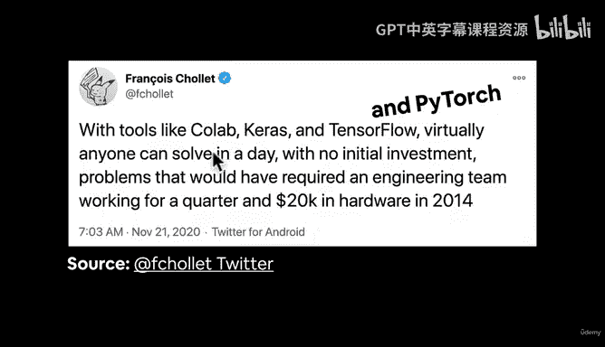

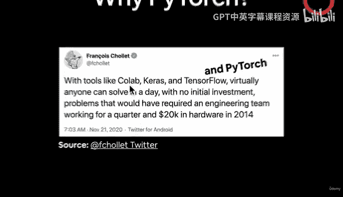

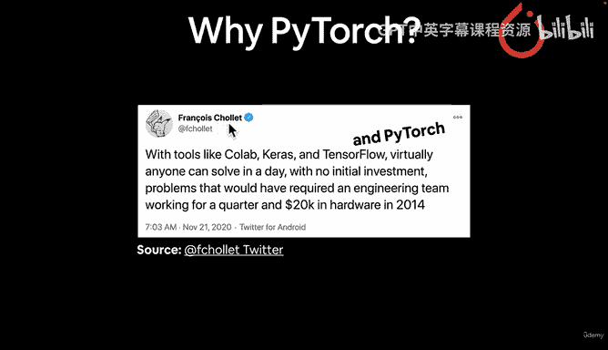

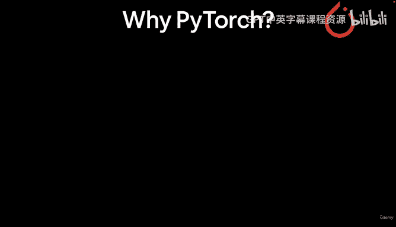

Why Pytorj， if you want some more reasons， Well， have a look at this。

 Look at all the places that are using Pytdge， which is just coming up everywhere。

 We've got Andre Cappathy here， who's the director of AI at Tesla。 So if we go。We could search this。

Pie torch。At Tesla。We've got a YouTube talk there。😡，Andre Cap Party， Director of AI at Tesla。And so。

 Tesla。Are using pintorrch。For the computer vision models of autopilot。

So if we go videos or maybe images。

Does it come up there？Things like this， a car detecting what's going on in the scene。Of course。

 there'll be some other code。For planning， but I'll let you research that。We come back here， Open AI。

 which is one of the biggest open artificial intelligence research firms open in the sense that they publish a lot of their research methodologies。

 however。

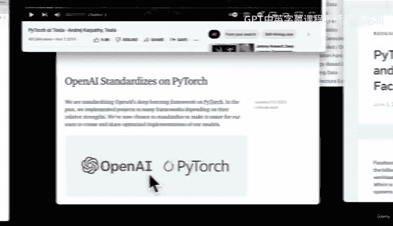

Recently， there's been some debate about that。 But if you go to openaiI co。

 let's just say that they're one of the biggest AI research entities in the world and they've standardized on Ptorrch。

 So they've got a great blog。 They've got great research and now they've got open AI API。

 which is you can use their API to access some of the models that they've trained。

 presumablyum with Pytorrch because this blog post from January 2020 says that open AI is now standardized across Pytorrch。

 There's a repo called the incredible Pitorrch， which collects a whole bunch of different projects that are built on top of Ptorrch。

 That's a beauty of Pytorrch is that you can build on top of it。 you can build with it。

 AI for AG for agriculture。 Pytorrch is being used， Let's have a look。😊。

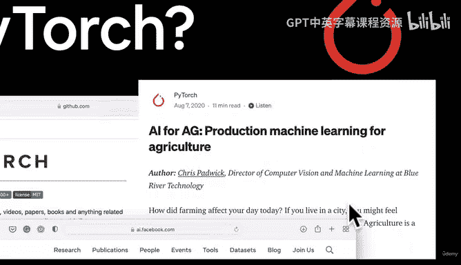

Pie torch in agriculture。There we go， agricultural robots use pietorrch。This is a media article。

It's everywhere。So if we go down here， this is using object detection beautiful。

Object detection to detect what kind of weeds should be sprayed with fertilizer。

 This is just one of many different things。 So Pytorch on a big tractor like this。

 It can be used almost anywhere。 And if we come back。

 Pytorch builds the future of AI and machine learning at Facebook。 So Facebook。

 which is also meta AI a little bit confusing， even though it says Me AI。

 It's on AI dot Facebook dot com。 That may change by the time you watch this。

 They use Pytorch inhouse for all of their machine learning applications。

 Microsoft is huge in the pytorch game。 It's absolutely everywhere。😊。

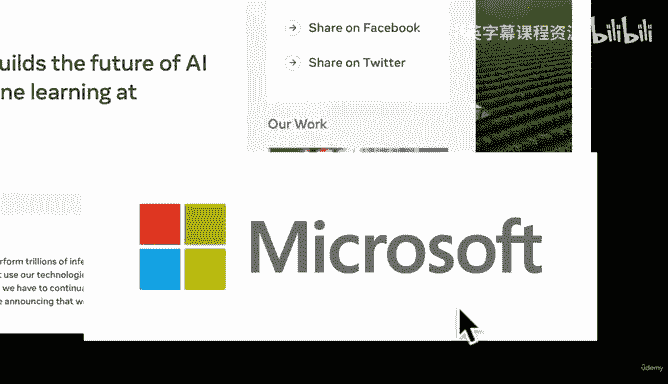

So if that's not enough reason to use Pytorrch， well then maybe you're in the wrong course。

 So you've seen enough reasons of why do you use Pytorrch， I'm gonna give you one more。

 That is that it helps you run your code， your machine learning code accelerated on a GPU。

 We've covered this briefly。 But what is a GPU slash a TU because this is more of a newer chip these days。

😊。

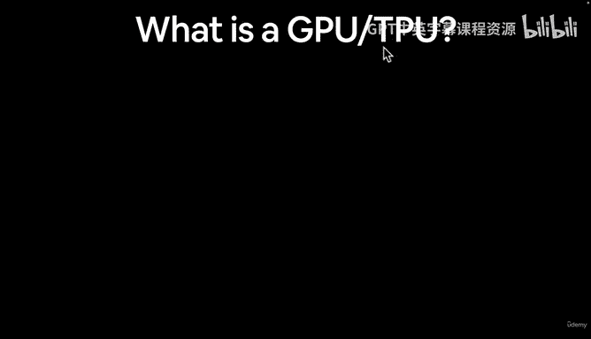

A GPU is a graphics processing unit， which is essentially very fast at crunching numbers originally designed for video games。

 If you've ever designed or played a video game， you know that the graphics are quite intense。

 especially these days。 And so to render those graphics。

 you need to do a lot of numerical calculations。 And so the beautiful thing about Pytorch is that it enables you to leverage a GPU through an interface called Kuda。

 which is a lot of words I'm going to throw out you here。

 A lot of acronyms in the deep learning space。 Couda。 Let's just search Kuda Kuda toolkit。

 So Couda is a parallel computing platform and application programming interface。

 which is an API that allows software to use certain types of graphics processing units for general purpose computing。

 That's what we want。 So Pytorch leverages kuda to enable you to run your machine learning code on Nvidia GPus。

 Now there is also an ability to run your Pytorch code on Tpus， which is a tensor processing unit。

 however。😊，GPUus are far more popular when running various types of pitorrch code。

 So we're going to focus on running our pi torch code on the GPU。

 And to just give you a quick example， Ptorrch on TPU。

Let's see that getting started with Pytororch on Cloud TUs there's plenty of guide for that。

 but as I said， GPUs are going to be far more common in practice。

 so that's what we're going to focus on。

And with that said。We've said tensor processing unit。Now。

 the reason why these are called tensor processing units is because machine learning and deep learning deals a lot with tensors and so。

In the next video let's answer the question， what is a tensor。

 but before I go through and answer that from my perspective， I'd like you to research this question。

 so open up Google or your favorite search engine and type in what is a tensor and see what you find I'll see you in the next video。

😊。

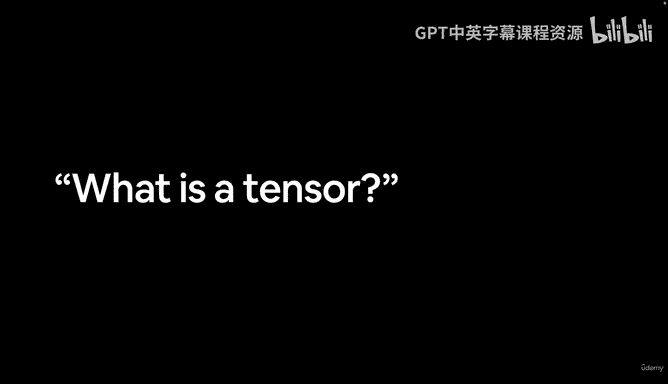