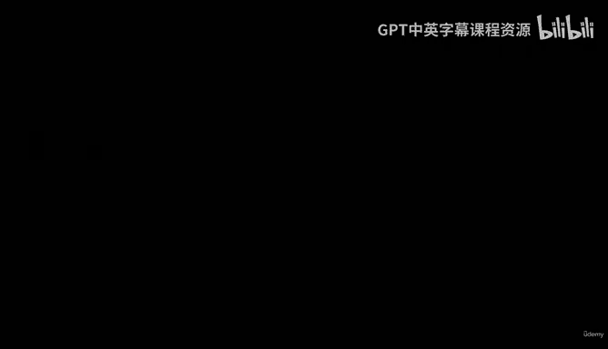
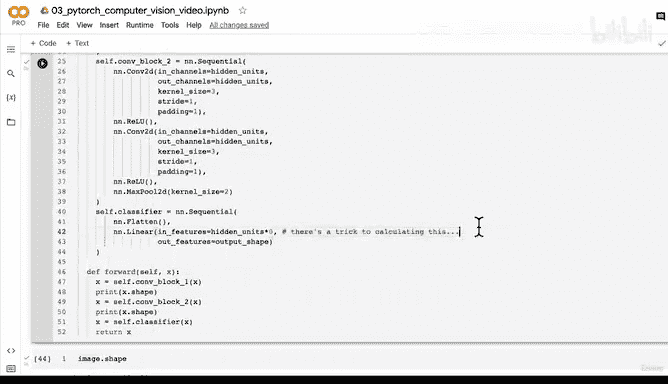

# Daniel Bourke《PyTorch 深度学习｜PyTorch 101 Crash Course For Beginners in 2025》中英字幕 - P120：120_05_024 模型2：逐步解析MaxPool2D层.zh_en - GPT中英字幕课程资源 - BV1kTSKB1E9m

Who's ready to step through the N N Max pool 2 D layer。 Put your hand up。 I've got my hand up。

 So let's do it together。 Hey， we've got 7。2。 Now， you might have already given this a shot yourself。

Stepping through。And then。Maxpo。2D。 And this is， this is what I do for a lot of different concepts that I haven't gone through before。

 I I just write some test code and see what the inputs and outputs are。

 And so where could we find out about Max pool 2 D。 Well， of course， we've got the documentation。

I'm just going to link this in here。Max pool 2D。In the simplest case。

 the output value of layer with input size N C H W output N C， H out W out， by the way。

 this is number of batches， color channels， height width。

 and this is the output of that layer and kernel size， which is a parameter up here。

K H KW can be precisely described as out is going to be the max of some value。

 depending on the kernel size and the stride。 So let's have a look at that in practice。 and。

 of course， you can read further through the documentation here。 I'll describe the link for this。

 actually。So谁样。Wonderful， and let's now first try it with our test image that we created above。

 So just highlight what the test image is。😊，Bunch of random numbers in the same shape as what a single image would be if we were to replicate the image size of the CNN explainer。

By the way， we'll have a look at a visual in a second of Max pool here。

 but you can go through that on your own time。 let's if in doubt， code it out。

 So we're going to print out the original image shape。Without unscezed dimension。

Because recall that we had to。Add an extra dimension to pass it through our co 2D layer。 Now。

 if you're using a later version of Ptorrch， you might not get an error if you only use a three dimensional image tensor and pass it through a co layer。

 So we're going to pass it in。Test image。Original shape。Test image dot shape。

 So this is just going to tell us what the line of code in the cell above tells us。 But that's fine。

I like to make pretty printouts， you know。Test image with unsqueezed dimension。

So this is just going to be our test image and we're going to see what happens when we unsqueeze a dimension。

Unsqueeze on the zero dimension that is。I was about to say first， but it's the zero。 Now。

 we're going to create a sample N N max pool。2 d layer。Because remember。

 even layers themselves in torch。nn are models。Of their own accord。 so we can just create a single。

 This is like creating a single layer model here。We'll set the kernel size equal to2。😡，And recall。

 if we go back to CNN explainer kernel size equal to 2 results in a2 by two square。

 a two by two kernel that's going to。Convolve over our image， like so。

And this is an example input and example output， and you can see the operation that max pooling does here。

 So just keep that in mind as we pass some sample data through our max pool layer。

And now let's pass data through it。I actually will pass it through just the conlayer first。

Through just the co layerer。Because that's sort of how you might stack things。

 you might put a convolutional layer and then a max pool layer on top of that convolutional layer。

So test image through Comv。We'll create a variable here equals al comp layer。

Is going to take as an input our test image dot unsqueze on the zero dimension again。Beautiful。

Now we're going to print out the shape here。This is just highlighting how I like to troubleshoot things is I do one step。

 print the shape， one step， print the shape， see what is happening as our data moves through various layers。

 So test image through Com dot shape will' see what our co layer does to the shape of our data。

And then， we're going to pass。Data through。The max pool layer。

Which is the layer we created a couple of lines above this one here。So let's see what happens。

Test image through。Can't type at the moment through Com and Maxpo。So quite a long variable name here。

 but this is to help us avoid confusion of what's going on。 So we go test image through Com。

 So you notice how we're taking the output of our convolutional layer this year。

And we're passing it through our max pool layer， which has another typo。Wonderful， and finally。

 we'll print out the shape， shape after going through。😊，Cmlayer。And Max Po。lay。What happens here？

So we want test image through Com and Max poolol。Let's see how our Max pool layout manipulates our test image shape you ready。

Three， two， one， let's go。What do we get， Okay， so we have the test image original shape。

 Re that our test image is just a collection of random numbers。And of course。

 our conlayer is going to be instantiated with random numbers。

 and Max poolol actually has no parameters。 It just takes the maximum of a certain range of inner tensor。

So， when we unsqueezze the。Test image as the input， we get an extra dimension here。

When we pass it through our con layer， oh， where did this 64 come from。1，64，64，64。

 Let's go back up to our co layer。Do you notice how that we get the 64 there because we change the out channels's value if we change this back to 10。

 like what's in the CNN explainer model 1，2，3，4，5，6，7，8，9，10。What do you think will happen there？

Well， we get our little highlight here，10。Then we keep going。 I'll just get rid of this extra cell。

 We don't need to check the version anymore more。 We'll check the test image shaped still 3，64，64。

 But then as we pass it through the con layer here。We get a different size now。

So it originally had three channels as the input for color channels。

 but we've upscaled it to 10 so that we have 10 hidden units in our layer。And then we have 64s， 64。

Now， again， these shapes will change if we change the values of what's going on here。

So we might put padding to zero。What happens there instead of 64，64， we get 62，62。

And then what happens after we pass it through the con layer and then through the max pool layer？

We've got1，10，64，64。 and now we have 1，10，32，32。 Now， why is that。Well。

 let's go back into the CNN explainer， jump into this max pool layer here。 maybe。

 maybe this one because got a bit more going on。Do you notice on the left here is the input。

 and we've got a two by two kernel here？And so the max pooling layer。

 what it does is it takes the maximum of whatever the input is。😊，So， you'll notice the。

Import is 6060 in this case。Whereas the output over here is 3030， now why is that？😊，Well。

 because the max operation here is reducing it from section of four numbers。

So let's get one with a few different numbers。There we go， that'll do。

So it's taking it from four numbers and finding the maximum value within those four numbers here。Now。

 why would it do that？so。As we've discussed before。

 what deep learning neural network is trying to do， or in this case， a CNN is take some input data。

And figure out what features best represent whatever the input data is and compress them into a feature vector that is going to be our output。

Now the reason being for that is because you could consider it from a neural network's perspective is that intelligence is compression。

 so you're trying to compress the patterns that make up actual data into a smaller vector space。

 go from a higher dimensional space to a smaller vector space in terms of dimensionality of a tensor。

But still， this smaller dimensionality space represents the original data。

And can be used to predict on future data。So that's the idea behind Max' pool is， hey。

 if we've got these learned features from our convolutional layers。Will the patterns。

 will the most important patterns stay around if we just take the maximum of a certain section？

So do you notice how the input here， we still have。 You can still see the outline of the car here。

Albeit a little bit more pixelated。 But just by taking the maxs of a certain region。

 we've got potentially the most important feature of that little section。And now， of course。

 you could customize this value here。 if when we create our max pool layer。

 you could increase the kernel size to 4 by 4。 What do you think will happen if we can increase it to 4。

So here we've got a two by two kernel。If we increase it to 4 by 4， what happens。

Do you notice that we've gone from 62 to 15。 We've essentially divided our feature space by 4。

 We've compressed it even further。 Now， will that work。Well。

 I'm not sure that's part of the experimental nature of machine learning。

 but we're going to keep it at2 for now。And so this is with our tensor here， 64，64。

 but now let's do the same as what we've done above。

 but we'll do it with a smaller tensor so that we can really visualize things。

And we're going to just replicate the same operation that's going on here。So let's go here。

 we'll create another random tensor。We'll set up the manual seed first。

And we're going to create a random tensor。With a similar number of dimensions。Now。

 record dimensions don't tell you。 So this is a dimension，1。3，64，64。 That is a dimension。

 The dimensions can have different values within themselves。

So we want to create a four dimensional tensor。To our images。 So what that means is。

 let me just show you， it's way easy to explain things when we've got code。Is torch。Dot R end。

And we're going to set it up as size equals one，1，2，2。We can have a look at this random tensor。

 it's got four dimensions。1，2，3，4。So you could have a batch size。

 color channels and height width a very small image， but it's a random image here。

 But this is quite similar to what we've got going on here， right？4our numbers。 Now。

 what do you think will happen if we create a max pool layer just like we've done above？

Create a max poll layer。So we' got max pool。Laah， just repeating the code that we have in the cell above。

 that's all right。 A little bit of practice。Colonel size。Equals 2。

And then we're going to pass the random tensor。Through the max pool layer。So we' go， Max pool。天测。

Equals Max poll。Layer， and we're going to pass it in the random tensor。Wonderful。

 and then we can print out some shapes and print out some tensesors。😊，As we always do to visualize。

 visualize， visualize， So we're going to write in here Max pool tensor on a new line。

We'll get in the max pool tensor。We'll see what this looks like and we'll also print out Max pool tensar。

Shape。And we can probably print out random tensor itself as well as its shape as well。

We'll get the shape here， dot shape。And we'll do the same for the random tenson。So print。

You get a new line。Random tensa。New line。Random tensor， and then we'll get the shape。

Random tensor shape， random tensor。 Oh， a lot of coding here。 Well that's。

 that's the fun part about machine learning， Right。 you get to write lots of code， okay。😊。

So we're visualizing what's going on with our random tensor。

 This is what's happening within the max pool layer。 We've seen this from a few different angles now。

 So we have a random tensor of numbers。 and we've got a size here。But the max pool tensor。

 once we pass our random tensor。Through the max pool layer， what happens when we have 0。

3367128823452303。 Now， what's the max of all these。While it takes the max here is 3，3，6，7。Oh。

 and we've got the random tensor down there。 we don't want that。

And see how we've reduced the shape from two by two to one by one。Now， what's going on here。

 just for one last time to reiterate， the convolutional layer is trying to learn the most important features。

Within an image。So if we jump into here。Now， what are they， Well。

 we don't decide what a convolutional layer learns。 It learns these features on its own。

So the convolutional layer learns those features。We pass them through a reello nonlinear activation in case our data requires nonlinear functions。

And then we pass those learned features through a max pool layer to compress them even further。

So the convolutional layer can compress the features into a smaller space。

 but the max pooling layer really compresses them。 So that's the entire idea。 One more time。

 we start with some input data。 We design a neural network。 In this case。

 a convolutional neural network to learn a compressed representation of what our input data is so that we can use this compressed representation to later on make predictions on images of our own。

 And in fact， you can try that out if you wanted to click here and add your own image。

 So I'd give that a go。 That's your extension for this video。 but now we've stepped through。😊。

The max pole 2D layer and the conv 2D layer。I think it's time we started to try and use our tiny VGG network。

 This is your challenge， is to create a dummy tensor and pass it through this model。

Pass it through its forward layer and see what happens to the shape of your dummy tensor as it moves through Com block 1 and Com block 2。

And I'll show you my trick to calculating the in features here for this final layer。

 which is equivalent to this final layer here。

I'll see you in the next video。