# Daniel Bourke《PyTorch 深度学习｜PyTorch 101 Crash Course For Beginners in 2025》中英字幕 - P121：121_05_025 模型2：层输入输出形状计算技巧.zh_en - GPT中英字幕课程资源 - BV1kTSKB1E9m

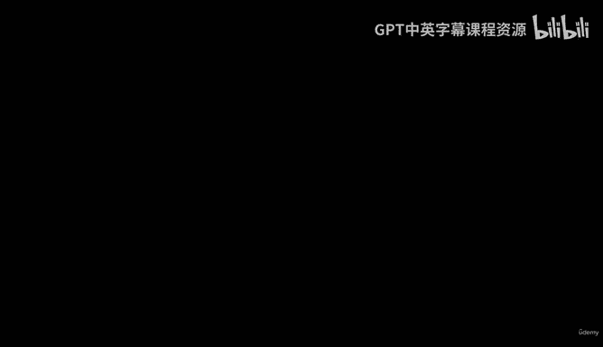

Over the last few videos， we've been replicating the tiny VG G architecture from the CNN explainplainer website。

 And I hope you know that this is this actually quite exciting because。😊，Years ago。

 this would have taken months of work， and we've just covered。

 we've broken it down over the last few videos and rebuilt it ourselves with a few lines of Pytorch code。

So that just goes to show how powerful pieytorch is and how far the deep learning field has come。

 but we're not finished yet。😊，Let's just go over to our keynote。😊，This is what we've done。

See an explainer model。We have an input layer， we've created that。😊，We have Com 2D layers。

 we've created those。We have rail activation layers， we've created those。And finally。

 we have pooling layers， and then we finish off with an output layer。

 But now let's see what happens when we actually pass some data through this entire model。

 And as I've said before， this is actually quite a common practice is。😊。

You replicate a model that you' found somewhere and then test it out with your own data。

 So we're going to start off by using some dummy data to make sure that our model works。

 and then we're going to pass through， oh， I've got another slide for this。

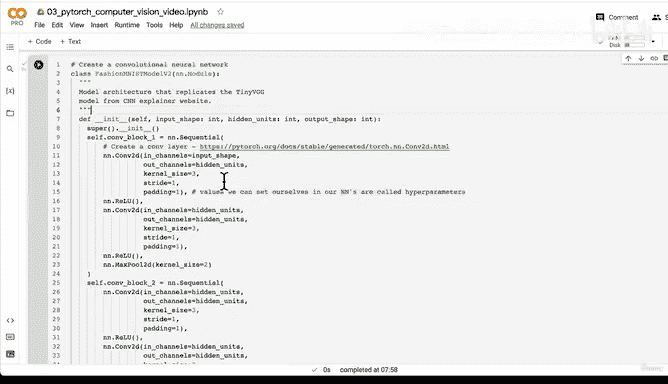

By the way， here's a breakdown of torch and Ncom 2D， if you'd like to see it in text form。

 nothing here that we really haven't discussed before。

 but this will be in the slides if you would like to see it。

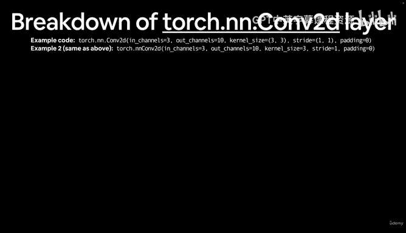

Then we have a video animation。 We've seen this before， though， And plus。

 I'd rather you go through the CNN explain a website on your own and explore these different values rather than me just keep talking about it。

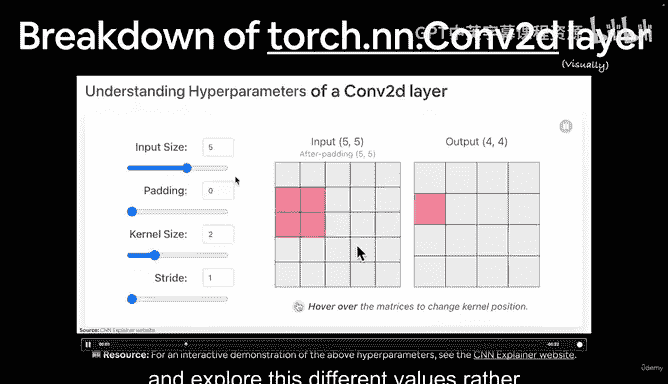

Here's what we're working towards doing。We have a fashion Mnes data set。And we have our inputs。

 We're going to numerically encode them。 We've done that already。

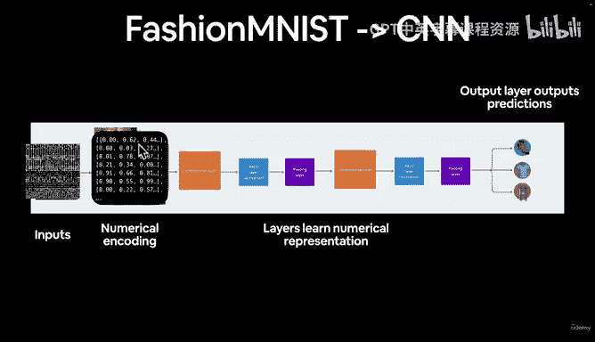

Then we have our convolutional neural network。

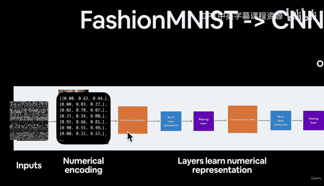

Which is a combination of convolutional layers， non nonlinear activation layers， pooling layers。

 But again， these could be comprised in many different ways， shapes and forms。

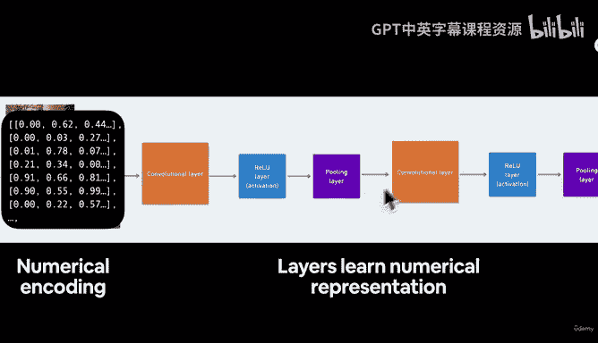

In our case， we've just replicated the tiny VGG architecture。

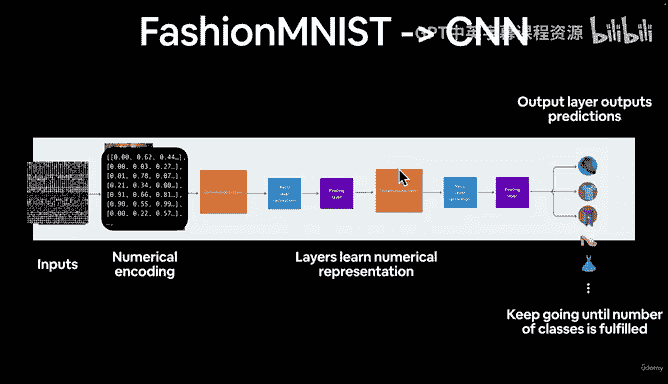

And then finally， we want to have an output layer to predict what class of clothing are particular input images。

😡。

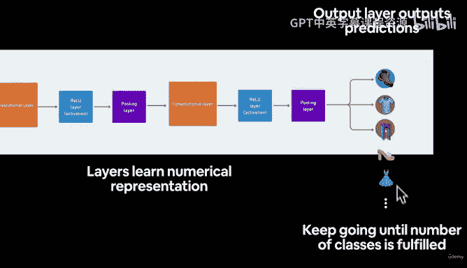

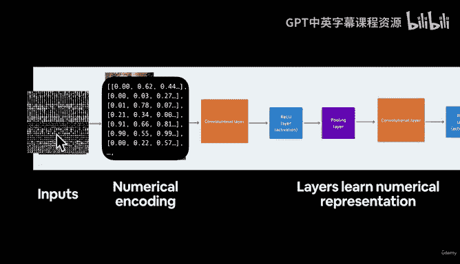

And so let's go back。😊，We have our CNNN model here。And we've got model 2。

So let's just practice a dummy Ford pass here。 We're going to come back up a bit to where we were。

 We'll make sure we've got Model 2。And we get an error。Here， because I've timesd this by 0。

 So I'm going to just remove that and keep it there。

Let's see what happens if we create a dummy tensor and pass it through here。 Now。

 if you recall what our image is， do we have image。This is a fashion mist image。

So I wonder if we can go。Pot。t im show。Image and I'm going to squeeze that and I'm going to set this C map e to gray。

😊，So this is our current image。Wonderful。So there's our current image。So let's create a tensor。

Or maybe we just try to pass this through the model and see what happens。How about we try that？

Model image。Right， we're going to try the first pass， forwardd pass。So pass image through model。

 what's going to happen？While we get an error。Another shape mismatch。 we've seen this before。

 How do we deal with this， Because what is the shape of our current image。1，28，28。 Now。

 if you don't have this image instantiated， you might have to go back up a few cells。

Where did we create image？I'll just find this。 So just， we created this a fairly a long time ago。

 So I'm going to。Probably recreate it down the bottom。My goodness， we have written a lot of code。

Well done to us， we could create a dummy tensor if we wanted to。😊，How about we do that？

 And then if you want to find， oh， right back up here， we have an image。How about we do that。

 we can just do it with a dummy tensor， that's fine。😊，We can create one of the same size。

 but if you have image instantiated， you can try that out。 So there's an image。

 Let's now create an image that is or a random tensor that is the same shape as our image。So Rand。

Image Tensa。Eagles what？Torch。randn。And we're going to pass in size equals 1， 28， 28。

Then if we get RAd image tensor。We check it shape， what do we get？

So the same shape as our test image here， but it's just going to be random numbers， but that's okay。

 We just want to highlight a point here of input and output shapes。

 We want to make sure our model works。Can our random image tends to go all the way through our model。

 that's what we want to find out。So we get an error here， we have four dimensions。

 but our image is three dimensions。 How do we add an extra dimension for batch size Now you might not get this error if you're running a later version of py toch。

 just keep that in mind。So unsqueeze zero。Oh， expected all tensors to be on the same device。

 but found at least two devices again， we're going through all the three major issues in deep learning。

 shape mismatch， device mismatch， data type mismatch。

 So let's put this on the device to target devicecause we've set up device agnostic code。

Maap1 and matte2 shapes cannot be multiplied， oh， but we get an output here。That is very exciting。

 So what I might do is move this a couple of cells up so that we can tell what's going on。

 I'm going to delete this cell。😊，so。Where do these shapes come from？Well。

 we've printed out the shapes there。 And so this is what's happened when our。

I'll just create our random tensor， I'll bring our random tensor up a bit too。 Let's bring this up。

There we go。So。We pass our random to image tensor。Through our model and we've made sure it's got four dimensions by unsqueezed zero。

 and we make sure it's on the same device as our model because our model has been sent to the GPU。

And this is what happens as we pass our random image tensor。

 we've got 12828 instead of previously we've seen 64643。 just going to clean this up a bit。😊。

And we get different shapes here。So you'll notice that as our input， if it was 64， 643。

 goes through these layers。It gets shaped into different values。 Now。

 this is going to be universal across all of the different data sets you work on。

 You will be working with different shapes。 So it's important to and also quite fun to troubleshoot what shapes you need to use for your different layers。

 So this is where my trick comes in。😊，To find out the shapes for different layers。

 I often construct my models how we've done here as best I can with the information that I've got。

 such as replicating what's here。 But I don't really know what the output shape is going to be before it goes into this final layer。

And so I recreate the model as best I can。 And then I pass data through it in the form of a dummy tensor in the same shape as my actual data so we could customize this to be any shape that we wanted。

 And then I print the shapes of what's happening through each of the forward past steps。

 And so if we pass it through this random tensor through the first calm block。😊。

It goes through these layers here， and then it outputs a tensor with this size。

So we've got 10 because that's how many output channels we've set and then 1414， because our 28。

28 tensor has gone through a max pool 2D layer and gone through a convolutional layer。

 And then it goes through the next block， column block2。

Which is because we've put it in the forward method here。 And then it outputs the shape。

 And if we go back down。We have now a shape of 1107，7。 So our previous tensor。

 the output of Com block 1， has gone from 1414 to 7，7。 So it's been compressed。

 So let me just write this down here。 outputput shape of Com block1。

 just so we get a little bit more。😊，Information。And I'm just going to copy this。Pull in here。

That will become column block 2。And then finally， I want to know if I get an output shape of。

Classifier。So if I rerun all of this。I don't get an output shape of classifier。

 so my model is running into trouble once it gets to， so I get the output of Com block 1。

 I don't get an output of classifier。 So this is telling me that I have an issue with my classifier layer。

Now， I know this because， well， I've coded this model before and the in features here。

 we need a special calculation。 So what is going on with our shapes。

MaAT 1 and mat 2 shapes cannot be multiplied。So do you see here。

 what is the rule of matrix multiplication， the inner dimensions here I have to match。 We've got 4。

90。 Where could that number have come from， and we've got 10 times 10。Now， okay。

 I know I've set hidden units to 10。 so maybe that's where that 10 came from。

And what is the output layer or the output shape of Com block 2？So if we look。

 we've got the output shape of Com block 2。Where does that go？😡，The output of Com block2。

Goes into our classifier model。 and then it gets flattened。 So that's telling us something there。

And then our NN linear layer is expecting the output of the flatten layer as its in features。😊。

So this is where my trick comes into play。I pass the output of Comv V2 into the classifier layer。

It gets flattened。And then that's what my N N not linear layer is expecting so。

What happens if we flatten this Shaia？Do we get this value， Let's have a look。

 So if we go 10 times 7 times 7。490。Now， where was this 10？Well， that's our hidden units。

And where were these sevens？Well。These sevens are the output of Com block 2。So that's my trick。

 I print the shapes of previous layers and see whether or not they line up with subsequent layers。

So if we go time  seven， times 7。We're going to have hidden units equals 10， times 7 times 7。

 where do we get the two7s， because that is the output shape of con block 2。

Do you see how this can be a little bit hard to calculate ahead of time？Now。

 you could calculate this by hand if you went into Ncom 2D。

 but I prefer to write code to calculate things for me。You can calculate that value by hand。

 if you go through。H out。 W out， you can。Add together all of their different parameters and multiply them and divide them。

 And what not， You can calculate the input and output shapes of your convolutional layers。

 You're more than welcome to try that out， by hand。😊，But I prefer to code it out。 if， in doubt。

 code it out。 Now， let's see what happens。If we。Run our random image tensor through our model。 Now。

 Do you think it will work。Well， let's find out All we've done is we've added this little line here。

 time 7， times 7。And we've calculated that because we've gone，huh。

 what if we pass a tensor of this dimension through a flatten layer？

And what is our rule of matrix multiplication， The inner dimensions here must match。

 And why do we know that these are matrices， Well， mat 1 and mat 2 shapes cannot be multiplied。

 and we know that inside a linear layer。Is a matrix multiplication。So let's now give this a go。

We'll see if it works。Oh， would you look at that That is so exciting。

 We have the output shape of the classifier is 1 and 10。 We have a look。 We have one number，1，2，3，4。

5，6，7，8，9，10，1 number for each class in our data set。😊，Wow， just like the CNN explainer website。

 we have 10 outputs here。 We just happen to have 10 classes as well。 Now， this number。

 again could be whatever you want。 It could be 100 could be 30， could be 3。

 depending on how many classes you have， but we have just figured out the input and output shapes of each layer in our model。

So that's very exciting。 I think it's now time。😊，We've passed a random tensor through。

 how about we pass some actual data through our model？😊，In the next video。

 let's use our train and test step functions to train our first convolutional neural network。

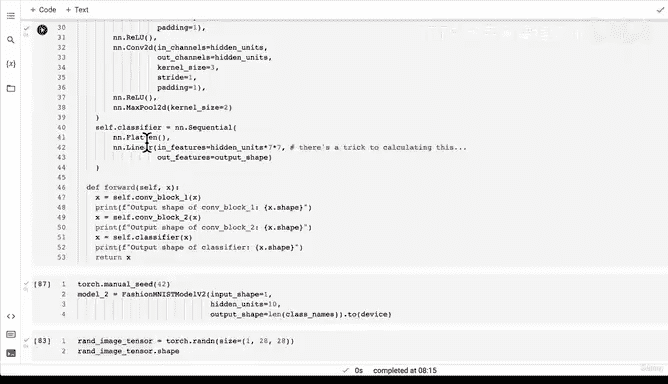

I'll see you there。

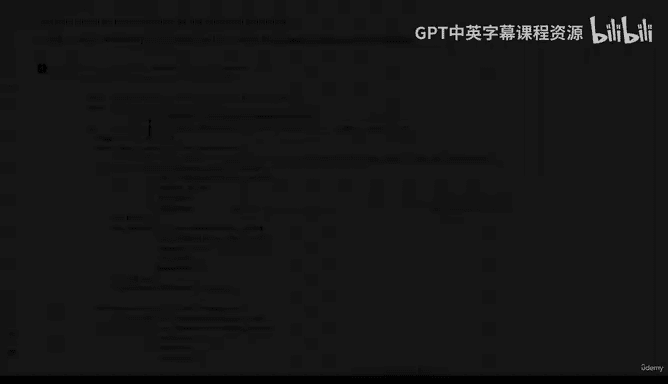