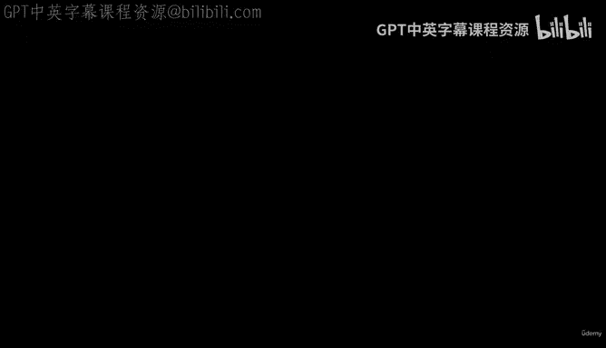
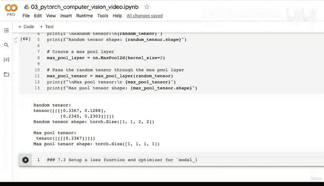
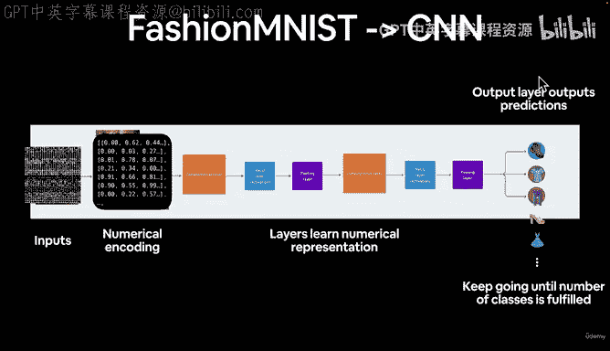
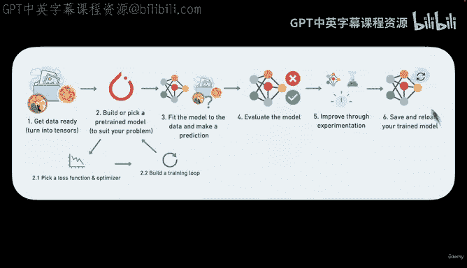
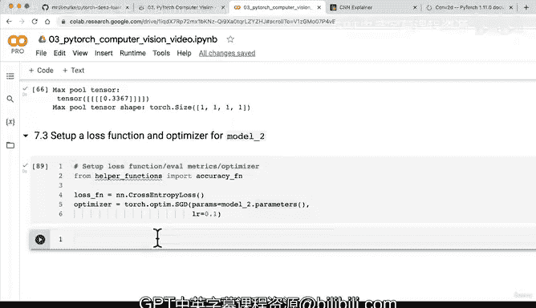

# Daniel Bourke《PyTorch 深度学习｜PyTorch 101 Crash Course For Beginners in 2025》中英字幕 - P122：122_05_026 模型2：配置损失函数与优化器.zh_en - GPT中英字幕课程资源 - BV1kTSKB1E9m

Well， let's get ready to train our first CNN。 So what do we need， Where are we up to in the workflow。

 Well， we've built a model and we've stepped through it。 We know what's going on。

 but let's really see what's going on by training。😊，This ENN。

 or see if it trains because we don't always know if it will on our own data set。

 which is of fashion Mnis。 So we're going to set up a loss function and optimizer。😊，For Model two。

 just as we've done before， Model 2， turn that into markdown。

I'll just show you the workflow again。 So this is what we're doing。 we've got some inputs。

 we've got a numerical encoding。 we've built this architecture。

 and hopefully it helps us learn or it helps us make a predictive model that we can input images such as grayscale images of clothing and predict。

😊。

And if we look where we are at the。😊。

Pytoage workflow， we've got our data ready。We've built our next model。Now here's where we're up to。

Picking a loss function。 and an optimizer。So let's do that， hey？Loss function。

 or we can do evaluation metrics as well， So set up loss function。

 slash Aval metrics slash Opr and we want from helper functions。

Import accuracy function we don't need to reimport it。

 but we're going to do it anyway for completeness Los function equals Nn do crossenttropy loss because we are working with a multiclass classification problem and the optimizer we're going to keep the same as what we've used before。

 Torch。 Opim SGD and we'll pass it in this time the parameterss that we're trying to optimize are the parameters of Model 2。

Prameters and we'll use a learning rate of 0。1 run that and just to reiterate。

 here's what we're trying to optimize Model 2 state dig。We have a lot of random weights in Model 2。

Have a look at all this。 There's the bias。 There's the weight。

 We're going to try and optimize these to help us predict on our fashion Mnes data set。

 So without any further ado， let's in the next video， go to the workflow。😊。

We're going to build our training load。 But thanks to us before we've now got functions to do this for us。

 So if you want to give this a go， use our train step and test step function to train Model 2。😊。

Try that out and we'll do it together in the next video。😊。

