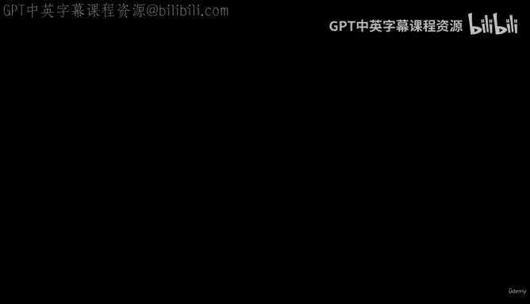
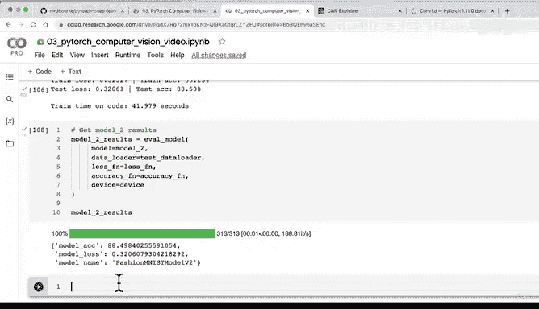

# Daniel Bourke《PyTorch 深度学习｜PyTorch 101 Crash Course For Beginners in 2025》中英字幕 - P123：123_05_027 模型2：训练首个CNN并评估结果.zh_en - GPT中英字幕课程资源 - BV1kTSKB1E9m

We're getting so close to training our model。 Let's write some code to train our first CNN model。😊。

Training and testing， I' just going to make another heading here， Model two。

 using our training and test functions。So we don't have to rewrite all of the steps in a training loop and a testing loop because we've already created that functionality before through our train step function。

😊，There we go， performs a training or this should be performs a training step with model trying to learn on data loader。

 So let's set this up。 I'm going to set up torch manual seed。

42 and we can set up a couda manual seed as well。Just to try and make our experiments as reproducible as possible because we're going to be using Kuda。

We're going to measure the time because we want to compare our models not only their performance in evaluation metrics。

 but how long they take to train。😊，From time it， because there's no point having a model that performs really。

 really well， but takes 10 times longer to train。Well， maybe there is。

 depending on what you're working on， Model two equals timer。And we're going to train and test model。

 but that the time is just something to be aware of is that usually a better performing model will take longer to train。

 not always the case， but just something to keep in mind。

So for epoch in we're going to use TQDm to measure the progress。

 we're going to create a range of epochs。 we're just going to train for three epochs。

 keeping our experiments short for now just to see how they work。Apoch。

And we're going to print a new line here。So for an epoch in a range。

We're going to do the training step， which is our train step function。

The model is going to be equal to Model 2， which is our convolutional neural network， our tiny VGG。

 the data loader is just going to be equal to the train data loader the same one we've used before。

 the loss function is going to be equal to the loss function that we've set up above。Los fn。

The optimizer as well， is going to be the optimizer， in our case， srcastic gradient descent。

Optimizer equals Opr。 Then we set up the accuracy function。

 which is going to be equal to our accuracy function。And the device is going to be the target device。

😊，How easy was that。 Now we do the same for the train or the testing step。 Sorry。

 the model is going to be equal to model 2。 And then the data loader is going to be。

The test data loader。And then the loss function is going to be our same loss function。

 and then we have no optimizer for this， we're just going to pass in the accuracy function here。

And then of course， the device is going to be equal to the device。And then what do we do now？Well。

 we can measure。The end time。So that we know how long the code here took to run。

So let's go train time end for Model2， this will be on the GPU， by the way。

 but this time it's using a convolutional neural network。And the total train time。

Total train time for Model 2 is going to be equal to print train time。

 our function that we created before as well to help us measure start and end time。

 so we're going to pass in train time start Model2 and then end is going to be train time and Model 2。

And then we're going to print out the device that it's using as well。 So you' ready。

 Are you ready to train our first convolutional neural network？Hopefully this code works。

 We've created these functions before， so it should be all right。😊，But if in doubt， code it out。

 if and doubt， run the code， let's see what happens。😊，Oh my goodness， Of course。

 we forgot to comment out the output shapes。😊，So we get a whole bunch of outputs for our model because what have we done back up here？

😊，We forgot to。 So this means every time our data goes through the forwardd pass。

 it's going to be printing out the output shapes。 So let's just comment out these。

And I think this cell is going to take quite a long time to run because。😊，It's got so many printouts。

 yeah， see， streaming output truncated to the last 5000 lines。😊，So we're going to try and stop that。

 Okay， there we go， beautiful。 That actually worked。 Sometimes it doesn't stop so quickly。

So we're going to rerun our fashion MSV2 model cell so that we comment out these print lines and then we'll just rerun these cells down here。

Just go back through fingers crossed。 There's no errors， and we'll train our model again。 Beai。

 not as many printouts this time。 So here we go。 Our first CNN is training。

 How do you think it'll go。😊，Well， that's all we have printouts right， so we can see the progress。

 So you can see here all the functions that are been called behind the scenes from Pytorch。

 So thank you to Pytorch for that。 There's our oh， our train step function was in there。😊，Train step。

 wonderful。Beautiful， so there's epoch 0。 Oh， we get a pretty good test accuracy。

 How good is that Test accuracy is climbing as well。 Have we beaten our baseline。😊。

We're looking at about 14 seconds per epoch here。And then the final epoch。What do we finish at88。

5 Wow， in 41。97979 or 42 there're about seconds Again， your mileage may vary。

 Don't worry too much if these numbers aren't exactly the same on your screen and same with the training time because we might be using slightly different hardware what GPU do I have today。

😡，I have a Tesla P100 GPU。 you might not have the same GPU。

 so the training time if this training time is something like 10 times higher。

 you might want to look into what's going on and if these values are like 10% lower or 10% higher。

 you might want to see what's going on with your code as well。

But let's now calculate our model 2 results。 I think it is the best performing model that we have so far。

 Let's get a results dictionary。 Model 2 results。 Is it so exciting when learning the power of convolutional neural networks。

 Model 2 results equals a vow model， And this is a function that we've created before。😊。

So return to dictionary containing the results of a model predicting on data loader。

 so now let's pass in the model which will be our trained model2。

And then we'll pass in the data loader， which will be our test data loader。And then， oh， excuse me。

Typo， our loss function will be， of course， our loss function and the accuracy function will be。

Accuracy function and the device is already set， but we can reset anyway， device， es device。

And we'll check out the Model2 results。Make some predictions， ho ho， look at that。

Model accuracy88 does that beat our baseline， Model zero results？😊，Oh。

 we did feed our baseline with a convolutional neural network。 All right。

 so I feel like that's that's quite exciting。 But now let's keep going on。

 And let's start to compare the results of all of our models。😊。

I'll see you in the next video。