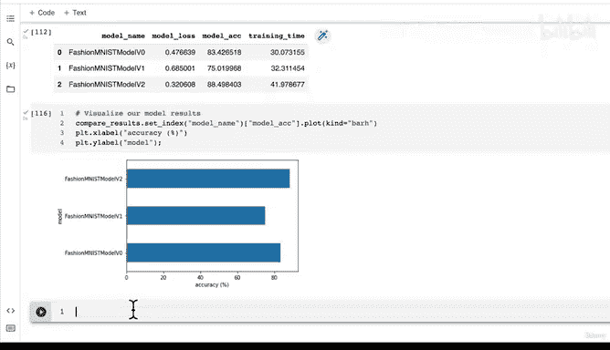

# Daniel Bourke《PyTorch 深度学习｜PyTorch 101 Crash Course For Beginners in 2025》中英字幕 - P124：124_05_028 模型实验效果对比.zh_en - GPT中英字幕课程资源 - BV1kTSKB1E9m

Welcome back。 Now， in the last video， we trained our first convolutional neural network and from the looks of things it's improved upon our baseline。

 but let's make sure by comparing this is another important part of machine learning experiments is comparing the results across your experiments So and training time Now we've done that in a way where we've got three dictionaries here of our Model0 results。

 Model 1 results， Model 2 results。 So how about we create a data frame comparing them。

 So let's import pandas。😊，As PDday。And we're going to compare results equals PDd。 data frame。

And because our model results dictionaries all have the same keys， let's pass them in as a list。

 so model zero results。😊，Model1 results。And Model two results to compare them。

Wonderful and what it looks like when we compare the results。Al righty。

 so recall our first model was our baseline v0， which just two linear layers。

 and so we have an accuracy of 83。4 and a loss of 0。47。😊。

The next model was we trained on the GPU and we introduced non linearities so。

We actually found that that was worse off than our baseline。Then we brought in the big guns。

 we brought in the tiny VGG architecture from the CNN Exer website and trained our first convolutional neural network。

 and we got the best results so far， but there's a lot more experiments that we could do。

 we could go back through our tiny VGG and we could increase the number of hidden units。😊。

Where do we create our model up here， We could increase this to say 30 and see what happens。

 That would be a good experiment to try。 And if we found that non linearities didn't help with our second model。

 we could comment out the Re layers。😊，We could， of course， change the kernel size。

 change the padding， change the max pool。 a whole bunch of different things that we could try here。

 We could train it for longer。 So maybe if we trained it for10 epos， it would perform better。

 But these are just things to keep in mind and try out。 I'd encourage you to give them a go yourself。

 But for now， we've kept all our experiments quite the same。😊。

How about we see the results we add in the training time。

 because that's another important thing that we've been tracking as well。 So we'll add。Training time。

Two results comparison。So the reason why we do this is because。😡。

If this model is performing quite well， even compared to our CNN。

 So a difference in about 5% accuracy， maybe that's tolerable in the the space that we're working。

 except that this model might actually train and perform inference 10 times faster than this model。

 So that's just something to be aware of。 It's called the performance speed trade off。

 So let's add another column here。 compareare results， and we're going to add in oh， excuse me。

Got a little error there。 That's all right。 Got trigger happy on the shift and enter training time equals。

 We're going to add in。We've got another list here is going to be total train time for Model zero。

And total train time for Model one and total train time for model。2。And then we have a look at our。

Compare results， dictionary or sorry， compareare results， data frame。Wonderful。

So we see and now this is another thing I keep stressing this to keep in mind if your numbers aren't exactly of what I've got here。

 don't worry too much， go back through the code and see if you've set up the random seeds correctly。

 you might need a coud or random seed， we may have missed one of those。😡。

If your numbers are outlandishly different to these numbers。

 then you should go back through your code and see if there's something wrong and again the training time will be highly dependent on the compute environment you're using so if you're running this notebook locally。

 you might get faster training times if you're running it on a different GPU to what I have Nvidia SMI you might get different training times so I'm using a Tesla P 100 which is quite a fast GPU but that's because I'm paying for coab Pro which generally gives you faster GPUus and Model 0 was trained on the CPU so depending on what compute resource Google allocates to you with Google coab。

 this number might vary here so just keep that in mind these values training time will be very dependent on the hardware you're using。

But if your numbers are dramatically different， well。

 then you might want to change something in your code and see what's going on。

And how about we finish this off with a graph so？Let's go visualize our model results and why are we're doing this。

 have a look at the data frame above。😊，Is the performance here 10 seconds longer training time worth that extra 5% of the results on the accuracy？

Now， in our case， we're using a relatively toy problem。

 What I mean by toy problem is quite a simple data set to try and test this out。

 but in your practice， that may be worth doing if your model takes longer to train but gets quite a bit better performance。

It really depends on the problem you're working with。

Compare results and we're going to set the index as the model name because I think that's what we want our graph to be。

 we want the model name and then we're going to plot， we want to compare the model accuracy。😊。

And we want to plot。The kind is going to be equal to bar H， horizontal bar chart。

We'll go Px label we're going to get。Accuracy as a percentage。And then we're going to go P Y label。

 This is just something that you could share if someone was asking how did your modeling experiments go on fashion Mn。

 Well， here's what I've got， And then they ask you well。

 what's the fashion Mnes Model V2 where you could say that's a convolutional neural network that trained that's replicates the CNN explainer website that trained on a GPU Look how long did that take to train Well then you've got the training time here。

 We could just do it as a vertical bar chart。I did it as horizontal so that this looks a bit funny to me。

So horizontal like that。So the model names are over here。Wonderful。

 so now I feel like we've got a trained model。 How about we make some visual predictions because we've just got numbers on a page here。

 but our model is trained on computer vision data and the whole point of making a machine learning model on computer vision data is to be able to visualize predictions。

😊，So let's give that a shot hey， in the next video we're going to use our best performing model。

 fashionash Ms Model V2， to make predictions on random samples from the test dataset set you might want to give that a shot。

 make some predictions on random samples from the test dataset set and plot them out with their predictions as the title。

😊，So try that out， otherwise we'll do it together in the next video。😊。

