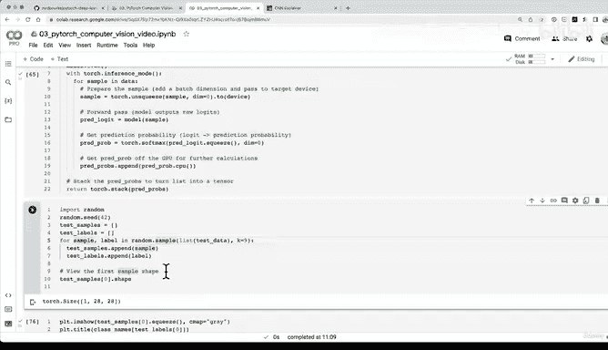

# Daniel Bourke《PyTorch 深度学习｜PyTorch 101 Crash Course For Beginners in 2025》中英字幕 - P125：125_05_029 使用最优模型对随机测试样本预测.zh_en - GPT中英字幕课程资源 - BV1kTSKB1E9m

In the last video， we compared our model's results。 We tried three experiments。

 One was a basic linear model， one was a linear model with nonlinearar activations。

 and fashion Ms model V2 is a convolutional neural network。

 and we saw that from an accuracy perspective， our convolutional neural network perform the best。

 However， it had the longest training time。 and I just want to exemplify the fact that the training time will vary depending on the hardware that you run on。

 we spoke about this in the last video， However， I took a break after finishing the last video。

 reran all of the cells that we've written。 all of the code cells up here。

 by coming back to the notebook and going run or。 And as you'll see。

 if you compare the training times here to the last video， we get some different values。 Now。

 I'm not sure exactly what hardware Google coab is using behind the scenes。

 but this is just something to keep in mind。 at least from now on。

 we know how to track our different variables。😊，Such as how long our model takes to train and what its performance values are。

But it's time to get visual， so let's create another heading， make and evaluate。

 This is one of my favorite steps after training a machine learning model。😊。

So make and evaluate random predictions with the best model。

So we are going to follow the data Explorer's motto of getting visual， visual， visual or visualize。

 visualize， visualize。 Let's make a function called make predictions。

And it's going to take a model which will be a torch nN dot module type。

It's also going to take some data， which can be a list。

It'll also take a device type which will be Torch dot device and we'll set that by default to equal the default device that we've already set up。

And so what we're going to do is create an empty list for prediction probabilities。😊。

Because what we'd like to do is just take random。Samples from the test data set。

 make predictions on using our model and then plot those predictions。 We want to visualize them。

And so we'll also turn our model into evaluation mode because if you're making predictions with your model。

 you should turn on evaluation mode。We'll also switch on the inference mode context manager because predictions is another word for inference。

And we're going to loop through for each sample in data。😊，Let's prepare the sample。

So this is going to take in。A single image。So we will unsqueeze it because we need to add a batch size dimension on the sample。

We'll set dim eags to zero。And then we'll pass that to the device， so add a batch dimension。

 that's with the unsqueeze and pass to target device。That way。

 our data and model are on the same device。And we can do a forwardd pass。 Oh。

 we could actually up here， go。Model。t2 device that way we know that we've got device agnostic code there。

Now let's do the forward pass。Forward pass model outputs raw Loits。

 so recall that if we have a linear layer at the end of our model， it outputs raw Loits。

So pre Loit for a single sample is going to equal model。We pass the sample to our target model。

And then we're going to get the prediction probability， how do we get the prediction probability？

So we want to go from Loit to prediction。Probability。Well。

 if we're working with a multiclass classification problem。

 we're going to use the softmax activation function on our prelogit。

 and we're going to squeeze it so it gets rid of an extra dimension and we're going to pass in dim equals zero。

😊，So that's going to give us our prediction probability for a given sample。

Now let's also turn our prediction probabilities into prediction labels。So， get pre。Well， actually。

 I think we're just going to return the Preed Pros。😊，Yeah。

 let's see what that looks like because we've got an empty list up here for Preed probs so。😊。

For Matplloot Libb， we're going to have to use our data on the CPU。

 so let's make sure it's on the CPU。😡，Because Mapllootlibb doesn't work with the GPU。

 so get Pre Prob off GPU for further calculations。So we'll just hard code it in here to make sure that our prediction probabil is off the GPU。

 so Pre Probs， which is our list up here。We're going to append。

The preed probeb that we just calculated。But we're going to put it on the CPU。

And then let's go down here， and we're going to。So if we've done it right。

 we're going to have a list of prediction probabilities relating to particular samples。

 so we're going to stack the pre pros。To turn L into a tensor。

So this is only one way of doing things。 There are many different ways that you could make predictions and visualize them。

 I'm just exemplifying one way。 So we're going to torch stack， which is just going to say， hey。

 concatenate everything in the list to a single tensor。So oh， we might need to tab that over tab。Tab。

Beautiful， so let's try this function in action and see what happens。😊，I'm going to import random。

And then I'm going to set the random seed to 42。And then I'm going to create test samples as an empty list because we want an empty or we want a list of test samples to iterate through。

😊，And I'm going to create test labels also as an empty list so that。

Remember when we are evaluating predictions， we want to compare them to the ground truth so we want to get some test samples and then we want to get their actual labels so that when a model makes predictions。

 we can compare them to their actual labels。😊，So for sample comma label in we're going to use random to sample。

The test data now note that this is not the test data loader。😡。

This is just test data and we're going to set k equals to9 and recall if you want to have a look at test data。

 what do we do here， we can just go test data。😊，Which is our data set。

Not converted into a data loader yet。 And then if we wanted to get the first 10 samples。

 can we do that。Only one element tensors can be converted into Python Scalrs。

 so if we get the first zero， then maybe we can go up to 10。Yeah。

 there we go and what's the shape of this？Tuple has no object shape okay， so we need to go image。

Label equals that and then can we check the shape of the image？Liel。Oh。

 because the labels are going to be integers。Wonderful， so that's not the first 10 samples。

 but that's just what we get if we iterate through the test data， we get an image tensor。

 and we get an associated label， so。That's what we're doing with this line here。

 We're just randomly sampling nine samples。 and this could be any number you want。

 I'm going to use 9 because this is a spoiler for later on we're going to create a three by three plot。

 So that just nine is just a fun number。So get some random samples from the test data set and then we can go testsles。

append。Sample and we will go test labelbels。append label。And then let's go down here。View the first。

 Maybe we go。First sample shape。So test samples。Zero dot shape。And then if we get test samples0。

 we're going to get a tensor of image values。 And then if we wanted to plot that， can we go PLt。

Im show C map。Equals gray。And we may have to squeeze this， I believe， to remove the。Batch tensa。

 Let's see what happens。 Batch dimension。There we go beautiful So that's to me a shoe。

 a high heel shoe of some sort， if we get the title， PLT dot title， test labels。

 let's see what this looks like。😊，It's a five which is， of course class names。

 where you will index on that。Sandal， okay， beautiful。 So we have 9 random samples。

9 labels that are associated with that sample。 Now， let's make some predictions。 So make predictions。

😊，And this is one of my favorite things to do， I can't stress it enough is to randomly pick data samples from the test data set and predict on them and do it over and over and over again to see what the model is doing。

 So not only at the start of a problem， I'll just get the prediction probabilities here。

 we're going to call our make predictions function。

 so not only at the start of a problem should you become one with the data。

 even after you've trained a model， you'll want to further become one with the data。

 but this time become one with your model's predictions on the data and see what happens。

So view the first two prediction probabilities list。

So we're just using our make predictions function that we created before， passing at the model。

 the train Model2， and we're passing it the data， which is the test samples。

 which is this list that we just created up here， which is comprised of random samples from the test data set。

Wonderful， so let's go。Prayed probs。Oh， we don't want to view them all。That's going to give us。Oh。

 we want2。 The prediction probabilities for a given sample。

 And so how do we convert prediction probabilities into labels， Because if we're trying to。

 if we have a look at test labels， if we're trying to compare apples to apples。

When we're evaluating our model， we want we can't really necessarily compare the prediction probabilities straight to the test labels。

 so we need to convert these prediction probabilities into prediction labels。So how can we do that？

Well， we can use AGmax to take whichever value here。The index， in this case， this one。

 the index of whichever value is the highest of these prediction probabilities。

So let's see that in action。Convert prediction probabilities to labels。So， we'll go。

Pread classes equals pre probs， and we'll get the a max across the first dimension。

 and now let's have a look at the preed classes。Wonderful。

 so are they in the same format as our test labels。Yes they are。

 so if you'd like to go ahead in the next video we're going to plot these and compare them。

 so we're going to write some code to create a map plotting function that's going to plot nine different samples along with their original labels and their predicted label。

😊，So give that a shot， we've just written some code here to make some predictions on random samples。

 if you'd like them to be truly random， you can comment out the seed here。

 but I've just kept the seed at 42 so that our random dot sample selects the same samples on your end and on my end。

So in the next video， let's plot these。

