# Daniel Bourke《PyTorch 深度学习｜PyTorch 101 Crash Course For Beginners in 2025》中英字幕 - P126：126_05_030 绘制最优模型随机测试样本预测与评估.zh_en - GPT中英字幕课程资源 - BV1kTSKB1E9m

Let's now continue following the data exploreers motto of visualize visualize visualize。

 We have some prediction classes。 We have some labels we'd like to compare them to。

 You can compare them visually。 It looks like our model is doing pretty good。

 but let's since we're making predictions on images。

 let's plot those images along with the predictions。

 So I'm going to write some code here to plot the predictions。

 I'm going to create a map plotlib figure。m going to set the fig size to 9 and 9。

 because we've got9 random samples。 You could， of course， change this to however menu you want。

 I just found that a three by three plot works pretty good in practice。 and I'm going to set n rows。

😊，So for my mapplt lib plot， I want three rows and I want three columns。

And so I'm going to enumerate through。The samples in test samples。

And then I'm going to create a subplot for each sample， so create a subplot。

Because this is going to create a subpllock because it's within the loop。

Each time it goes to a new sample， create a subplot of anrows and coals and the index it's going to be on。

Is going to be i plus one because it can't start at  zero。 So we just put i plus one in there。

What's going on here？Enumerate， Oh， excuse me。In enumerate， wonderful。

 So now we're going to plot the target image。😊，We can go plot。mshow we're going to get sample。

squeeze。Because we need to remove the batch dimension。

And then we're going to set the C map is equal to gray。What's this telling me up here。H no。

 that's correct。Next， we're going to find the prediction label in text form because we don't want it in a numeric form。

 we could do that， but we want to look at things visually with human readable language such as sandal for whatever class sandal is。

 whatever number class that is。So we're going to set the pre label equals class names。

 and we're going to index using the pre class's i value。😊。

So right now we're going to plot our sample， we're going to find its prediction。

And now we're going to get the tro label。So we also want this in text form。

And what is the truth label going to be？Well， the truth label is we're going to have to index using in class names and index on that using test labelbels I。

 so we're just matching up our indexes here。Finally， we're going to create a title。😊。

Create a title for the plot and now here's what I like to do as well if we're getting visual well we might as well get really visual right so I think we can change the colour of the title text depending if the prediction is right or wrong。

😊，So I'm going to create a title using an F string。

 Pre is going to be a pre label and the truth label。

We could even plot the prediction probabilities here if we wanted to。

 that might be an extension that you might want to try。And so here we're going to check for equality。

Between pre and truth。And change color of title text。

So what I mean by this it's going to be a lot easier to explain if we just if and doubt， code it out。

 so if the pre label equals the truth label， so they're equal。

 I want the plot dot title to be the title text。But I want the font size。

 well the font size can be the same 10， I want the color to equal green。So， if there。

So green text if。Prediction。Same as truth。And else， I'm going to set the plot title to have。

Title text， font size equals 10， and the color is going to be red。So does that make sense？

All we're doing is we're reumerating through our test samples that we got up here。

 test samples that we found randomly from the test data set。

And then each time we're creating a subplot。 We're plotting our image。

 We're finding the prediction label by indexing on the class names with our pre classes value。

We're getting the truth label and we're creating a title for the plot that compares the pre label to the truth。

 and we're changing the color of the title text， depending if the pre label is correct or not。

So let's see what happens， did we get it right？😊，Oh， yes， we did。 Oh， I'm gonna do one more thing。

 I want to turn off the aes。Just so we get more real estate。I love these kind of plots。😊。

It helps that our model got all of these predictions right， so look at this Pre sandal， true sandal。

 Pre trouser。😊。

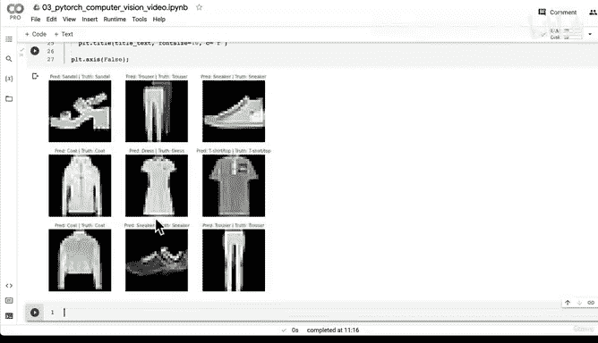

Truth trouser。 So that's pretty darn good， right？ See how for me。

 I much appreciate like I much prefer visualizing things。 Numbers on a page look good。

 but there's something， there's nothing quite like visualizing your machine learning models predictions。

 especially when it gets it right。 So how about we select some different random samples up here。

 We could functionize this as well to do like all of this code in one hit。 But that's all right。

 We'll be a bit hacky for now。 So this is just going to randomly sample with no seed at all。

 So your samples might be different to mine。😊。

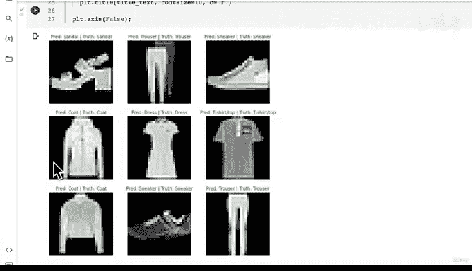

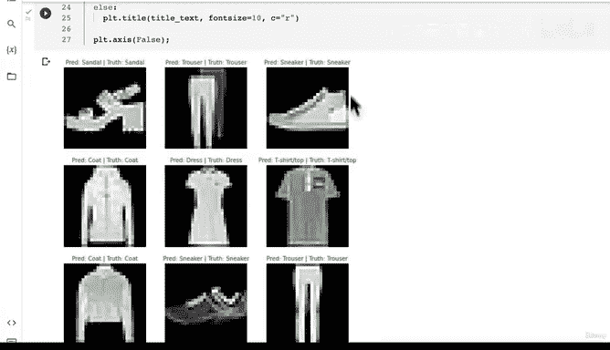

Nine different samples， so this time we have an ankle boot we'll make some predictions。

 we'll just step through all of this code here。And oh， there we go。 It got one wrong。

 So all of these are correct。 But this is more interesting as well。

 is where does your model get things wrong， So it predicted a dress。 But this is a coat。😊。

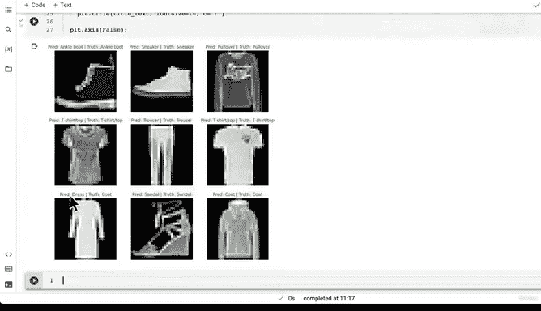

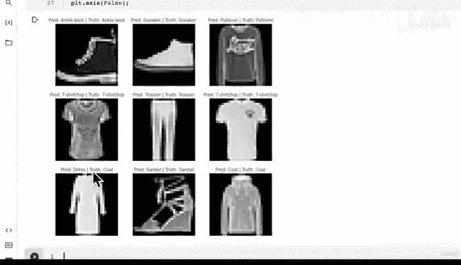

Now， do you think that this could be potentially addressed to me。

 I could see that as being addressed。 So I kind of understand where the model is coming from in there。

 Let's make some more random predictions。

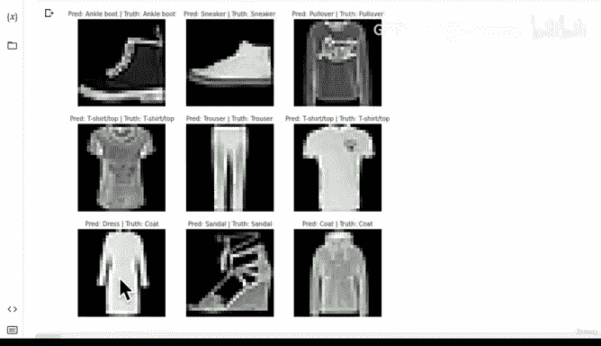

We might do two more of these before we move on to the next video。Oh， all correct。

 We're interested in getting something wrong here。 So our model seems to be too good。😊，Yeah。

All correct again。 Okay， one more time。 if we don't get any wrong， we're going on to the next video。

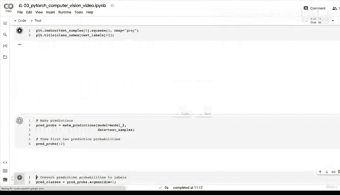

But this is just。Really， oh， there we go。 too wrong。 beautifuli。 So I predicted a dress。

 and that's a shirt。 Okay， I can kind of see where the model might have stuffed up there。

 It's a little bit long for a shirt for me， but I can still understand that that would be a shirt。😊。

And this is a pullover， but the truth is a coat。 So maybe maybe there's some issues with the labels。

 And that's probably what you'll find in a lot of datas， especially quite large ones。

 just for the sheer lo of large numbers， then maybe some truth labels in your datasets that you work with that are wrong。

 And so that's why I like to see compare the model's predictions versus the truth on a bunch of random samples to go you know what is our model's results better or worse than they actually are。

 and that's what visualizing helps you do。 It's figure out。

 you know what our model is actually it says it's good on the accuracy。

 but when we visualize the predictions it's not too good and vice versa right So you can keep playing around with this try look at some more random samples by running this again we'll do one more for good luck。

 and then we'll move on to the next video。 we're going to go on to another way Oh see this is another example。

 Some labels here could be confusing。😊。

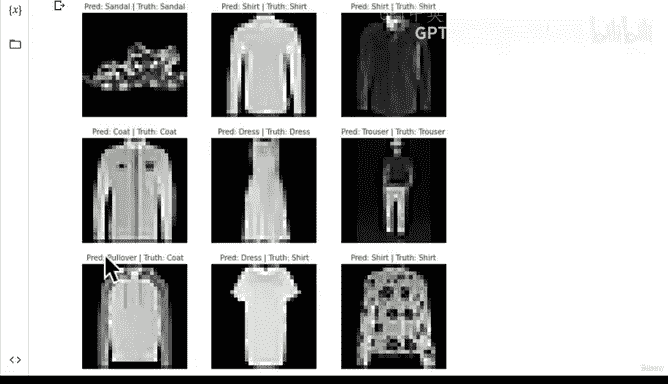

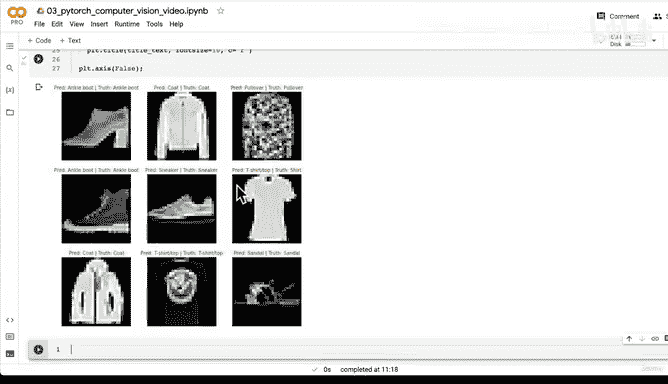

And speaking of confusing， well， that's going to be a spoiler for the next video。

But do you see how the prediction is a t shirt top， but the truth is a shirt to me。

 that label is kind of overlapping like， I don't know。

 what's the difference between a T shirt and a shirt。

So that's something that you'll find as you train models is maybe your model is going to tell you about your data as well。

😡，And so we hinted that this is going to be confused。 The model is confused between T shirt。

 top and shirt。

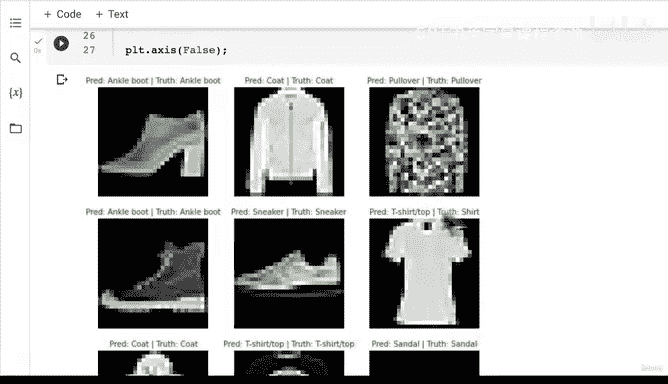

How about we plot a confusion matrix in the next video？I'll see you there。

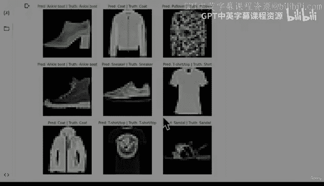