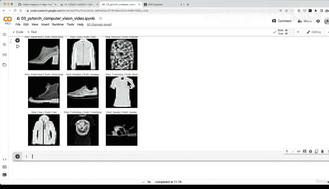
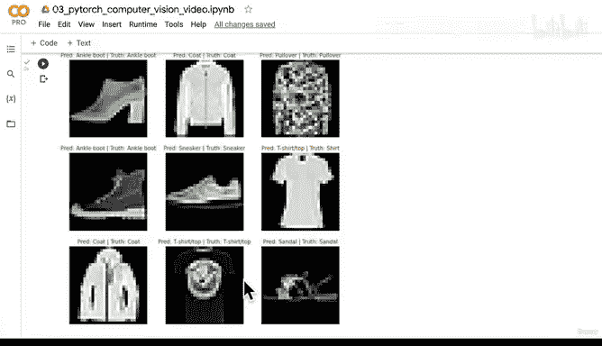
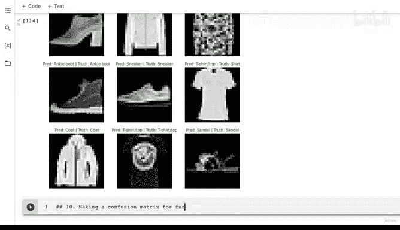
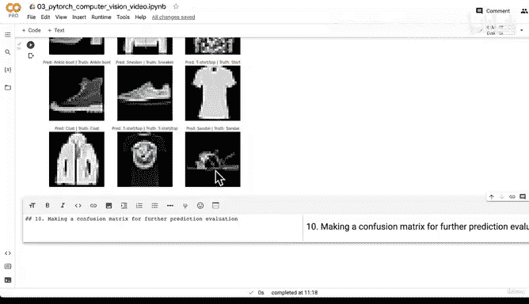
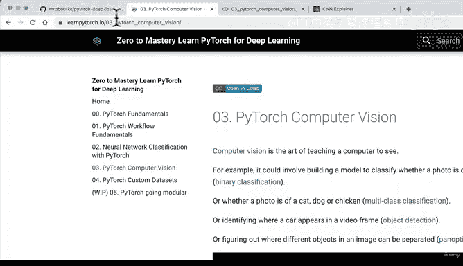
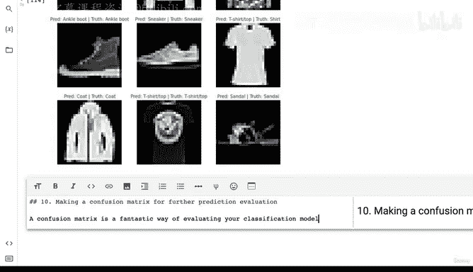
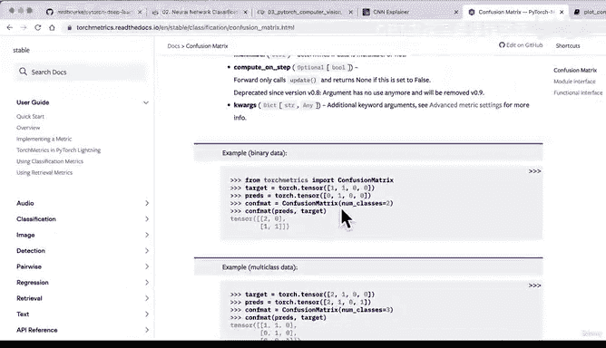

# Daniel Bourke《PyTorch 深度学习｜PyTorch 101 Crash Course For Beginners in 2025》中英字幕 - P127：127_05_031 预测与混淆矩阵绘制库导入.zh_en - GPT中英字幕课程资源 - BV1kTSKB1E9m

We're up to a very exciting point in evaluating our machine learning model and that is visualizing。

 visualizing， visualizing， and we saw that in the previous video our model kind of gets a little bit confused and in fact。

 I would personally get confused at the difference between T shirt slash top and a shirt。😊。

So these kind of insights into our model predictions can also give us insights into maybe some of our labels could be improved。

😊。

And another way to check that is to make a confusion matrix。 So let's do that。

 making a confusion matrix for further。

Prediction。Evaluation now， a confusion matrix is another one of my favorite ways of evaluating a classification model because that's what we're doing。

 We're doing multiclass classification。 And if you recall。

 if we go back to section2 of the Learnptorch。 book。😊。

And then if we scroll down， we have a section here， More classification evaluation metrics。

 So accuracy is probably the gold standard of classification evaluation。 There's precision。

 there's recall， there's F1 score， and there's a confusion matrix here。

 So how about we try to build one of those。 I want to get this and copy this。😊，So and write down。

A confusion matrix is a fantastic way of evaluating your classification models。😊。

Visually。Beautiful。So we're going to break this down。 first of all。

 we need to to plot a confusion matrix， we need to make predictions with our trained model。😊。

On the test data set。Number two， we're going to make a confusion matrix。

 and to do so we're going to leverage torch metrics， tricks after to figure out how to spell metrics。

 and confusion matrix。So recall that torch metrics we've touched on this before is a great package torch metrics for。

😊，A whole bunch of evaluation metrics of machine learning models。And piey taught flavor。

So if we find we've got classification metrics， we've got audio image detection lookout。

 This is beautiful。 A bunch of different evaluation metrics。 And if we go down over here。

 we've got confusion matrix。😊，So I only touched on five here， but or six。

 but if you look at torch metrics， they've got， how many is that about 25 different classification metrics。

 So if you want some extra curriculum you can read through these。But let's go to Con matrixtri。

And if we look at some code here， we've got torch metrics， confusion matrix。

 we need a pass in number of classes。 we can normalize if we want。

And you notice how this is quite similar to the Ptorrch documentation。

 well that's the beautiful thing about torch metrics is that it's created with pietorrch in mind。😊。

So let's try out if you wanted to try it out on some。Test a code， you could do it here。

 but since we've already got some of our own code， let's just bring in this。

And then number three is to plot it。😡，We've got another helper package here。

Ploot the confusion matrix。Using MLXend So this is another one of my favorite helper libraries for machine learning things it's got a lot of functionality that you can code up yourself。

 but you often find yourself coding it a few too many times such as plotting a confusion matrix。

 So if we look up ML extend plot confusion matrix。😊，This is a wonderful library， I believe it was。

It was created by。Yeah， Sebastian Rushka， who's a machine learning researcher and also author of a great book。

 There is。 Yeah， this is a side note， Mach learning with Ptorrch andsit loan。 I just got this book。

 It just got released in the start of 2022。 And it's a great book。

 So that's a little side note for learning more about machine learning with Piytorrch ands kit loan。

 So shout out to Sebastian Rushka。 Thank you for this package as well。 This is going to just help us。

 P a confusion matrix like this。 So we'll have our predicted labels on the bottom and our true labels on the side here。

 But we can just copy this code in here。😊，Link sorry， and then confusion matrix。

 we can copy that in here。The thing is that torch metrics doesn't come with Google Coab。

 So if you're using Google Colaab， I think ML L extendend does。

 but we need a certain version of ML extend that Google Coab doesn't yet have。 Yeah。

 so we actually need version 0。19。0。But we're going to import those in a second。

 Let's first make some predictions across our entire test data set。So previously。

 we made some predictions only on nine random samples。So random sample， we selected9。 You could。

 of course， change this number to make it or more， but this was only on9 samples。

 Let's write some code to make predictions across our entire test data set。So import tqdm。ordo。

For progress bar tracking。CQDM auto， we don't need to re importport it。

 I believe we've already got it above， but I'm just going to do it anyway for completeness。

 And so we're going to make。This is step one。Above。Make predictions。Make predictions with。

Trained model。 Our trained model is model 2。 So let's create an empty predictions list。

So we can add our predictions to that， we're going to set our model into evaluation mode。😊。

And we're going to set with torch inference mode as our context manager。 and then inside that。

 let's just build the same sort of code that we used for our testing loop。

Except this time we're going to aend of our predictions to a list。

So we're going to iterate through the test data loader。And we can give our TQDM description。

We're going to say making predictions do dot， you'll see what that looks like in a minute。

And here we are going to send the data。And Ta to target device。So x， Y equals x。Two device。And why。

Two device。Wonderful， and we're going to do the forwardd pass。😊，So we're going to create Y Loit。

Remember， the raw outputs of a model with a linear layer at the end are referred to as logits。

And we don't need to calculate the loss， but we want to turn predictions。

From logits to prediction probabilities。To prediction。Labels。So we'll set here why pre equals torch。

ofmax， you could actually skip the torch softmax step if you wanted to and just take the argm of the Loitts。

 but we will just go from prediction probabilities to pre labels for completeness。😊，So。Squeeze。

 and we're going to do it across the first dimension or the0th dimension。

 and then we'll take the arg max of that across the first dimension as well。 and a little tidbit。

 if you take different dimensions here， you'll probably get different values。

 So just check the inputs and outputs of your code to make sure you're using the right dimension here。

And so let's go put predictions。On CPUU for evaluation。Because if we're going to plot anything。

 and that plot lid will want them on the CPU， so we're going to ourend our predictions to Ypres。

 yPread。cpu。Beautiful and because we're going to have a list of different predictions we can use concatenate。

😊，List of predictions。Into a tensor， so let's just print out ypre and so I can show you what it looks like。

 And then if we go why pre。Tensor， this is going to turn our list of predictions into a single tensor。

And then we'll go why pre。Tensor and we'll view the first10。Let's see if this works。

So making predictions， oh， would you look at that？Okay， so yeah， here's our list of predictions。😊。

A big list of tensesors。Right， we don't really want it like that。

 So if we get rid of that and there's our progress bar。

 it's going through each batch in the test data loader。 So there's 313 batches of 32。

So if we comment out print wide pres。This line here at torch dot cat Y Pres is going to turn this。

 these tensors into a single tensor or this list of tensors into a single tensor， concatenate。

Now if we have a look， there we go， beautiful and if we have a look at the whole thing。

 we're making predictions every single time here， but that's all right， they are pretty quick。

 there we go。😊，One big long tensor。 And then if we check length， wide pre tensor。

 there should be one prediction per test sample。10000 beautiful。 So now we're going to。

 we need to install torch metrics because torch metrics doesn't come with Google Coab at the time of recording。

 So let me just show you if we tried to import torch metrics。😊，It doesn't it might in the future。

 so just keep that in mind it might come with Google Co Laab because it's a pretty useful package。😊。

But let's now install， see if required packages are installed and if not。Install them。

So we'll just install torch metrics， we'll finish up this video by。😊。

Trying to import we'll set up a try and accept loop so Python is going to try import Torch metrics and ML extendend。

 I write it like this because you may already have torch metrics and MLXend if you're running this code on a local machine but if you're running it in Google Coab which I'm sure many of you are we are going to try and import it anyway and if it doesn't work we're going to install it。

So ML I' extend， I'm just going to check the version here because we need version for our plot confusion matrix function。

This one， we need version 0。19。0 or higher。So I'm just going to write a little statement here。Assert。

Int MLlXend dot version。So if these two， if this condition in the try loop is or try block is accepted。

 it will skip the next step。Dot split。 And I'm just going to check the first index string equals。

Is greater than L equal to 19 otherwise I'm going to return an error saying ML extend version should be。

0。19。0 or higher。And so let me just show you what this looks like。If we run this here。String and int。

 Did I not turn it into a string。Oh， excuse me。There we go。And I don't need that bracket on the end。

There we go so that's what I'm saying so this is just saying， hey。

 the version of MLX that you have should be zero or should be 19 or higher。😊，Because right now。

 Google Colab by default has 14。 This may change in the future。

 So let's finish off this accept block。If the above condition fails， which it should。

 we are going to。Pip install， so we're going to install this into Google Co Lab Torch metrics。

 we're going to do it quietly， and we're also going to pass the U tag for update MLL extend。So。

 import。Torch metrics， ML extend afterwards， after it's been installed and upgraded and print。

 we're going to go ML extend version。You're going to go ML， extend。Unders version。

And let's see what happens if we run this。So we should see， yes， some installation happening here。

 This is going to install torch metrics。Oh， do we not have ML extend the upgraded version？😊。

Let's have a look， we may need to restart our Google Coabab instance。Okay， let's take this off。Quiet。

Is this going to tell us to restart Google CoLb？Well， let's restart our runtime。

After you've run this cell。If you're using Google Collab。

 you may have to restart your runtime to reflect the fact that we have the updated version of ML extendtend。

 So I'm going to restart my runtime now。Otherwise， we won't be able to plot our confusion matrix。

 We need 0。19。0。And I'm going to run all of these cells， I'm going to pause a video here。

 run all of the cells by clicking Run All note if you run into any errors。

 you will have to run those cells manually， and then I'm going to get back down to this cell and make sure that I have ML extendend version 0。

1。9。I'll see， in a few seconds。I'm back and just a little heads up。

 If you restart your run time and click Run all， your coab notebook will stop running cells if it runs into an error。

 So this is that error we found in a previous video where our data and model were on different devices。

 So to skip past that， we can just jump to the next cell。 and we can click run。😊，After there we go。

 And it's going to run all of the cells after for us。 It's going to retrain our models。

Everything's going to get rerun。 and then we're going to come right back down to where we were before。

 trying to install the updated version of ML L Xend。

 I'm going to write some more code while our code is running。Import ML extend。

 and then I'm going to just make sure that we've got the right version here。

You may require a runtime restart， you may not so just try to see after you've run this install of torch metrics and upgrade of MLXend。

 see if you can reimport ML extend and if you have the version 0。19。

0 or above we should be able to run the code Yeah there we go wonderful ML extend 0。19。0。

And we've got ML extendend version， assert。Import。Beautiful， so we've got a lot of extra code here。

In the next video let's move forward with creating a confusion matrix。

 I just wanted to show you how to install and upgrade some packages in Google ColLab if you don't have them。

 but now we've got predictions across our entire test data set and we're going to be moving towards using confusion matrix function here to compare our predictions versus the target data of our test data。

😊。

So I'll see in the next video， let's plot a confusion matrix。😊。

