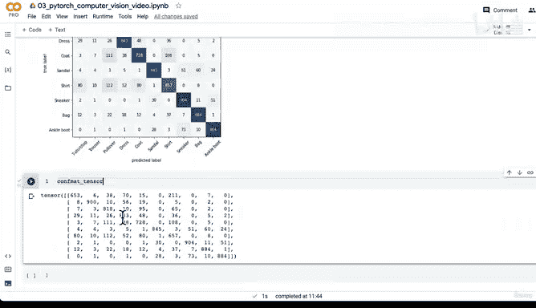

# Daniel Bourke《PyTorch 深度学习｜PyTorch 101 Crash Course For Beginners in 2025》中英字幕 - P128：128_05_032 使用混淆矩阵评估最优模型预测.zh_en - GPT中英字幕课程资源 - BV1kTSKB1E9m

Welcome back In the last video， we wrote a bunch of code to import some extra libraries that we need for plotting a confusion matrix。

 and this is really helpful， by the way， Google Coab comes with a lot of prebuilt installed stuff。

 but definitely later on down the track you're going to need to have some experience installing stuff and this is just one way that you can do it。

😊，We also made predictions across our entire test data set， so we've got 10。

000 predictions in this tensor， and what we're going to do with the confusion matrix is confirm or compare these predictions to the target labels in our test data set。

So we've done step number one。And we've prepared ourselves for step 2 and three by installing torch metrics and installing ML extend or the later version of MLXend。

 so now let's go through step 2 making a confusion matrix and step 3 plotting that confusion matrix This is going to look so good I love how good confusion matrixes look So because we've got torch matrix now we're going to import the confusion matrix class and from ML extendend we're going to go into the plotting module and import plot confusion matrix。

😊，Recall that the documentation for both of these are within torch metrics here and within MLX here。

Let's see what they look like， so number two is set up confusion matrix instance and compare predictions to target。

That's what evaluating a model is right comparing our model's predictions to the target predictions。

 so I'm going to set up a confusion matrix under the variable confmat then I'm going to call the confusion matrix class from Torch Ma and to set up an instance of it I need to pass in the number of classes that we have。

So because we have 10 classes， they are all contained within class names。

 recall that class names is a list of all of the different classes that we're working with。

So I'm just going to pass in the number of classes as the length of our class names。

And then I can use that co mat instance， confusion matrix instance。

 to create a confusion matrix tensor。😊，By passing into Comfmat。

 which is what I've just created up here。Com Matt， just like we do with our loss function。

 I'm going to pass in pres equals our Y pre tensor， which is。Just above。

 why pre tensor that we calculated all of the。Predictions on the test data set。There we go。

 that's our pres and our target is going to be equal to test data。t targets。

And this is our test data data set that we've seen before， So if we go test data and press tabab。

 we've got a bunch of different attributes we can get the classes。😊，And of course。

 we can get the targets， which is the labels。Pytorch calls labels targets。

 I usually refer to them as labels but the target is the test data target。

 so we want to compare our model' predictions on the test data set to our test data targets。

And so let's keep going forward。 We're up to step number three3 now。

 So this is going to create our confusion matrix tensor。 Oh， let's see what that looks like。

 actually。😊，Com from that Tensor。Oh， okay。So we've got a fair bit going on here。

 but let's turn this into a pretty version of this。

 So along the bottom is going to be our predicted labels。

 and along the side here is going to be our true labels。

 But this is where the power of MLLX 10 comes in。We're going to plot our confusion matrix。

So let's create a figure and an aes。We're going to call the function plot confusion matrix。

That we've just imported above。And we're going to pass in our Com format。Equals our Comf mat tensor。

 but because we're working with a matpl Lib， it'll want it as nuy。So I'm just going to write here。

Mapplot Lib likes working with。Numpie。And we're going to pass in the class name so that we get labels for each of our rows and columns。

Class names， this is just a list of our text based class names。

 and then I'm going to set the fig size to my favorite hand and poker， which is 107。

Also happens to be a good dimension for Google Collab。 Look at that。

Oh that is something beautiful to see。 Now， a confusion matrix。

 the ideal confusion matrix will have all of the diagonal rows。😊。

Darkened with all of the values and no values here and no values here。

 because that means that the predicted label lines up with the true label。 So in our case。

 we have definitely a very dark diagonal here。 But let's dive into some of the highest numbers here。

 It looks like our model is predicting shirt。 When the true label is actually T shirt slashed top。

 So that is reflective of what we saw before。 Do we still have that image there。Okay。

 we don't have an image there， but in a previous video， we saw that when we plotted our predictions。

The model predicted t-shirt slash top when it was actually a shirt。 And of course， vice versa。

 So what's another one here。 It looks like our model is predicting shirt， when it's actually a coat。

 now this is something that you can use to visually inspect your data to see if the errors that your model is making make sense from a visual perspective。

 So it's getting confused by predicting pullover when the actual label is coat。

 predicting pullover when the actual label is shirt。

 So a lot of these things clothing wise and data wise may， in fact， look quite the same。

 Here's a relatively large one as well。 It's predicting sneaker when it should be an ankle boot。

 So it's confusing two different types of shoes there。😊。

So this is just a way to further evaluate your model and start to go。

 maybe our labels are a little bit confusing。 Could we expand them a little bit more。

 So keep that in mind。 A confusion matrix is one of the most powerful ways to visualize your classification model predictions。

And a really， really， really helpful way of creating one is to use torch matrix confusion matrix and to plot it。

😊，You can use plot Con matrixtrix from MLXtend， however， if you're using Google CoLB for these。

 you may need to import them or install them。So that's a confusion matrix。

 if you would like more classification metrics， you've got them here and you've got of course。

 more in torch metrics， so give that a look， I think in the next video。😊。

We've done a fair bit of evaluation。 Where are we up to in our workflow。

I believe it's time we saved and loaded our best trained model。 So let's give that a go。

 I'll see you in the next video。😊。

