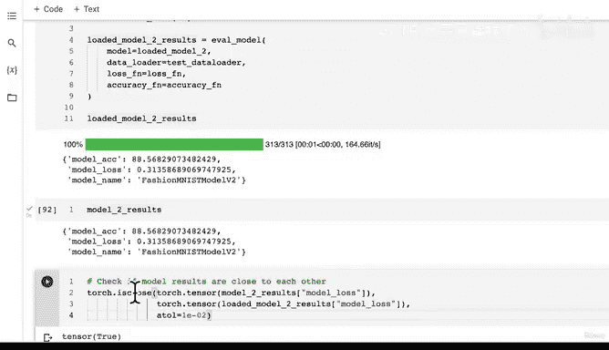

# Daniel Bourke《PyTorch 深度学习｜PyTorch 101 Crash Course For Beginners in 2025》中英字幕 - P129：129_05_033 保存与加载最优性能模型.zh_en - GPT中英字幕课程资源 - BV1kTSKB1E9m

In the last video， we created our beautiful confusion matrix with the power of torch matrix。😊。

And M' extend。 But now it's time to save and load our best model because if we， if we evaluated it。

 our convolutional neural network can go， you know what， this models pretty good。

 Let's export it to a file so we can use it somewhere else。 Let's see how we do that。 And by the way。

 if we go into our keynote。😊，We've got evaluateval model。Torch metrics。

 We've been through this a fair few times now。 We've improved through experimentation。

 We haven't used Tensor board yet， but that'll be in a later video。

And save and reload your train model So here's where we're up to if we've gone through all these steps enough times and we're like you know what。

 let's save our model so we can use it elsewhere and we can reload it in to make sure that its it's saved correctly。

😊，Let's go through this step。 We want number 11。I'm going to go save and load best performing model you may have already done this before。

 so if you've been through the other parts of the course you definitely have so if you want to give that a go。

Pause the video now and try it out yourself。 I believe we did it in notebook number one。We have。

Here we go。 saving and loading a pie torch model。 You can go through this section of section number one on your own and see if you can do it。

 Otherwise， let's code it out together。 So I'm going to start from with importing。

Path from Partth Lib because I like to create a model directory path。So create model directory path。

 So my model path is going to be set equal to path。 and I'm going to save it to models。

 This is where I want to。I want to create file over here called models。And save my models to there。

Modelpath dotmkD for make directory。Parents， yes， I want to make the parent directories if they don't exist and exist okay。

 also equals true so if we try to create it， but it's already existing， we're not going to get error。

That's fine。And next， we are going to create a model save path。

Just going to add some code cells here so I have more space。Let's pass in here a model name。

I'mGoing to set this equal to since we're on section three， I'm going to call this03 pi torch。

Computer vision。Model 2 is our best model and I'm going to save it to PTH。For Pi towach。

 you can also save it to dot PT。😡，I like to use PTH。And we're going to go model save path equal。

Model path slash model name。 So now if we have a look at this。

 we're going to have a path called model save path， but it's going to be a Posits path。

In models 03 Pytorch Computer Vision， Model2。pt， and if we have a look over here。We should have。

 yeah， we have a models directory now。That's not going to have anything in it at the moment。

 We've got our data directory that we had before。 There's fashionash Mn。

 This is a good way to start setting up your directories。 Bre them down data， models。

 helper function files， etc cetera。 But let's keep going。Let's save。Save the model state dict。

We're going to go print。Saving model two， she's going to give us some。

Information about what's happening。Model save path， and we can save a model by calling torch。

Dot save and we pass in the object that we want to save using the object parameter OBj。

And we get a dock string there。We're going to go model 2， we want to save the state d。

 recall that the state dict is going to be our models what。

Our models learned parameters on the data set。 So all the weights and biases and all that sort of jazz。

Beautiful， so when we first created Model 2， these were all random numbers。 They've been。

 or since we trained Model 2 on our training data， these have all been updated to represent the training images。

😊，And we can leverage these later on， as you've seen before， to make predictions。

 so I'm not going to go through all those， but that's what we're saving。

And the file path is going to be our model save path。 So let's run this and see what happens。

Beautiful， we're saving our model to our model directory。And now let's have a look in here。

 Do we have a model。 Yes， we do。 beautiful。 So let's how quickly we can save a model。 Of course。

 you can customize what the name is， where you save it， etc cetera， etc cetera。 Now。

 let's see what happens when we load it in。😊，So create a new instance because we only save the state di of Model 2。

 we need to create a new instance of our Model 2 or how it was created which was with our class fashion MNT V2。

😊，If we saved the whole model， we could just import it to a new variable。

 but I'll let you read back more on that on the different ways of saving a model in here。

 there's also a link to the Pytoch documentation would highly recommend that。

But let's see it in action， we need to create a new instance of our fashion Ms model， V2。

Which is our convolutional neural network， so I'm going to set the manual seed。😊。

That way when we create a new instance， it's instantiated with the same random numbers。

So we're going to set up loaded Model two equals。Fashion Mnes， V 2。

And it's important here that we set it up with the same parameters as our original saved model。

So fashion Mnest V2。 Oh， we got a typo here。O fashion Amnesist Model V 2。Wonderful。

 so the input shape is going to be one because that is the number of color channels in our test in our images。

Test image dot shape。 Do we still have a test image。Should be， well， we've created a different one。

 but our image size， our image shape is 1，28，28。Image shape。Forour color channels。Height width。

 then we create it with hidden units。 We use 10 for hidden units so we can just set that here。

This is important they just have to otherwise if the shapes aren't the same。

 what are we going to get， we're going to get a shape mismatch error and our output shape is what。😊。

Is also going to be 10 or length of class names。If you have the class names variable instantiated that is。

😊，So we're going to load in the saved state dick， the one that we just saved。

So we can go loaded Model2。Dot load state deck。And we can pass in torch。

 load in here and the file that we want to load or the file path is model Sa path。Up here。

 this is why I like to just save my path variables to a variable so that I can just use them later on instead of retyping out this all the time。

 which is definitely prone to errors。So we're going to send the model to the target device。

Loaded Model2。Dot2 device。Beautiful， let's see what happens here。Wonderful。

So let's now evaluate the loaded model。So evaluate loaded model。

 the results should be very much the same as our Model 2 results。So Model  two results。

So this is what we're looking for。 We want to make sure that our saved model saved these results pretty closely。

 Now I say pretty closely because you might find some discrepancies in this lower these lower decimals here just because of the way files get saved and something gets lost。

 etc cea， etc。 So that's just to do with precision and computing。

 but as long as like the first few numbers are quite similar well， then we're all gravy。

 So let's go torch。Manual seed。Remember， evaluating a model is almost as well。

 is just as important as training a model。 So this is what we're doing。

 We' making sure our model saved correctly before we deployed it。 If it didn't。

 if we deployed it and it didn't save correctly。 Well， then we'd get our。

We would get less than ideal results wouldn't we so model equals loaded Model2。

 we're going to use our same ofval model function， by the way。And of course。

 we're going to evaluate it on the same test data set that we've been using， test data loader。

And we're going to create a loss function or just putting in our loss function that we've created before。

 and our accuracy function is the accuracy function we've been using throughout this notebook。😊。

So now let's check out loaded Model 2 results， they should be quite similar to this one。

We're going to make some predictions， and then if we go down。Do we have the same numbers， Yes， we do。

 So we have 5，6，8，29，5，6，8，2，9， wonderfulnder and 3，1，3，5，8，3，1，3，5，8。

 beautiful it looks like our loaded model gets the same results as our previously trained model before we even saved it。

 And if you wanted to check if they were close， you can also use torch dot is close。

 check if model results。 If you wanted to check if they were close programmatically， that is。

 because we just looked at these visually。😊，Check if model results are close to each other。

Now we can go torch is close。We're going to pass in torch。tensor。

 we have to turn these values into a tensor。We're going to go model two results。

And we'll compare the。Model loss。 How about we do that。

 We want to make sure the loss values are the same。Or very close that is with Torchdot is close。

Toorch。tensar。Or we want this one to be loaded Model2 results。Model loss。

Another bracket on the end there and we'll see how close they are true， wonderful Now。

 if this doesn't return true， you can also adjust the tolerance levels in here。

So we go a toll equals this is going to be the absolute tolerance。 so if we do one to the negative8。

 it's saying like hey， we need to make sure our results are basically the same up to eight decimal points。

 that's probably quite low， I would say just make sure they're at least within two。

But if you're getting discrepancies here between your saved model and your loaded model or sorry。

 this model here， the original one and your loaded model， if they are quite large。

 So they are like more than a few decimal points off in this column or even here。

 I'd go back through your code and make sure that your model is saving correctly。

 make sure you've got random seeds set up。 But if they're pretty close like in terms of within three or two decimal places of each other。

 well then I'd say that's close enough， but you can also adjust the tolerance level here to check if your model results are close enough programmatically。

Wow， we have covered a fair bit here。 We've gone through this entire workflow for a computer vision problem。

Let's are in the next video， I think that's enough code for this section， section 3。

 Ptorrch Comp vision， I've got some exercises and some extracur lined up for you。

 so let's have a look at those in the next video。😊，I'll see you there。

