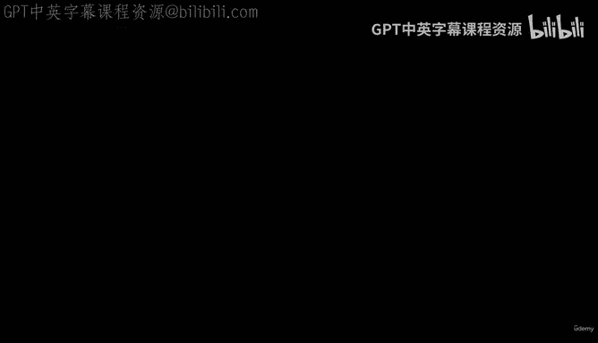
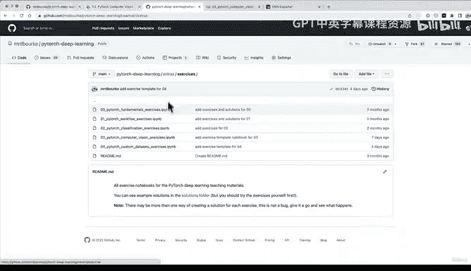

# Daniel Bourke《PyTorch 深度学习｜PyTorch 101 Crash Course For Beginners in 2025》中英字幕 - P130：130_05_034 内容回顾与练习拓展.zh_en - GPT中英字幕课程资源 - BV1kTSKB1E9m

My goodness。 look how much computer vision Pytorrch code we've written together。

 We started off right up the top。 We looked at the reference notebook and the online book。

 We checked out computer vision libraries in Pytorrch， the main one being Torch vision。

 Then we got a dataset set， namely the fashion Mnes data set There are a bunch more dataset sets that we could have looked at。

 And， in fact， I'd encourage you to try some out in the torchvision dot datas。

 Use all of the steps that we've done here to try it on another data set。😊。

We repaired our data loaders， so turned our data into batches。

We built a baseline model which is an important step in machine learning because the baseline model is usually relatively simple and it's going to serve as a baseline that you're going to try and improve upon through。

 just go back to the keynote through various experiments。😊，We then made predictions with Model zero。

 we evaluated it。We timed our predictions to see if running our models on the GPU was faster and we learned that sometimes a GPU won't necessarily speed up code if it's a relatively small data set because of the overheads between copying data from CPU to GP。

We tried a model with non lineararity， and we saw that it didn't really improve upon our baseline model。

 but then we brought in the big guns， a convolutional neural network replicating the CNN explainer website and by gosh。

 didn't we spend a lot of time here。 I'd encourage you as part of your extra curriculum to go through this again and again。

 I still even come back to refer to it too。 I referred to it a lot making the materials for this video section and this code section。

 So be sure to go back and check out the CNN explainer website for more of what's going on behind the scenes of your CNNs。

 but we coded one using pure pie torch that is amazing。

 We compared our model results across different experiments。

 We found that our convolutional neural network。😊，Did the best。

 although it took a little bit longer to train， and we also learned that the training time values will definitely vary depending on the hardware you're using。

 so that's just something to keep in mind。We made an evaluated random predictions with our best model。

 which is an important step in visualizing visualizing visualizing your model's predictions because you could get evaluation metrics。

 but until you start to actually visualize what's going on Well in my case that's how I best understand what my model is thinking we saw a confusion matrix using two different libraries torch metrics and MLl extend a great way to evaluate your classification models and we saw how to save and load the best performing model to file and made sure that the results of our save model weren't too different from the model that we trained within the notebook So now it is time。

😊，I'd love for you to practice what you've gone through。

 This is actually really exciting now because you've gone through an end to end computer vision problem。

 I've got some exercises prepared。 If you go to the Learnptorrch doo website in Section 03。 Sc down。

 You can read through all of this。 This is all the materials that we've just covered in pure code。

 there's a lot of pitch in this notebook2 that are helpful to learn things what's going on。

 We have some exercises here。 So all of the exercises are focused on practicing the code and the sections above。

 we have two resources， we also have some extra curriculum that I've put together。

 If you want an in depth understanding of what's going on behind the scenes in the convolutional neural networks because we focused a lot on code。

 Id highly recommend Mit's induction to deep computer vision lecture。😊。

You can spend 10 minutes clicking through the different options in the Py Torch Viion library。

 Torch Vi， look up most common convolutional neural networks in the Torch Viion model library。😊。

And then for a larger number of pretrain pitorrch computer vision models。

 and if you get deeper into computer vision， you're probably going to run into the Torch image models library。

 otherwise known as10， but I'm going to leave that as X curriculum I'm going to just link this exercises section here again it's at learnpytororch。

 in the exercises section we come down。😡，There we go。But there is also resource here。

 an exercise template notebook， so we've got one， one or three areas in industry where computer vision has been currently used。

Now this is in the Pytorch deep learning repo extratras exercises number3。

 I've put out some template code here for you to fill in these different sections。

 so some of them are code related， some of them are just text based。

 but they should all be able to be completed by referencing what we've gone through in this notebook here。

And just as one more， if we go back to Pytor deep learning。

This will probably be updated by the time you get here。

 You can always find the exercise and extra curriculum by going computer vision。

 go to exercise an extra curriculum， or if we go into the extras file and then we go to solutions。

 I've now also started to add video walkthroughs of each of the solutions。

 So this is me going through。Each of the exercises myself and coding them。

 And so you'll get to see they're unedited videos。 So they're just one long live stream。

 and they've done some for 0203 and 04。 and there will be more here by the time you watch this video。

 But if you'd like to see how I figure out the solutions to the exercises。

 you can watch those videos and go through them yourself。 But first and foremost。

 I would highly recommend trying out the exercises on your own first。 And then if you get stuck。

 refer to the notebook here， refer to the Pytorch documentation。 And finally。

 you can check out what I would have coded as a potential solution。

 So there's number3 computer vision exercise solutions。 So congratulations。

 on going through the Pytorch computer vision section。😊。

I'll see you in the next section， we're going to look at Plytorch custom datas。But no spoilers。

I'll see you soon。