# Daniel Bourke《PyTorch 深度学习｜PyTorch 101 Crash Course For Beginners in 2025》中英字幕 - P131：131_06_001 自定义数据集概念与内容规划.zh_en - GPT中英字幕课程资源 - BV1kTSKB1E9m

Hello， hello， hello and welcome to Section number 4 of the Learn Pyth told for deep Learning course。

 We have custom data sets with。😊，Pytorch。 Now， before we dive into what we're going to cover。

 let's answer the most important question。 Where can you get help Now。

 we've been through this a few times now， but it's important to reiterate。

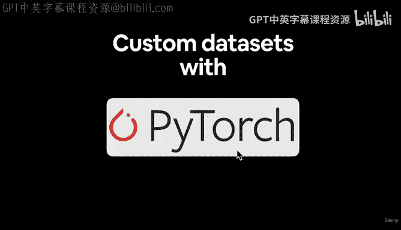

Follow along with the code as best you can， We're going to be writing a bunch of pieytorrch code。😡。

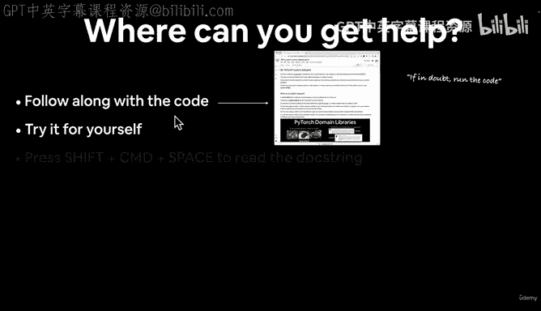

Remember the motto， if in doubt， run the code。 That's in line with try it for yourself。

 If you'd like to read or read the doc string， you can press shift command plus space in Google Coab。

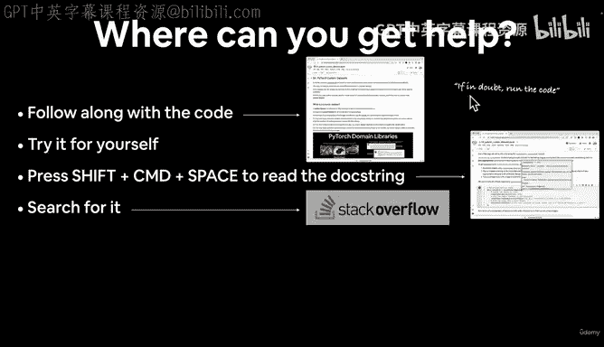

Or if you're on Windows， command might be control。Then if you're still stuck， you can search for it。

 Two of the resources you will probably come across is stack overflow or the wonderful Pytorage documentation。

 which we've had a lot of experience with so far。 Then， of course， try again。

 go back through your code if and doubt， code it out or if and doubt， run the code。 And then finally。

 if you're still stuck， ask a question on the Pytorage deep learning Disc Github page。

 So if I click this link。 We come to Mr。 De Burke slash Pytorage deep learning。 the URL is here。

 we've seen this before。 If you have a trouble or a problem with any of the course。

 you can start a discussion。😊。

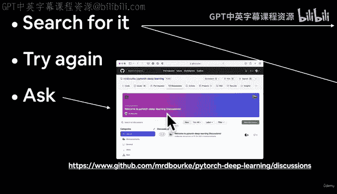

And you can select a category， general ideas， polls， Q& A， and then we can go here video。

 put the video number in， So 99， for example。My code doesn't do what I'd like it to。

So say your problem。And then come in here， write some code here。😊，Code here and then my question is。

Something something something click start discussion and then we can help out and then if we come back to discussions of course you can search for what's going on so if you have an error and you feel like someone else might have seen this error。

 you can of course search it and find out what's happening。😊。

Now I just want to highlight again the resources for this course are at Learnpytororch。

o we are up to section 4。 This is a beautiful online book version of all the materials we are going to cover in this section so spoiler alert。

 you can use this as a reference and then of course in the Github We have the same notebook here。

 Pytorch custom datas This is the ground truth notebook So check that out if you get stuck。😊。

So I'm just going to exit out of this， I've got Pytoch custom data sets at learn Pytoch。o。

 and then of course the discussions tab for the Q&A。😊。

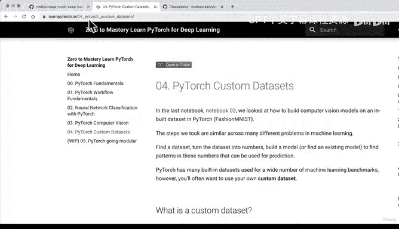

Now， if we jump back to the keynote， what do we have？We might be asking。What is a custom data set。

 Now， we've built a fair few Pytorrch deep learning neural networks so far on various data sets such as fashion Mnist。

 But you might be wondering， hey， I've got my own data set， or I'm working on my own problem。

 Can I build a model with pieytorrch to predict on that data set。And the answer is yes， however。

 you do have to go through a few pre processingces steps to make that data set compatible with Pytorch。

 and that's what we're going to be covering in this section。

And so I'd like to highlight the Pytorch domain libraries。 Now。

 we've had a little bit of experience before with torch vision。

 such as if we wanted to classify whether a photo was a pizza， steak or sushi。

 so a computer vision image classification problem。😊。

Now there's also text， such as if these reviews are positive or negative。

And then you can use torch text for that。But again。

 these are only just one problem within the vision space， within the text space。

I want you to just understand that if you have any type of vision data。

 you probably want to look into torch vision and if you have any kind of text data。

 you probably want to look into torch text。 and then if you have audio such as if you wanted to classify what song was playing。

 this is what Chizam does。😡，It uses the input sound of some sort of music and then runs a neural network over it to classify it to a certain song。

 You can look into torch audio for that。 And then if you'd like to recommend something such as you ever have an online store or if you're Netflix or something like that and you'd like to have a homeage that updates for recommendations。

 you'd like to look into Torch Re， which stands for recommendations system And so this is just something to keep in mind。

😊。

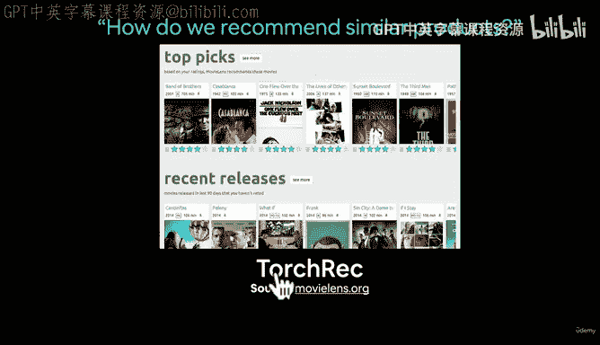

Because each of these domain libraries has a data sets module that helps you work with different data sets from different domains。

 and so different domain libraries contain data loading functions for different data sources。

 So Torch vision let's just go into the next slide we have problem space vision。😊。

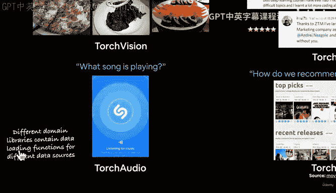

For prebuilt data sets or existing data sets like we've seen with fashion Mist。

 as well as functions to load your own vision dataset sets。

 you'll want to look into torchvision do data sets。 So if we click on this。

 we have built in data sets。 this is the Ptorrch documentation。 And if we go here。

 we have torch audio， Torch text， Torch vision， Torch rack， Torch data。 Now。

 at the time of recording， which is April 2022。 this is torch data is currently in beta。

 but it's going to be updated over time。 So just keep this in mind。

 updated over time to add even more ways to load different data resources。

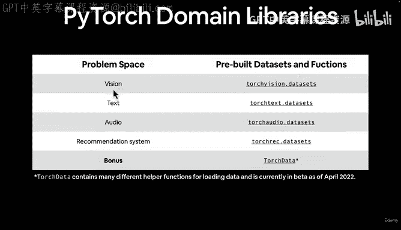

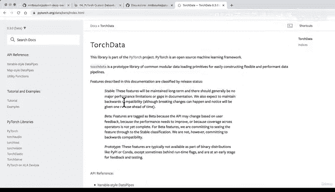

But for now， we're just going to get familiar with torch vision data sets。

 If we went into torch text， there's another torch text dot data sets。

And then if we went into torch audio， we have torch audio data sets。

 And so you're noticing a trend here that depending on the domain you're working in。

 whether it be vision， text， audio or your data is recommendation data。

 you'll probably want to look into its custom library within Pitorrch。 and of course。

 the bonus is torch data， it contains many different helper functions for loading data and is currently in beta as of April 22。

 So 2022 so that by the time you watch this torch data may be out of beta。

 and then that should be something that's extra curriculum on top of what we're going to cover in this section。

😊。

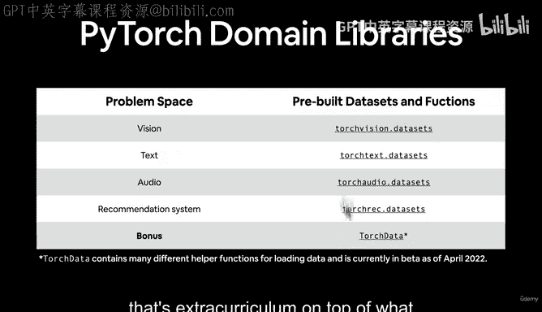

So let's keep going。So this is what we're going to work towards building。Food vision mini。

 So we're going to load some data， namely some images of pizza。

 sushi and steak from the Food 101 data set。 We're going to build an image classification model such as the model that might power a food vision recognition app or a food image recognition app。

And then we're going to see if we can classify an image of pizza as pizza。

 an image of sushi as sushi and an image of steak as steak。

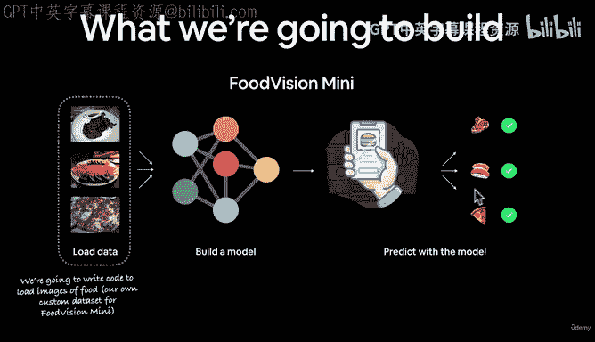

So this is what we're going to focus on。 We want to load。

 say we had images existing already of pizza， sushi and steak。

 We want to write some code to load these images of food。

 So our own custom data set for building this food visionion mini model。

 which is quite similar to if you go to， this is the project I'm working on personally nurify dot app。

😊。

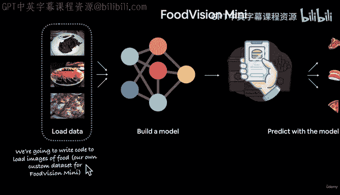

This is a food image recognition model。Here we go。 So it's still a work in progress as I'm going through it。

 but you can upload an image of food， and nuutrify will try to classify what type of food it is。

 So do we have steak There we go， Let's upload that。 Beaiful St。

 So we're going to be building a similar model to what powers nurify。😊。

And then there's the macronutrients for the stake ya， if you'd like to find out how it works。

 I've got all the links here， but that's at nuchafin app。

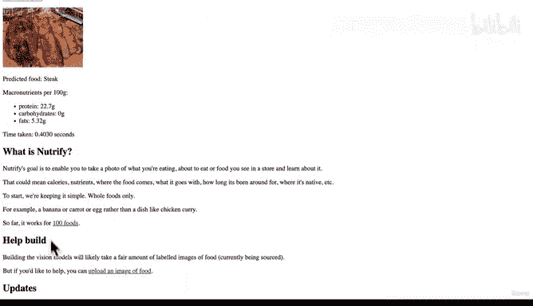

So let's keep pushing forward， we'll go back to the keynote。This is what we're working towards。

 as I said we want to load these images into Pytorrch so that we can build a model。

 we've already built a computer vision model。😡，So we want to figure out how do we get our own data into that computer vision model？

😊。

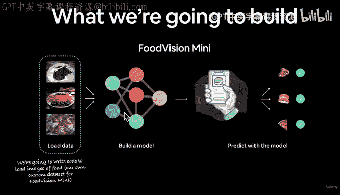

And so of course， we'll be adhering to our Pytorch workflow。

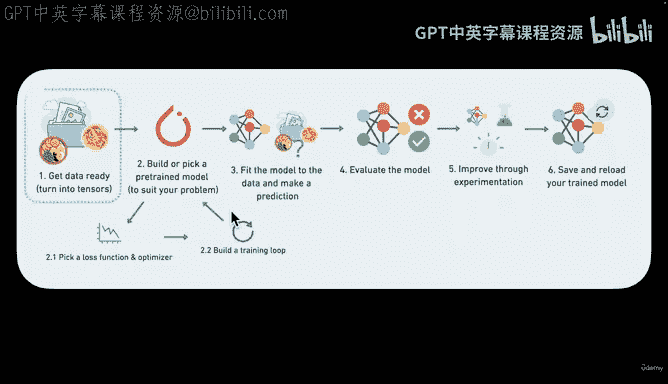

That we've used a few times now。So we're going to learn how to load a data set with our own custom data rather than an existing data set within Pytorch。

We'll see how we can build a model to fit our own custom data set。

 We'll go through all the steps that's involved in training a model such as picking a loss function and an optimizer。

 We'll build a training loop。Will evaluate our model。We'll improve through experimentation。

 and then we can see save and reloading our model， but we're also going to practice predicting on our own custom data。

 which is a very， very important step whenever training your own models。

 So what we're going to cover broadly。😊，We're going to get a custom data set with Pytoch。

 As we' said， we're going to become one with the data。 In other words， preparing and visualizing it。

 We'll learn how to transform data for use with a model。 very important step。

 We'll see how we can load custom data with pre builtil functions， and our own custom functions。😊。

We'll build a computer vision model， AK Food Viion Min， to classify pizza， steak and sushi images。

 So a multi class classification model We'll compare models with and without data augmentation。

 We haven't covered that yet， but we will later on。And finally， we'll see how we can， as I said。

 make predictions on custom data， so this means data that's not within our training or our test data set。

😊，And how are we going to do it？ Well， we could do it cooks or chems。

But I like to treat machine learning as a little bit of an art。

 so we're going to be cooking up lots of code。That being said？I'll see you in Google Co Lab。

 Let's code。

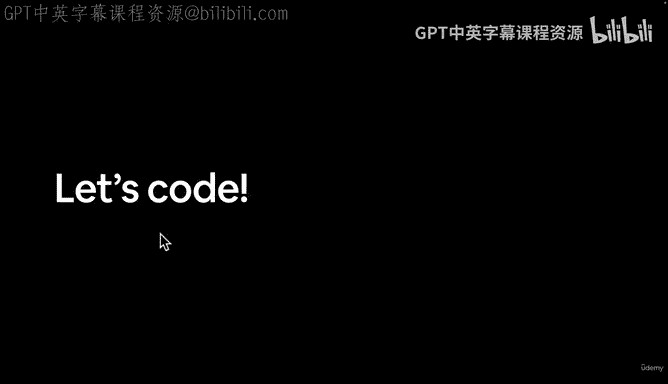