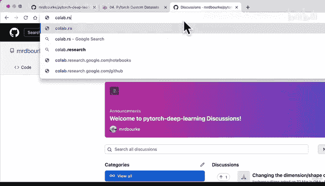
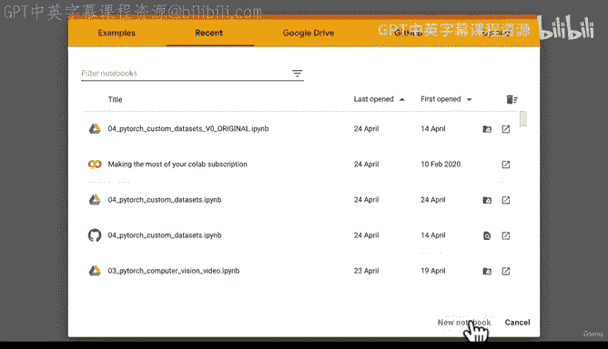
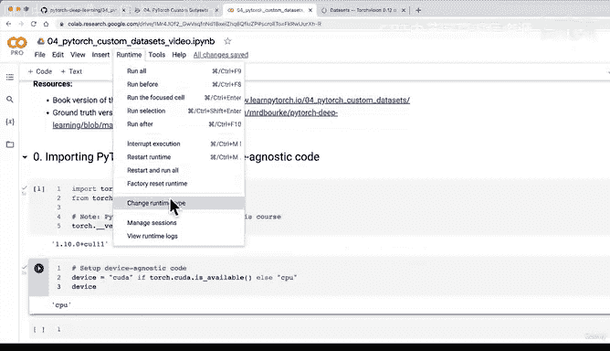
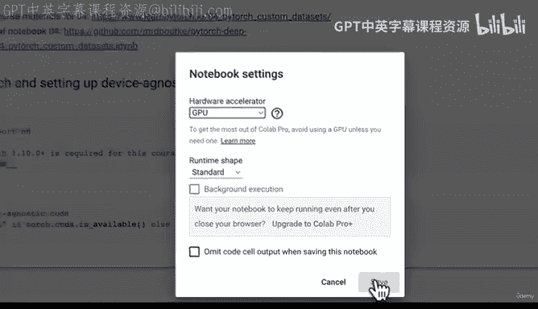
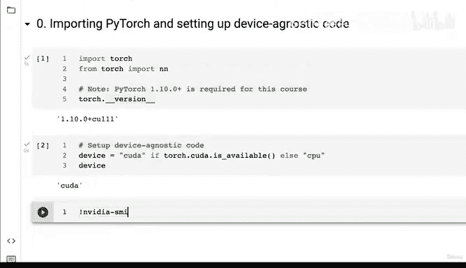

# Daniel Bourke《PyTorch 深度学习｜PyTorch 101 Crash Course For Beginners in 2025》中英字幕 - P132：132_06_002 导入PyTorch与配置设备无关代码.zh_en - GPT中英字幕课程资源 - BV1kTSKB1E9m

Welcome back to the Pylytorch Cook show。 Let's now learn how we can cook up some custom data sets。

 I'm going to jump into Google Coab。 So coabab dot research dot Google dot com。😊。

And I'm going to click new notebook。😡。

Just' going to make sure this is zoomed in enough for the video。Wonderful。

 so I'm going to rename this notebook。04 because we're up to section 04。😊。

And I'm going to call it Pytorch custom datas underscore video because this is going to be one of the video notebooks。

 which has all the code that I write during the videos。

 which is of course contained within the video notebooks folder on the Pytorch deep Learn Repo。😊。

So if you'd like the resource or the ground truth notebook for this。

 I'm going to just put a heading here。04。Pytorrch， custom data sets。Video notebook。Like that bigger。

And then。P resources。So。Book version。Of the course materials。For 04。

We'll go there and then we'll go ground truth version of notebook 04。

 which will be the reference notebook that we're going to use for this section。

Come into to Pytorch custom datas。And then we can put that in there。Wonderful。

 so the whole synopsis of this custom data set section is。😊，We've used some data sets with Pitorrch。

Before。But how do you get your own data into Pytorrch？

Because that's what you want to start working on， right。

 you want to start working on problems of your own。

 You want to come into any sort of data that you've never worked with before and you want to figure out how do you get that into Pytorch。

 So one of the ways to do so。Is viaya。Custom data sets。And then I want to put a note down here。

So we're going to go zero section zero is going to be importing pietorrch and setting up device agnostic。

codeode。But I want to just stress here。That。Domain libraries。So。

Just to reiterate what we went through last video， so depending on what。You're working on。

Whether it be vision。Text， audio， recommendation， something like that。

You'll want to look into each of the pie torch。Domain libraries。For existing。

Data loader or data loading。Functions and customizable。Data loading functions。

So just keep that in mind。 we've seen some of them So if we go torch vision。

 which is what we're going to be looking at。Torch vision。

 we've got data sets and we've got documentation， we've got data sets for each of the other domain libraries here as well。

So if you're working on a text problem， it's going to be a similar set of steps to what we're going to do with our vision problem when we build food Viion Min。

😡，What we have is a data set that exists somewhere。

 and what we want to do is bring that into Pytorrch so we can build a model with it。

So let's import the libraries that we need。 So we're going to import torch and。

We'll probably import Nn。So we'll import that from P torch and I'm just going to check the torch version here。

 So note。We need pietorrch 1。10。0。Plus is required for this course。

 so if you're using Google CoLab at a later date， you may have a later version of Pytorrch。

 I'm just going to show you what version I'm using。I's going to let this load。

We're going to get this ready。 We're going to also set up device agnostic code right from the start this time because this is best practice with Ptorrch。

😊，So this way， if we have a couder device available。

 our model is going to use that couder device and our data is going to be on that couder device。

So there we go， wonderful。 We've got Ptorch 1。10。0 plus Kuda 111。 Maybe that's 11。1。

 So let's check if Kuda dot is available。 Now I'm using Google co Lab。 We haven't set up a GPU yet。

 So it probably won't be available yet。😊，Let's have a look。Wonderful。

 so because we've started a new coab instance， it's going to use the CPU by default。

 So how do we change that， We come up to run time， change runtime type。😊。

I'm going to go hard the accelerator GPU。 We've done this a few times now。

 I am paying for Google Coab Pro。 So one of the benefits of that is that it Google Coabab reserves faster GPUus for you。

 You do not need Google Coab Pro， as I've said to complete this course。 You can use the free version。

 but just recall Google Coabab Pro tends to give you a better GPU just because GPUs aren't free。😊。

Wonderful， so now we've got access to a GPU， Coa。 What GPU do I have。

NviDdia SMMI， we have， I have a Tesla P100 with 16 gigabytes of memory。

 which will be more than enough for the problem that we're going to work on in this video。

So I believe that's enough to cover for the first coding video。 Let's in the next section。

 we are working with custom data sets。 after all。 Let's in the next video。 Let's get some data， hey。

😊。