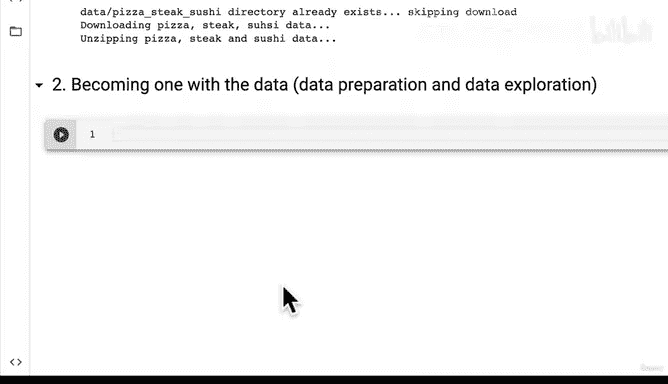
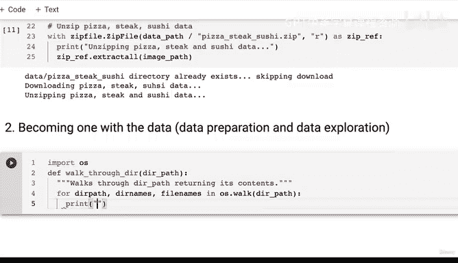
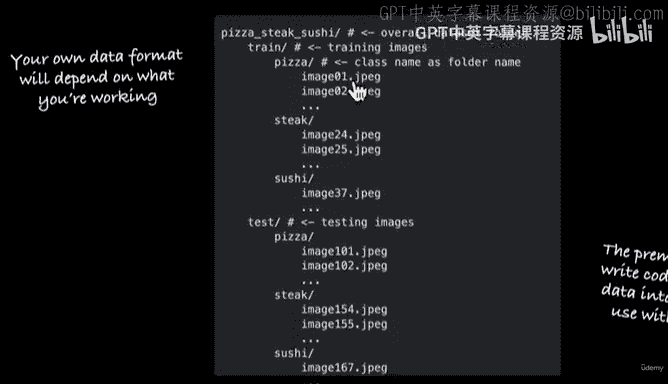
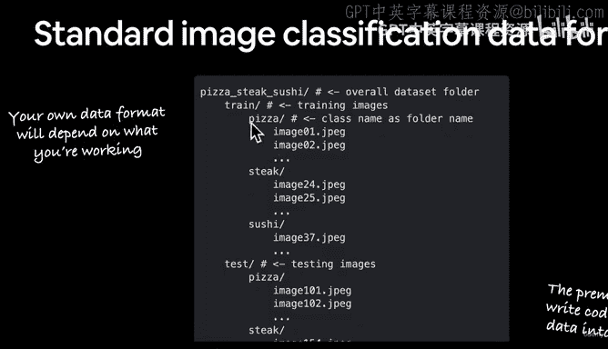
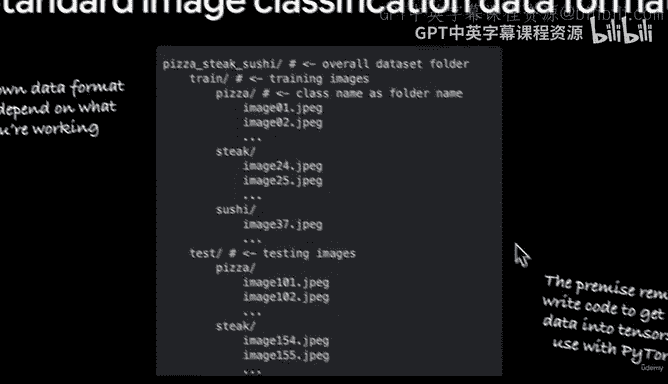
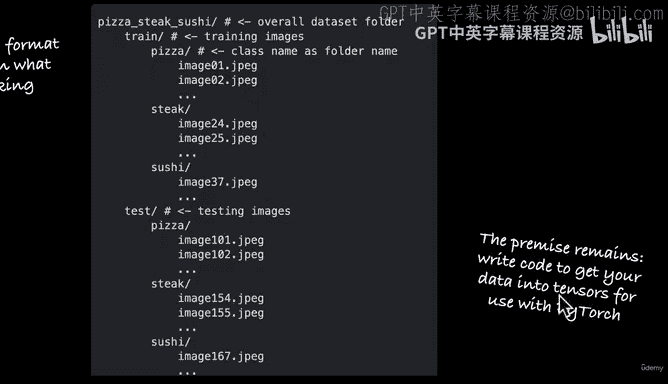
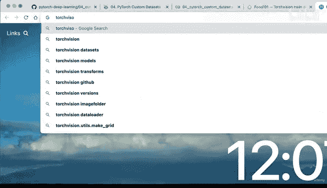
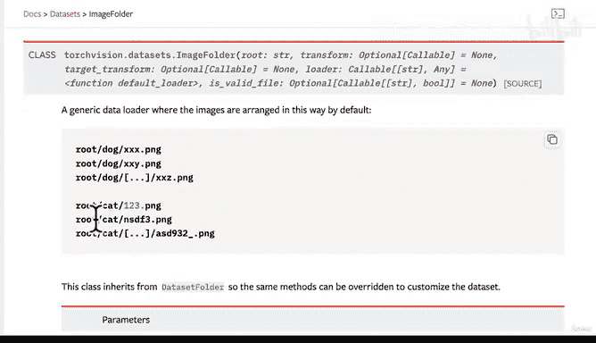

# Daniel Bourke《PyTorch 深度学习｜PyTorch 101 Crash Course For Beginners in 2025》中英字幕 - P134：134_06_004 数据探索（第一部分）：数据格式解析.zh_en - GPT中英字幕课程资源 - BV1kTSKB1E9m

Welcome back in the last video we wrote some code to download a target data set。

 our own custom data set from the Py Toch deep learning data。😊，Directory。

And if you'd like to see how that data set was made， you can go to Pytor deep learning slash extras。

 and it's going to be in the custom data creation notebook here for04。

 So I've got all the code there。😊，All we've done is take data from the food 101 data set。

 which you can download from this website here or from Torch Viion。

 So if we go to Torch Vision Food 101，We've got the data set built into Pytorch there。

 So I've used that data set from Pytorch and broken it down from 101 classes to three classes so that we can start with a small experiment。

 So there we go。 get the training data， data sets food 101。

 and then I've customized it to be my own style。 So if we go back to coabab。

 We've now got pizza St sushi， a test folder， which will be our testing images and a train folder。

 which will be our training images。This data is in standard image classification format。

 but we'll cover that in a second。All we're going to do in this video is kick off section number2。

 which is。Becoming one with the data。Which is。One of my favorite ways to refer to data preparation。

And data exploration。So becoming one with the data。

 and I'd just like to show you one of my favorite quotes from Abraham Loss function。

So if I had eight hours to build a machine learning model。

 I'd spend the first six hours preparing my data set。And that's what we're going to do。

 Abraham Los function sounds like he knows what is going on。

 But since we've just downloaded some data， let's explore it。 Hey， and we'll write some code now to。

Walk through each of the directories。 How you explore your data will depend on。What data you've got。

 So we've got a fair few different directories here with a fair few different folders within them。

 So how about we walk through each of these directories and see what's going on。

If you have visual data， you'll probably want to visualize an image。

 so we're going to do that in a second two， write a little doc string for this helper function。😊。

So walk through door path。Returning its content。Now。

 just in case you didn't know Abraham loss function does not exist as far as I know。

 but I did make up that quote。 So we're going to use the。OS dot walk function O。 walk。

 and we're going to pass it in a door path。 and what does walk do？We can get the dock string here。

Diirectctory tree generator for each directory in the directory tree， rooted at the top。

 including top itself， but excluding dot and dot dot yields a three tuple de path。

Dur names and file names。 you can step through this in the Python documentation if you'd like。

 but essentially it's just going to go through our target directory。

 which in this case will be this one here and walk through each of these directories。

 printing out some information about each one。 So let's see that in action。

 This is one of my favorite things to do if we're working with standard image classification format data。

So there are length domainnas， directories。And let's go Lng。Len file names。Let me say at length。

 like I've got the G on the end， but it's just L images in。Let's put in here。Dpath。So。

Little bit confusing if you've never used Walk before。

 but it's so exciting to see all of the information in all of your directories。😡，Oh。

 we didn't we didn't run it， let's check our function now。

 walk through D and we're going to pass it in the image path， which is what？😊，Well。

 it's going to show us。Are beautiful， so let's compare what we've got in our print out here。😊。

There are two directories and zero images in data， pizza Stak sushi， so this one here。

There's zero images， but there's two directories。Test and train wonderful。

 and there are three directories in data pizzaizz Steak sushi test。Yes， that looks correct。

 three directories， pizza steak sushi。And then we have zero directories and 19 images in our pizza steakak sushi slash test their steak。

 If we have a look at this， So that means there's 19 testing images for steak。

 let's have a look at one of them。There we go。 Now， again， these are from the Food 101 data set。

 the original food 101 data， which is just a whole bunch of images of food。100000 of them。

 there's some steak there。 Wo。 And we're trying to build a food vision model to recognize what is in each image。

😊，Then if we jump down to here， we have three directories in the training directory。

So we have pizza steak sushi， and then we have 75 steak images， 72 sushi images and 78 pizza。

 so slightly different， but very much the same numbers they're not too far off each other。

 so we've got about 75 or so training images and we've got about 25 or so testing images per class Now these were just randomly selected from the food 101 data set。

 10% of three different classes。So let's keep pushing forward。

 and we're going to set up our training and test parts。Parts so I just want to show you。

 we'll just set up this and then I'll just show you the the standard image classification setup。

 image path。t train。And we're going to go tester so if you're working on an image classification problem。

We want to set this up as test and then if we print out the trainer and the tester。

This is what we're going to be trying to do。 We're going to write some code to go， hey。

 look at this path。For our training images。 And look at this path for our testing images。

And so this is the standard image classification data format is that you have your overall data folder and then you have a training folder dedicated to all of the training images that you might have。

 and then you have a testing folder dedicated to all of the testing images that you might have and you could have a validation data set here as well if you wanted to。

But to label each one of these images。

The class name is the folder name。 So all of the pizza images live in the pizza directory。

 the same for steak and the same for sushi。So depending on your problem。

 your own data format will depend on whatever you're working on。

 you might have folders of different text files or folders of different audio files。

But the premise remains we're going to be writing code to get our data here into tensess for use with Pytorch。

And so where does this come from， this image data classification format。

 well if we go to the Torch visionion datas documentation。😊。

As you start to work with more data sets， you'll start to realize that there are standardized ways of storing specific types of data。

So if we come down to here， base classes for custom data sets will be working towards using this image folder data set。

But this is a generic data loader where the images are arranged in this way by default。

 So I've specifically formatted our data to mimic the style that this pre built data loading function is for。

 So we've got a root directory here in case of we were classifying dog and cat images。 we have root。

 then we have a dog folder， Then we have various images。😡，And the same thing for cat。

 This would be dog versus cat。 But the only difference for us is that we have food images and we have pizza steak sushi。

 If we wanted to use the entire food 101 data set， we would have 101 different folders of images here。

Which is totally possible， but to begin with， we're keeping things small。

So let's keep pushing forward， as I said， we are dealing with a computer vision problem。

 so what's another way to explore our data other than just walking through the directories themselves？

😊，Let's visualize an image， hey， but we've done that before with just clicking on their file。

 how about we write some code to do so？😊，We'll replicate this， but with code。

I'll see you in the next video。