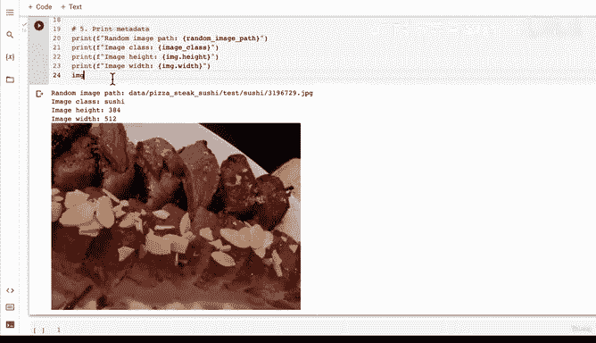
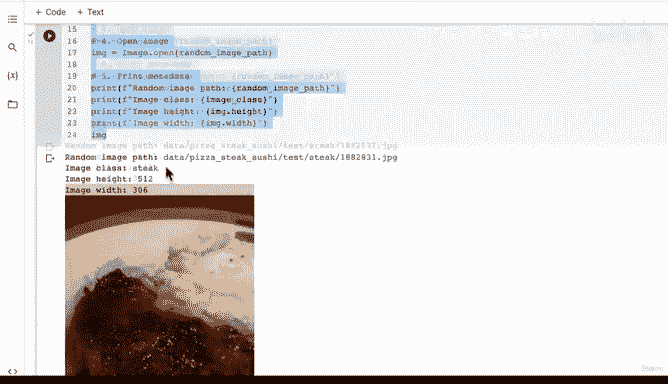
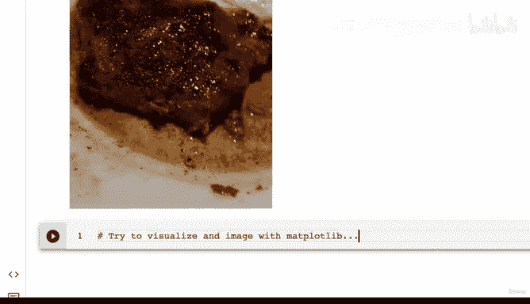
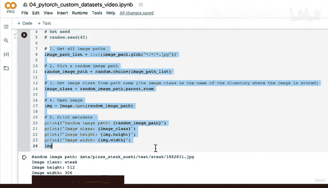
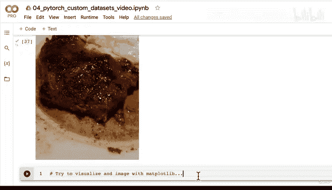
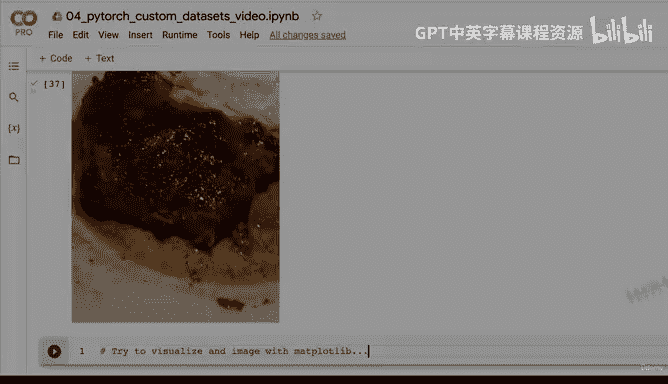

# Daniel Bourke《PyTorch 深度学习｜PyTorch 101 Crash Course For Beginners in 2025》中英字幕 - P135：135_06_005 数据探索（第二部分）：随机图像可视化.zh_en - GPT中英字幕课程资源 - BV1kTSKB1E9m

Welcome back in the last video， we started to become one with the data and we learned that we have about 75 images per training class and about 25 images per testing class and we also learned that the standard image classification data structure is to have the stake images within the stake folder of the training data set in the same for test and the pizza images within the pizza folder and so on for each different image classification class that we might have So if you want to create your own data set you might format it in such a way that your training images are living in a directory with their classification name So if you wanted to classify photos of dogs and cats you might create a training folder of train slash dog train slash cat put images of dogs in the dog folder。

 images of cats in the cat folder and then the same for the testing data set。😊。

But the premise remains。 I'm going to sound like a broken record here。

 We want to get our data from these files， whatever files they may be in。

 whatever data structure they might be in into tensess。 But before we do that。

 let's keep becoming one with the data and we're going to visualize an image。😊。

So visualizing an image and you know how much I love randomness so let's select a random image from all of the files that we have in here and let's plot it hey because we could just click through them and visualize them but I like to do things with code so specifically let's let's plan this out let's write some code。

😊，Two number one is get all of the image pubs。We'll see how we can do that with the Path Lib library。

 we then want to pick a random image path using we can use Python's random for that。

Python's random dot choice will pick a single image。Random dot choice。

Then we want to get the image class name。And this is where Partlib comes in handy class name recall that whichever target image we pick the class name will be。

 whichever directory that it's in。 So in the case of if we picked a random image from this directory。

 the class name would be pizza so we can do that using I think it's going to be pathlib dot path and then we'll get the parent folder。

 wherever that image lives so the parent image， parent folder。

 that parent directory of our target random image and we're going to get the stem of that so we have ST the stem is the last little bit here。

Number four， what should we do？Well， we want to open the image。 So since where。Working with images。

 let's open the image。With Python's pill， which is Python image library。

 which will actually be pillow。 So if we go Python Pi。

A little bit confusing when I started to learn about Python image manipulation。

 so Pi is a friendly pill fork。😊，But it's still called pill。

So just think of Pi as a way to process images with Python。

 So Pi is the Python imagingaging Library by Frederick Lund。

And so Alex Clark and contributors have created pillow。 so thank you， everyone。😊。

And let's go to number five。What do we want to do as well？ We want to， yeah。

 let's get some metadata about the image。 Well then show the image。And print metadata。Wonderful。

 so let's import random because machine learning is all about harnessing the power of randomness。

 and I like to use randomness to explore data as well as model it。😊，So let's set the seed。

So we get the same image on both of our ends， so random dot seed。I'm going to use 42。

 you can use whatever you'd like， but if you'd like to get the same image as me。

 I'd suggest using 42 as well。Now， let's get all the image paths。

We can do this because our image path。List， we want to get our image path。So recall our image path。

Is this。 So this folder here。 I'm just going to close all this。 So this is our image path。

 this folder here。 you can also go copy path if you wanted to。

 We're just going to get something very similar there。That's going to error out。

 so I'll just comment that。So it doesn't error。It's our path。

 but we're going to keep it in the Po path format。And we can go list。

 let's create a list of imagepath dot Gloob， which stands for grab。

 I don't actually know what Glob stands for， but to me it's like Glob together all of the images that or all of the files that suit a certain pattern。

 so Glob together for me means stick them all together。😊。

And you might be able to correct me if I've got the wrong meaning there。 I'd appreciate that。

And so we're going to pass in a certain combination， so we want star。Slash star。

 And then we want star dot JPG。 Now， why are we doing this or because we want every image path。

 So star is going to be this first。Diirectctory here。 So any combination it can be trained or test。

 And then this star means anything for what's inside tests。

 And let's say this first star is equal to test。 This second star is equal to anything here。

 so it could be any of pizza steak or sushi。 And then finally， this star。

 let's say it was test pizza， this star is anything in here that is before dot JPG。

 So it could be any one of these files here。 Now， this will make more sense once we printed out。

 So image path list。 Let's have a look。😊，There we go。

 so now we've got a list of every single image that's within pizza steakak sushi。😡。

And this is just another way that I like to visualize data is to just get all of the pars and then randomly visualize it whether it be an image or text or audio you might want to randomly listen to it。

 recall that each each of the domain libraries have different input and output methods for different data sets。

 So if we come to torch vision we have UTs。 So we have different ways to draw on images。😊。

Reading and writing images and videos。 so we could load an image。V read image， we could decode it。

 We could do a whole bunch of things。 I'll let you explore that as extra curriculum。

 But now let's select a random image from here and plot it。So we'll going number two。

Which was our'll step up here， pick a random image。So pick a random。Image path。

Let's get rid of this and so we can go random image path。Equals random， do choice。

 harnessness the power of randomness to explore our data。

 Let's get a random image from image part list， and then we'll print out random image path。

 Which one was our lucky image that we selected。Beautiful。

 so we have a test pizza image is our lucky。😊，Rr a image。And。Because we've got a random seed。

 it's going to be the same one each time， yes it is。And if we comment out the random seed。

 we'll get a different one each time we've got a stake image， we've got another stake image。

Another stake image， all three in a row，4 in a row。Pizza， okay， let's keep going。

 so we'll get the image class。😊，From the path name。

 so the image class is the name of the directory because our image data is in standard image classification format where the image is stored。

So let's do that image class。Equals random image。Plf dot parent， dot stem。

 And then we're going to print image class。 What do we get， So we've got pizza。 wonderful。

 So the parent is this folder here。😊，And then the stem is the end of that folder， which is pizza。

Beautiful， what are we up to now？We're working with images。

 Let's open up the image so we can open up the image using pill。

 We could also open up the image with Pytage here。 So with read image。

 but we're going to use pill to keep things a little bit generic for now。So open image。

Image equals image so from pill import image and the image class has an open function and we're just going to pass it in here。

 the random image path note if this is corrupt if your image is corrupt。😊，This may error。

 so then you could potentially use this to clean up your data set。I've。

Ied a lot of images with images。 open of our target data set here。

 I don't believe any of them are corrupt， but if they are。

 please let me know and we'll find out later on when our model tries to train on it。

So let's print some metadata， so when we open our image， we get some information from it。

So let's go our random image path is what？Random image path。We're already printing this out。

 but we'll do it again anyway。And then we're going to go the image class。Is equal to what。

Will be the image class。Wonderful and then we can print out。

 we can get some metadata about our images so the image height is going to be img。he。

 we get that metadata from using the pill library and then we're going to print out image width and we'll get IMG dot width and then we'll print the image itself。

Wonderful， and we can get rid of this。 and we can get rid of this。

 Let's now have a look at some random images from our data set。😊，Lovely。

 we've got an image of pizza there。 Now， I will warn you that one of the downsides of working with food data is it does make you a little bit hungry。

 So there we've got some sushi。😊，And then we've got some more sushi。Some steak。And we have a steak。

 we'll go one more for good luck。😊，And we finish off with some sushi。 Oh。

 that could be a little bit confusing to me。 I thought that might be stake to begin with。

 And this is， do you see now， we'll do one more why it's important to sort of visualize your images randomly because you never know what you're gonna to come across。

 And this way， once we visualize enough images， you could do this 100 more times。

 you could do this 20 more times until you feel comfortable to go， hey。

 I feel like I know enough about the data now， Let's see how well our model goes on this sort of data。

 So'll finish off on this stake image And now I'll set you a little challenge before the next video is to。

😊。

Visualize an image like we've done here， but this time do it with Maplot Lib。

 so try to visualize an image with Maplot Lib。

That's your little challenge before the next video， so give that a go。

 we want to do a random image as well， so quite a similar setup to this。

 but instead of printing out things like this， we want to visualize it using mapplotlib so try that out and we'll do it together in the next video。

😊。

