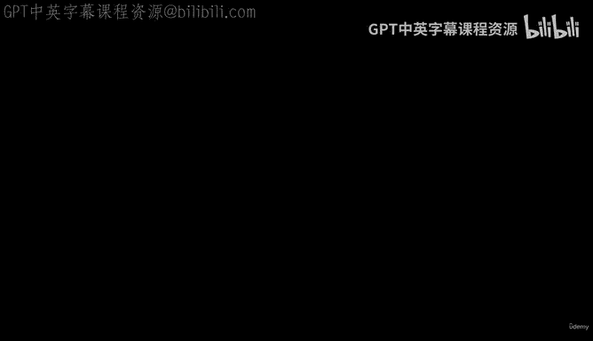
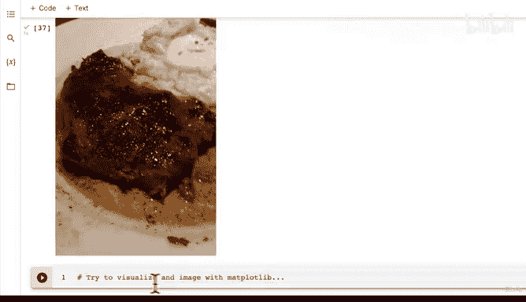
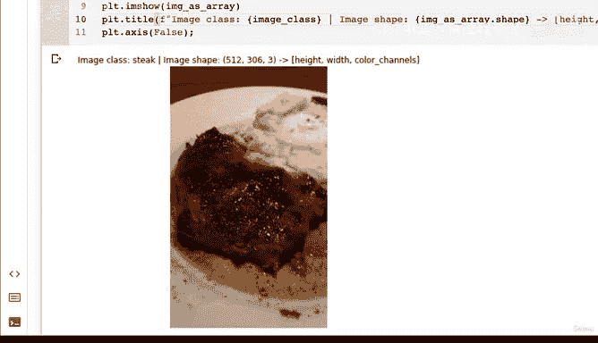
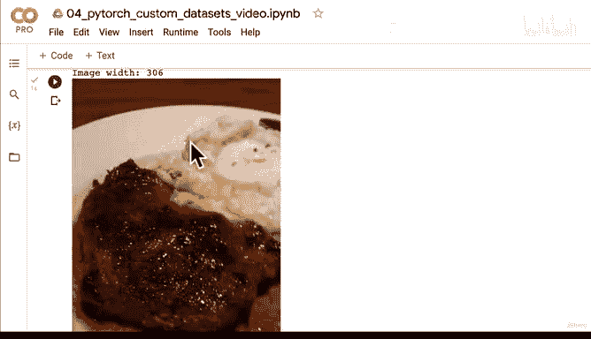
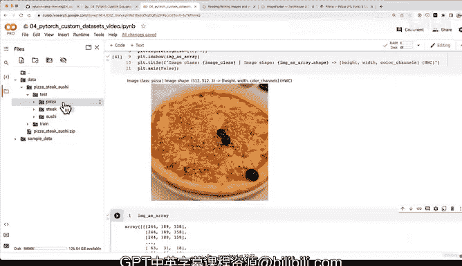

# Daniel Bourke《PyTorch 深度学习｜PyTorch 101 Crash Course For Beginners in 2025》中英字幕 - P136：136_06_006 数据探索（第三部分）：Matplotlib图像可视化.zh_en - GPT中英字幕课程资源 - BV1kTSKB1E9m

Ho we are well on the way to creating our own pi toch custom data set。

 and we've started to become one with the detail。 But now let's continue to visualize another image。

 I set you the challenge in the last video to try and replicate what we've done here with the pill library with Matpllib So now let's give it a goy。

 and why use Matplotlib Well， because Matpllib and I'm going to import nu pie as well because we're going to have to convert this image into an array。

 That was a little little trick that I didn't quite elaborate on。

 but I hope you tried tocode it out and figure it out from the errors you received。😊。

But MaplotLib is one of their most fundamental data science libraries。

 so you're going to see it everywhere， so it's just important to be aware of how to plot images and data with MapllotLib。

So turn the image。Into an array。So we can go image as。Aray。

 and I'm going to use the nuy method NP as array。We're going to pass it in the image。

 recall that the image is the same image that we've just set up here。

 and we've already opened it with pill。And then I'm going to plot the image。Pt the image with。

Map plot lib。PLT。figu。And then we can go fig size。Equs 10。seven。And then we're going to go plt。imhow。

😊，Image as。Aray， pass it in the array of numbers， I'm going to set the title here as an F string。

And then I'm going to pass in image class。It goes image class。

Then I'm going to pass in image shape so we can get the shape here and now this is another important thing to be aware of of your different data sets when you're exploring them is what is the shape of your data because what's one of the main errors in machine learning and deep learning？

😊，It's shape mismatch issues， so if we know the shape of our data where we can start to go okay I kind of understand what shape I need my model layers to be in。

 what what shape I need my other data to be in and I'm going to turn the aes off here。😊，Beautiful。

 so look at what we've got。Now， I've just thrown this in here without really explaining it。

 but we've seen this before in the computer vision section as our image shape is 5123063。

 Now the dimensions here are height is 512 pixels。 The width is 306 pixels。

 and it has three color channels。 So what format is this， This is color channels last。😊。

Whi is the default for the pill library， and there's also the default for Mapllib。

 but Pytorage recall is default if we put the color channels at the start color channels first。

Now， there is a lot of debate， as I've said over which is the best order。

 It looks like it's leading towards going towards this， but for now。

 Pytorch defaults to color channels first， but that's okay because we can manipulate these dimensions to what we need for whatever code that we're writing。

 and the three color channels is what red， green and blue。 So if you combine red。

 green and blue in some way， shape or form， you get the different colorss here that represent our image。

And so if we have a look at our image as a。😊，Our image is in numerical format， wonderful。😊，So， okay。

 we've got one way to do this for。One image。I think we start moving towards scaling this up to do it for every image in our data folder。

 So let's just finish off this video by visualizing one more image。 What do we get。Same premise。

 The image is now。As an array， different numerical values。

 you've got a delicious looking pizza here of shape 512，512 with color channels last。

 and we've got the same thing up here。😊，So that is one way to become one with the data。

 is to visualize different images， especially random images。 You could do the same thing。

 visualizing different text samples that you're working with or listening to different audio samples。

 It depends what domain you're working in。 So now in the next video。

 let's start working towards turning all of the images in here。

 Now that we' visualized some of them and become one with the data。

 We've seen that the shapes are varying in terms of height and width。

 but they all look like they have three color channels because we have color images。

But now we want to write code to turn all of these images into Py torch tenseors。

So let's start moving towards that， I'll see you in the next video。😊。

