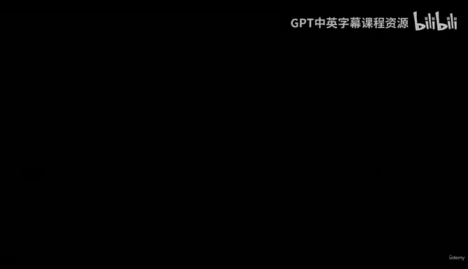
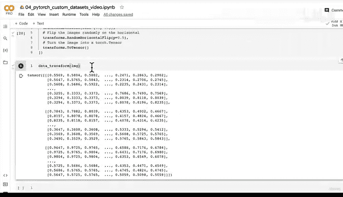

# Daniel Bourke《PyTorch 深度学习｜PyTorch 101 Crash Course For Beginners in 2025》中英字幕 - P137：137_06_007 数据转换（第一部分）：图像转张量.zh_en - GPT中英字幕课程资源 - BV1kTSKB1E9m

Hello and welcome back。 In the last video， we converted an image to a numpy array。

 and we saw how an image can be represented as an array。

 But what if we'd like to get this image from our custom data set over here。😊。

Pizza steak sushi into pie toch。 Well， let's cover that in this video。

 So I'm going to create a new heading here。 and it's going to be。Transforming data。

 And so what we'd like to do here is I've been hinting at it the fact the whole time is we want to get our data into tensor format because that is the data type that Pytorch accepts。

 So let's write down here before we can use our image data with Pytorch。 Now this goes for images。

 other vision data， it goes for text， it goes to audio。

 basically whatever kind of data set you're working with， you need some way to turn it into tensors。

 So that step number one， turn your target。Data into tenses in our case。

It's going to be a numerical representation of our images。😊，And number two is turn it into a torch。

utts。data。data set。😡，So recall from a previous。Video that we've used the data set to house all of our data in Tensor format。

And then subsequently we've turned our data sets， our Ptor data sets into torch。utils。data。

data loader。😡，And a data loader creates an iterable or a batched version of our data set。

 So for short， we're going to call these。Data set and data loader。😡，Now， as I discussed previously。

 if we go to the Pytorrch documentation， Torch vision。For torch vision。

And this is going to be quite similar for torch audio， torch text， torch rack。

 torch data eventually when it comes out of beta。😡。

There are different ways to create such data sets so we can go into the data sets。

Module and then we can find built in data sets and then also base classes for custom data sets。But。

If we go into here。Image folder。 There's another parameter I'd like to show you。

 and this is going to be universal across many of your different data types。

 is the transform parameter。Now， the transform parameter is。

A parameter we can use to pass in some transforms on our data so when we load our data sets from an image folder。

It performs a transform on those data samples that we've sent in here as the target data folder。 Now。

 this is a lot more easier to understand through illustration rather than just talking about it。

 So let's create a transform。And the main transform we're going to be doing is transforming our data and we're turning it into tensor so let's see what that looks like so we're going to just going to reimport all of the main libraries that we're going to use。

So from Torch Us。 data， let's import data loader。And we're going to import from Torch Vi。

I'm going to import datas， and I'm also going to import transforms。Beautiful。

 and I'm going to create another little heading here。 This is going to be 3。

1 transforming data with torch visionion dot transform。

 So the main transform we're looking to here is turning out images。😊，From JPEgs。

If we go into train and then we go into any folder， we've got JPEG images。

And we want to turn these into tenser representation， so there's some pizza there。Forget out of this。

 let's see what we can do。How about we create a transform here？Write a transform for image。And。

Let's start off by calling it data transform and I'm going to show you how we can combine a few transforms together。

 If you want to combine transforms together， you can use transforms。

t composeose You can also use anN dot sequential。To combine transforms。

 or we're going to stick with transformforms。com for now。And it takes a list。

 And so let's just write out three transforms to begin with。

 and then we can talk about them after we do so。 So we want to resize our images。To 64， 64。 Now。

 why might we do this？ Well， do you recall in the last section， computer vision。

 We use the tiny VGG architecture。And what size were the images that the tiny VGG architecture took？

Well we replicated the CNN website version or the CNN explain a website version and they took images of size 6464。

 so perhaps we want to leverage that computer vision model later on。

 so we're going to resize our images to 6464。And then we're going to create another transform。

And so this is I just want to highlight how transforms can help you manipulate your data in a certain way。

 So if we wanted to flip the images， which is a form of data augmentation， in other words。

 artificially increasing the diversity of our data set。😊。

We can flip the images randomly on the horizontal。So transforms dot random。Horizontal。Flip。

 and I'm going to put a probability in here of P equals 0。5。

 So that means 50% of the time if an image goes through this transform pipeline。

It will get flipped on the horizontal axis。 As I said。

 this makes a lot more sense when we visualize it。 So we're going to do that very shortly。

 And finally， we're going to turn the image into a torch tensor。

So we can do this with transform dot to Tensor。And now。Where might you find such transforms。

So this transform here says two Tensor。 If we have a look at the dock string。

 we've got convert a pill image， which is what we're working with right now or a nuy array to a tensor。

This transform does not support torch script if you'd like to find out what that is。

 I'd like to read the documentation for that it's essentially turning your Pythtorrch code into a Python script。

It converts a pill image or a nuy array from height width colour channels in the range 0 to 2，5，5。

 which is what our。Values are up。 They're from 0 to 2，5，5， red。

 green and blue to a torch float tensor of shape color channels height width in the range 0 to 1。

So it will take our tensor value here or our nuier array values from 0 to 2，5。

5 and convert them into a torch tensor in the range 0 to 1。

 We're going to see this later on in action。 But this is our first transform。

So we can pass data data through that， in fact， I'd encourage you to try that out。😊。

See what happens when you pass in data transform。What happens when you pass it in our image as a？

Image as ary， let's see what happens？Oh， image should be pill image， got class nuie， or。

 what if we just pass in our straight up image？So this is a pill image。There we go， beautiful。

 So if we look at the shape of this， what do we get？😊，3，64，64， there's 64。

 And if what if we wanted to change this to 2，2，4， which is another common value for。

Computer vision models，224，224。 Do see how powerful this is。 This little transforms module。

 the Torch vision library will' change that back to 64，64。😊。

And then if we have a look at what D type of our transform tensor is。😊，We get torch floatat 32。

Beautiful， so now we've got a way to transform our images into tensesors。And so。

 but we're still only doing this with one image。😊，How about we progress towards doing it for every image in our。

Data folder here。But before we do that， I'd like to visualize what this looks like。

 So in the next video， let's write some code to visualize what it looks like to transform multiple images at a time。

And I think it'd be a good idea to compare the transform that we're doing to the original image。😊。

So I'll see you in the next video， let's write some visualization code。😊。

