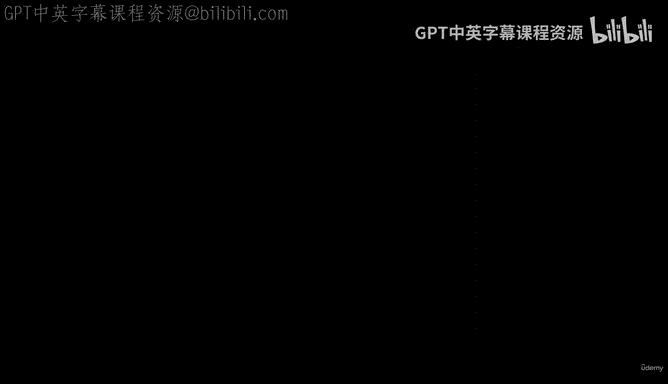
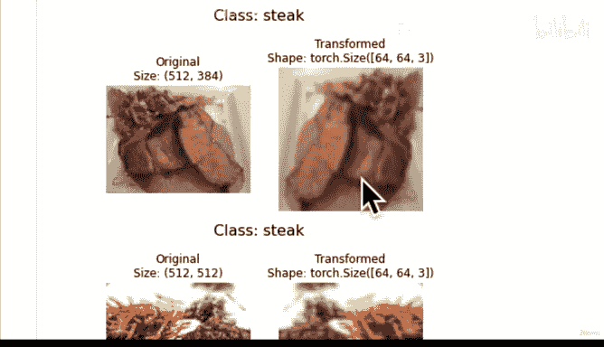
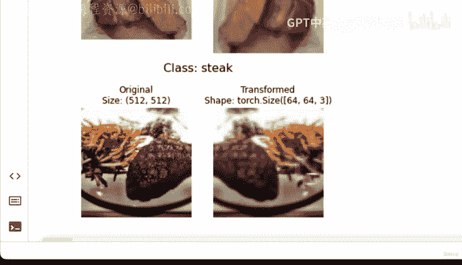
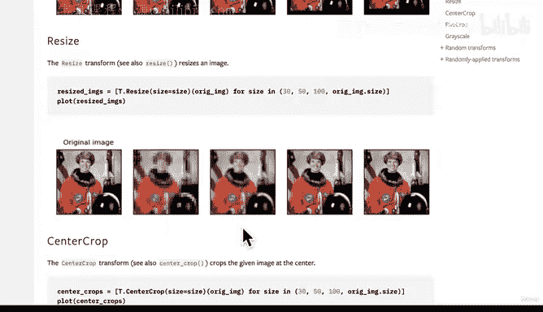
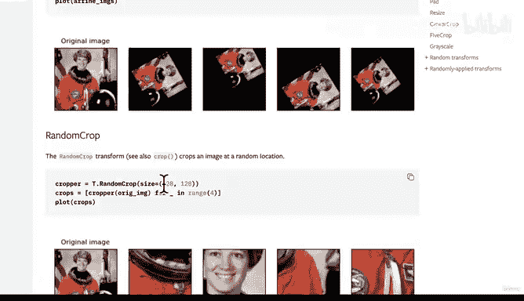
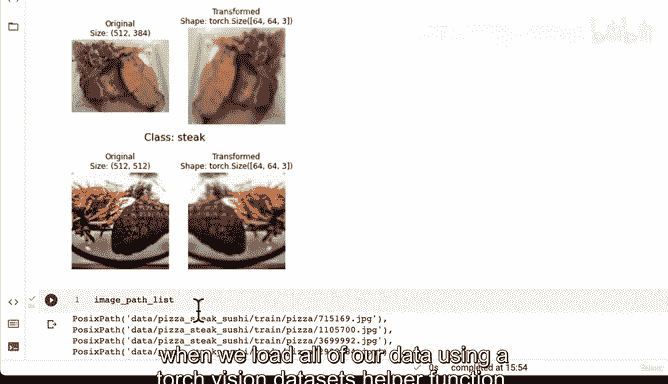
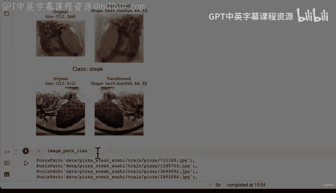

# Daniel Bourke《PyTorch 深度学习｜PyTorch 101 Crash Course For Beginners in 2025》中英字幕 - P138：138_06_008 数据转换（第二部分）：转换后图像可视化.zh_en - GPT中英字幕课程资源 - BV1kTSKB1E9m

Let's now follow our data Explorer's motto of visualizing our transformedform images。

 so we saw what it looks like to pass one image through a data transform。

And if we wanted to find more documentation on Tor vision transforms， where could we go？😊。

There is a lot of these， so transforming and augmenting images。

 this is actually going to be your extra curriculum for this video。😊。

So transforms are common image transformations available in the Transs module。

 They can be chained together using compose， which is what we've already done beautiful。

 And so if you'd like to go through all of these， there's a whole bunch of different transforms that you can do。

 including some data augmentation transforms。 And then if you'd like to see them visually。

 I'd encourage you to check out illustration of transforms。

 but let's write some code to explore our own transform visually first。 So I'll leave this as a link。

😊，So。And grab up here。Right here， transforms。Help you get your images ready to be used with a model。

Slash， perform。Data augmentation。Wonderful， so we've got a way to turn images into tensesors。

 That's what we want for our model。 We want our images as pie torch tensesors。

 The same goes for any other data type that you're working with。😊。

But now I'd just like to visualize what it looks like if we plot a number of transformed images。

 so we're going to make a function here that takes in some image paths。

 a transform a number of images to transform at a time and a random seed here because we're going to harness the power of randomness and sometimes we want to set the seed sometimes we don't。

😊，So。We have an image path list that we've created before。

 which is just all of the image paths that we have of our data set。😊，So data。Pizza steakd sushi。Now。

 how about we select some random image paths and then take the image from that path。

 run it through our data transform， and then compare the original image of what it looks like and the transformed image and what that looks like？

Let's give it a try， hey， so I'm going to write a doctoring of what this does。And then select。

Random images from a path of images and loads slash transforms them。

Then plots the original verse the transformed。Version。That's quite a long dock string。

 but that'll be enough we can put in some stuff for the image path， transforms and seed。

 we'll just code this out。Let's go randomand seed will create the seed。Or maybe we do it if seed。

Random seed。 Let's put that and we'll set seed to equal none by default。That way we can are。

 we'll see if this works， okay？If in doubt， code it out random image paths。

 and then we're going to go random sample from the image paths and the number of sample that we're going to do。

 so random sample is going to this will be a list。I'll just pass in here that this is a list。

So we're going to randomly sample。K， which is going to be n。

 So three images from our image path list。And then we're going to go four image path we're going to loop through the randomly sampled image parts you know how much I love harnessing the power of randomness for visualization So for image path in random image paths。

 let's open up that image using pill。😊，Image。t open image path as F。

And then we're going to create a figure and an aes。

 and we're going to create a subplot with Matplot lib。 So subplots。 and we want it to create。😊。

One row。So it goes N rows N Cos。One row。And N cos equals 2。 And then on the first or the zeroth axie。

 we're going to plot the original image。 so I show。We're just going to pass it straight in F。

And then if we want to go a0， we're going to set the title， so set title。

We're going to set it to be the original， so we'll create this as an F string， original。

 and then new line will create a size variable， and this is going to be F dot size。

 So we're just getting the size attribute from our file。

So we'll keep going and we'll turn off the axes here。So axis and we're going to set that to false。

Now let's transform on the first axes plot。We're going to transform and plot target image。

 This is so that our images are going to be side by side， the original and the transformed version。

So there's one thing that we're going to have to do。

 I'll just I'll code it out in the wrong way first。

 I think that'll be a good way to illustrate what's going on。F， so I'm just going to put a note here。

Note， we will need to change shape for mappl Lib because we're going to come back here。

Because what does this do？What have we noticed that our transform does？If we check the shape here。Oh。

 excuse me， it converts our image。Two color channels first。Whereas Matplotlibb prefers。

Coolour channels last。 so just keep that in mind for when we're going forward。

 this code I'm writing it， it will error on purpose。So transformed image。

And then we're going to go Acts1 as well， we're going to set the title。

 which is going to be transformed。And then we'll create a new line and we'll say size is going to be。

Transformed。Image dot shape。Oh probably a bit of， yeah， we could probably go shape here。😊。

And then finally we're going to go a1， we're going to turn the axis。

 we're going to set that to false， You can also set it to off so you could write false or you could write off。

 you might see that different versions of that somewhere and I'm going to write a super title。Here。😊。

Wch you' will see what this looks like， class is going to be image path。

So we're getting the target image path and we're just going to get the attribute or the parent attribute and then the stem attribute from that。

 just like we did before， to get the class name。 And then I'm going to set this to a larger font size。

 So that we make some nice looking plots right if we're going to visualize our data。

 we might as well make our plots visually appealing。

 So let's plot some transform data or transformed images， So image paths。

 we're going to set this to image path list， which is just the variable we have down below。

 which is a path list a list containing all of our image parts， our transform。

 we're going to set our transform to be equal to our data transform。

 So this just means that if we pass the transform in our image is going to go through that transform and then go through all of these is going to be resized。

 it's going to be randomly horizontally flipped and it's going to be converted to a tensor。😊。

And then so we're going to set that data transfer there or data transform， sorry。

And is going to be three， so we plot three images and we'll set the seed to 42 to begin with。

Let's see if this works。哦。What did we get wrong， We have invalid shape， As I said。

 I love seeing this error， because we have seen this error many times。

 and we know what to do with it。 We know that we have to rearrange the shapes of our data in some way。

 shape or form。 Well， I said shape a lot there。 That's all right。 Let's go here。 permute。

 This is what we have to do。 We have to permute。 We have to swap the order of the axises。

 So right now， our color channels is first。 So we have to bring this color channel axis or dimension to the end。

 So we need to shuffle these across。 So 64 into here，64 into here and 3 on the end。 We need to。

 in other words， turn it from color channels first to color channels last。

 So we can do that by permuting it to have the first axie come now in the0 dimension spot。

 And then number two is going to be in the first dimension spot。

 And then number 0 is going to be at the back end。 So this is essentially going from C。😊，H。W。

 and we're just changing the order to be H。WC， so the exact same data is going to be within that tensor。

 we're just changing the order of the dimensions。 Let's see if this works。Ho， look at that。Oh。

 I love seeing some manipulated data。 We have a class of pizza and the original images there。

 and it's 512 by 5，12。 But then we've resized it using our transform。

 Notice that it's a lot more pixelated now， But that makes sense because it's only 64，64 pixels。 Now。

 why might we do such a thing。😊，Well， one， if is this image still look like that， Well， to me。

 it still does， but the most important thing will be， does it look like that to our model。

 Does it still look like the original to our model。Now， 64 by 64。

 there is less information encoded in this image， so our model will be able to compute faster on images of this size。

 However， we may lose some performance because not as much information is encoded as the original image。

😡，Again， the size of an image is something that you can control。

 you can set it to be a hyperparameter， you can tune the size to see if it improves your model。

But I've just decided to go 664， 643 in line with the CNN Explainer website。

So a little hint we're going to be rerelicating this model that we've done before。 Now。

 you notice that our images are now the same size 64，64，3 as what the CNN explainer model uses。

 So that's where I've got that from。 But again， you could change this to size to whatever you want。

 And we see， oh， we've got a stake image here。 And you notice that the our image has been flipped on the horizontal。

So the horizontal axis， our image has just been flipped same with this one here。

So this is the power of torch transforms。😡，Now there are a lot more transforms， as I said。

You can go through them here to have a look at what's going on。

 Illrations of transforms is a great place。So there's resize， there's scent a crop。

 you can crop your images， you can crop five different locations， you can do gray scale。

 you can change the color， a whole bunch of different things。

I'd encourage you to check this out， that's your extra curriculum for this video。😊。

But now that we've visualized the transform。This is what I hinted out before that we're going to use this transform for when we load all of our images in。

 using into a torch data set。So I just wanted to make sure that they had been visualized first。

 We're going to use our data transform in the next video when we load all of our data using a torchvision do data setss helper function。

So let's give that a go， I'll see you in the next video。

