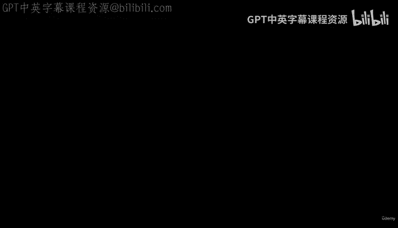
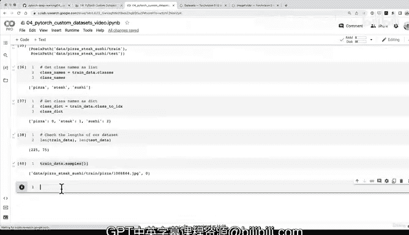

# Daniel Bourke《PyTorch 深度学习｜PyTorch 101 Crash Course For Beginners in 2025》中英字幕 - P139：139_06_009 使用ImageFolder加载图像并转换为张量.zh_en - GPT中英字幕课程资源 - BV1kTSKB1E9m

。

Have a look at that beautiful plot。 We've got some original images and some transformed images and the beautiful thing about our transformed images is that they're in tensor format。

 which is what we need for our model。 That's what we've been slowly working towards。

 We've got a data set。 and now we've got a way to turn it into tensors ready for a model。

 So let's just visualise what another。 I'll turn the seed off here so we can look at some more random images。

😊，There we go Okay， so we've got steak pixelated because we are downsizing 64，643。

 same thing for this one and it's been flipped on the horizontal and then same thing for this pizza image and we'll do one more to finish off。

😊，Wonderful， so that is the premise of transforms， turning our images into tenses and also manipulating those images if we want to。

😊，So let's get rid of this， I'm going to make another heading， we're up to section or part four now。

 and this is going to be option one。😊，So loading image data using。Image folder。And now。

I'm going to turn that into markdown。And so let's go torch vision。Data sets。

So recall how each one of the Torch Viion domainin libraries has its own datas module that has built in functions for helping you load data。

In this case， we have an image folder and there's a few others here if you'd like to look into those。

But an image folder， this class is going to help us load in data that is in this format。

 the generic image classification format。 So this is a prebut data sets function。

 just like there's prebuil data sets， we can use prebuil data set functions。Now， option 2， later on。

 this is a spoiler is we're going to create our own custom version of a data set loader。

 But we'll see that in a later video。 So let's see how we can use image folder to load all of our。😊。

Custom data， our custom images into tensesors。So this is where the transform is going to come in helpful。

So let's right here， we can。Load image classification data using。Let's write this。

 let's write the full path name， Torch vision by data sets。😊，Dot image folder。😡，Put that in there。

Beautiful， and so let's just start it out， use image folder。

To create data sets and now in a previous video I hinted at the fact that we can pass a transform to our image folder class。

That's going to be。Right here。So let's see what that looks like in practice。 So from tarch vision。

I'm going to import data sets because that's where the image folder module lives and then we can go train data equals datas。

image folder。And we're going to pass in the route， which is our trainer。

Because we're going to do it for the training directory first。

 and then we're going to pass in a transform， which is going to be equal to our data transform。😊。

And then we're going to pass in a target transform， but we're going to leave this as none。

 which is the default， I believe。If we go up to him。Yeah， target transform is optional。

 So what this means is this is going to be a transform for the data。

And this is going to be a transform。For the labelel。/lash target Pytorch likes to use target。

 I like to use label， but that's okay。So this means that we don't need a target transform because our labels are going to be inferred by the target directory where the images live。

 So our pizza images are in this directory and they're going to have pizza as the label because our data set is in standard image classification format。

 Now， if your dataset wasn't in standard image classification format。

 You might use a different data loader here。 A lot of them will have a transform for the data。

 So this transform is going to run our images， whatever images are loaded from these folders。

 through this transform that we've created here。 It's going to resize them randomly flip them on the horizontal and then turn them into tensors。

 which is exactly how we want them for our Pytorage models。

And if we wanted to transform the labels in some way， shape or form。

 we could pass in a target transform here， but in our case we don't need to transform the labels。

So let's now do the same thing for the test data。And so that's why I wanted to visualize our transforms in the previous videos。

 because otherwise we're just passing them in as。A transform。 So really。

 what's going to happen behind the scenes is all of our images are going to go through these steps。

 And so that's what they're going to look like when we turn them into a data set。

So let's create the tester here or the test data set。

 the transform we're going to transform the test data set in the same way we've transformed our training data set and we're just going to leave that like that。

So let's now print out。What our data sets look like， train data and test data。Beautiful。

 so we have a data set， a torch data set， which is an image folder and we have a number of data points this is going to be for the training data set。

 we have 225， so that means about 75 images per class and we have the root location which is the folder we've loaded them in from。

 which is our training directory we've set these to up before Traer and tester。😊。

And then we have a transform here， which is a standard transform。

 a resize followed by a random horizontal flip， followed by two tensor。

 then we've got basically the same output here for our test directory。

 except we have less samples there。So let's get a few little attributes from the image folder。

 This is one of the benefits of using a Pytorage prebuilt data loader， is that or data set loader。

 is that it comes with a fair few attributes so we could go to the documentation。

 find this out from in here， inherits from data folder， keep digging into there。

 or we could just come straight into Google coabab Let's go get class names as a list。😊。

Can we go train data dot and then press tabab？Beautiful。

 so we've got a fair few things here that are attributes。 Let's have a look at classes。😊。

This is going to give us a list of the class names。Class names。This is very helpful later on。

 So we've got pizza steak sushi。 We're trying to。Do everything with code here。

 So if we have this attribute of traindata do classes。

 we can use this list later on for when we plot images straight from our data set or make predictions on them and we want to label them。

 You can also get class names as a dictionary mapped to their integer。Index that is。

 so we can go train data。Dot and press tab。 We've got class to IDX。 Let's see what this looks like。

Class died。Wonderful， so then we've got our。String class names mapped to their integer。

 So we've got pizza is 0。 Steak is one。 Sushi is 2。 Now。

 this is where the target transform would come into play。If you wanted to transform those。

These labels here in some way shape or form， you could pass a transform into here。

And then if we keep going， let's check the lengths of what's going on。

 Check the lengths of our data set。So we've seen this before。

 but this is going to just give us how many samples that we have length。Train data length test data。

 beautiful and then of course if you'd like to explore more attributes you can go Tra data dot and then we've got a few other things。

 functions， images， loader， samples， targets， if you wanted to just see the images。

 you can go dot samples， if you wanted to see just the labels you can go dot targets。

This is going to be all of our labels， look at that。😊，And I believe they're going to be an audit。

 so we're going to have 0，0，0，11，1222。 and then if we wanted to have a look。

 let's say we have a look at the first sample， hey。We have data， pizza， steak， sushi， train， pizza。

There's the image path， and it's a label0 for pizza。 Woful。 So now we've done that。 How about we。

 we've been visualizing this whole time。 So let's keep up that trend and let's visualize a sample and a label from the train data data set。

😊，So in this video， we've used image folder to load our images into tensesors。

 and because our data is already in standard image classification format。

 we can use one of Torchvision。 dataet's prebuilt functions。

So let's do some more visualization in the next video。I'll see you there。

