# Daniel Bourke《PyTorch 深度学习｜PyTorch 101 Crash Course For Beginners in 2025》中英字幕 - P13：013_02_009 PyTorch课程内容概览.zh_en - GPT中英字幕课程资源 - BV1kTSKB1E9m

Now it's time to get specific about what we're going to cover codewise in this fundamentals module。

 But I just want to reiterate the fact that going back to the last video where I challenge you to look up what is a tensor。

 Here's exactly what I would do。 I would come to Google。 I would type in the question。

 What is a tensor。 There we go。 What is a tensor in ptorrch。

 It knows Google knows that using that deep learning data that we want to know what a tensor is in Pytorrch。

 But a tensor is a very general thing。 It's not associated with just pieytorrch。 Now。

 we've got tensor on Wikipedia。 we've got tensor。 This is probably my favorite video on what is a tensor。

 by Dan F F， I'm probably saying that wrong， But good first name。 and。😊。

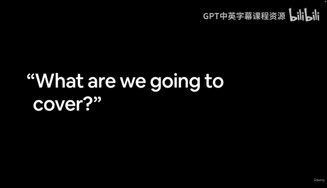

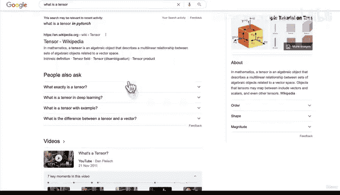

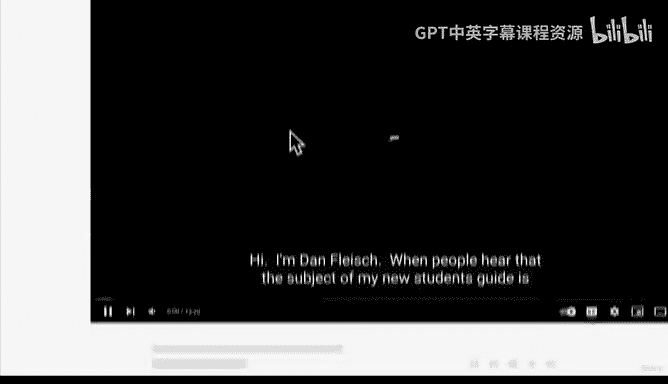

This is going to be your extra curriculum for this video。

 and the previous video is to watch this on what is atensor。AndNow you might be saying， well。

 what gives， I've come to this course to learn pieytorrch and all this guy's doing All you're doing。

 Daniel is just googling things when a question comes up。 Why don't you just tell me what it is。

 Well， if I was to tell you everything about deep learning and machine learning and pietorrch and what it is and what it's not。

 That course would be far too long。 I'm doing this on purpose。

 I'm searching questions like this on purpose， because that's exactly what I do day to day as a machine learning engineer。

 I write code like where' about to do， And then if I don't know something。

 I literally go to whatever search engine I'm using， Google most of the time。

 And type in whatever error I'm getting or pitorrch， what is a ten or something like that。

 So I want to not only tell you that it's okay to search questions like that， but it's encouraged。

 So just keep that in mind as we go through the whole course。 You're gonna see me do it lots。

 But let's get into what we're going to cover。😊。

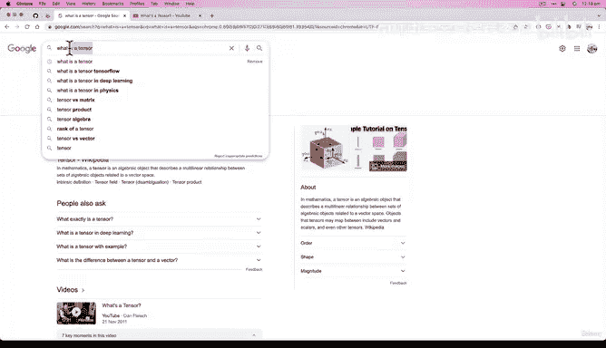

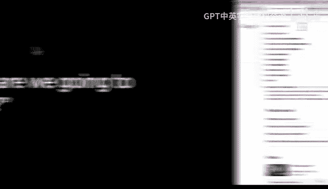

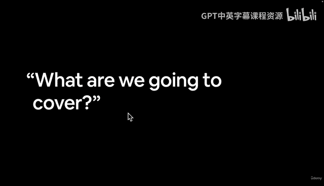

Here we go。Now， this tweet is from Elon Musk。 And so I've decided， you know what。

 Let's base the whole course on this tweet。 We have learning M L D L from university。

 You have a little bit of a small brain online courses。 Well， like this one。

 that brains start to explode and you get some little fireworks from YouTube。

 if you're watching this on YouTube。 Look at that Shi brain from articles。 My goodness。

 lucky that this course comes in。😊。

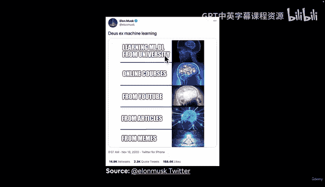

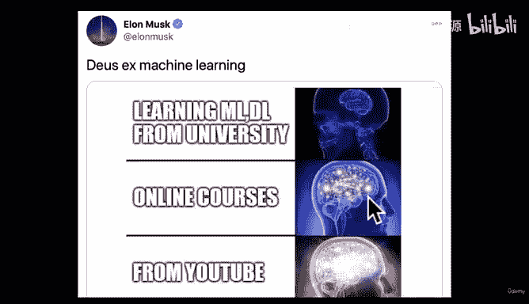

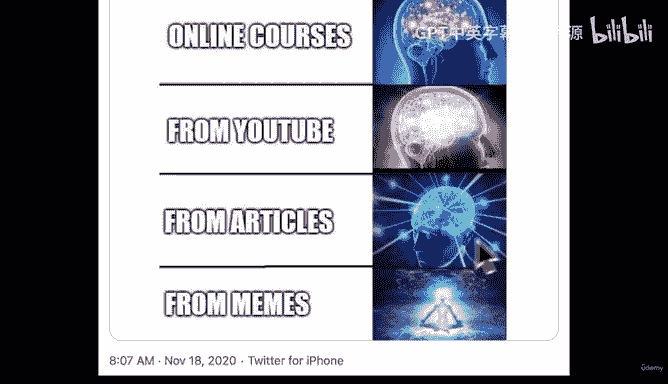

Article format if you go to learn pietorrch。😡，Dot I O。

 All of the course materials are in online book format。

 So we're going to get into this fundamental section very shortly。 But if you want to reference。

 the course materials are built off this book。 And by the time you watch this is gonna be more chapters here。

 So we're covering all the bases here。 And then finally， from memed。

 you would ascend to some Godlike C。 I think that's hovering underwater。

 So that is the best way to learn machine learning。

 So this is what we're going to start with M L Dl from university。

 online courses YouTube from articles from memes。 No， no， no， no no， But kind of yeah。😊。

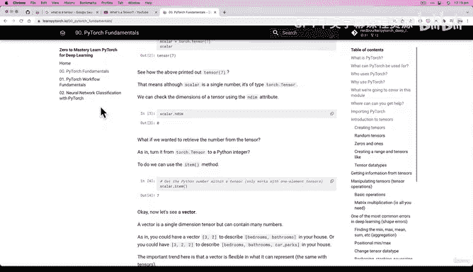

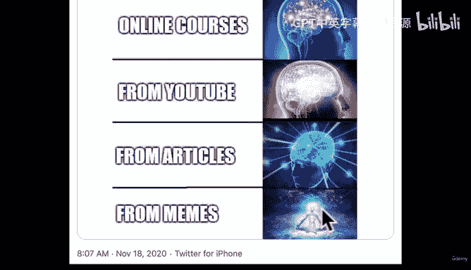

Here's what we're going to cover broadly。😊，So now in this module。

We are going to cover the ptorch basics and fundamentals。

 mainly dealing with tensors and tensor operations。

 Remember a neural network is all about input tensors， performing operations on those tensors。

 creating output operations。 Later， we're going to be focused on preprocessing data。

 getting it into tensors。 So turning data from raw form images， whatever into a numerical encoding。

 which is a tensor。 Then we're going to look at building and using pretrained deep learning models。

 specifically neural networks。 We're going to fit a model to the data。

 So we're going to show our model or write code for our model to learn patterns in the data that we've preprocessed We're going to see how we can make predictions with our model。

 because that's what deep learning and machine learning is all about， right。

 using patterns from the past to predict the future。😊。

And then we're going to evaluate our models' predictions。

 We're going learn how to save and load our models， for example。

 if you wanted to export your model from where we're working to an application or something like that。

 And then finally， we're going to see how we can use a trained model to make predictions on our own data on custom data。

 which is very fun， And how well， you can see that the scientist has faded out a little bit。

 But that's not really that true。 we're going to do it like cooks， not chemists。

 So chemists are quite precise。 Everything has to be exactly how it is。 But cooks them more like。

 you know what a little bit of sold add a little bit of butter。 does it taste good。 Okay， well。

 then we're on。 But machine learning is a little bit of both。 Its。😊。

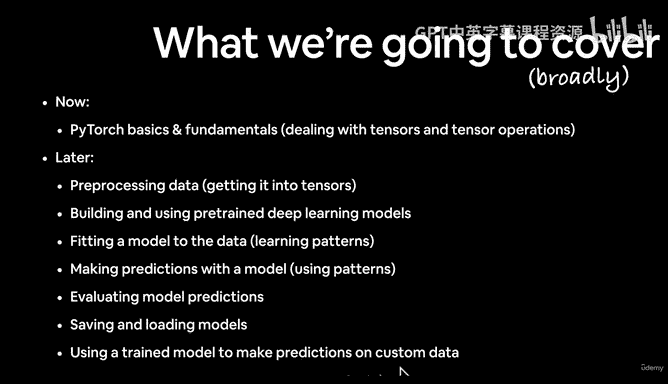

Little bit of science。 little bit of art。 that's how we're going to do it。

 But I like the idea of this being a machine learning cooking show。

 So welcome to cooking with machine learning， cooking with pie Torch with Daniel。😊。

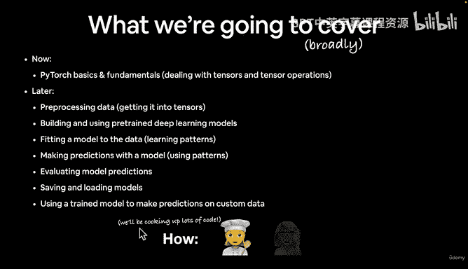

And finally， we've got a workflow here， which we have a Pyto workflow， which is one of many。

 We're gonna kind of use this throughout the entire course。 is step 1。

 we're gonna get our data ready。 Step 2， we're gonna build or pick a pretrain model to suit whatever problem we're working on。

 Step 2。1， pick a loss function and optr。 Don't worry about what they are。

 We're gonna cover them soon。 Step 2。2， build a training loop。 Now。

 this is kind of all part of the parcel of step 2。 Hence why we've got 2。1 and 2。2。

 You'll see what that means later on。 Number 3， we're gonna fit the model to the data and make a prediction。

 So say were working on image classification for raman or spaghetti。

 How do we build a neural network or put our images through that neural network to get some sort of idea of what's in an image。

😊。

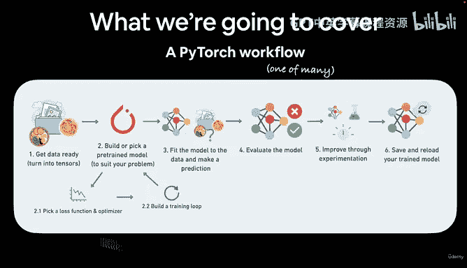

We'll see how to do that。 We'll evaluate our model to see if it's predicting B S。

 or it's actually going。 All right。 number 5， we're going to improve through experimentation。

 That's another big thing that you'll notice throughout machine learning throughout this course is that it's very experimental。

 Part art， part science。 Numb 6， save and reload your train model again。

 I' put these with numerical order。 But they can kind of be mix and match depending on where you are in the journey。

 But numerical order is just easy to understand for now。😊。

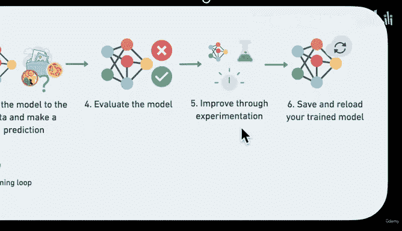

Now we've got one more video， maybe another one before we get into code， but in the next video。

 I'm going to cover some very， very important points on how you should approach this course。

I'll see you there。

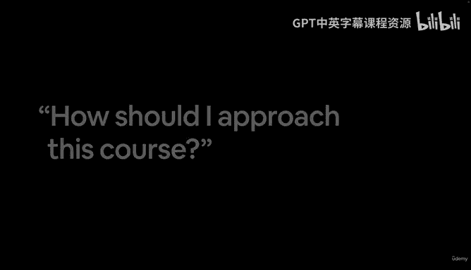