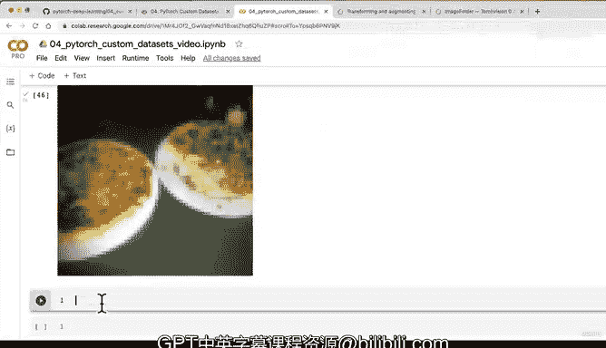

# Daniel Bourke《PyTorch 深度学习｜PyTorch 101 Crash Course For Beginners in 2025》中英字幕 - P140：140_06_010 可视化训练集加载图像.zh_en - GPT中英字幕课程资源 - BV1kTSKB1E9m

Welcome back in the last video we used datas。im folder to turn all of our image data into tensors and we did that with the help of our data transform which is a little pipeline up here to take in some data or specifically an image resize it to a value that we've set in our K6464 randomly flip it along the horizontal。

 we don't necessarily need this， but I've just put that in there to indicate what happens when you pass an image through a transforms pipeline and then most importantly we've turned our images into a torch tensor。

 so that means that our data， our custom data set， this is so exciting is now compatible to be used with a Ptorrch model so let's keep pushing forward we're not finished yet。

 we're going to visualize some samples from the train data data。😊，So let's， how can we do this。

 Let's get， we can index on the train data data set。To get a single image and a label。So if we go。

Can we do train data zero， what does that give us？Okay， so this is going to give us an image tensor。

😊，And it's associated label， in this case， it's an image of pizza because why its associated label is pizza。

😊，So let's take the00。 So this is going to be our image and the label is going to be train data0。

 And we're just going to get the first index item there， which is going to be one。

 And then if we have a look at them separately。Image and label。Beautiful。

 so now one of our target images is in Tensor format， exactly how we want it。

 and its label is in numeric format as well， which is also exactly how we want it。

 And then if we wanted to convert this back to a non label， we can go class names。😊。

And index on that。And we see pizza and I mean， non labelers in nonnumeric。

 we can get it back to string format， which is human understandable。

 we can just index on class names， So let's print out some information about what's going on here。😊。

Print F， we're going to go image tensor。I love Fstrs if you haven't noticed yet。

Image tensor and we're going to set in new line， we're going to pass it in our image。

 which is just the image that we've got here。Then we'll printed some more information about that this is still all becoming one with the data right where we're slowly finding out information about our data set so that if errors arise later on we can goHm our image or we're getting a shape error and I know our images are of this shape or we're getting a data type error which is why I've got the dot D type here and that might be why we're getting a data type issue。

😊，So let's do one more with the image label。Label， oh well actually we'll do one more。

 we'll do print， we'll get the label data type as well。Label。

 this will be important to take note of later on。Type。As I said， three big issues shape mismatch。

 device mismatch and data type mismatch。Can we get the type of our label？Beautiful。

 so we've got our image tensor。And we've got its shape It's of torch size 36464。

 That's exactly how we want it。 The data type is torch F 32。

 which is the default data type in Pi torch。 our image label is0 and the label data type is of integer。

😊，So let's try and plot this and see what it looks like， hey， using that plot lib， so first of all。

 what do we have to do while we have to rearrange the order of dimensions。😊，In other words。

 mapplotlib likes color channels last， so let's see what this looks like。 We'll go image permute。

 we've done this before， image dot permute 1，2，0 means we're reordering the dimensions。

0 would usually be here， except that we've taken the zero dimension the color channels and put it on the end and shuffled the other two forward。

So let's now print out。Different shapes。I love printing out the change in shapes。

 helps me really understand what's going on because sometimes I look at a line like this and it doesn't really help me。

 but if I print out something of what the shapes were originally and what they changed to well， hey。

 that's a big help。 That's what Jupiter notebooks are all about right。😊。

So this is going to be colour channels first， height， width。And depending on what data you're using。

 if you're not using images， if you're using text， still knowing the shape of your data is a very good thing。

 We're going to go imagepermute dot shape and this should be everything going right is height width color channels on the end here。

And we're just going to plot the image。Can never get enough plotting practice。Pt the image。

 I'm going to go Plt。fi or pass in fig size。Equals 10，7。And then we're going to Plt。mshow。

We'll pass in the commuted image。Image underscore commmutees， and then we'll turn off the axes。

And we will set the title to be class names and we're going to index on the label just as we did before。

 and we're going to set the font size equal to 14 so it's nice and big here we go。Beautiful。

 there is our image of pizza。 It is very pixelated because we're going from about 512 as the original size 512 by 512 to 6464。

 I would encourage you to try this out， potentially you could use a different image here。

 So we've indexed on sample0， maybe you want to change this to just be a random image and go through these steps here。

 And then if you'd like to see different transforms， I'd also encourage you to try changing this out。

 our transform pipeline here， maybe increase the size and see what it looks like。

 And if you're feeling really adventurous， you can go into torch vision。

 and look at the transforms library here and then try one of these and see what it does to our images。

 But we're going to keep pushing forward， we are going to look at another way。😊，Or actually。

 I think for completeness， let's now turn， we've got a data set。

We want to we wrote up here before that we wanted to turn our images into a data set and then subsequently a torch U's data data loader。

 So we've done this before。By batching our images or batching our data that we've been working with。

So I'd encourage you to give this a shot yourself。😡。

Try to go through the next video and create a train data loader using our train data。

 wherever that is， train data and a test data loader using our test data。

So give that a shot and we'll do it together in the next video。

 we'll turn our data sets into data loaders。

