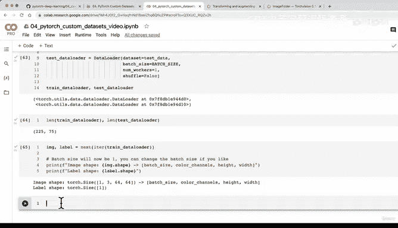

# Daniel Bourke《PyTorch 深度学习｜PyTorch 101 Crash Course For Beginners in 2025》中英字幕 - P141：141_06_011 将图像数据集转换为PyTorch DataLoader.zh_en - GPT中英字幕课程资源 - BV1kTSKB1E9m

Welcome back。 How'd you go In the last video， I issued you the challenge to turn our data sets into data loaders。

 So let's do that together Now。 I hope you gave it a shot。 That's the best way to practice。

 So turn loaded images into data loaders。😊，So we're still adhering to our Pytorch workflow here。

 We've got a custom data set。 We found a way to turn it into tenseors in the form of data sets。

 and now we're going to turn it into a data loader so we can turn our data sets into iterables or batchify our data So let's write down here a data loader。

😊，Is going to help us。Turn our data sets into iterables。And we can customize the batch size。

 write this down。So our model can see。Batch size。Images at a time。

So this is very important as we touched on in the last section， computer vision。

 we create a batch size because if we had 100，000 images，😊。

Chances are if they were all in one data set。There's 100。

000 images in the Food 101 data set we're only working with about 200。If we try to load all 100。

000 in one hit， chances are our hardware may run out of memory。

 and so that's why we matchify our images。 So if we have a look at this Navidia SMI。😊。

Our GPU only has 16 gig。 I'm using a Tesla T4 right now， Well has about 15 gigs of memory。

 so if we tried to load 100，000 images into that whilst also computing on them with a pint much model potentially we're going out memory and run into issues so instead we can turn them into a data loader so that our model looks at 32 images at a time and can leverage all of the memory that it has rather than running out of memory。

So let's。Turn our train and test datas into data loaders。

Turn train and test data sets into data loaders Now this is not just for image data。

 this is for all kinds of data in Pytorch。Images， text， audio， you name it。So import data loader。

 then we're going to create a train data loader。We're going to set it equal to data loader。

 we're going to pass in a data set。So let's set this to train data。Let's set the batch size。

 What should we set the batch size to， I'm going to come up here and set a laser。

Capital variable I'm going to use 32 because 32 is a good batch size So we'll go 32 or actually let's start small。

 let's just start with a batch size of one and see what happens batch size1 number of workers。

 So this parameter is going to be this is an important one。

 I'm going to I potentially have covered it before， but I'm going to introduce it again。

 is this going to be how many cause or how many CPU core that is used to load your data So the higher the better usually and you can set this via OS CPU count which will count how many CPUus your compute hardware has So I'll just show you how this works importport O and this is a Python O module we can do CPU count to find out how many CPUus our Google coab instance has mine has two your number may vary。

 but I believe most coabab instances have two CPUus if you're running this on your local machine you may have。

If you're running it on dedicated deep learning hardware， you may even have even more。

 right So generally， if you set this to one。It will use one CPU core， but if you set it to OS。

cpu count， it will use as many as possible。So we're just going to leave this as one right now。

 you can customize this to however you want， and I'm going to shuffle the training data。

Because I don't want my model to recognize any order in the training data， so I'm going to mix it up。

And then I'm going to create the test data loader。Data set equals test data。

And batch size equals one nu workers。 I'm going to set this to equal one as well。 Again。

 you can customize each of these their hyperparameter to whatever you want。Number of workers。

 generally， the more， the better。And then I'm going to set shuffle es false for the test data so that if we want to evaluate our models later on。

 our test data set is always in the same order。So now let's have a look at Tra data loader。

 see what happens and test data loader。Wonderful， so we get two instances of torch us dot data dot data loader。

 And now we can。😊，See if we can visualize something from the train data loader。

 as well as the test data loader。 I actually maybe we just visualize something from one of them。

 So we're not just double handling everything。 Do we get a length here。Wonderful。

 because we're using a batch size of one， our lengths of our data loaders are the same as our data sets。

😊，Now， of course， this would change if we set， oh， we didn't even set this to the match size parameter。

Bch size。Let's come down here and do the same here。Blash size。

So we'll watch this change if we wanted to look at 32 images at a time， we definitely could do that。

 so now we have eight batches because 22 225 divided by 32 equals roughly8。

And then 75 divided by 32 also equals roughly 3。 And remember。

 these numbers are going to be rounded if there are some overlaps。 So let's get rid of。

We'll change this back to one。And we'll keep that there， we'll get rid of these too。

And let's see what it looks like to plot an image from our data loader。Or at least have a look at it。

Check out the shapes， that's probably the most important point at this time we've already plotted enough things。

So let's iterate through our train data loader and we'll grab the next one。

 we'll grab the image and the label and we're going to。😊，Print out here。

 So batch size will now be one。 you can change。The batch size， if you like， this is just again。

 another way of getting familiar with the shapes of our data。😡，So image shape。Let's go image。

t shape and we're going to right down here， this shape is going to be batch size。

 this is what our data loader is going to add to our images， is's going to add a batch dimension。

Coollor channels， height， width。And then print。Let's check out that label shape。

Same thing with the labels， it's going to add a batch dimension。Label and let's see what happens。Oh。

 we've got the end of the bracket。Beautiful， so we've got image shape。

 Our label shape is only one because we have a batch size of one。

 And so now we've got batch size 1 color channels 3 height width。 And if we change this to 32。

 what do you think is going to happen。😊，We get a match size of 32。😡，Still three color channels。

 still 64， still 64。 And now we have 32 labels。 So that means within each batch， we have 32 images。

 and we have 32 labels。We could use this with a model。 I'm going to change this back to one。😊。

And I think we've covered enough in terms of learning our data sets。 How cool is this。

 We've come a long way。 We've downloaded a custom data set。

 We've loaded it into a data set using image folder， turned it into tensesors。

 using our data transform and now batchified our custom data set in data loaders。😊。

We've used these with models before， so if you wanted to you could go right ahead and build a convolutional neural network to try and find patterns in our image tensesors。

But in the next video， let's pretend we didn't have this data loader。😊，This image folder。

Class available to us。How could we load our image data set？So that it's compatible。

Like our image data set here， how could we replicate this image folder class？

So that we could use it with a data loader because data load is part of torchutils。 datata。

 you're going to see these everywhere， let's pretend we didn't have the Torchvision datas image folder to helper function。

And we'll see in the next video how we can replicate that functionality。😊。

I'll see you there。