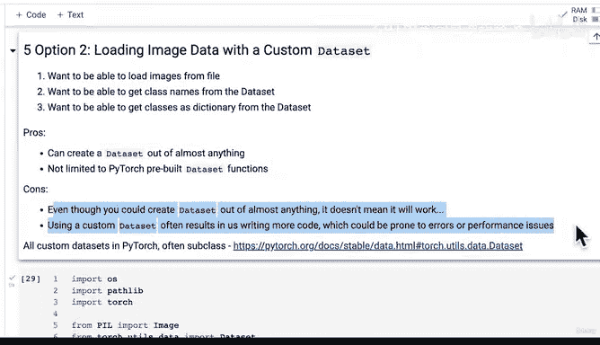

# Daniel Bourke《PyTorch 深度学习｜PyTorch 101 Crash Course For Beginners in 2025》中英字幕 - P142：142_06_012 PyTorch自定义数据集类高层概览.zh_en - GPT中英字幕课程资源 - BV1kTSKB1E9m

Welcome back So over the past few videos we've been working out how to get our data from our data folder。

 pizza steak and sushi， we've got images of different food data here and we're trying to get it into Tensor format。

 So we've seen how to do that with an existing data loader helper function or a data set function in image folder。

😊，However， what if image folder didn't exist and we need to write our own custom data loading function Now。

 the premise of this is， although it does exist， it's going to be good practice because you might come across a case where you're trying to use a data set where a prebuilt function doesn't exist。

😡，So let's replicate the functionality of image folder by creating our own data loading class。😊。

So we want a few things。 we want to be able to get the class names as a list from our loaded data。

 and we want to be able to get our class names as a dictionary as well。

 So the whole goal of this video is to start writing a function or a class that's capable of loading data from here。

😊，Into Tensor format， capable of being used with the Pytorchches data loader class like we've done here。

 so we want to create a data set。😡，Let's start it off。 We're going to create another heading here。

 This is going to be number five， option 2。Loading image data with a custom data set。😊。

So we want a few。Functionality steps here number one is want to be able to load images。

From file to want to be able to get class names from the data set。

And three want to be able to get classes as dictionary from the data set。

And so let's briefly discuss the pros and cons of creating your own custom data set。😊。

We saw option one was to use a pre existing data set loader helping function from TorchVi。

And it's going to be quite similar if we go torch vision data sets。😊。

Quite similar if you're using other domain libraries here。

 there were going to be data loading utilities。But。

At the base level of pitorrch is torchuts dot data dot data。 Now， this is the base data set class。

 So we want to。Build on top of this to create our own image folder loading class。😡。

So what are the pros and cons of creating your own custom data？Well， let's discuss some pros。

So one pro would be you can create a。Data set。Out of almost anything。

As long as you write the right code to load it in。And。

Another pro is that you're not limited to high torch。Prebuilt。Data set。Functions。

A couple of cons would be that even though this is to point number one。😡。

So even though you could create a data set。Out of almost anything。

It doesn't mean that it will automatically work。😡，It will work and of course you can verify this through extensive testing seeing if your model actually works if it actually loads data in the way that you want it。

And another con is that using a custom data set。Requires us to write more code。

 so often results in us writing more code。Which could？Be prone to errors。Or performance issues。

So typically if something makes it into the Pytorch standard Library or the Pytorch domain libraries。

If functionality makes it into here， it's generally been tested many。

 many times and it can kind of be verified that it works quite well with， or if you do use it。

 it works quite well whereas if we write our own code， sure we can test it ourselves。

 but it hasn't got the robustness to begin with that is。

 we could fix it over time as something that's included in say the Pytorch standard library。😡。

Nonetheless， it's important to be aware of how we could create such a custom data set。

So let's import a few things that we're going to use We'll import OS because we're going to be working with Python's file system over here。

We're going to import Partlibb because we're going to be working with file parts。

Well import torch we don't need to again， but I'm just doing this for completeness。

We're going to import image from pill， the image class， because we want to be opening images。

I'm going to import from Torchuts data， I'm going to import data which is the base data set and as I said over here we can go to datas。

 click on Torch U's data do data set。 This is an abstract class representing a data set and you'll find that this data set links to itself。

 so this is the base data set class many of the data sets in Ptorrch， the prebuilt functions。

Subclass this， so this is what we're going to be doing it。And there's a few notes here。

 all subclass should overwrite get item。😊，And you should optionally overwrite L these two methods we're going to see this in a future video。

 For now， we're just， we're just setting the scene here。So from Torch vision。

We're going to import transforms because we want to。Not only import our images。

 but we want to transform them into tensesors and from the Python'ons typing module。

 I'm going to import Tuple。Dickt and list so we can put T pins when we create our class and loading functions。

Wonderful。So。This is our instance of Torchvision。 datas image folder。😡，Toorgevision datas。im folder。

Let's have a look at the train data。So we wanted to write a function that can replicate getting the classes from a particular directory and also turning them into an index。

Or dictionary that is。So let's build a helper function to replicate this functionality here。

 In other words， I'd like to write a helper function that if we pass it in a file path。

Such as pizza Stak sushi or this data folder。It's going to go in here and it's going to return the class names as a list。

 and it's also going to turn them into a dictionary。😊。

Because it's going to be helpful for later on when we'd like to access the classes and the class to IDX and if we really want to completely recreate image folder while image folder has this functionality。

 so we'd like that too。😊，So this is just a little high level overview of what we're going to be doing。

 I might link in here that we're going to subclass this。😊，So all custom data sets in P torch。

Often subclass。This。So here's what we're going to be doing。Over the next few videos。

 we want to be able to load images from a file。 Now you could replace images with whatever data that you're working with。

 the same premise will be here。You want to be able to get the class names from the data set and want to be able to get classes a dictionary from the data set。

 So we're going to map our samples， our image samples。To their class name。

By just passing a file path。To a function that we're about to rot。

And some pros and cons of creating a custom data set。😊。

We've been through that， let's in the next video start coding up a helper function to retrieve these two things from our target directory。

