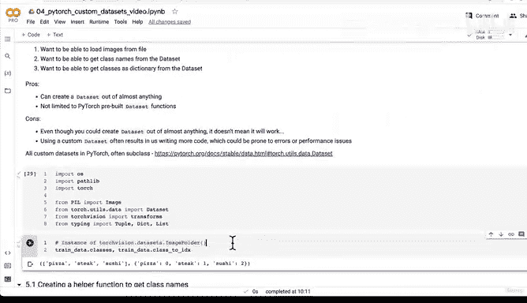

# Daniel Bourke《PyTorch 深度学习｜PyTorch 101 Crash Course For Beginners in 2025》中英字幕 - P143：143_06_013 创建从目录获取类名的辅助函数.zh_en - GPT中英字幕课程资源 - BV1kTSKB1E9m

In the last video， we discussed the exciting concept of creating a custom data。

 and we wrote down a few things that we want to get。 We discussed some pros and cons。

 and we learned that many custom datas inherit from torch。t us do data do data。

 So that's what we'll be doing later on。😊，In this video。

 let's focus on writing a helper function to recreate this functionality。

 So I'm going to title this 5。1。😊，Creating a helper function。To get class names。

I'm going to turn this into markdown。 And if I go into here。 So we want to function to。

Let's write down some steps and then we'll code it out。So we'll get the class names。

 and we're going to use OS。cander， so it's going to scan a directory。To traverse a target directory。

And ideally， the directory is in standard image。Classification。Format。

So just like the image folder class。Our custom data class is going to require our data already be formatted。

In the standard image classification format， such asT and Test for training and test images。

 and then images for a particular class are in a particular directory。So let's keep going。

And number two， what else do we want it to do， We want it to raise an error if the class names。

Aren't found。So if this happens。There might be。We want this to hint at the fact that there might be something wrong with the directory structure。

😊，And number three， we also want to turn。The class names into our D and a list and return them。

Beautiful， so let's get started。 Let's set up the part directory。For the target directory。

So our target directory is going to be what？The directory we want to load directory。

 if I could spell， we want to load our data from。 Let's start with the training there。

 just for an example， so target。Directory， what do we get？

So we're just going to use the training folder as an example to begin with。And we'll go print。

Target di。 We'll put in the target directory。 Just want to exemplify what we're doing。

 and then we're going to。Get the class names。From the target directory。

So I'll show you the functionality of OS scaner， of course you could look this up in the Python documentation。

So class names found， let's set this to be sorted。And then we'll get the entry name。

 entry dot name for entry in list， so we're going to get OS list scaner。Of the image path， slash。

Target directory。Let's see what happens when we do this。Target directory。

 have we got the right brackets here？Is this going to work， let's find out。Oh， image path。

 slash target directory。What do we get wrong？Oh， we don't need the image path there。

 put let's just put target directory there。There we go， beautiful。

 so we set up our target directory as been the training term。😊，And so if we just go。

 let's just do list。What happens if we just run this function here？O， Skander。Yeah， so there we go。

 so we have three directory entries， so this is where we're getting entry。t name。😊。

For everything in the training directory。So if we look in the training directory。

 what do we have train and we have one entry for pizza， one entry for sushi， one entry for steak。

 wonderfulnder， So now we have a way to get a list of class names and we could quite easily turn this into a dictionary。

 couldn't we。😊，Which is exactly what we want to do。 We want to recreate this， which we've done。

 and we want to recreate this， which is also done。 So now let's take this functionality here。

And let's turn that into a function。All right。 What can we do， What do we call this。

I'm going to call this deaf F classes。And I'm going to say that it takes in a directory。

 which is a string。 and it's going to return。 This is where I imported typing from Python typing。

 I imported tuple and I'm going to。Return a list， which is a list of strings and a dictionary。

 which is strings mapped to Integers。Beautiful， so let's keep going。 We want to。

We want this function to return given a target directory， we want it to return these two things。

 so we've seen how we can get a list of the directories in a target directory by using OS scanander。

 So let's write finds the classes are the class folder names in a target directory。Beautiful。

 and we know that it's going to return a list and a dictionary。😊，So let's do step number one。

 We want to get the class names by scanning。The target directory。

We'll go classes just we're going to replicate the functionality we've done above。

But for any given directory here。So classes equals sorted entry。t name。For entry in OS scaner。

And we're going to pass it the target directory。If。

Entry dot is we're just going to make sure it's a directory as well。

And so if we just return classes and see what happens。So find classes。

 let's pass it in our target directory， which is our training directory， what do we get？Beautiful。

So we need to also return class to IDX。So let's keep going。

 so number two is let's go raise an error if class names could not be found。So if not classes。

Let's say raise file， we're going to raise a file not found error。

And then let's just write in here F。Couldn't find any classes in directory。

 so we're just writing some error checking code here。

So if we can't find a class list within our target directory。

 we're going to raise this error and say couldn't find any classes in directory。😊，Please， check。

File structure。And there's another check up here that's going to help us as well to check if the entry is a directory。

So finally， let's do number three， what do we want to do so we want to create a dictionary of index labels。

So computers， why do we do this while computers prefer？Numbers rather than strings as labels。

So we can do this， we've already got a list of classes， so let's just create class to IDX equals。

Class name I for I， class name in。Enumerate。Classesses。Let's see what this looks like， he？😊。

So we'll go class names and then class to IDX。Or we can just return it actually。😊。

Do we spell enumerate wrong， Yes， we did。 So what this is going to do is going to map a class name to an integer or to I for I class name in enumerate classes。

 So it's going to go through this and it's going to go for I。 So the first one。

0 is going to be pizza ideally。 One will be steak 2 will be sushi。 Let's see how this goes。Beautiful。

 look at that。 We've just replicated the functionality of。😊，Image folder。

So now we can use this helper function in our own custom data set。

 find classes to traverse through a target directory such as train。

 We could do the same for test if we wanted to， to。 And that way， we've got a list of。😊。

Classes and we've also got a dictionary mapping those classes to integers。

So now let's in the next video， move towards。Subclassing。Torchutts。 datata。

 data set and we're going to fully replicate image folder。So I'll see you there。😊。

