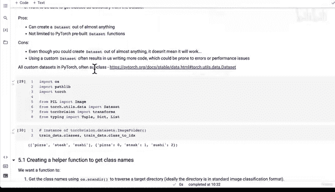

# Daniel Bourke《PyTorch 深度学习｜PyTorch 101 Crash Course For Beginners in 2025》中英字幕 - P144：144_06_014 从零编写PyTorch自定义数据集类.zh_en - GPT中英字幕课程资源 - BV1kTSKB1E9m

In the last video， we wrote a great helper function called F classes that takes in a target directory and returns a list of classes and a dictionary mapping those class names to an integer。

😊，So let's move forward and this time we're going to create a custom data set。😊。

To replicate image folder now we don't necessarily have to do this right because image folder already exists and if something already exists in the Pytorch library chances are it's going to be tested well it's going to work efficiently and we should use it if we can。

 but if we needed some custom functionality， we can always build up our own custom data set by subclassingtorch。

utils。 data。 data set or if a pre-built dataet function didn't exist well we're probably going to want to subclasstorrchutils data。

 data set anyway。😊，And if we go into the documentation here。

 there's a few things that we need to keep in mind when we're creating our own custom data set。😊。

All data sets that represent a map from keys to data samples， so that's what we want to do。

 we want to map keys， in other words targets or labels to data samples which in our case are food images。

So we should subclass。This class here。Now， to note， all subclass should overrite get item。

 So get item is a method in Python， which is going to get an item or get a sample。

 supporting fetching a data sample for a given key。 So， for example。

 if we wanted to get sample number 100。 This is what get item should support。

 it should return us sample number 100。And subclass could also optionally override L。

 which is the length of a data set。 So return the size of the data set by many sampler implementations and the default options of data loader。

 because we want to。Use this custom data set with data loader later on。

 so we should keep this in mind when we're building our own custom subclasses of Torch U's data data。

Let's see this hands on， we're going to break it down， it's going to be a fair bit of code。

 but that's all right。😊，Nothing that we can't handle。To create。Our own。Custom data set。We want to。

Number one， first things first is going to be going to subclass。Sumclass torch。uttails。daet。Two。

 what do we want to do， We want to init our subclass。With a target directory。

So the directory we'd like to get data from。As well as a transform。If we'd like to transform。

Our data so just like when we used image folder， we could pass a transform to our data set。

So that we could transform the data that we were loading， we want to do the same thing。

And we want to create several。Attributes。Let's write them down here， We want paths。

 which will be the paths of our images。What else do we want， We want transform。

 which will be the transform we'd like to use。We want classes。

 which is going to be a list of the target classes。And we want class to IDX。

 which is going to be a di of the target classes。Mat。Two In labels。Now， of course。

 these attributes will differ depending on your data set， but we're replicating image folder here。

 So these are just some of the things that we've seen that come with image folder。

 but regardless of what data you're working with， there are probably some things that you want to cross them universal you probably want all the paths of where your data is coming from。

 the transforms you'd like to perform on your data。

 what classes you're working with and a map of those classes to an index。

 so let's keep pushing forward， we want to create a function to load images because after all we want to open some images。

 So this function will open an image。Number five， we want to overrite the L method。To return。

The length。Of our data， so just like it said in the documentation。If you subclass using Torch。

utils that dated the data set。😡，You should overwrite get item and you should optionally overwrite La。

 so we're going to instead of optionally we are going to overwrite length。And number six。

 we want to overrite。The get item。Method to return a given sample when passed an index。Excellent。

 so we've got a fair few steps here， but。If they don't make sense now it's okay， let's code it out。

 remember our motto if and down， code it out and if and down run the code。

 so we're going to write a custom data set This is so exciting because。😊。

When you work with prebuilt data sets， it's pretty cool in machine learning。

 but when you can write code to create your own data sets and that's oh that's magic So number one is we're going to well number zero is we're going to import Torch UT's data set we don't have to rewrite this we've already imported it。

 but we're going to do it anyway for completeness Now step number one is to subclass it subclass torch UTs data the data。

So just like when we built a model。We're going to subclass and in module。

 but in this time we're going to call us our class image folder custom and we're going to inherit from data set。

 this means that all the functionality that's contained within Torch U's data data set we're going to get for our own custom class。

😊，Number two， let's initialize， so we're going to initialize。Our custom data set。

There's a few things that we'd like and knit our subclass with the target directory。

 the directory we'd like to get data from， as well as a transform if we'd like to transform our data。

 so let's write a knit function。😊，Ant， and we're going to go self。Tggeder。And。

Tug de is going to be a string， and we're going to set a transform here， we'll set it equal to none。

Beautiful。So this way we can pass in a target directory of images that we'd like to load。

 and we can also pass in a transform just similar to the transforms that we've created previously。

So now we're up to number three， which is create several attributes。

 so let's see what this looks like， create class attributes。So we'll get all of the image parts。

So we can do this just like we've done before， self paths equals list， pathlibb。path。

 because what's our target directory going to be？Well， I'll give you a spoiler alert。

 It's going to be a path like the test directory， or it's going to be the train directory。

Because we're going to use this once for our test directory and our train directory。

 just like we use the original image folder。So we're going to go through the target directory and find out。

All of the paths。 So this is getting all of the image paths that support or that follow the file name convention of。

Star slashstar。jPG。 So if we have a look at this， we passed in the test folder。

So test is the folder star would mean any of these，1，2，3， pizza steak sushi。 That's the first star。

Then slash would go into the pizza directory。😊，The star here would mean any of the file combinations here that end in dot JPG。

So this is getting us a list of all of the image paths within a target directory。In other words。

 within the test directory and within the train directory when we call these two separately。

So let's keep going。 We've got all of the image parts。 What else did we have to do。

 We want to create transforms。 So let's set up transforms。Self dot transforms equals transform。Oh。

 we'll just call that transform actually setup transform equals transform。

 so we're going to get this from here。And I put it as none because it transform can be optional。

So let's create classes and Class to IDX attributes， which is the next one on our list。

 which is here classes and Class to IDX now lucky us in the previous video we created a function to return just those things。

 so let's go self dot classes and self dot class to IDX equals find classes。

And we're going to pass in the target di or the target D from here。Now， what's next？

 We've done step number 3， we need。Number four is create a function to load images。 Allright。

 let's see what this looks like so。Number four， create a function to load。Images。

 so let's call it load image and we're going to pass in self and we'll also pass in an index。

 So the index of the image we'd like to load and this is going to return an image dot。Image。

So where does that come from， well previously we imported from P。

 so we're going to use Python image library or pillow to import our images。

So we're going to given a file path from here， such as P。

 we're going to import it with the image class and we can do that using。

 I believe it's image dot open， so let's give that a try。 I'll just write a note in here。

 opens an image via a path and returns it。😊，So let's write image path equals。Self。

 this is why we got all of the image paths above。So self dot paths and we're going to index it on the index。

Beautiful， and then let's return image dot open。Image path。

So we're going to get a particular image path and then we're just going to open it。😊。

So now we're up to step number five， override the land method to return the length of our data set。

This is optional， but we're going to do it anyway。So overr。linin。

So this just wants to return how many samples we have in our data set。 So let's write that de L。

 So if we call L on our data set。Instance， it's going to return just how many numbers there are。

 So let's write this down。Returns the total number of samples。

And this is just going to be simply return length or then of self dot Hs。😊。

So for our target directory， if it was the training directory。

 we'd return the number of image paths that this code has found out here and same for the test directory。

So next， I'm going to go。Number six is we want to overrite。We put this up here， the get item method。

 So this is required if we want to subclass Tor Us data data set。

 So this is in the documentation here， all subclasss should override get item。

 So we want get item to if we pass it in index to our data set。

 we want it to return that particular item， So let's see what this looks like override the get item。

Method to return are particular。Sample。And now this method is going to leverage。

Get item all of the code that we've created above。So this is going to go take in self。

 which is the class itself， and it's going to take in an index which will be of an integer。

 and it's going to return a tuple of torch do tensor。And an integer。

 which is the same thing that gets returned when we index on our training data。

 so if we have a look image label equals train data。0ero。Gt item is going to replicate this。

We passed at index here。Let's check out the image and the label。This is what we have to replicate。

 so remember train data was created with image folder from Torchvision。 datas。

And so we will now get item to return an image and a label。

 which is a tuple of a torch tensor where the image is of a tensor here。😊。

And the label is of an integer， which is the label here。

 the particular index as to which this image relates to。So let's keep pushing forward。

I'm going to write down here。Returns。One sample of。Data。Data and label。X， and well， we'll just go X。

 Y。So we know that it's a tuple。Beautiful， so let's set up the image。😊。

What do we want the image to be？Well， this is where we're going to call on our self。

t load image function， which is what we've created up here。

Do you see the customization capabilities of creating your own class？

So we've got a fair bit of code here， right， but essentially all we're doing is we're just creating functions that iss going to help us load our images into some way。

 shape or form。😊，Now again， I can't stress this enough regardless of the data that you're working on。

The pattern here will be quite similar。You'll just have to change the different functions you use to load your data。

So let's load an image of a particular index。 So if we pass in an index here。

 it's going to load in that image。Then what do we do Well we want to get the class name。

 which is going to be self。Dot paths and we'll get the index here。And we can go parent。t name。

So this expects。Path in format。Data。Folder， slash class name， slashimage。jpg。

That's just something to be aware of and the class IDX is going to be self。

 class to IDX and we will get the class name here。So now we have an image by loading in the image here。

We have a class name。By because our data is going to be or our data is currently instead image classification format。

 you may have to change this depending on the format your data is in。

 we can get the class name from that， and we can get the class IDX by indexing on our attribute up here。

Our dictionary of class names to indexes。Now we have one small little step。

 this is transform if necessary。So remember our。Transform parameter up here。

 if we want to transform our target image， well， let's put in if self dot transform。

 if the transform exists， let's pass the image through that transform。Transform image。

And then we're going to。Also return the class IDX。So do you notice how we've returned to topppple here。

 this is going to be a torch tensor。If our transform exists and the class IDX is also going to be returned。

Which is what we want here， X and Y， which is what gets returned here。

 image as a tensor label as an integer。So， return。Data， label， X， Y。

 And then if the transform doesn't exist， let's just return。Image， class IDX。Return。

Untransformed image and label。Beautiful， so that is a fair bit of code there。

 so you can see the pro of subclassing torch Us data that data set is that we could customize this in almost any way we wanted to to load whatever data that we're working with。

 or almost any data。😊，However， because we've written so much code， this may be prone to errors。

 which we're going to find out in the next video to see if it actually works。😊。

But essentially all we've done is we've followed the documentation here Torch。uttil's data data set。

To replicate the functionality of an existing data loader function， namely image folder。

 So if we scroll back up。

Ideally， if we've done it right， we should be able to write code like this。😊。

Passing in a route directory such as a training directory， a particular data transform。

And we should get very similar instances as image folder， but using our own custom data set class。

So let's try that out in the next video。