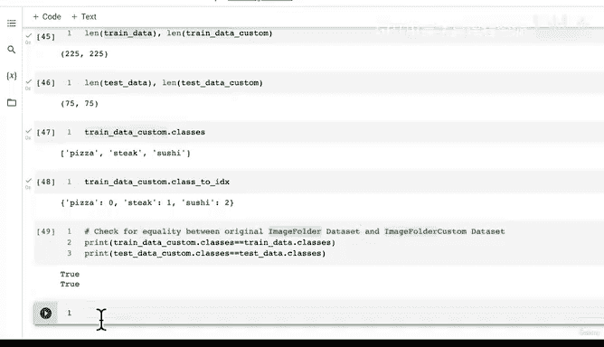

# Daniel Bourke《PyTorch 深度学习｜PyTorch 101 Crash Course For Beginners in 2025》中英字幕 - P145：145_06_015 对比自定义数据集类与原始ImageFolder类.zh_en - GPT中英字幕课程资源 - BV1kTSKB1E9m

So now we've got a custom image folder class。That replicates the functionality of the original image folder。

 data loader class， or data set class that is。Let's test it out。

 Let's see if it works on our own custom data。 So we're going to create a transform here。😊。

So that we can transform our images。Raw JpeEg images into tensess。

Because that's the whole goal of importing data into Pytorrch。

 so let's set up a train transforms compose。We're going to set it to equal2 transformforms dotcompose and I'm going to pass in a list here that it's going to be transforms。

 we're going to resize it to 6464。😊，Whatever their image size will reduce it down to 64，64。

 Then we're going to go transforms dot random horizontal flip。

 We don't need to necessarily flip them， but we're going to do it anyway just to see if it works。

And then let's put in here， transforms dot to Tenor。

 because our images are getting opened as a pill image。Using image dot open。

 but now we're using the to transform transform from pi torch or Torchvisions dot transforms。

 So I'll just put this here。From Torchvision dot transforms that way。

 you know we're importing transforms there， and let's create one for the test data set as well。

 Test transforms Well set this up。 Oh excuse me。 We'll need to just go import。Transforms。

And let's go transformforms do composeose。And we'll pass in another list we're going to do the exact same as above。

 we'll set up resize and we'll set the size equal to 64，64。😊。

And then transforms we're going to go dot to Tensor。

 we're going to skip the data augmentation for the test data because typically you don't manipulate your test data in terms of data augmentation。

 you just convert it into a tensor rather than manipulate its orientation， shape， size， etcter。

 etca so let's run this。And now let's see how image folder custom class works。Test out。Image。

Folder custom。Let's go， we'll set up the train data custom。Is equal to。

Image folder custom and then we'll set up the T di， which is equal to the training directory。

 and then we'll pass in the transform， which is equal to the train transforms。

 which we just created above train transforms。And then we're going to。I think that's all we need。

 actually， We only had two parameters there。 We're not going to use a target transform because our labels。

 we've got to help a function to transform our labels。

 So test data custom is going to be image folder custom。

 And I'm going to set up the tag dough to be equal to the test directory。

 and the transform is going to be the test transforms from the cell above there。😊。

And what's coabab telling me there？I'm going to set that up。Didn't we spell something， oh。

 we spelled it wrong， train transforms， there we go。Beautiful。

 now let's have a look at our train data and test data custom。😊，See if it worked。What do we have？

Or we have an image folder custom， well it doesn't give us as much rich information as just checking it out as it does for the train data。

😊，But that's okay。 We can still inspect these。 So this is our original one made with image folder and we've gotten our train data custom and test data custom。

 Let's see if we can get some information from these。

 So let's check the original length of the train data and see if we can use the land method on our train data custom。

 Did that work。😊，Wonderful now how about we do it for the original test data made with image folder and our custom version made with test data or image folder custom。

😊，Beautiful， that's exactly what we want。 and now let's have a look at the train data custom。

 let's see if the class' attribute comes up。😊，Dot classes and。We'll just leave that there。

 We'll do the class dot Id X。 Yes， it is。 So this attribute here is， I wonder if we get。😊。

Information from group Co Lab loading， what do we get oh classes to IDX classes load image paths transform So if we go back up here。

😊，All these attributes are from here， paths， transform， classes， class to ID D X。

 as well as load image。 So this is all coming from the code that we wrote。 our custom data set class。

 So let's keep pushing forward。 Let's have a look at the class to I D X。

 Do we get the same as what we wanted before。 Yes， we do。 beautiful。

 a dictionary containing our string names and their integer associations。

 So let's now check for a quality。😊，We can do this by going。

Check for a quality between original image folder。Data set and image folder。Custom data set。 Now。

 we've kind of already done that here。 But let's just try it out。 Let's go print。

Let's go train data custom dot classes is that equal to train， oh I don't want three equals。

 train data the original one dot classes and also print， let's do test data。Custom dot classes。

Is this equal to？Test data， the original one classes。True and true。 Now， you could try this out。

 In fact， it's a little exercise to try it out to compare the others， but。Congratulations to us。

 We have replicated the main functionality of the image folder data set class。

 And so the takeaways from this is that。😊，Whatever data you have。

Pytorch gives you a base dataset class to inherit from。

 and then you can write a function or a class that somehow interacts with whatever data you're working with。

 So in our case， we load in an image。 And then you as long as you override the land method and the get It method and return some sort of values。

 Well， you can create your own data set loading function。 How beautiful is that。

 So that's going to help you work with your own custom datas in Pytorch。

 So let's keep pushing forward， we've seen analytically that our custom data is quite similar to the original pytorch Torch vision datas image folder data set。

 But you know what I like to do I like to visualize things。 So let's in the next video。

 create a function to display some random images from our trained data custom class。😊。

