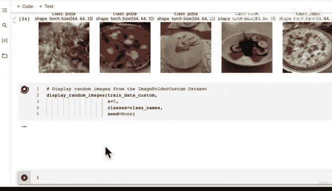

# Daniel Bourke《PyTorch 深度学习｜PyTorch 101 Crash Course For Beginners in 2025》中英字幕 - P146：146_06_016 编写自定义数据集随机图像可视化函数.zh_en - GPT中英字幕课程资源 - BV1kTSKB1E9m

It's time to follow the data Explorer's motto of visualize visualize visualize。

 so let's create another section I'm going to write here a title called Create a function。😊。

To display random images。 And sure we've we've had a look at the different attributes of our custom data set。

 We see that it gives back a list of different class names。

 We see that the lengths are similar to the original。

 but there's nothing quite like visualizing some data， so let's go in here。

 we're going to write a function， a helper function。😊，So step number one。

 we need to take in a data set， so one of the data sets that we just created。

 whether it be train data custom or train data。And a number of other parameters。

Such as class names and how many images？To visualize。And then step number two is。To prevent。

The display。Getting out of hand， let's cap the number of images to see at 10， because， look。

 if our data set is going to be thousands of images and we want to put in a number of images to look at。

 let's just make sure it's the maximum is 10。 That should be enough。 So we'll set the random seed。

For reproducibility。Number four is let's get a list of random samples。

 so we want random sample indexes let' just get rid of this S。

From what do we want it from from the target data set？

So we want to take in a data set and we want to count the number of images we're seeing。

 We want to set a random seed。 and do you see how much I use randomness here to really get an understanding of our data？

 I really， really， really love harnessing the power of randomness。

 So we want to get a random sample of indexes from all of our data。😊。

And then we're going to set up a mappl Lib plot。Then we want to loop through。

The random sample images。And plot them。With Mattpottlib。And then as a side to this one。

 step seven is we need to make sure the dimensions of our images line up with Mapllib。

So Maplot Lib needs height width color channels。All right。Let's take it on， hey？So number one is。

Create a function。To take in a data set。So we're going to call this de。

 let's call it de display random images going to be one of our helper functions we've created a few type of functions like this。

But let's take in a data which is torch u of type that is of type dataset。

Then we're going to take in classes， which is going to be a list of different strings。

 so this is going to be our class names for whichever data set we're using。

 I'm going to set this equal to none。😊，And then we're going to take in n。

 which is the number of images we'd like to plot and I'm going to set this to 10 by default so we can see 10 images at a time。

10 random images that is do we want to display the shape。

 Let's set that equal to true so that we can display what the shape of the images because were we're passing it through our transform as it goes into。

A data set， so we want to see what the shape of our images are just to make sure that that's okay。

And we can also， let's set up a seed， which is going to be an integer。

 and we'll set that to none to begin with as well。Okay， so step number two。

 what do we have above We have to prevent the display getting out of hand。

 Let's cap the number of images to see at 10。 So we've got n is by default。 It's going to be 10。

 but let's just make sure that it stays there， adjust just display if n is too high。😊。

So if n is greater than 10。Let's just readjust this。 Let's set n equal to 10 and display shape。

 We'll turn off the display shape because if we have 10 images， our display may get out of hand。

 So just print out here for display purposes。N shouldn't be。

Larger than 10 setting to 10 and removing shape display。 Now。

 I only know this because I've had experience cooking this dish before。 In other words， I'。

 I've written this， this type of code before。 So you can customize the beautiful thing about Python and pythtorrches。

 you can customize these display functions in any way you see fit。 So step number 3。

 What are we doing， Set the random seed for reproducibility， Okay。😊，Set the seed。 So if seed。

 let's set random dot seed equal to that seed value， and then we can keep going。

So number four is let's get some random sample indexes so we can do that by going。

 get random sample indexes。Wwhichch is step number four here。

 so we've got a target data set that we want to inspect and we want to get some random samples from that so let's create a random samples IDX list and I'm going to randomly sample from a length of our data set or sorry a range of the length of our data and I'll show you what this means in a second。

And the K， oh， excuse me。Have we got enough brackets there， I always get confused with the brackets。

 The K is going to be M。 So in this case， I want to randomly sample 10 images from the length of our data set or 10 indexes。

So let's just have a look at what this looks like。 we'll put in here our train data custom here。😊。

So this is going to take a range of the length of our train data custom。

 which is what 225 we looked at that before， just up here。😊，Length of this。 So between 0 and 255。

 we're going to get 10 indexes if we've done this correctly。 beautiful。

 So there's 10 random samples from our train data custom or 10 random indexes， that is。😊。

So we're up to step number five。Which was。Loop through the random sample images or indexes。

 let's count this to indexes。Indexes and plot them with mappl Lib。

 So this is going to give us a list here， So let's go loop through random indexes。And plot them。With。

Mappl lib。Beautiful， so for I tu sample in enumerate。Let's enumerate through the random。

Random samples。ID X list。 And then we're going to go tag image and tag label。

 because all of the samples in our target data set are in the form of topples。

 So we're going to get the target image and the target label， which is going to be data set tag。

Sample will take the index， so it might be one of these values here。 We'll index on that。

 and the zeroth index will be the image， and then we'll go on the data set as well。

 We'll take the target sample index。 and then the index number one will be the label of our target sample。

 and then number 7。Oh， excusecus me， with Mr。 Stepb。That should be number6。Did you catch that？

Number five is setup up plot so we can do this quite easily by going plot figure This is so that each time we we iterate through another sample we're going to have quite a big figure here。

 so we set up the plot outside the loop so that we can add a plot to this original plot here。

And now this is number 7， where we make sure the dimensions of our images line up with mappllib。

 So if we recall by default， Pythr is going to turn our image dimensions into what color channels first。

 However， mappllib preferverse color channels last。 So let's go adjust tensor dimensions。

For plotting。So let's go tag image。Let's call this tag image adjust equals tag image dot permute。

 And we're going to alter the order of the indexes。

 So this is going to go from color channels or the dimensions that is height， width。

And we're going to change this width if I could spell。To height width color channels。Beautiful。

 that one will probably catch you off guard for a few times， but we've seen it a couple of times now。

 so I're going to keep going with this plot adjusted samples。😊。

So now we can add a subplot to our mappl Lib plot and we want to create we want one row of n images。

 this will make a lot more sense until we visualize it and then for the index we're going to keep track of i plus1。

So let's keep going， so then we're going to go plot in show and I'm going to go tag。Image adjust。

 so I'm going to plot this image here。And then let's turn off the axis。

And we can go if the classes' variable exists， which is up here。😊，A list of classes。

 Let's adjust the title of the plot to be the particular index in the class list。 So title equals F。

Class。And then we're going to put in here classes and we're going to index on that with the target label index。

 which is going to come from here because that's going to be a numerical format and then if display shape。

😊，Let's set the title equal to title plus F。We're going to go new line shape。

 this is going to be the shape of the image T image， adjust dot shape。

And then we'll set the title to Plt。 title。So you see how if we have display shape。

 we're just adjusting the title variable that we created here。

 and then we're putting the title onto the plot。 So let's see how this goes。

 That is quite a beautiful function。 Let's pass in one of our data sets and see what it looks like。

 Let's plot some random images。😊，So which one should we start with first， so let's display。

Random images from the image folder created data set， so this is the Ibuilt Pi torch image folder。

Let's go display random images， the function we just created above。

 we're going to pass in the train data and then we can pass in the number of images。

 let's have a look at five and the classes is going to be the class names which is just a list of our different class names and then we can set the seed。

 we want it to be random so we just set the seed to equal none。😊，Oh，Doesn't that look good。

 So this is from our original train data made with image folder。 So option number one up here。

 option 1， There we go。😊，And weve passed in the class name。 So this is sushi resize to 64，64，3。

 same with all of the others but from different classes。 Let's set the seed to 42， see what happens。

😊，I get these images， we got a sushi， we got a pizza， we got pizza， sushi pizza。

 and then if we try a different one， we just go none。We get random images again。 wonderful。 Now。

 let's write the same code。 But this time using our train data custom data set。

 So display random images from the image folder custom data set so。😊，This is the one that we created。

Display random images， I'm going to pass in train data custom。

Our own data set this is exciting let's set n equal to 10 and just see how far we can go with our plot or maybe we set it to 20 and just see if our code for adjusting the plot makes sense。

😊，Class names and seed eagles I'm going to put it in 42 this time。There we go for display purposes。

 and shouldn't be larger than 10 setting to 10 and removing shape display。 So we have a steak image。

 a pizza image， pizza， steak， pizza， pizza， pizza， pizza， steak pizza。

 If we turn off the random seed， we should get another 10 random images here。😊，Beautiful。

 look at that。 steak， steak， sushi， pizza， steak， sushi class。

 I'm reading out the different things here。 pizza， pizza， pizza， pizza。 Okay。

 so it looks like our custom data set is working from both the qualitative。😊，Standpoint。

 looking at the different images and a quantitative。

 how about we change it to5 and see what it looks like？😊。

Do we have a different shape， Yes， we do the same shape as above。😊，Wonderful， okay。

 so we've got train data custom。😊，And we've got train data which is made from image folder。

 but the premises remain， we've built up a lot of different ideas and we're looking at things from different points of view。

 we are getting our data from the folder structure here into Tensor format。😊。

So there's still one more step that we have to do。 And that's go from data set to data loader。

 So in the next video， let's see how we can turn our custom loaded images。

Train data custom and test data custom into data loaders。

So you might want to go ahead and give that a try yourself we've done it before up here。

Turn loaded images into data loaders， we're going to replicate the same thing as we did in here for our option number two。

 except this time we'll be using our custom data set。😊，I'll see you in the next video。

