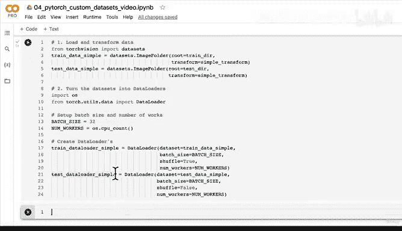

# Daniel Bourke《PyTorch 深度学习｜PyTorch 101 Crash Course For Beginners in 2025》中英字幕 - P149：149_06_019 构建基线模型（第一部分）：数据加载与转换.zh_en - GPT中英字幕课程资源 - BV1kTSKB1E9m

Welcome back In the last video we covered how the Pytoch team used trivial augment wide。

 which is the latest state of the art in data augmentation at the time of recording this video to train their latest state of the art computer vision models that are within Torchvision and we saw how easily we could apply trivial augment thanks to Torchvision do transforms。

😊，And we'll just see one more of those in action just to highlight what's going on。

So it doesn't look like much happened to that image when we augmented。

 but we see this one has been moved over， we've got some black space there this one has been rotated a little and now we've got some black space there。

😊，But now's time for us to build our first computer vision model on our own custom data set。

 So let's get started。 We're going to go model 0。😊。

We're going to reuse the tiny VGG architecture which we covered in the computer vision section and the first experiment that we're going to do。

 we're going to build a baseline， which is what we do with Model zero。😊。

We're going to build it without data augmentation。 So rather than use trivial augment。

 which we've got up here， which is what the Pytorch team used to train their state of the art computer vision models。

 We're going just start by training our computer vision model without data augmentation。

 And then so later on， we can try one to see with data augmentation to see if it helps or doesn't。

 So let me just put a link in here， C an explainer。

This is the model architecture that we covered in depth in the last section。

 so we're not going to go spend too much time here。

 all you have to know is that we're going to have an input of 64 64。

3 into multiple different layers such as convolutional layers， Re layers， max pool layers。

 and then we're going to have some output layer that suits the number of classes that we have。😊。

In this case， there's 10 different classes， but in our case we have。😊，3 different classes。

 one for pizza， steak and sushi。 So let's replicate the tiny VG G architecture。From。

The CNN explainer website。 And this is going to be good practice， right。

 We're not going to spend too much time referencing their architecture。

 We're going to spend more time coding here。But of course， before we can train a model。

 what do we have to do， Well， let's go to 7。1。We're going to create some transforms and loading data。

We're going to load data for Model zero。 Now we could， of course。

 use some of the variables that we already have loaded。

 but we're going to recreate them just to practice。So let's create a simple transform。

And what is our whole premise of loading data for Model 0。

 We want to get our data from the data folder， from pizza St sushi。

 from the training and test folders， from their respective folders。

 we want to load these images and turn them into tensesors。 Now we've done this a few times now。

 And one of the ways that we can do that is by creating a transform。Equals transforms dot composeose。

And we're going to pass in， let's resize it。So transforms dot resize。

 we're going to resize our images to be the same size as the tiny VGG architecture on the CNN explainer website。

64，64，3。 And then we're also going to pass in another transform to tensor so that our images get resized to 6464。

 and then they get converted into tensors， and particularly these values within that tensor are going to be between 0 and 1。

So there's our transform now we're going to load some data if you want to pause the video here and try to load it yourself。

 I'd encourage you to try out option1， loading image data using the image folder class and then turn that data set。

 that image folder data set into a data loader， so batchify it so that we can use it with a Pytorch model。

So give that a shot， Otherwise， let's go ahead and do that together。

So one we're going to load and transform data we've done this before。

 but let's just rehash on it what we do so from Torch visionion import data sets。

Then we're going to create the train data simple， and I call this simple because we're going to use at first a simple transform。

 one with no data augmentation， and then later on for another modeling experiment。

 we're going to create another transform one with data augmentation。😊，So let's put this here。

 data sets image folder。And let's go， the root equals the training directory。

And then the transform is going to be what it's going to be our simple transform that we've got above。

And then we can put in test data simple here， and we're going to create datas。

image folder and then we're going to pass in the route as the test directory and we'll pass in the transform is going to be the simple transform again above。

 so we're performing the same transformation here on our training data and on our testing data。😊。

Then what's the next step we can do here？Well， we can two turn the data sets into data loaders。

 so let's try it out。 First we're going to import OS， then from Torch。uts。 data。

 we're going to import data loader。And then we're going to set up。Bge size and number of workers。

So let's go batch size。 We're going to use a batch size of 32 for our first model。Numb workers。

 which will be the number of， oh excuse me， I've got to typo appear， classic number of workers。

 which will be the wt， the number of CPU cores that we dedicate towards loading our data。

So let's now create the data loaders。We're going to create train data loader simple。

Which will be equal to data loader。And the data set that goes in here will be train data simple。

 then we can set the batch size equal to the batch size parameter that we just created or hyperparameter that is。

😊，Recall the hyperparameter is something that you can set yourself。

 We would like to shuffle the training data， and we're going to set none workers equal to。

Numb workers。So in our case， how many core does Google CoAab have， let's just run this。

Find out how many numb workers there are， I think there's going to be two CPUs。Wonderful。

 and then we're going to do the same thing for the test data loader。Test data loader， simple。

We're going to go data loader， we'll pass in the data set here。

 which is going to be the test data simple， and then we're going to go batch size。Equals batch sign。

We're not going to shuffle the test data set and then the number workers will just set it to the same thing as we've got above。

Beautiful。So。I hope you gave that a shot， but now do you see how quickly we can get our data loaded if it's in the right format？

😊，I know we spent a lot of time going through all of these steps over multiple videos and writing lots of code。

 but this is how quickly we can get set up to load our data。 We create a simple transform。

 and then we load in and transform our data at the same time。

 and then we turn the data sets into data loaders just like this。 Now。

 we're ready to use these data loaders with a model。😊，So speaking of models。

 how about we build the tiny VGG architecture in the next video and in fact。

 we've already done this in notebook number3， so if you want to refer back to the model that we built there。

Right down here， which was model number 2。 If you are on refer back to this section and give it a go yourself。

 I'd encourage you to do so， otherwise。

We'll build the tiny VGG architecture in the next video。

