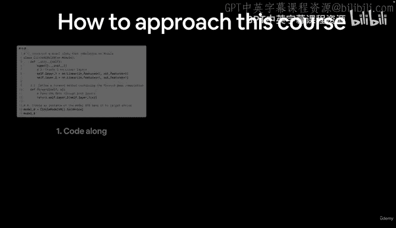
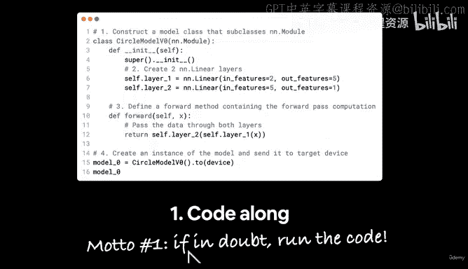
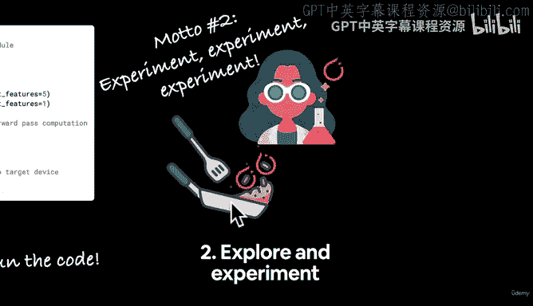
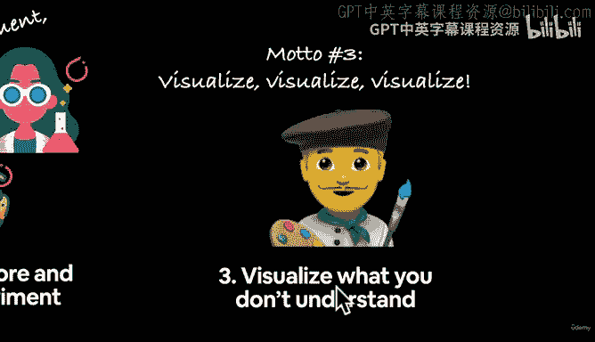
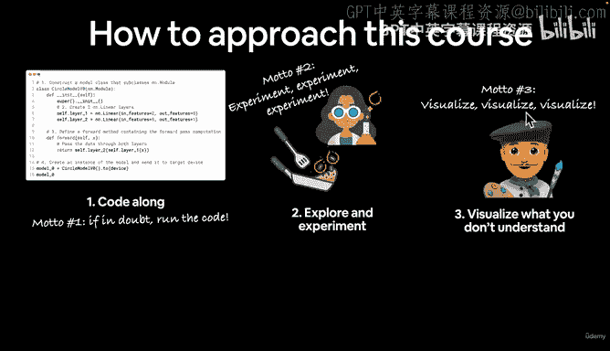
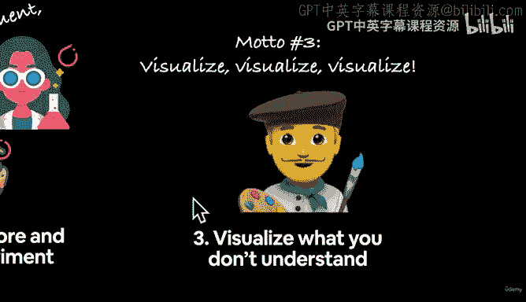
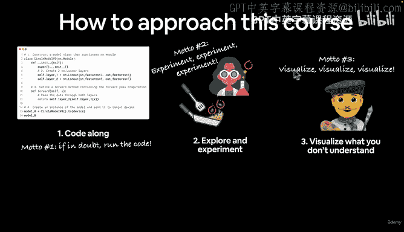
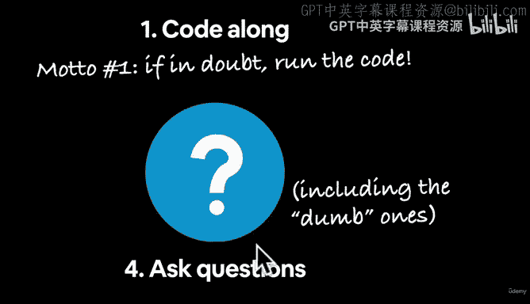
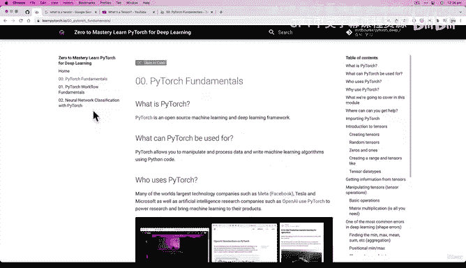
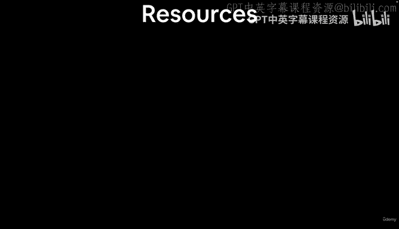

# Daniel Bourke《PyTorch 深度学习｜PyTorch 101 Crash Course For Beginners in 2025》中英字幕 - P14：014_02_010 正确与错误的学习方法.zh_en - GPT中英字幕课程资源 - BV1kTSKB1E9m

Now you might be asking， how should I approach this course you might not be asking。

 but we're going to answer it anyway。😡，How to approach this course。

 This is how I would recommend approaching this course。

 So I am a machine learning engineer day to day and learning machine learning to coding machine learning。

 a kind of two different things。 I remember when I first learned it was kind of you learned a lot of theory rather than writing code。

 So not to take away from the theory of been important。

 this course is going to be focusing on writing machine learning specifically pytorrch code。

 So the number one step to approaching this course is to code along。 Now。

 because this course is focused on purely writing code I will be linking extracurricular resources for you to learn more about what's going on behind the scenes of the code。

 my idea of teaching is that if we can code together， write some code， see how it's working。

 that's going to spark your curiosity to figure out what's going on behind the scenes。

 So motto number one is， if in doubt， run the code， write it， run the code， see what happens。😊。

Number two， I love that。Explore and experiment again。 Approach this with the idea。

 the mind of a scientist and a chef or science an art experiment， experiment experiment。

 Try things with rigggle like a scientist' wood， and then just try things for the fun of it like a chef would。

😊。

Number3， visualize what you don't understand。 I can't emphasize this one enough。

 We have three motto so far， if in doubt， or run the code。 You're going to hear me say this a lot。

 experiment， experiment experiment and number three， visualize， visualize。

 visualize why is this Well， Because we've spoken about machine learning and deep learning deals with a lot of data。

 a lot of numbers。 And so I find it that if I visualize some numbers in whatever form that isn't just numbers all over a page I tend to understand it better and there are some great extra resources that I'm going to link that also turn what we're doing So writing code into fantastic visualizations。

😊。

Number 4， ask questions， including the dumb questions， really。

 there's no such thing as a dumb question。 Everyone is just on a different part of their learning journey。

 And in fact， if you do have a quote unquote dumb question。

 it turns out that a lot of people probably have that one as well。 So be sure to ask questions。

 I'm going link a resource in a minute of where you can ask those questions， but please， please。

 please ask questions not only to the community， but to Google to the Internet to wherever you can。

 or just yourself， ask questions of the code and write code to figure out the answer to those questions。

😊。

Number 5， do the exercises。 There are some great exercises that I've created for each of the modules。

 If we go， have we got the book version of the course up here， We do。😊。

Within all of these chapters here down the bottom is going to be exercises and extra curriculum。

 So we've got some exercises。 I'm not going to jump into them， but I would highly recommend。

 don't just follow along with the course and code after I code。 Please， please。

 please give the exercises a go， because that's going to。😊。

Stretch your knowledge。We're going to have a lot of practice writing code together。

 doing all of this stuff here， but then the exercise is are going to give you a chance to practice what you've learned and then of course。

 extra curriculum well， hey， if you want to learn more。

 there's plenty of opportunities to do so there。😊，And then finally。Number 6， share your work。

 I can't emphasize enough how much writing about learning deep learning or sharing my work through Github or different code resources or with the community has helped with my learning。

 So if you learn something cool about Pytorch， I'd love to see it link it to me somehow in the Discord chat or on Github or whatever。

 there'll be links of where you can find me。 I'd love to see it， please do share your work。

 It's a great way to not only learn something， because when you share it， when you write about it。

 Well it's like， how would someone else understand it。

 but it's also a great way to help others learn， too。😊，And so。He said how to approach this course。

 Now， let's go how not to approach this course。 I would love for you to avoid overthinking the process。

 So this is your brain。 this is your brain on fire。 So avoid having your brain on fire。

 That's not a good place to be。 we are working with pie torch。 So it's gonna be quite hot。

 Just playing on words with the name torch。 But avoid your brain catching on fire。

 and avoid saying I can't learn da da da。 I've said this to myself lots of times。

 And then I've practiceised it。 And it turns out， I can actually learn those things。

 So let's just draw a red line on there。 Oh， I thicker red line。 Yeah， there we go。

 nice and thick red line。 We'll get that out there。

 It doesn't really make sense now that this says a void and crossed out。 But don't say I can't learn。

 and prevent your brain from catching on fire。Finally。

 we've got one more video that I'm going to cover before this one gets too long of the resources for the course before we get into coding。

😡。

Ill see you that。