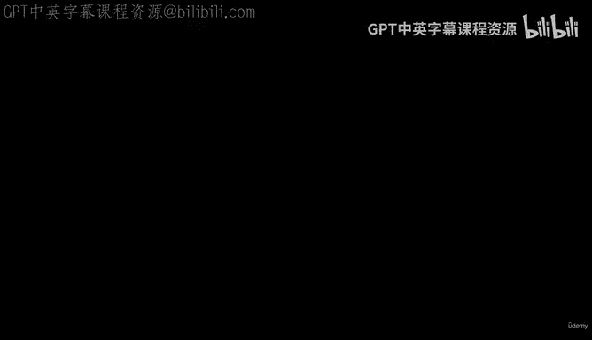
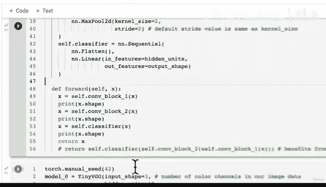

# Daniel Bourke《PyTorch 深度学习｜PyTorch 101 Crash Course For Beginners in 2025》中英字幕 - P150：150_06_020 构建基线模型（第二部分）：从零复现TinyVGG.zh_en - GPT中英字幕课程资源 - BV1kTSKB1E9m

Welcome back in the last video we got set starting to get ready to model our first custom data and I issued you the challenge to try and replicate the tiny VGG architecture from the CNN explainplainer website which we covered in notebook number3。

 but now let's see how fast we can do that together hey。😊，I'm going to write down here section 7。2。

And I know we've already coded this up before， but it's good practice to see what it's like to build Pto models from scratch。

 create tiny VGG model class。So the model is going to come from here previously we created our model there would have been one big change from the model that we created in section number three。

 which is that our model in section number three used black and white images。

 but now the images that we have are going to be color images。

 so there's going to be three color channels rather than one。

And there might be a little bit of a trick that we have to do to find out the shape later on in the classifier layer。

 But let's get started。 We've got class tiny VG G。 We're going to inherit from N N dot module。

 This is going to be。The model architecture copying。Tiny VGG from。CnN explainer。

And remember that it's quite a common practice in machine learning to find a model that works for a problem similar to yours and then copy it and try it on your own problem。

So I only want two underscores there， we're going to initialize our class。

 we're going to give it an input shape。Which will be an int。

We're going to say how many hidden units do we want， which will also be an end。

 and we're going to have an output shape， which will be an end as well， and it's going to return。

Something none of type none。Then if we go down here。

 we can initialize it with super dot underscore a net。Beautiful。

 now let's create the first Com block， so Com block1。

 which recall will be this section of layers here。So Com block1。

 let's do an N N dot sequential to do so。 Now we need Com Reello Com Reello max pool。

 So let's try this out and then Com2 D， the in channels is going to be。The input shape of our model。

The input shape parameter， the out channels is going to be the number of hidden units we have。

 which is from。Oh， I'm going to might just put enter down here， input shape， hidden units。

 we're just getting those to there。Let's set the kernel size to 3。

 which will be how big the convolving window will be over our image data。 There's a stride of one。

 and the padding equals one as well。 So these are the similar parameters to what the。

CNN Explainer website users。And we're going to go Nn。Reello。And then we're going to go N N co2 D。

 And I want to stress that even if someone else uses like certain values for these。

 you don't have to copy them exactly。 So just keep that in mind。

 you can try out various values of these。 These are all hyper parametersa that you can set yourself。

Hiing units， out channels。Eles hidden units as well。Then we're going to go kernel size equals three。

 stride equals one， and we're going to put padding equals one as well。

 then we're going to have another relu layer and I believe I've forgotten a comma up here。

Another Re layer here。And we're going to finish it off。😊，With Nn dot max pull 2D。

 and we're going to put in the kernel size。Egleles two。And the stride here equals two。Wonderful。So。

Oh， by the way， for Max42D， the default stride value is same as the kernel size。

So let's have a go here， what can we do now？😊，Well， we could just replicate this block as block 2。

 So how about we copy this。Down here。We've already had enough practice writing this sort of code。

 So we're going to go Com block 2， but we need to change the input shape here。

 The input shape of this block2 is going to receive the output shape here。

 So we need to line those up。 This is going to be hidden units。Heading units。

And I believe that's all we need to change there。😊，Beautiful， so let's create the classifier layer。

And the classifier layer recall is going to be this output layer here。

 so we need at some point to add a linear layer that's going to have a number of outputs equal to the number of classes that we're working with and in this case the number of classes is 10 but in our case our custom data set we have。

Three classes， pizza steak sushi。So let's create a classifier layer， which will be an end sequential。

And then we're going to pass in nN dot flatten to turn the outputs of our convolutional blocks into feature vector。

 into a feature vector sorry。And then we're going to have Nn。t linearar。And the in features。

 do you remember my trick for calculating the shape for in features？😊。

I'm going to put hidden units here for the time being out features is going to be output shape。

So I put hidden units here for the time being because we don't quite yet know what the output shape of all of these operations is going to be。

 Of course we could calculate them by hand by looking up the formula for input and output shapes of convolutional layers。

So the input and output shapes are here， but I prefer to just do it programmatically and let the errors tell me where I'm wrong。

 So we can do that by doing a forwardd pass。 And speaking of a Ford pass。

 let's create a forward method。 because every time we have to subclass N N dot module we have to override the forward method。

 We've done this a few times。 But as you can see， I'm picking up the page a little bit because you've got this。

 So let's pass in the comm block 1。 we're going to go X。 Then we're going to print out x dot shape。😊。

And then we're going to reassign X to the self。com block。2。

 so we're passing it through our second block of convolutional layers。

 print x dot shape to check the shape here。 Now this is where our model will probably error is because the input shape here isn't going to line up in features hidden units because we've passed all of the output of what's going through Com block1 Com block 2 to a flatten layer because we want to feature vector to go into our Nn dot linear layer。

 our output layer， which has an out features size of output shape and then we're going to return X So I'm going to print x dot shape here and I just want to let you in our one little secret as well。

 we haven't covered this before， but we could rewrite this entire forward method。

 this entire stack of code by going return self dot classifier and then going from the outside in So we could pass in co block 2 here。

😊，Comm block2 and then self Com block。1 and then X on the inside So that is essentially the exact same thing as what we've done here。

 except this is going to benefits from operator fusion Now this topic is beyond the scope of this course essentially all you need to know is that operator fusion behind the scenes speeds up how your GPU performs computations So all of these are going to happen in one step rather than here we are reassigning X every time we make a computation through these layers。

 So we're spending time going from computation back to memory computation back to memory。

 whereas this kind of just chunks it all in one hit。If you'd like to read more about this。

 I'd encourage you to look up the blog post how to make your GPUs go bur from first principles and B。

Maans fast。That's why I love this post， right， because it's half satire。

 half legitimately like GPU computer science。 So if you go in here， yeah。

 here's what we want to avoid。 We want to avoid all of this transportation between memory and compute。

 And then if we look in here， We might have operator fusion。 There we go。 This is operator fusion。

 The most important optimization in deep learning compilers。 So I， we will link this。

 making deep learning go bare from first principles by Horace Ha。

 a great blog post that I really like。😊，Right here， so if you'd like to read more on that。

 it's also going to be in the extracurricular section of the course so don't worry it'll be there。

Now we've got a model， oh， where do we forget a comma？Right here。 Of course， we did。

And we got another。Weve forgot another comma up here。 Did you notice these。Beautiful， okay。

 so now we can create our model by going torch or an instance of the tiny VGG to see if our model holds up。

 let's create model 0 equals tiny VGG。😊，And I'm going to pass in the input shape。

 what is the input shape， it's going to be the number of colour channels of our image。

 so number of colour channels。In our image data， which is three because we have color images。

And then we're going to put in hidden units equals 10。

 which will be the same number of hidden units as the tiny VGG architecture，1，2，3，4，5，6，7，8，9，10。

 Again， we could put in 10。 we could put in 100。We could put in 64， which is a good multiple of 8。

 so let's just leave it at 10 for now， and then the output shape is going to be what it's going to be the length of our class names because we want one hidden unit or one output unit per class。

 and then we're going to send it to the target device， which is of course couda。

 and then we can check out our model0 here。Beautiful。

 so that took a few seconds as you saw there to move to the GPU memory。

 so that's just something to keep in mind for when you build large neural networks and you want to speed up their computation is to use operator a fusion where you can because as you saw it took a few seconds for our model to just move from the CPU。

 which is the default to the GPU。So we've got our architecture here， but of course。

 we know that this potentially is wrong and how would we find that out Well。

 we could find the right hidden unit shape or we could find that it's wrong by passing some dummy data through our model。

 So that's one of my favorite ways to troubleshoot a model。

 Let's in the next video Pass some dummy data through our model and see if we've implemented the forward pass correctly and also check the input and output shapes of each of our layers。

😊。

I'll see you there。