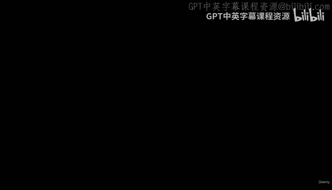
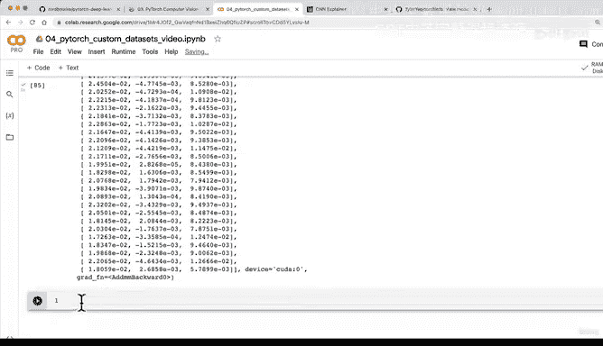

# Daniel Bourke《PyTorch 深度学习｜PyTorch 101 Crash Course For Beginners in 2025》中英字幕 - P151：151_06_021 构建基线模型（第三部分）：前向传播测试模型形状.zh_en - GPT中英字幕课程资源 - BV1kTSKB1E9m

In the last video， we replicated the tiny VGG architecture from the CNN explainer website。

 very similar to the model that we built in Section 03。

 But this time we're using color images instead of grayscale images and we did it quite a bit faster than what we previously did because we've already covered it and we've had some experience now building pinetorch models from scratch。

 So we're going to pick up the pace when we build our models。

 but let's now go and try a dummy forwardd pass to check that our forwardd method is working correctly and that our input and output shapes are correct。

 So let's create a new heading。😊，Try a For pass on a single image and this is one of my favorite ways to test the model。

So let's first get a single image。Get a single image。We want an image batch。

 maybe we get an image batch， get a single image batch because we've got images that are batches already。

Image batch and then we'll get a label batch。🤢，And we'll go next。Itter train data loader simple。

 that's the data loader that we're working with for now。And then we'll check image batch。

 dot shape and label batch。Dot shape。Wonderful， and now let's see what happens。Try a forward pass。Oh。

 I felt single wrong up here。Try a For， we could try this on a single image。

 trying it on a same batch will result in similar results。

So let's go model zero and we're just going to pass it in the image batch and see what happens。Oh。

 no。😊，Of course， we get that input type torch float tensor and weight type torch coter float tensor should be the same or input should be。

 So we've got tensors on a different device right， So this is on the CPU。 the image batch。

 whereas our model is， of course， on the target device。 So we've seen this error a number of times。

 Let's see if this fixes it。😊，Oh， we get another error， and we kind of expected this type of error。

 We've got runtime error， M1 and mat 2 shapes cannot be multiplied。32。

 so that looks like the batch size。2，5，6，0 and 10。 What is 10。 Well。

 recall that 10 is the number of hidden units that we have。 So this is the size here。

 That's 10 there。 So it's trying to multiply a matrix of this size by this size。

 So 10 has got something going on with it。 We need to get these two numbers。

 the middle numbers to satisfy the rules of matrix multiplication。

 because that's what happens in our linear layer。 We need to get these two numbers the same。😊。

And so our hint and my trick is to look at the previous layer。😊，So if that's our batch size。

 where does this value come from？Well， could it be the fact that。

A tensor of this size goes through the flatten layer。Recall that we have this layer up here。

So we've printed out the shape here of the conv block， the output of Comv block1。Now。

 this shape here is the output of Comv block 2。 So we've got this number。The output of convlog 1。

 and then the output of conv V 2。So that must be the input to our classifier layer so if we go 10 times 16 times 16。

What do we get？2，560。😊，Beautiful， so we can multiply our hidden units，10 by 16 by 16， which is the。😊。

The shape here， and we get 2，5，60。 Let's see if that works。We'll go up here Time 16， times 16。

 And let's see what happens。 We'll rerun the model。 We'll rerun the image batch。

 and then we'll pass it。 look at that。 Our model works。 or the shapes at least line up。

 We don't know if it works yet。 We haven't started training yet。 but this is the output size。

 We've got the output。 It's on the coud device， of course。

 but we've got 32 samples with three numbers in each。 Now。

 these are going to be as good as random because we haven't trained our model yet。

 We've only initialized it here with random weights。

 So we've got 32 or a batch worth of random predictions on 32 images。😊。

So you see how the output shape here 3 corresponds to the output shape we set up here。

Output shape equals length class names， which is exactly the number of classes that we're dealing with。

But I think our number is a little bit different to what's in the CNN explainer， 1616。

 how did they end up with 13，13？You know what I think we got one of these numbers wrong。

 kernelnal size， stride padding。 Let's have a look。

 jump into here if we wanted to truly replicate it。Is there any padding here？

I actually don't think there's any padding here。 So what if we go back here and see if we can change this to0。

And change this to0。0， I'm not sure if this will work， by the way。 If it doesn't， it's not too bad。

 but we're just trying to line up the shapes with the CNN explainer to truly replicate it。

 So the output of the Com block 1 should be 3030，10。 What are we working with at the moment。

We've got 32， 3210， so let's see if removing the padding from our convolutional layers lines our shape up with the CNN explainer。

So I'm going to rerun this， rerun our model， I've set the padding to0 on all of our padding hyperparameter。

 oh， when we get another error。We get another shape error。

 of course we do because we've now got different shapes。😊，Wow， do you see how。

 how often that these errors come up。Trust me， I spend a lot of time troubleshooting these shape errors。

 so we now have to line up these shapes so we've got 13 1310 Now does that equal 1690？😊。

Let's try it out， 13， 13，10。1690 beautiful， and do our shapes line up with the CNN explainer？😊。

So we've got 30，3010。 Remember these in pytorch。 So color channels first。

 whereas this is color channels last。 So yep， we've got the output of our first Com block is lining up here。

 That's correct。 And then same with the second block， how good is that。

 we've officially replicated the sand and explain a model so we can take this value 131310。

 and bring it back up here。😊，131310。 remember hidden units is 10。

 so we're just going to multiply it by 1313。 You could calculate these shapes by hand。

 but my trick is， I like to let the error codes give me a hint of where to go。And boom， there we go。

 We get it working again， some shape troubleshooting on the fly。

 So now we've done a single forward pass on the model。

 we can kind of verify that our data at least flows through it。What's next？Well。

 I'd like to show you another little package that I like to use to also have a look at the input and output shapes of my model。

 And that is called torch info。 So you might want to give this a shot before。

We go into the next video， but in the next video we're going to see how we can use torch info to print out a summary of our model so we're going to get something like this。

😊，So， this is how。Beautifully easy torch info is to use。 So give that a shot。

 install it into Google Colaab and run it in a cell here。

 See if you can get something similar to this output for our model 0。😊。

And I'll see you in the next video， we'll try that together。😊。

