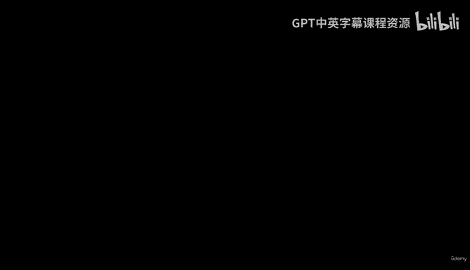
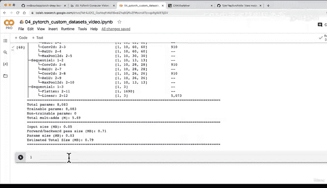

# Daniel Bourke《PyTorch 深度学习｜PyTorch 101 Crash Course For Beginners in 2025》中英字幕 - P152：152_06_022 使用Torchinfo获取模型摘要.zh_en - GPT中英字幕课程资源 - BV1kTSKB1E9m

In the last video we checked our model by doing a forward pass on a single batch and we learned that our forward method so far looks like it's intact and that we don't get any shape errors as our data moves through the model。

 but I'd like to introduce to you one of my favorite packages for finding out information from a Ptorrch model and that is Torch info so let's use Torch infovo to get an idea of the shapes going through our model。

😊，So you know how much I love doing things in a programmatic way well that's what To info does before we used print statements to find out the different shapes going through our model and I'm just going to comment these out in our forward methods so that when we run this later on during training。

 we don't get excessive printouts of all the shapes。😊，So let's see what torch info does。

 And in the last video， I issued a challenge to give it a go。

 It's quite straightforward of how to use it， but let's see it together。

 This is the type of output we're looking for from our tiny VGG model。 And， of course。

 you could get this type of output from almost any piytorrch model。But we have to install it first。

 And as far as I know Google Co Laab doesn't come with Torch info by default。 Now。

 you might as well try this in the future and see if it works。 but yeah。

 I don't get this module because my Google coab instance does it have it installed。

 No problem with that。 Let's install Torch info here。 Ins Torch info。And。

Then we'll import it if it's available。So we're going to try and import to info if it's already installed。

 we'll import it。And then if it doesn't work， if that try block fails， we're going to run Pip。

 install Torch info， and then we will import torch info。

And then we're going to run down here from Torch infofo import summary。 And then if this all works。

 we're going to get a summary of our model， we're going to pass it in Model 0。

 and we have to put in an input size here。 Now that is an example of the size of the data that will flow through our model。

 So in our case， let's put in an input size of 1，36464。

 So this is an example of putting in a batch of one image。

You could potentially put in 32 here if you wanted。

 but let's just put in a batch of a singular image。 and of course。

 we could change these values here if we wanted to to do 4， to 24。

 But what you might notice is that if it doesn't get the right input size， it produces an error。

There we go。 So just like we got before when we printed out our input sizes manually。

 we get an error here。 because what torch info behind the scenes is going to do is it's going to do a forward pass on whichever model you pass it with an input size of whichever input size you give it。

 So let's put in the input size that our model was built for。Wonderful。

 so what torch info gives us is， oh， excuse me。 We didn't comment out。The print outs before。

 So just make sure。We've commented out these printouts in the forwardd method of it of our tiny VGG class。

So I'm just going to run this。 Then we run that， run that just to make sure everything still works。

 We'll run torch info。 There we go。 So no print outs from our model。 But this is。

 look how beautiful this is。 I love how this prints out。 So we have our tiny EG G class。

 And then we can see it's comprised of three sequential blocks。😊。

And then inside those sequential blocks we have different combinations of layers。

 we have some con layers， some reello layers， some max pool layers。

 and then the final layer is our classification layer with a flatten and a linear layer and we can see the shapes changing throughout our model as our data goes in and gets manipulated by the various layers。

😊，So are these in line with the CNN explainer？So if we check this last one。

 we've already verified this before。And we also get some other helpful information down here。

 which is total parameterss， so you can see that each of these layers has a different amount of parameters to learn。

 Now recall that a parameter is a value such as a weight or a bias term within each of our layers。

 which starts off as a random number and the whole goal of deep learning is to adjust those random numbers too。

😊，Better represent our data。 So in our case， we have just over 8000 total parameters。 Now。

 this is actually quite small。In the future you'll probably play around with models that have a million parameters or more。

 and models now are starting to have many billions of parameters。

And we also get some information here， such as how much the model size would be。 now。

 this would be very helpful depending on where we had to put our model。

 So what you'll notice is that as a model gets larger as more layers， it will have more parameters。

 more weights and bias terms that can be adjusted to learn patterns and data。😊。

But its input size and its estimated total size would definitely get bigger as well。

 So that's just something to keep in mind if you have size constraints in terms of storage on in your future applications。

So ours is under a megabyte， which is quite small， but you might find that some models in the future get up to 500 Mbys maybe even over a gigabyte。

 So just keep that in mind for going forward。 And that's the crux of Torch info。

 One of my favorite packages。 just gives you an idea of the input and output shapes of each of your layers。

So you can use Torch info wherever you need， it should work with most of your Pitorrch models。

 just be sure to pass it in the right input size， you can also use it to verify like we did before if the input and output shapes are correct。

So check that out， big shout out to Tyler Yp and everyone who's created the Torch infofo package。

Now in the next video， let's move towards training our tiny VGG model。😊。

We're going to have to create some training and test functions。 If you want to jump ahead。

 we've already done this。

So I encourage you to go。Back to section 6。2 in the functionising training and test loops。

 and we're going to build functions very similar to this， but for our custom data set。

So if you want to replicate these functions in this notebook。Give that a go。

 otherwise I'll see you in the next video and we'll do it together。😊。

