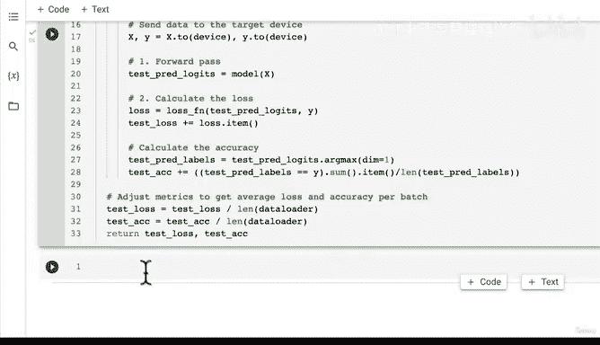

# Daniel Bourke《PyTorch 深度学习｜PyTorch 101 Crash Course For Beginners in 2025》中英字幕 - P153：153_06_023 创建训练测试循环函数.zh_en - GPT中英字幕课程资源 - BV1kTSKB1E9m

How'd you go？Did you give it a shot， Did you try replicating the train step and the test step function。

 I hope you did。 Otherwise， let's do that in this video。

 But this time we're going to do it for our custom data sets。

 And what you'll find is not much if anything changes because we've created our train and test loop functions。

In such a way that they're generic。 So we want to create a train step function。And by generic I mean。

 they can be used with almost any model and data loader。

 so Traint is takes in a model and data loader and trains the model。On the data loader。

And we also want to create another function called Testt。Which takes in。

A model and a data loader and other things and evaluates the model on the data loader。 And。

 of course， for the train step and for the test step。

 each of them respectively are going to take a training data loader。

 I just might make this a third heading so that our outline looks nice and beautiful。😊。

Section 7 is turning out to be quite a big section。 Of course。

 we want them to be respectively taken their own data loader。

 So train takes in the train data loader。 Test takes in the test data loader。Without any further ado。

 let's create the train step function。Now we've seen this one in the computer vision section。

 so let's see what we can make here， so we need a train step which is going to take in a model which will be a torch NN dot module。

😊，And we wanted it also to take in a data loader， which will be a torch。 us。Dot data。 data loader。

And then it's going to take in a loss function， which is going to be a torchnn dot module as well。

And then it's going to take in an optimizer。Which is going to be torchopim do optimizer。😡。

Wonderful and then what do we do， what's the first thing that we do in a training step？😊，Well。

 we put the model in train mode。So let's go model。trainin。Then what shall we do next？Well。

 let's set up some evaluation metrics， one of them being loss and one of them being accuracy。

 so set up train loss and train。😊，Accuracy values。And we're going to accumulate these per batch because we're working with batches。

So we've got train loss and train act equals0 zero。Now we can loop through our data loader。

So let's right loop through。Data loader and we'll loop through each of the batches in this because we've batchrified our data loader。

 so for batch X Y in enumerate data loader。😊，We want to send the data to the target device。😡。

So we could even put that device parameter up here。

Devicice equals device we'll set that to device by default。And then we can go X， Y。Equals x。2 device。

And why dot2 device？Beautiful， and now what do we do Well， remember the pie torch。😊。

The unofficial pieto optimization song we do the Ford pass。So y pre equals model on x。

 and then number two is we calculate the last， so calculate the loss。

Let's go loss equals loss function and we're going to pass it in Ypre Y we've done this a few times now so that's why we're doing it a little bit faster。

 so I hope you notice that the things that we've covered before I'm stepping up the pace a bit so it might be a bit of a challenge。

 but that's all right。 You can handle it and then so that's accumulating the loss so we're starting from zero up here and then each batch we're doing a forward pass calculating the loss and then adding it to the overall train loss。

😊，And so we're going to optimizer zero gra， so zero the gradient of the optimizer。😊。

For each new batch。And then we're going to。Perform back propagation。So loss backwards and then five。

 what do we do， optimize a step， step， step。Wonderful， look at that。

 look at us coding a train loop in a minute or so。😊。

Now let's calculate the accuracy and accumulate it。Calculate the。

You notice that we don't have an accuracy function here， that's because accuracy is。Quite a。

Straightfor metric to calculate， so we'll first get the the wide class because this is going to output model logits。

As we've seen before， the raw output of a model is Loit。

 so to get the class we're going to take the AG max。Torch dot softmax。

 so we'll get the prediction probabilities of Ypre。

 which is the raw logicit what we've got up here across dimension 1 and then also across dimension1 here。

Beautiful， so that should give us the labels， and then we can find out if this is wrong by checking it later on。

And then we're going to create the accuracy by taking the wide pre class。

 checking for a quality with。The right labels。 So this is going to give us how many of these values equal true。

 And we want to take the sum of that， take the item of that， which is just a single integer。

 And then we want to divide it by the length of y pre。

So we're just getting the total number that are right and dividing it by the length of samples。

 so that's the formula for accuracy。😡，Now we can come down here outside of the batch loop。

 we know that because we've got this helpful line drawn in here。And we can go adjust metrics。

To get the average。Loss and accuracy per batch。So we're going to set train loss is equal to train loss divided by the length of the data loader。

 So the number of batches in total and the train accuracy is the train Act divided by the length of the data loader as well。

 So that's going to give us the average loss and average accuracy。Per epoRC across all batches。

So train act。Now， that's a pretty good looking function to me。For a train step。

Do you want to take on the test step， so pause the video。

 give it a shot and you'll get great inspiration from this notebook here。

 Otherwise we're going to do it together in three，2， one。

 let's do the test step so create a test step function。😊。

So we want to be able to call these functions in an epoch loop。And that way。

 instead of writing out training and test code for multiple different models。

 we just write it out once and we can call those functions。 So let's create de test step。

 you're going to do model。Which is going to be。If I could type Torch NN module。

And then we're going to do data loader。😊，Which is torchutils。data。 datata loader。Capital L there。

And then we're going to just pass in a loss function here because we don't need an optimizer for。

The test function， we're not trying to optimize anything we're just trying to evaluate how our model did on the training data set and let's put in the device here。

 why not。That way we can change the device if we need to。

 so put model in a Valel mode because we're going to be evaluating or we're going to be testing。

Then we can sit up。Test loss and test accuracy values。So test loss and test a。

 we're going to make these zero， we're going to accumulate them per batch。

 but before we go through the batch， let's turn on inference mode。So this is behind the scenes。

 going to take care of a lot of pieytorch functionality that we don't need。

 That's very helpful during training， such as track ingredients。 But during testing。

 we don't need that。 So loop through。Data loader or data batches。And we're going to go four batch X。

 Y。And enumerate。Data loader， you'll notice that above we didn't actually use this batch term。Here。

 and we probably won't use it here either。 But I just like to go through and have that there in case we wanted to use it anyway。

 So send data to。The target device。 So we're going to go X， Y equals。X dot2 device and same with Y。

t2 device。Beautiful， and then what do we do for an evaluation step or a test step。😊，Well， of course。

 we do the forward pass。Forward pass。 and we're going to。

Let's call these test prelogitts and get the raw outputs of our model。

 and then we can calculate the loss on those raw outputs， calculate the loss。

We'll get the loss is equal to loss function on test prelogits versus y。

 and then we are going to accumulate the loss。 so test loss plus equals loss dot item。

Remember item just gets a single integer from whatever term you call it on。

And then we're going to calculate the accuracy。 Now。

 we can do this exactly how we've done for the training data set or the training step。

 So test pre labels， we're going to， you don't。 I just want to highlight the fact that you actually don't need to take the softm here。

 You could just take the ag max directly from this。 The reason why we take the softm。😊。

So you could do the same here， you could just directly take the argm of the Loitts。

The reason why we get the softmax is just for completeness。

 So if you wanted the prediction probabilities， you could use torch dot softmax on the prediction logits。

 but it's not 100% necessary to get the same values and you can test this out yourself so try this with and without the softmax and see if you get the same results。

So we're going to go test accuracy。Plus equals。 Now we'll just create our accuracy calculation on the fly test pre labels。

 We'll check for quality on the y， and then we'll get the sum of that。 We'll get the item of that。

 and then we'll divide that by the length of the test pre labels。 beautiful。

 So it's going to give us accuracy per batch。 And so now we want to adjust the metrics to get average。

😊，Loss and accuracy。Per batch。 So test loss equals test loss。Divided by length of the data loader。

 and then we're going to go test a equals test a divided by length of the data loader。

 and then finally we're going to return the test loss， not lost and test accuracy。look at us go。😊。

Now， in previous videos， that took us or in previous sections， that took us a fairly long time。

 but now we've done it in about 10 minutes or so。So give yourself a pat in the back for all the progress you've been making。

 But now， let's in the next video， We did this in the computer vision section as well。 We created。

 do we create a train function Oh， no， we didn't。😊，But we could。

 So let's create a function to functionise this。 We want to train our model。 I think we did。

 actually， Deaf train。 We've done so much。 I'm not sure what we've done。 Okay。

 So looks like we might not have。 but in the next video。 give yourself this challenge。

 create a function called train that combines these two functions。😊，And loops through them both。

With an epoch range。 So just like we've done here in the previous notebook。Can you functionise this。

So just this step here。So you'll need to take in a number of epoCs。

 you'll need to take in a train data loader and a test data loader， a model。

 a loss function and optimizer， and maybe a device。

And I think you should be pretty on your way to all the steps we need for train， so give that a shot。

 but in the next video we're going to create a function that combines train step and test step to train a model。

I'll see you there。