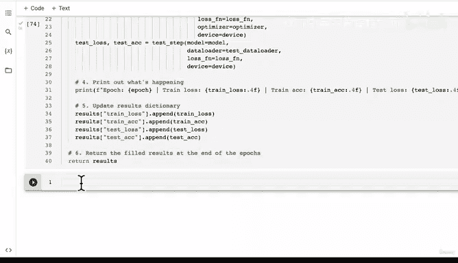

# Daniel Bourke《PyTorch 深度学习｜PyTorch 101 Crash Course For Beginners in 2025》中英字幕 - P154：154_06_024 创建模型训练评估函数.zh_en - GPT中英字幕课程资源 - BV1kTSKB1E9m

How'd you go？In the last video， I issued you the challenge to combine our train step function。

 as well as our test step function together in their own function so that we could just call one function that calls both of these and train a model and evaluate it。

 of course。 So let's now do that together。 I hope you gave it a shot。😊，That's what it's all about。

 So we're going to create a train function。 Now the role of this function is going to， as I said。

 combine train step。😊，And test step。 Now， we're doing all of this on purpose， right。

 because we want to not have to rewrite all of our code all the time。

 so we want to be functionizing as many things as possible so that we can just import these later on if we wanted to train more models and just leverage the code that we've written before as long as it works。

 So let's see if it does。 We're going to create a train function。

 I'm going to first import TqDm TqDm do auto because I'd like to get a progress bar while our model is training。

 There's nothing quite like watching neural network train So step number one is we need to。

Create a train function that takes。In various model parameters。Plus Opr plus data loaders。Plus。

 a loss function。A whole bunch of different things。

 So let's create deaf train and I'm going to pass in a model here。Which is going to be torch and N。

module， you'll notice that the inputs of this are going to be quite similar to our train step and test step。

I don't actually need that there。So we also want a train data loader for the training data， torch。

utts。data。data loader。And we also want a test data loader， which is going to be torch。utts。 data。

 data loader。And then we want an optr， so the optimizer will only be used with our training data set。

 but that's okay， we can take it as an input。Optimizer， and then we want a loss function。

 This will generally be used for both our training and testing step。

 because that's what we're combining here。 Now， since we're working with multi class classification。

 I'm going to set our loss function to be a default of an end dot cross entropy loss。

Then I'm going to get epochs，m I set five， we'll train for5 epochs by default。

 and then finally I'm going to set the device equal to the device。So。What do we get wrong here？

That's all right， we'll just keep coding we'll ignore these little red lines。If they stay around。

 we'll come back to them。 So step number two， I'm going to create。

 this is a step you might not have seen， but I'm going to create an empty results dictionary。 Now。

 this is going to help us track our results。 Do you recall in a previous notebook。

 We outputted a model dictionary for how a model went。😊，So if we look at model1 results， yeah。

 we've got a dictionary like this， So I'd like to create one of these on the fly。

 but keep track of the result every epoch So what was the loss on epoch number 0。

 what was the accuracy on epoch number3 So we'll show you how I'll do that we can use a dictionary and just update that Well our model trains。

😊，So results， I want to keep track of the train loss。

So I'm going to set that equal to an empty list and just append to it。

 I also want to keep track of the train accuracy。We'll set that as an empty list as well。

 I also want to keep track of the test loss。And I also want to keep track of the test accuracy now you'll notice over time that these。

 what you can track is actually very flexible and what your functions can do is also very flexible。

So this is not the gold standard of doing anything by any means， it's just one way that works。

And you'll probably find in the future that you need different functionality。 And， of course。

 you can code that out。 So let's now loop through。Our epochs。 So for epoch in TQDm。

 let's create a range of our epochs above。And then we can set the train loss。

 Have I missed a comm up here somewhere？Type annotation， not supported for that type of expression。

 Okay， that's all right。 We'll just leave that there。 So we're going to go train loss and train act。

 recall that our train step function。That we created in the previous video。

 train step returns our train loss and train Act。 So as I said。

 I want to keep track of these throughout our training。So I'm going to get them。From train step。

 then。For each epoch in our range of epochs， we're going to pass in our model and perform a training step。

 So the data loader here is， of course， going to be the train data loader。

 The loss function is just going to be the loss function that we pass into the train function。

 And then the optimizer is going to be the optimizer。And then the device is going to be device。

 beautiful。 Look at that。 We just performed a training step in five lines of code。

 So let's keep pushing forward。 It's telling us we've got a whole bunch of different things here。

 Epoch is not defined。 Maybe we just have to get rid of this。😊。

We can't have the type annotation here。And that'll stop。

That'll stop Google CoLab getting angry at us。If it does any， I'm just going to ignore it for now。

 epoch。Anyway， we'll leave it at that。 We'll find out if there's an error later on。 Test loss。

 you might be able to find it before I do。 So test step， we're going to pass in the model。

 We're going to pass in a data loader。 Now， this is going to be the test data loader。

 look at us go creating training and test step functions， Los function。

 and then we don't need an optimizer。 We're just going to pass in the device and then behind the scenes。

😊，Both of these functions are going to train and test our model。 How cool is that。

 So still within the loop。RightThis is important within the loop。

 we're going to have number four is we're going to print out， let's print out what's happening。😊。

Print out what it's happening， we can go print and we'll do a fancy little print statement here。

 we'll get the epoch。😊，And then we will get the train loss。Which will be equal to the train loss。

 We'll get that to let's go four decimal places。 How about that and then we'll get the train。

Accuracy， which is going to be the train act。 We'll get that to。4。

Maybe three decimal or four for just so it looks nice， looks aesthetic， and then we'll go test loss。

 we'll get that coming out here。😊，And we'll pass in the test loss。

 we'll get that to four decimal places as well and then finally we'll get the test accuracy。

 so fairly long print statement here， but that's all right。😊。

We'd like to see how our model is doing while it's training。Beautiful， and so again。

 still within the epoch， we want to update our results dictionary so that we can keep track of how our model performed over time。

 So let's pass in results。 We want to update the train loss。😊，And so this is going to be this。

And then， we can append。Our train loss value。So this is just going to expend the list in here with the train loss value every epoch。

And then we'll do the same thing on the train accuracy。Appendd train act。

And then we'll do the same thing again。With test loss。Dot append。Test loss。

And then we will finally do the same thing with the test accuracy。Test accuracy。

 Now this is a pretty big function， but。This is why we write the code now so that we can use it multiple times later on。

 So return the filled results at the end of the epoch。 So outside the epos loop。So our loop。

 we're outside it now， let's return results。Now I've probably got an error somewhere here and you might be able to spot it。

 okay train data loader， where do we get that invalid syntax？😊，Maybe up here。

 We don't have a comma here。 Was that the issue the whole time。Wonderful， you might have seen that。

 I'm completely missed that， but we now have a train function to train our model。

 and the train function， of course， is going to call out our train step function and our test step function。

😊，So what's left to do？Well， nothing less than train and evaluate Model 0。

So our model is way back up here。How about in the next video we leverage our functions namely just the train function because it's going to call our train step function and our test step function and train our model so I'm going to encourage you to give that a go you're going to have to go back to the workflow maybe or maybe you already know this。

So what have we done， We've got our data ready and we turned it into tensesors using a combination of these functions。

😊，We've built and P model while we've built a model which is the tiny VGG architecture。

 Have we created a loss function yet？I don't think we have or an optimizer。😊。

I don't think we've done that yet。We've definitely built a training loop， though。

We aren't using torch metrics。 We're just using accuracy， but we could use this if we want。

 We haven't improved through this experimentation yet， but we're going to try this later on。

 and then save and reload the model。 We've seen this before。

 So I think we're up to picking a loss function and an optimizer。So give that a shot。

In the next video， we're going to create a loss function and an optimizer and then leverage the functions we've spent the last two videos creating to train our first model。

 Model 0 on our own custom data set。 This is super exciting。😊。

I'll see you in the next video。