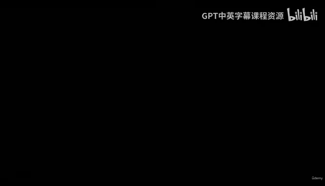
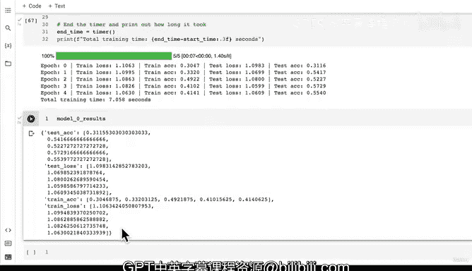

# Daniel Bourke《PyTorch 深度学习｜PyTorch 101 Crash Course For Beginners in 2025》中英字幕 - P155：155_06_025 使用训练函数评估模型0.zh_en - GPT中英字幕课程资源 - BV1kTSKB1E9m

Who's ready to train and evaluate Model 0。 Put your hand up。I definitely am。 So let's do it together。

We're going to start off section 7。7， and we're going to put in train and evaluate Model 0 our baseline model on our custom data set。

 Now， if we refer back to the Pytorch workflow。 I issued you the challenge in the last video to try and create a loss function and an optimizer。

 I hope you gave that a go。 but we've already built a training loop。

 So we're going to leverage our training loop functions， namely train， train step and test step。

 all we need to do now is instantiate a model。Choose a loss function and an optimizer and pass those values to our training function。

 so let's do that。Alright， this is so exciting， let's set the random seeds。😊。

I we're going to set torch manual seed 42。And torch kuda manual seed 42 Now， remember。

 I just want to highlight something。 I read an article the other day about not using random seeds。

 The reason why we are using random seeds is for educational purposes。

 So to try and get our numbers on my screen and your screen as close as possible。 But in practice。

 you quite often don't use random seeds all the time。

 The reason why is because you want your model's performance to be similar。

 regardless of the random seed that you use。 So just keep that in mind going forward。

 We're using random seeds to just。Exemplify how we can get similar numbers on our page， but ideally。

 no matter what the random seed was， our models would go in the same direction。That's where we want。

Our models to eventually go， but we're going to train for five epochs and now let's create a recreate an instance of tiny VGG。

We can do so because we've created a tiny VDG class。So tiny VGG， which is our model0。

 we don't have to do this， but we're going to do it any just so we've got all the code in one place tiny VGG what is our input shape going to be that is the number of colour channels。

Of our target images。And because we're dealing with color images， we have an input shape of three。

 previously we use an input shape of one to deal with grayscale images。

 I'm going to set hidden units to 10 in line with the CNN explainer website。

And the output shape is going to be the number of classes in our training data set。And then。

 of course， we're going to。Send the target model to the target device。So what do we do now Well。

 we set up a loss function and an optimizer。Loss function and Opr。

So our loss function is going to be because we're dealing with multiclass classification and then cross entropy if I could spell。

😊，Cros entropy loss。 And then we're going to have an optimizer this time。 How about we mix things up。

 How about we try the atom optimizer。 Now， of course。

 the optimizer is one of the hyperparameter that you can set for your model and a hyperparameter being a value that you can set yourself。

 So the parameters that we want to optimize are our model 0 parameters。

 And we're going to set a learning rate of 0。😊，001。 Now， recall that you can tweet this。

 this learning rate， if you like。 But I believe， did I just see that the default learning rate of atom is。

0，0，1。Yeah， there we go， so Adam's default learning rate is one to the power of 10 to the negative 3。

And so that is the default learning rate for Adam and as I said。

 oftentimes different variables in the Pytodge library。

 such as optimizers have good default values that work across a wide range of problems。

 so we're just going to stick with the default if you want to。

 you can experiment with different values of this。But now let's start the timer because we want to time our models。

We're going to import from timeit。We want to get the default timer。Class。

 and I'm going to import that as timer just so we don't have to type out default timer。

So the start time is going to be timer， this is going to just put a。

A line in the sand of what the start time is at this particular line of code it's going to measure that。

 and then we're going to train Model 0。 Now this is using， of course， our train function。

 So let's write model0 results then the wrote Model 1， but we're not up to there yet。

So let's go train。Model equals model zero， and this is just the training function that we wrote in a previous video。

And the train data is going to be our train data loader。

 and we've got train data loader simple because we're not using data augmentation for Model1。

 and then our test data loader is going to be our test data loader simple。

And then we're going to set our Opr， which is equal to the optimizer we just created。😊。

The friendly atom optimizer and the loss function is going to be the loss function that we just created which is NN cross entropy loss Finally we can send in epochs is going to be numb epochs which is what we set at the start of this video to five and of course we could train our model for longer if we wanted to but the whole idea of when you first start training a model is to keep your experiments quick so that's why we're only training for five maybe later on you train for 10 20 tweak the learning rate do a whole bunch of different things。

But let's go down here， let's end the timer， see how long our models took to train。

 end the timer and print out。How long it took。So in a previous section we created a helper function for this。

We're just going to simplify it in this section and we're just going to print out how long the training time was。

Total training time， let's go end time， minus start time， and then we're going to go point。

 we'll take it to three decimal places， hey。Second， you're ready to train our first model。

 our first convolutional neural network on our own custom data set。On pizza steakak and sushi images。

Let's do it， you ready，3， two， one， no errors。Oh， there we go， okay。

Should this be trained data loader， did you notice that？What does our train data take as input？Oh。

 we're not getting a doctoring。Oh there we go， we want Tra data loader。

Data loader and same with this， I believe， let's try again。Beautiful， oh。

 look at that lovely progress bar。 Okay， how's our， our model is training quite fast， okay。😊。

All right， What do we get， So we get an accuracy on the training data set of about 40%。

 And we get an accuracy on the test data set of about 50%。Now， what's that telling us。

 It's telling us that about 50% of the time our model is getting the prediction correct。

 but we've only got three classes。 So even if our model was guessing， it would get things right。

33% of the time。So even if you just guessed pizza every single time。

 because we only have three classes。If you guessed pizza every single time。

 you get a baseline accuracy of 33%。 So our model isn't doing too much better than our baseline accuracy。

 Of course， we'd like this number to go higher， and maybe it would if it trained for longer。

So I'll let you experiment with that。 but if you'd like to see some different methods of improving a model。

 recall back in section number02。We had an improving a model section， improving a model。Here we go。

 so here's some things you might want to try。😊，We can improve a model by。Adding more layers。

 so if we come back to our 20 VGG architecture。Right up here。

We're only using two convolutional blocks。Perhaps you wanted to add in a convolutional block 3。

You can also add more hidden units right now we're using 10 hidden units。

 you might want to double that and see what happens。Fitting for longer。

 this is what we just spoke about。 So right now， we're only fitting for5 epochs。

 So if you maybe wanted to try double that again and then even double that again。

Changing the activation functions， So maybe ReLou is not the ideal activation function for our specific use case。

Change the learning rate we've spoken about that before。 So right now our learning rate is 0。

001 for atom， which is the default， but perhaps there's a better learning rate out there。

Change the loss function。 This is probably not。In our case。

 not going to help too much because crossandtropy loss is a pretty good loss for multiclass classification。

But these are some things that you could try these first three， especially。

 you could try quite quickly， you could try doubling the layers。

 you could try adding more hidden units and you could try fitting for longer。

 so I'd give that a shot。But in the next video， we're going to take our。Model 0 results。

Which is a dictionary， or at least it should be。 And we're going to plot some loss curves。

So this is a good way to inspect how our model is training， yes so we've got some values here。

 let's plot these in the next video。😊，I'll see you there。

