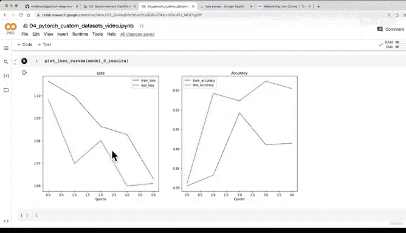

# Daniel Bourke《PyTorch 深度学习｜PyTorch 101 Crash Course For Beginners in 2025》中英字幕 - P156：156_06_026 绘制模型0损失曲线.zh_en - GPT中英字幕课程资源 - BV1kTSKB1E9m

In the last video， we trained our first convolutional neural network on custom data。

 So you should be very proud of that。 That is no small feat to take our own data set of whatever we want and train a pytch model on it。

 However， we did find that it didn't perform as well as we'd like it to。

 We also highlighted a few different things that we could try to， to do to improve it。 But now。

 let's plot our model results using a loss curve。😊，So I'm going to write another heading down here。

We'll go， I believe we're up to 7。8。 So plot the loss curves of model0。 So what is a loss curve。

So I'm going to write down here， a loss curve is a way of tracking your model's progress over time。

So if we just looked up Google and we looked up loss curves。Oh， there's a great guide， by the way。😊。

I'm going to link this。But I'd rather， if in doubt， code it out than just look at guides。Yeah。

 loss curves。 So yeah， loss over time。 So there's our loss value on the left。 And there's say， steps。

 which is epochs or batches or something like that。

 Then we've got a whole bunch of different loss curves over here。Essentially。

 what we want it to do is go down over time。So that's the ideal loss curve。Let's go back down here。

And。A good guide for different loss curves can be seen here。

 We're not going to go through that just yet。 Let's focus on plotting our own models loss curves。

 and we can inspect those。Let's get the model keys， get the model0。Results keys。

 I'm going to type in Model 0 results do keys because it's a dictionary。

 Let's see if we can write some code to plot these。Values here。So yeah， over time。

 so we have one value for Tra Los Tra Act， test loss and test Act for every epoch and of course these lists would be longer if we train for more epochs。

 but let's just how about we create a function called de plot loss curbs which will take in a results dictionary which is of string and a list of floats。

😊，So this just means that our results parameter here is taking in a dictionary that has a string as a key。

And it contains a list of floats。That's what this means here。So。Let's write a dock string， plots。

 training curves。Of a results dictionary。Beautiful。And so we're in the section of our workflow。

 which is kind of like a。We're kind of doing something similar to Tensor board what it does。

 I'll let you look into that if you want to。 otherwise we're going to see it later on。

 but we're really evaluating our model here。 let's write some plotting code。

 We're going to use mappllib， So we want to get the loss values of the results dictionary。

So this is training and test。Let's set loss equal to results， train loss。

 so this is going to be the loss on the training data set， and then we'll create the test loss。

Which is going to be。We'll index on the results dictionary and get the test loss。Beautiful。

 now we'll do the same and we'll get the accuracy。 Get the accuracy values of the results dictionary。

So training and test。Then we're going to go accuracy equals results。

 This will be the training accuracy Tra Act and accuracy， we'll call this test accuracy， actually。

 test accuracy equals results。Test act。Now， let's create a number of epochs。

 So we want to figure out how many epochs we did。 We can do that by just counting the length of this value here。

So figure out how many epochs。There were。So we'll set epochs equal to a range because we want to plot it over time。

 Our models results over time。 That's， that's the whole idea of a loss curve。 So we'll just get the。

The length of。Our results here。And we'll get the range。So now we can set up a plot。Let's go PlT。

t figure。And we'll set the fig size equal to something nice and big because we're going to do four plots。

 we want one for or maybe two plots， one for the loss， one for the accuracy。And then we will go。

Ploot the loss。PLT。 subplot， we're going to create one row， two columns and index number one。

 we want to put PLT。tplot。And here's where we're going to plot the training loss。

So we get that a label of。Train loss。And then we'll add another plot with epochs and Tela。

The label here is going to be test loss。And then we'll add a title， which will be loss PLT。

 Let's put a label on the X， which will be epos。 So we know how many steps we've done。

 This plot over here， loss curves。 It uses steps。 I'm going to use epochs。

 They mean almost the same thing。 It depends on what scale you'd like to see your loss curves。

We'll get a legend as well so that the labels appear。Now we're going to plot the accuracy。😡，So Plt。

 subplot， let's go one， two and then index number two that this plot' is going to be on Plt。t plot。

I'm going to go epochs accuracy， and the label here is going to be。Train。Accuracy。

And then we'll get on the next plot， which is actually going to be on the same plot。

 we'll put the test accuracy that way we have the test accuracy and the training accuracy side by side。

😊，Test accuracy same with the train loss and train sorry test loss。

And then we'll give our plot a title， this plot's going to be accuracy。

And then we're going to give it an next label which is going to be epochs as well。

 and then finally we'll get the plot， the legend， a lot of plotting code here。

 but let's see what this looks like， hey。😊，If we've done it all right。

 we should be able to pass it in a dictionary just like this and see some nice plots like this。

Let's give it a go。And I'm going to call plot loss curves。And I'm going to pass in model。0 results。

Alrighty then， Okay， so that's not too bad。Now， why do I say that？ Well。

 because we're looking here for mainly trends， we haven't trained our model for too long。

Quantitatively， we know that our model hasn't performed at the way we'd like it to do。

 so wed would like the accuracy on both the train and test data sets to be higher， and then。

 of course， if the accuracy is going higher， then the loss is going to come down。So。

The ideal trend for a loss curve is to go down from the top left to the bottom right。 In other words。

 the loss is going down over time。So that's the trend is all right here。

 So potentially if we train for more epochs。Which I'd encourage you to give it a go。

 Our model's loss might get lower， and the accuracy is also trending in the right way。 Our accuracy。

 we want it to go up over time。So if we train for more epochs。

 these curbs may continue to go on now they may not they。You never really know right。

 you can guess these things， but until you try it， you don't really know。

So in the next video we're going to have a look at some different forms of loss curves。

 but before we do that I'd encourage you to go through this guide here， interpreting Los curves。

 so I feel like if you just search out loss curves。

 you're going to find Google's guide or you could just search interpreting Los curves because as you'll see there's many different ways that loss curves can be interpreted。

But the ideal。Trend is for the loss to go down over time and metrics like accuracy to go up over time。

So in the next video， let's cover a few different forms of loss curves， such as the ideal loss curve。

 what it looks like when your model is underfitting and what it looks like when your model's overfitting。

 And if you'd like to have a primer on those things， I'd read through this guide here。

 Don't worry too much if you're not sure what's happening。

 We're going to cover a bit more about loss curves in the next video。

I'll see you there。