# Daniel Bourke《PyTorch 深度学习｜PyTorch 101 Crash Course For Beginners in 2025》中英字幕 - P157：157_06_027 过拟合与欠拟合的平衡与应对策略.zh_en - GPT中英字幕课程资源 - BV1kTSKB1E9m

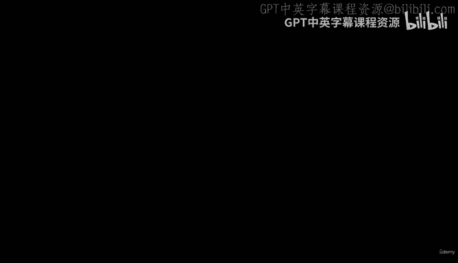

In the last video， we looked at our models loss curves and also the accuracy curves and a loss curve is a way to evaluate a model's performance over time。

 such as how long it was training for。 and as you'll see if you Google some images of loss curves。

 you'll see many different types of loss curves。😊，They come in all different shapes and sizes。

 and there's many different ways to interpret loss curves。

 So this is Google's testing and debugging and machine learning guide。

 So I'm going to set this as extra curriculum for this section。😊，So we're up to number eight。😡。

Let's have a look at what should an ideal loss curve。Look like。So we'll just link that in there。Now。

 loss curve， I'll just rerite here is a loss curve is。I want to make some space。

A loss curve is one of the most helpful。Ways to troubleshoot。按 model。

So the trend of a loss curve you want it to go down over time and the trend typically of an evaluation metric like accuracy。

 you want it to go up over time。So let's go into the keynote。

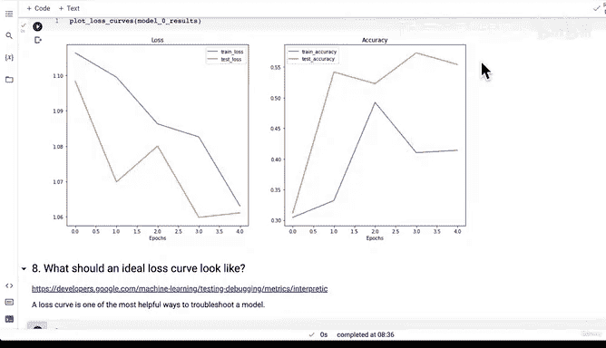

Loss curves。So way to evaluate your model's performance over time。

These are three of the main different forms of loss curve that you'll face。 But again。

 there's many different types， as mentioned in here， interpreting loss curves。

 Sometimes you get it going all over the place。 Sometimes your loss will explode。

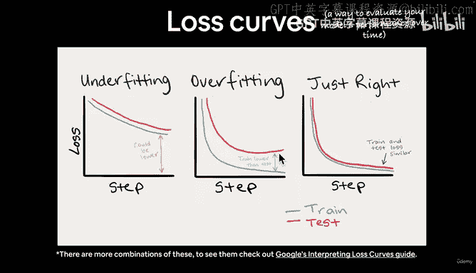

Sometimes your metrics will be contradictory。Sometimes your testing loss will be higher than your training loss。

 will' have a look at what that is。 Sometimes your model gets stuck that in other words。

 the loss doesn't reduce。 Let's have a look at some。

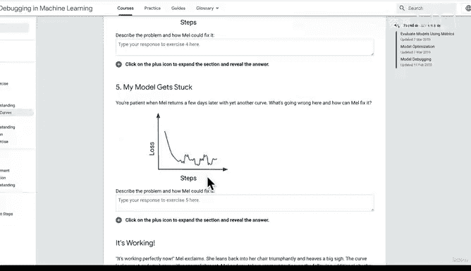

Lost curvebs here in the case of underfitting， overfitting and just right。

 so this is the Goldilock zone。

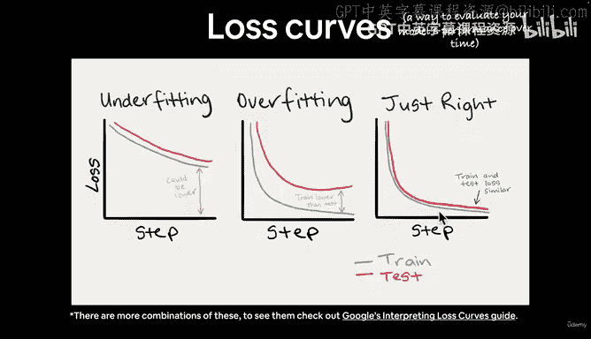

Underfitting is when your model's loss on the training and test data sets could be lower。😡。

So in our case， if we go back to our loss curves， of course we want this to be lower and we want our accuracy to be higher。

So from our perspective， it looks like our model is underfitting and we would probably want to train it for longer。

 say 1020 epochs to see if this train continues。

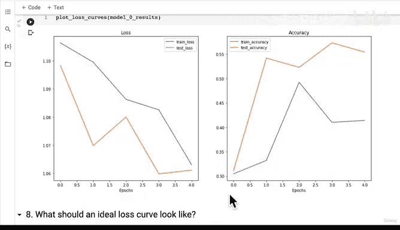

If it keeps going down， it may stop underfitting。 So underfitting is when your loss could be lower。

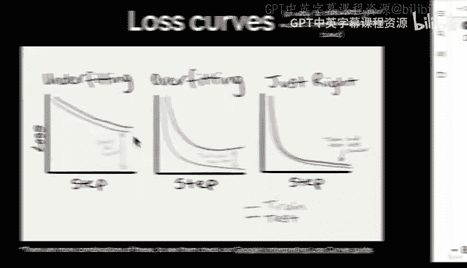

Now， the inverse of underfitting is called overfitting and so two of the biggest problems in machine learning is trying to reduce underfitting。

 So in other words， make your loss lower and also reduce overfitting。

 These are both active areas of research because you always want your model to perform better。

 but you also want it to perform pretty much the same on the training set as it does the test set。

And so overfitting would be when your training loss is lower than your testing loss。😡。

And why would this be overfitting So it means overfitting because your model is essentially learning the training data too well。

 and that means the loss goes down on the training dataset， which is typically a good thing。 However。

 this learning is not reflected in the testing data set。😡。

So your model is essentially memorizing patterns in the training data that don't generalize well to the test data set。

So this is where we come to the just right curve is that we want ideally our training loss to reduce as much as our test loss。

And quite often you'll find that the loss is slightly lower on the training set than it is on the test set。

 and that's just because the model is exposed to the training data and it's never seen the test data before。

 so it might be a little bit lower on the training data set than on the test data set。

So under fittingtting， the model's loss could be lower。😡。

Overfitting the model is learning the training data too well。

 Now this would be equivalent to say you were studying for a final exam and you just memorize the course materials。

 the training said， and when it came time to the final exam because you'd only memorize the course materials you couldn't adapt those skills to questions you hadn't seen before So the final exam would be the test set So that's overfitting the train loss is lower than the test loss and just right。

 ideally you probably won't see loss curves this exact smooth I mean they might be a little bit jumpy。

Ideally， your training loss and test loss go down at a similar rate。 And of course。

 there's more combinations of these。 If you'd like to see them。

 check out the Google's loss curve guide that you can check that out up there。 That's some extracur。

 Now， you probably want to know how do you deal with underfitting and overfitting。

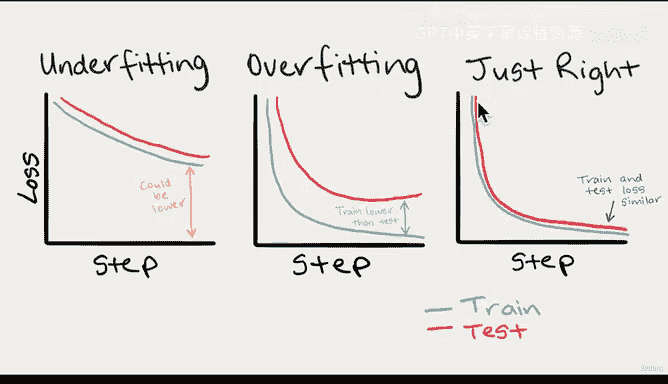

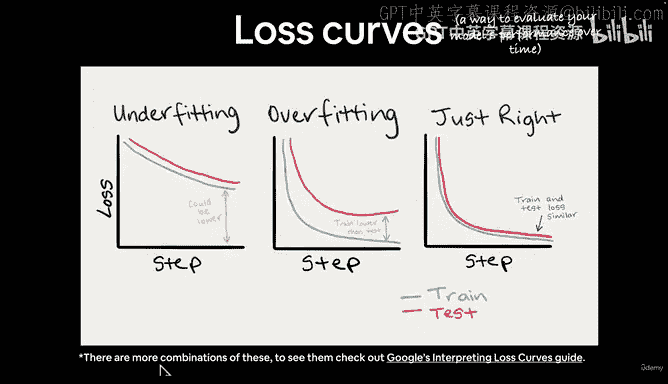

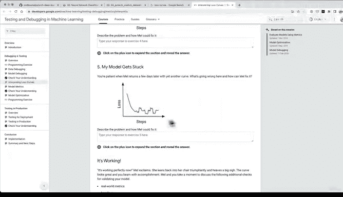

Let's look at a few ways。We'll start with overfitting。

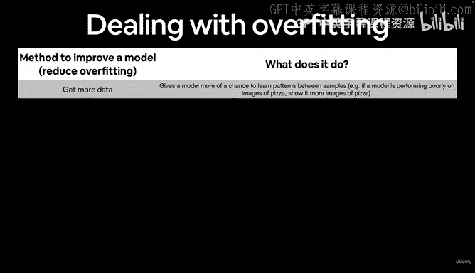

So we want to reduce overfitting in other words， we want our model to perform just as well on the training data set as it does on the test data set。

So one of the best ways to reduce overfitting is to get more data。

 So this means that our training data set will be larger。 Our model will be exposed to more examples。

 and will thus。In theory， it doesn't always work。 These all come with a caveat， right。

 They don't always work as with many things in machine learning。 So get more data。

 give your model more chance to learn patterns， generalizable patterns in a data set。

You can use data augmentation so make your models's training data set harder to learn。

 So we've seen a few examples of data augmentation。 You can get better data， So not only more data。

 perhaps the data that you're using isn't that the quality isn't that good。

 So if you enhance the quality of your data set， your model may be able to learn better。

 more generalizable patterns and in turn， reduce overfitting。😊，Use transfer learning。

 So we're going to cover this in a later section of the course。

 but transfer learning is taking one models that works。

 taking its patent that it's learned and applying it to your own data set。 So， for example。

 I'll just go into the Torch Viion models library。 many of these models in here in Torch vision。

 the models module have already been trained on a certain data set and such as Inet。

And you can take the weights or the patterns that these models have learned。

 And if they work well on an image net dataset set， which is millions of different images。

 you can adjust those patterns to your own problem。 And oftentimes， that will help with overfitting。

If you're still overfitting， you can try to simplify your model。

 usually this means taking away things like extra layers， taking away more hidden units。

 So say you had 10 layers， you might reduce it to five layers。

 Why does this what's the theory behind this Well if you simplify your model and take away complexity from your model you're kind of telling your model hey。

 use what you've got and you're going to have to because you've only got five layers now。

 you're going to have to make sure that those five layers work really well because you've no longer got 10 and the same for hidden units say you started with 100 hidden units per layer you might reduce that to 50 and say hey。

 you had 100 before， now use those 50 and make your patent generalizable。Use learning rate decay。

 So the learning rate is how much your optimizer updates its or your optimizer updates your model's weights。

Every step。 So learning rate decay is to。Dey the learning rate over time。 So you might look this up。

 You can look this up， Go pie torch。Learning rate scheduling。

So what this means is you want to decrease your learning rate over time。 Now。

 I know I'm giving you a lot of different things here， but。You've got this keynote as a reference。

 so you can come across these over time。 So learning rate scheduling。So we might look into here。

 Do we have schedule。Schedler， beautiful。 So this is going to adjust the learning rate over time。

 So for example， at the start of when a model is training， you might want a higher learning rate。

 and then as the model starts to learn patterns more and more and more。

 you might want to reduce that learning rate over time so that your model doesn't update its patterns too much in later epochs。

So that's the concept of learning rate scheduling at the closer you get to convergence。

 the lower you might want to set your learning rate。 Think of it like this。

 if you're reaching for a coin at the back of a couch。

 Can we get an image of that coin at back of couch。😊。

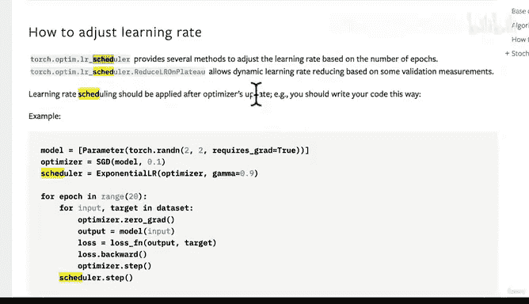

Images。So if you're trying to reach a coin。In the cushions here。 So the closer you get to that coin。

 at the beginning， you might take big steps， but then the closer you get to that coin。

 the smaller the step you might take to pick that coin out。

 because if you take a big step when you're really close to the coin here。

 The coin might fall down the couch。 The same thing with learning rate decay。

 at the start of your model training， you might take bigger steps as your model works its way down the loss curve。

 But then you get closer and closer to the ideal position on the loss curve。

 you might start to lower and lower that learning rate until you get right very close to the end and you can pick up the coin。

 or in other words， your model can converge。And then finally， use early stopping。

 So if we go into an image is there early stopping here？Early stopping。Loss curbs， early stopping。

So what this means is that you stop。😡，Yeah， there we go。So there's heaps of different guides。

 early stopping with pytorch beautiful。 So what this means is before your testing error starts to go up。

 you keep track of your model's testing error and then you stop your model from training or you save the weights or you save the patterns where your model's loss was the lowest So then you could just set your model to train for an infinite amount of training steps And as soon as the testing error starts to increase for say 10 steps in a row you go back to this point here and you go。

 I think that was where our model was the best and the testing error started to increase after that。

 So we're going to save that model there instead of the model here。

 So that's the concept of early stopping。So that's dealing with overfitting。😊。

There are other methods to deal with underfitting， so we underfitting is when we have a loss that isn't as low as we'd like it to be。

 our model is not fitting the data very well， so it's underfitting。So to reduce underfitting。

 you can add more layers s units to your model you're trying to increase your model's ability to learn by adding more layers or units。

 you can again tweak the learning rate， Perhaps your learning rate is too high to begin with and your model doesn't learn very well so you can adjust the learning rate again just like we discussed with reaching for that coin at the back of a account。

If your model is still underfitting， you can train for longer。

 So that means giving your model more opportunities to look at the data。 So more epochs。

 that just means it's got looking at the training set over and over and over and over again and trying to learn those patterns。

 However， you might find again， if you try to train for too long。

 your testing error will start to go up。 your model might start overfitting if you train too long。

 So machine learning is all about a balance between underfitting and overfitting。

 You want your model to fit quite well。 and。😊。

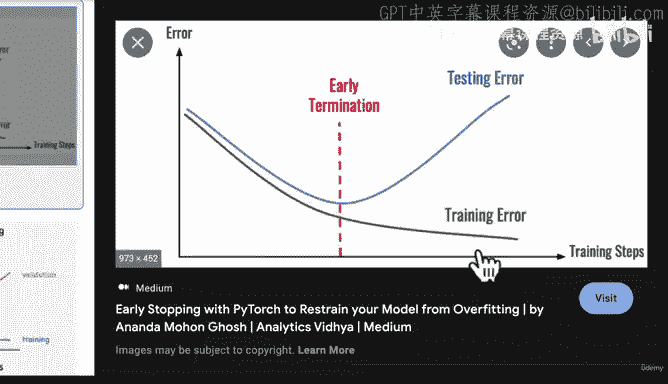

So this is a great one。 So you want your model to start fitting quite well。

 But then if you try to reduce underfitting too much， you might start to overfi and then vice versa。

 right， if you try to reduce overfitting too much， your model might underfi。

 So this is one of the most fun dances in machine learning。

 the balance between overfitting and underfitting。😊，Finally， you might use transfer learning。

 so transfer learning helps with overfitting and underfitting recalled transfer learning is using a model's learned patterns from Ron problemble and adjusting them to your own we're going to see this later on in the course。

And then finally， use less regularization。 So regular is holding your model back。

 So it's trying to prevent overfitting。 So if you do too much preventing of overfitting。

 In other words， regularizing your model， you might end up underfitting。So if we go back。

 we have a look at the ideal curves。Underfitting， if you try to prevent underfitting too much。

 So increasing your model's capability to learn， you might end up overfitting。

 And if you try to prevent overfitting too much， you might end up underfitting。

 We are going for the just right section。 And this is going to be a balance between these two throughout your entire machine learning career。

In fact， it's probably the most prevalent。Area of research is trying to get models not to underfi。

 but also not to overfi。

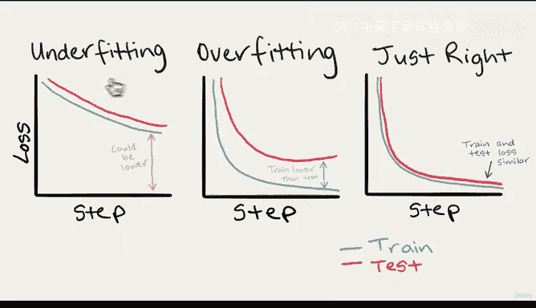

So keep that in mind， a loss curve is a great way to evaluate your model's performance over time and a lot of what we do with the loss curves is try to work out whether our model is underfitting or overfitting and we're trying to get to this just right curve we might not get exactly there。

 but we want to keep trying getting as close as we can。So with that being said。

 let's now build another model in the next video， and we're going to try a method to try and see if we can use data augmentation to prevent our model from overfitting。

 Although that experiment doesn't sound like the most ideal one we could do right now because it looks like our model is underfitting。

 So with your knowledge of what you've just learned in the previous video。

 how to prevent underfitting。😊。

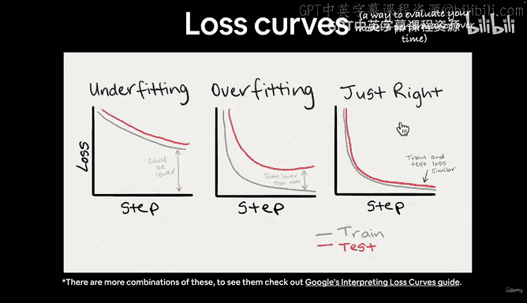

What would you do to increase this model's capability of learning patterns in the training data set。

 Would you train it for longer， Would you add more layers， Would you add more hitting units。

Have a think and we'll start building another model in the next video。😊。

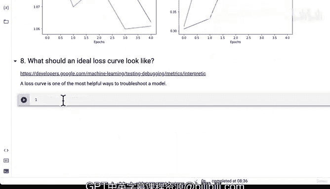