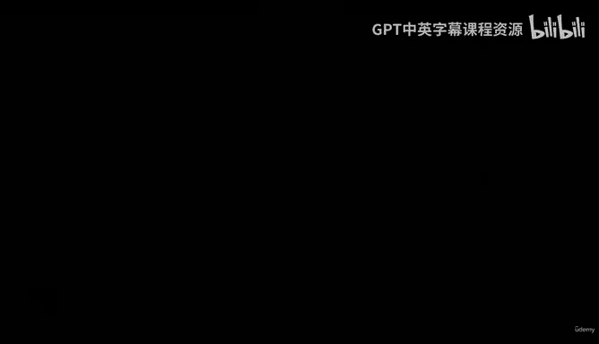
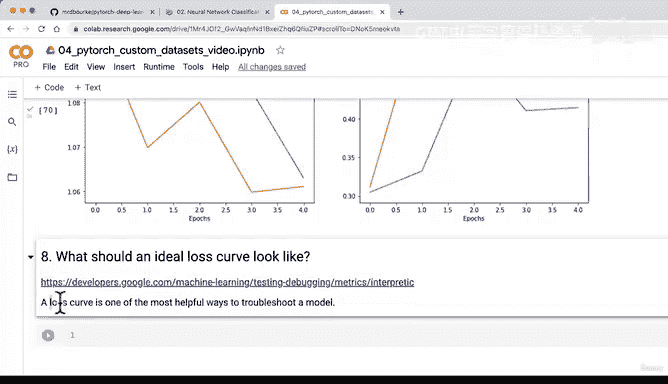
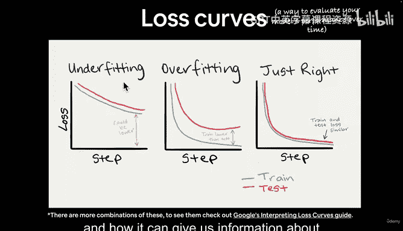
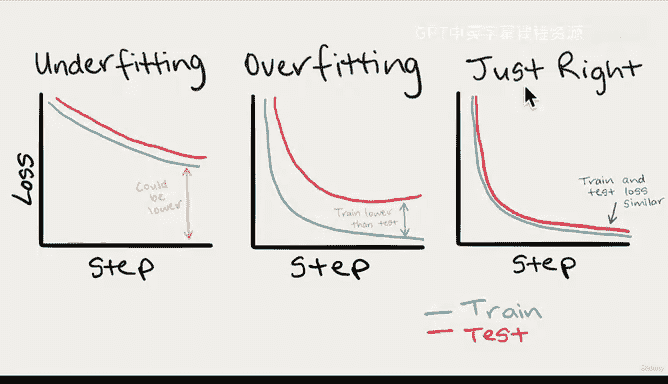
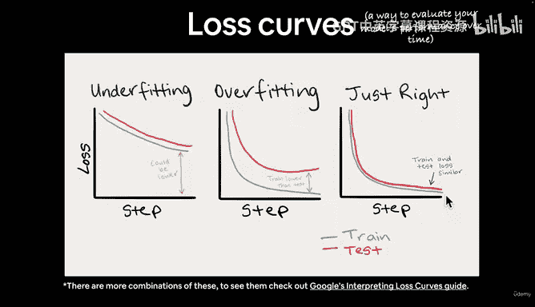
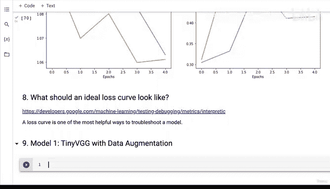
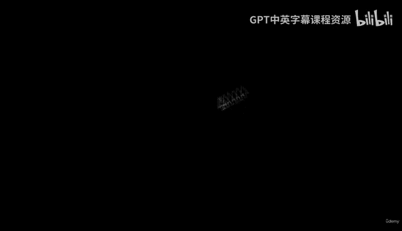
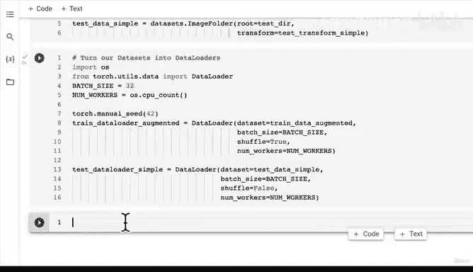

# Daniel Bourke《PyTorch 深度学习｜PyTorch 101 Crash Course For Beginners in 2025》中英字幕 - P158：158_06_028 为模型1创建增强训练数据集与DataLoader.zh_en - GPT中英字幕课程资源 - BV1kTSKB1E9m

Welcome back。 In the last video， we covered the important concept of a loss curve and how it can give us information about whether our model is underfitting。

 In other words， our model's loss could be lower or whether it's overfitting。 In other words。

 the training loss is lower than the test loss or far lower than the validation loss。

 That's another thing to note here。 I that I've put training in test sets here You could also do this with a validation data set。

😊。

And that the just right， the Goldilock zone is when our training and test loss are quite similar over time。

Now， there was a fair bit of information in that last video。

 So just wanted to highlight that you can get this all in section 04。

 which is the notebook that we're working on。 And then if you come down over here。😊。

If we come to section 8， what should an ideal loss curve look like we've got underfitting overfitting just right。

 how to deal with overfitting， we've got a few options here， we've got how to deal with underfitting。

 and then we've got a few options there and then if we wanted to look for more how to deal with overfitting。

😊，You could find a bunch of resources here and then how to deal with underfitting。

You could find a bunch of resources here as well， so that is a very fine line。

 very fine balance that you're going to experience throughout all of your machine learning career。

 but it's time now to move on。 We're going to move on to creating another model which is tiny VGG with data augmentation this time。

So if we go back to the slide， data augmentation is one way of dealing with overfitting。

 Now it's probably not the most ideal experiment that we could take because our model 0 our baseline model looks like it's underfitting but data augmentation as we've seen before。

 is a way of manipulating images to artificially increase the diversity of your training data set without collecting more data So we could take our photos of pizza。

 a sushi and steak and randomly rotate them 30 degrees and increased diversity forces a model to learn or hopefully learn again。

 all of these come with a caveat of not always being the silver bullet to learn more generalizable patterns Now I should have spelled generalizable here rather than generalization but similar thing。

Let's go here。 Let's create， to start off with。We'll just write down。Now， let's try another modeling。

Experiment， so this is in line with our Pytorch workflow。

 trying a model and then trying another one and trying another one so and so over again。This time。

 using the same model as before， but with。Some slight data augmentation。Well maybe were not slight。

 that's probably not the best word， we'll just say with some data augmentation。

And if we come down here， we're going to write section 9。1。

We need to first create a transform with data augmentation。So we've seen what this looks like before。

 we're going to use the trivial augment。Daate augmentation， create training transform， which is。

 as we saw in a previous video what Pitorrch the Piytorrch team have recently used to train their state of the art computer vision models。

So train transform trivial。This is what I'm going to call my transform。And I'm just going to。

From Torch vision import transforms， we've done this before we don't have to reimport it。

 but I'm going to do it anyway just to show you that we're re-importing or we're using transforms and we're going to compose a transform here。

 recall that transforms help us manipulate our data。

So we're going to transform our images into size 64 by 64。

Then we're going to set up a trivial augment transforms just like we did before。Trivial。Augment wide。

 And we're going to set the number of magnitude bins here to be 31， which is the default here。

 which means we'll randomly use some data augmentation on each one of our images。

 and it will be applied at a magnitude of 0 to 31， also randomly selected。

 So if we lowered this to 5， the upper bound of intensity of how much that data augmentation is applied to a certain image will be less than if we set it to say 31。

Now our final transform here is going to be too tensor because we want our images in tensor format for our model。

And then I'm going to create a test transform， I'm going to call this simple。

 which is just going to be transforms dot composeose and all that it's going to have。

 oh I should put a list here， all that it's going to have， I'll just make some space over here。😊。

Is going to be transforms， all we want to do is resize the image。Size equals 6464。

 Now we don't apply data augmentation to the test data set。

Because we only just want to evaluate our models on the test dataset set。

 our models aren't going to be learning any generalizable patterns on the test dataset set。

 which is why we focus our data augmentations on the training data set。

 and I've just readjusted that。 I don't want to do that beautiful。So we've got a transform ready。

 now let's load some data using those transforms。So we'll create。Train and test。Data sets。

And data loaders。With data augmentation。So we've done this before。

 you might want to try it out on your own， so pause the video if you'd like to test it out。

 create a data set and a data loader using these transforms here。

And recall that our data is going to be creating a data set from pizza steakak and sushi for the train and test folders。

And that our data loader is going to be batchrifying our data set。

So let's turn our image folders into datas。Data sets beautiful and I'm going to write here train data augmented just so we know that it's been augmented。

We've got a few of similar variable names throughout this notebook。

 so I just want to be as clear as possible and I'm going to use。

 I'll just reimport Torch vision data sets。We've seen this before the image folder。

 so rather than now use our own custom class， we're going to use the existing image folder class that's within Torch Vi data sets。

😊，And we have to pass in here a route。So I'll just get the dock string there。Root。

 which is going to be equal to our trainer。Which recall is the path to our training directory。

We've got that saved， and then I'm going to pass in here the transform is going to be train transform trivial。

 So our training data is going to be augmented。Thanks to this transform here and transforms trivial augment wide。

 you know where you can find more about trivial augment wide， of course。

 in the Pytorch documentation or just searching transforms trivial augment wide。And。

Did I spell this wrong。Trivial。Oh， train， train transform。 I felt that wrong。 Of course I did。

 So test data。 let's create this as test data simple equals data sets dot image folder。

 And the root di is going to be here。 The test directory。 and the transform is just going to be what。

😊，The test transform simple。Beautiful。So now let's turn these data sets into data loaders。

So turn our。Data sets into。Data loaders。We're going to import OS。

I'm going to set the batch size here equal to 32。The number of workers that are going to load our data loaders。

 I'm going to set this to OS。cpu count， so there'll be one worker per CPU on our machine。

I'm going to set here the torch manual seed。To 42 because we're going to shuffle our training data。

Train data loader， I'm going to call this augmented。

Equals data loader Now I just want to I don't need to reimport this。

 but I just want to show you again。From torch。utils。You can never have enough practice。

 right do data， let's import。Data loader。So that's where we got the data loader class from。

 Now let's go train data augmented， we'll pass in that as the data set。

And I'll just put in here the parameter name for completeness。 That's our data set。

 And then we want to set the batch size， which is equal to batch size。

I'm going to set shuffle equal to true， and I'm going to set nu workers equal to nu workers。

Beautiful。And now let's do that again with the test data loader that this time。Test data loader。

 I'm going to call this test data loader simple， we're not using any data augmentation on the test data set。

 just turning our images， our test images into tensesors。

The data set here is going to be test data simple。We're going to pass in the batch size equal to batch size。

 so both our data loaders will have a batch size of 32。

I'm going to keep shuffle on false and numb workers I'm going to set to numb。Workers。Look at us go。

 We've already got a data set and a data loader。 This time our data loader is going to be augmented for the training data set。

 and it's just going to be nice and simple for the test data set。 So this is really similar。

 This data loader to the previous one we made The only difference in this modeling experiment is that we're going to be adding data augmentation。

😊，Namely trivial augment wide。So with that being said， we've got a data set。 We've got a data loader。

 in the next video， let's construct and train Model 1。 In fact。

 you might want to give that a go so you can use our tiny VGG class。

To make Model one， and then you can use our train function to train a new tiny VGG instance。

With our training data loader augmented and our test data loader simple。

So give that a go and we'll do it together in the next video。I'll see you there。

