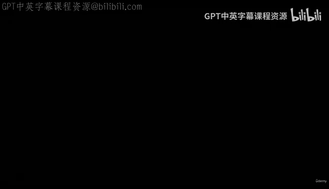
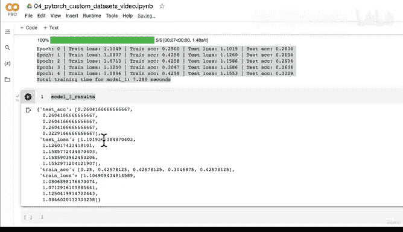

# Daniel Bourke《PyTorch 深度学习｜PyTorch 101 Crash Course For Beginners in 2025》中英字幕 - P159：159_06_029 构建与训练模型1.zh_en - GPT中英字幕课程资源 - BV1kTSKB1E9m

Now that we've got our data sets and data loaders with data augmentation ready。

 let's now create another model。 So 9。3 we're going to construct。And train Model one。And this time。

Justs going to write what we're going to doing， going to be doing。 So， this time we'll be using。

The same model architecture， but we're changing the data here。Except this time。

We've augmented the training data。😡，So we'd like to see how this performs compared to a model with no data augmentation。

So that was our baseline up here。 and that's what you'll generally do with your experiments。

 You'll start as simple as possible and introduce complexity when required。

So create Model one and send it to the target device that is to the target device and because of our helpful selves previously。

 we can create a manual seed here， torch up manual seed。And we can create Model one。

 leveraging the class that we created before。So although we built tiny VGG from scratch in this video in this section。

 sorry。In subsequent。Coding sessions， because we've built it from scratch once and we know that it works。

 we can just recreate it by calling the class and passing in different variables here so let's get the number of classes that we have in our train data augmented。

😊，Classes and we're going to send it to device and then if we inspect Model one， let's have a look。

Wonderful。Now， let's keep going。 We can also leverage our training function that we did。

 You might have tried this before， so let's now train our model。 She're going to put here wonderful。

😊，Now we've got a model and data loaders， let's create what do we have to do。

 we have to create a loss function and an optimizer and call upon our train function that we created earlier。

To train and evaluate our model。Beautiful。So I'm going to set the random seeds。Torch dot manual。

Saint。And torch。 ka because we're going to be using kuda， let's set the manual seed here， 42。

I'm going to set the number of epochs， we're going to keep many of the parameters the same。

 set the number of epochs。Numb epoch equals5。We could， of course。

 train this model for longer if we really wanted to by increasing the number of epochs。

 but now let's set up the loss function。So loss Fn equals Nn。croross entropy loss don't forget。

 this has just came into mind Los function often as well in Pytorch is called criterion。

 so the criterion you're trying to reduce， but I just like to call it loss function。

And then we're going to have optimizer。Let's use the same optimizer we used before， torch。opim。adom。

Recall SGD and At are two of the most popular optimizers， so Model1 dot parameters。

They're the parameters we're going to optimize， we're going to set the learning rate to 001。

 which is the default for the atom optimizer in Pytorch。Then we're going to start the timer。

 so from time it。Let's import the default timer。As timer， and we'll go start time equals timer。

And then let's go train Model one。How can we do this， Well。

 we're going to get a results dictionary as Model one results。

 We're going to call upon our train function inside our train function will'll pass the model parameter as model1。

For the train data loader parameter， we're going to pass in Tra Data loader augmented。

 so our augmented training data loader。And for the test data loader， we can pass in here。

 test data loader simpleimple。Then we can write our Opr， which will be the atom optimizer。

 our loss function is going to be NN cross entropy loss， what we've created above。

 and then we can set the number of epochs is going to be equal to nu。Epochs。

 and then if we really wanted to， we could set the device equal to device。

 which will be our target device。 And now let's end the timer and print out how long it took。Took。

En time equals timer and we'll go print。茶路。Training time for Model 1。Is going to be end time。

 minus start time。And oh。It would help if I could spell。

 We'll get that to three decimal places and that'll be seconds。 So you're ready。

 We look how quickly we built a training pipeline for Model one。😊。

And look how big easily we created it。So go ask for coding all of that stuff up before。

 let's train our second model， our first model using data augmentation。😊，You're ready， three， two。

 one， oh let's go。No errors。 beautiful。 We're going nice and quick here。So oh。

 about just over7 seconds。 So what GPU do I have currently？

Just keep this in mind that I'm using Google Coabab Pro so I get preference in terms of allocating a faster GPU。

 your model training time may be longer than what I've got， depending on the GPU。

 it also may be faster again depending on the GPU， but we get about seven seconds。

 but it looks like our model with data augmentation didn't perform as well as our model without data augmentation。

H。😊，So how long did our model before without data augmentation take the train just over seven seconds as well。

 but we got better results in terms of accuracy on the training and test data sets for Model0。

 so maybe data augmentation doesn't help in our case。

And we kind of hinted at that because the loss here was already going down。

 we weren't really overfitting yet， so recall that data augmentation is a way to help with overfitting generally。

😊，So maybe that wasn't the best step to try and improve our model。

 but let's nonetheless keep evaluating our model。 in the next video。

 we're going to plot the loss curves of Model 1。 So in fact， you might want to give that a go。

 So we've got a function plot loss curves and we've got some results in a dictionary format。

 So try that out， plot the loss curves and see what you see。

Let's do it together in the next video。😊，I'll see you there。

