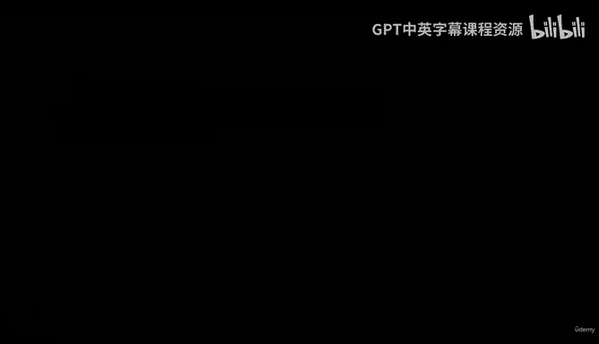
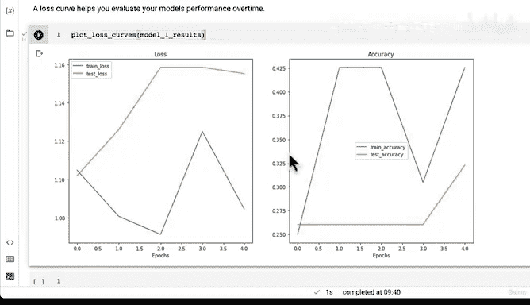
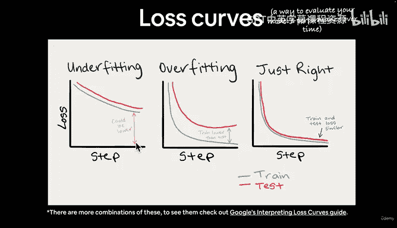
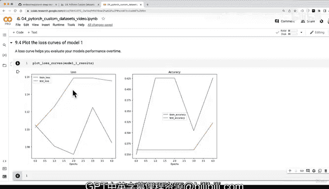

# Daniel Bourke《PyTorch 深度学习｜PyTorch 101 Crash Course For Beginners in 2025》中英字幕 - P160：160_06_030 绘制模型1损失曲线.zh_en - GPT中英字幕课程资源 - BV1kTSKB1E9m

In the last video， we did the really exciting thing of training our first model with data augmentation。

 but we also saw that quantitatively， it looks like that it didn't give us much improvement So let's keep evaluating our model here。

 I'm going to make a section。 recall that one of my favorite ways or one of the best ways。

 not just my favorite to evaluate the performance of a model over time is to plot the loss curves。

 So a loss curve。😊，Helps you evaluate your model's performance。Over time。

 And it will also give you a great visual representation or a visual way to see if your model is underfitting or overfitting。

 So let's plot the loss curves of Model 1 results。😊，And see what happens。

 we're using this function we created before。😊，And oh my goodness。

 is that going in the right direction？It looks like our test loss is going up here。😡，Now。

 is that where we want it to go。 Remember， the ideal direction for a loss curve is to go down over time because loss is measuring what is measuring how wrong our model is。

 And the accuracy curve looks like it's all over the place as well。 I mean， it's going up kind of。

 But maybe we don't have enough time to measure these things。

 So an experiment it could do is train both of our models。

 Model 0 and Model 1 for more epoch and see if these loss curves flatten out。

So I'll pose you the question， is our model underfitting or overfitting right now or both？

So if we want to have a look at the loss curves， our just right is for the loss。 That is。

 this is not for accuracy。 This is for loss over time。 we want it to go down。So for me。

 our model is underfitting because our loss could be lower。

 but it also looks like it's overfitting as well， so it's not doing a very good job because our test loss is far higher than our training loss。

So if we go back to section 4 of the Learnpytorch。 A O book。

 what should an ideal loss curve look like， I'd like you to start thinking of some ways that we could deal with overfitting of our model。

 So could we get more data， Could we simplify it， Could we use transfer learning。

 We're going to see that later on， But you might want to jump ahead and have a look。

And if we're dealing with underfitting， what are some other things that we could try with our model。

 Could we add some more layers， potentially another convolutional block。

 Could we increase the number of hidden units per layer？

 So if we've got currently 10 hidden units per layer。

 maybe you want to increase that to 64 or something like that。Could we train it for longer。

 That's probably one of the easiest things to try with our current training functions。

 We could train for 20 epochs。 So have a go at this。Reference this。

 try out some experiments with see if you can get these lost curves more towards the ideal shape。

And in the next video， we're going to keep pushing forward。 We're going to compare our model results。

 So we've done two experiments。 Let's now see them side by side。

 We've looked at our model results individually， and we know that they could be improved。

 But a good way to compare all of your experiments is to compare your models results side by side。

 So that's what we're going to do in the next video。😊，I'll see you there。

