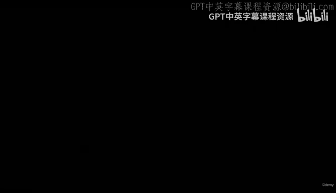
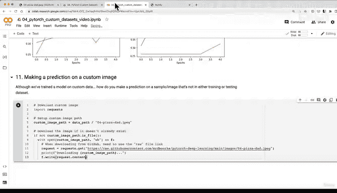

# Daniel Bourke《PyTorch 深度学习｜PyTorch 101 Crash Course For Beginners in 2025》中英字幕 - P162：162_06_032 自定义数据预测（第一部分）：下载图像.zh_en - GPT中英字幕课程资源 - BV1kTSKB1E9m

Welcome back。 In the last video， we compared our modelling experiments。 Now。

 we're going to move on to one of the most exciting parts of deep learning。

 and that is making a prediction。😊，On a custom image。 So although。

We've trained a model on custom data。How do you make a prediction？

On a sample slash image in our case。That's not in either the training or testing data set。

 So let's say you are building。A food recognition app such as nurify。

 Take a photo of food and learn about it。 You wanted to use computer vision to essentially turn foods into Q R codes。

 So I'll just show you the workflow here。 If we were to upload this image of my dad giving two thumbs up for a delicious pizza。

😊，And what is nurify predicted as pizza beautiful。 So macronutrientency。

 you get some nutrition information and then the time taken。

 So we could replicate a similar process to this using our trained Pytorch model albeit it。

 it's not going to be too great of results or performance because we've seen that we could improve our models based on the accuracy here and based on the loss and whatnot。

 but let's just see what it's like the workflow。 So the first thing we're going to do is get a custom image。

 Now we could upload one here。😊，Such as clicking the upload button in Google Coabab。

 choosing an image， and then importing it like that。

 But I'm going to do so programmatically as you've seen before。

 So let's write some code in this video to download a custom image。I'm going to do so using requests。

And like all good cooking shows， I've prepared a custom image for us。So custom image path。

 but again you could use this process that we're going to go through with any of your own images of pizza。

 steak or sushi， and if you wanted to train your own model on another set of custom data。

 the workflow will be quite similar。So I'm going to download a photo calledP Dad。Which is my dad。

 two big thumbs up。😊，And so I'm going to download it from Github。

 So this image is on the course Github， and let's write some code to download the image if it doesn't already exist in our。

Collab。Instance， so if you wanted to upload a single image， you could click with this button。

 just beware that like all of our other data， it's going to disappear if coab disconnects。

 So that's why I like to write code so we don't have to re upload it every time。So if not。

 custom imagepath dot is file。Let's open a request here or open a file。

Going to open up the custom image path with right binary permissions as F short for file。

 and then when downloading。This is because our image is stored on GiHub when downloading an image。

Or when downloading from Gitthub in general， you typically want the raw link need to use the raw。

File link。So let's write a request here equals request。get。

 so if we go to the Pytorch deep learning repo， then if we go into I believe it might be extras。

Not in extras， it's going to be in images that would make a lot more sense， wouldn't it Daniel？

Let's get04 P dad。😊，So if we have a look， this is Pytoj Deep learninging Ims04 P Dad。

There's a big version of the image there。 And then if we click download。

 is this going to give us the raw link。 Yeah， there we go。 So that's the image。 Hey， dad。

 how you doing。 Is that pizza delicious， It looks like it。😊。

Let's see if our model can get this right。What do you think， will it？So of course。

 we want our model to predict pizza for this image because it's got a pizza in it。

So custom image path， we're going to download that。😊，I've just put in the raw URL above。

 so notice the raw GitHub user content。That's from the course Github。

 Then I'm going to go F dot right， So file。Right， the request content。

 so the content from the request， in other words， the raw file from GitthHub here。

Similar workflow for if you are getting another image from somewhere else on the Internet。 And else。

 if it is already downloaded， let's just not download it。 So print F custom image path。

Already exists， skipping。downownload。And let's see if this works or run the code。

So downloading data 04pizzada。jpeEg。And if we go into here， we refresh。There we go。 beautiful。

 So our data。Or our custom image story is now in our data folder。 So if we click on this。

 this is inside Google Coab now。Beautiful， we got a big， nice。

 big image there and there's a nice big pizza there。

So we're going to be writing some code over the next few videos to do the exact same process as what we've been doing to import our custom data set for our custom image。

 What do we still have to do， We still have to turn it into tensors。

 And then we have to pass it through our model。 So let's see what that looks like over the next few videos。

😊。