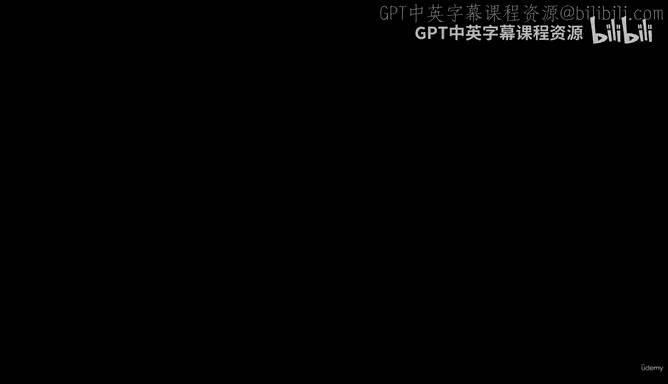
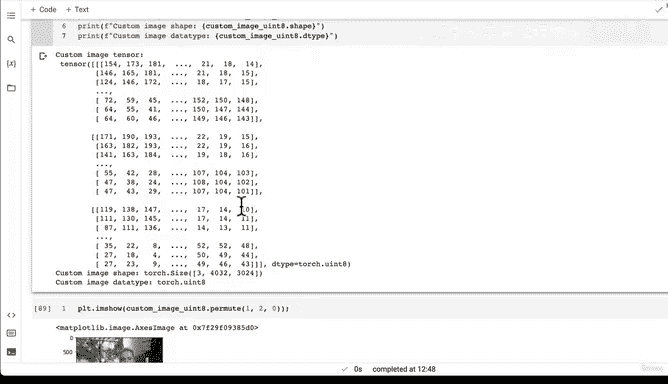
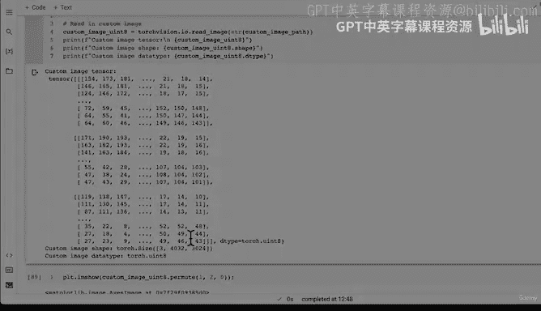

# Daniel Bourke《PyTorch 深度学习｜PyTorch 101 Crash Course For Beginners in 2025》中英字幕 - P163：163_06_033 自定义数据预测（第二部分）：加载自定义图像.zh_en - GPT中英字幕课程资源 - BV1kTSKB1E9m

，We are up to one of the most exciting parts of building deep learning models。

 and that is predicting on custom data， In our case， a custom image of。😊。

A photo of my dad eating pizza。 So， of course， we're training a computer vision model on here on pizza steak and sushi。

 So hopefully， the ideal result for our model to predict on this image will be pizza。

 So let's keep going。 Let's figure out how we can get our image， our custom image。

 our singular image into tensor form。😊，Loading in a custom image with pie torch。

 creating another section here。 So I'm just going to write down here。

 We have to make sure our custom image is in the same format。As the data our model was trained on。

So namely， that was intensor form。With data time。Torch F 32。😡，And then of shape 64 by 64。By three。

 so we might need to change the shape of our image and then we need to make sure that it's on the right device。

Command M M beautiful。 So let's see what this looks like。 Hey。

 so if I'm going to import torch vision。😊，Now， the package you use to load your data will depend on the domain you're in。

 so let's open up the torch vision documentation。We can go to models， that's okay。

So if we're working with text， you might want to look in here for some input and output functions so some loading functions。

Torch audio， Sam thing。 Torch vision is what we're working with。 Let's click into Torch vision。 Now。

 we want to look into reading and writing images and videos because we want to read in an image。

 right， We've got a custom image。 We want to read it in。So this is part of your extra curricula。

 by the way， to go through these for at least 10 minutes each。

 so spend an hour if you're going through Torch vision， you can do the same across these other ones。

 it will just really help you familiarize yourself with all the functions of Pytorrch domain libraries。

😊，So we want to look， here's some options for video， we're not working with video。

 here's some options for images。 Now， what do we want to do， We want to read in an image。😊。

So we've got a few things here。 Decode image。 Oh， I've skipped over one。

 We can write a JpeEg if we wanted to。 We can encode a P And G。 Let's， let's jump into this one。

 read image。 What does it do， reads a Jpeg or P And G into a three dimensional RGB or gray scale tensor。

 That is what we want。 and then optionally converts the image to the desired format。😊。

The values of the output tensor are U in 8。 Okay， beautiful。 So let's see what this looks like， ah。😊。

Moode， the read mode used optionally for converting the image lets。

 Let's see what we can do with this。 I'm going to copy this in。So。I write this down。

 We can read an image into P torch using。We'll go with that。

So let's see what this looks like in practice。Read in custom image I can't explain to you how much I love using deep learning models to predict on custom data so custom image we're going to call it U int 8 because as we read from the documentation here it reads it in U int 8 format So let's have a look at what that looks like rather than just talking about it。

😊，Torchvision。Io read image， what's our target image path？😡。

While we've got custom image path up here， this is why I like to do things programmatically。

 So if our coabab notebook reset， we could just run this cell again， get our custom image。

 And then we've got it here。So custom image U in8， let's see what this looks like。Oh。

 what did we get wrong。Unable to cast Python instance， oh。

Does it need to be a string expected a value type of string or but found Possits path。 So this。

 the path needs to be a string。 Okay， if we have a look at our custom image path。

 what did we get wrong。Oh， we've got a Possix path。

 so let's convert this custom image path into a string and see what happens。Oh， look at that。

That's how image in integer form。 I wonder if this is plotable。

 Let's go P L T dot M show custom image U int 8。 Maybe well get a dimensionality problem here in valid shape。

 Okay， let's arm permute it。Perm mutute and we'll go  one2，0， is this going to plot？

It's a fairly big image。 There we go。 Two thumbs up。 Ha Look at us。

 So that is the power of Torchvision dot I O。 I O stands for input output。

 We were just able to read in our custom image。 Now， how about we get some metadata about this。

 Let's go。 We'll print it up here， actually， I'll keep that there because that's fun to plot it。😊。

Let's find the shape of our data， the data type and yeah we've got an intensor format。

 but it's U int 8 right now， so we might have to convert that to F 32。

 we want to find out its shape and we need to make sure that if we're predicting on a custom image the data that we're predict on the custom image needs to be on the same device as our model So let's print out some info print let's go custom image tensor and this is going to be a new line and then we will go custom image U in 8。

😊，Wonderful， and then let's go custom image shape。 We will get the shape parameter。

 custom image shape or attribute， sorry， and then we also want to know the data type。

 custom image data type， but we have a kind of an inkling because the documentation said it would be U in 8 U in8 and we'll go D type。

😊，Let's have a look。What do we have？So there's our image tensor。And it's quite a big image。

 so custom image shape。 So what was our model trained on。

 Our model was trained on images of 64 by 64。 So this image encodes a lot more information than what our model was trained on。

So we're going to have to change that shape to pass it through our model。

And then we've got an image data type here or tensor data type of torch UNent 8。

 So maybe that's going to be some errors for us later on。

 So if you want to go ahead and see if you can resize this tensor to 6464 using a torch transform or torch vision transform。

 I'd encourage you to try that out， and if you know how to change a torch tensor from UNent8 to torch float 32。

 give that a shot as well。So let's try and make a prediction on our image in the next video。

I'll see you there。

